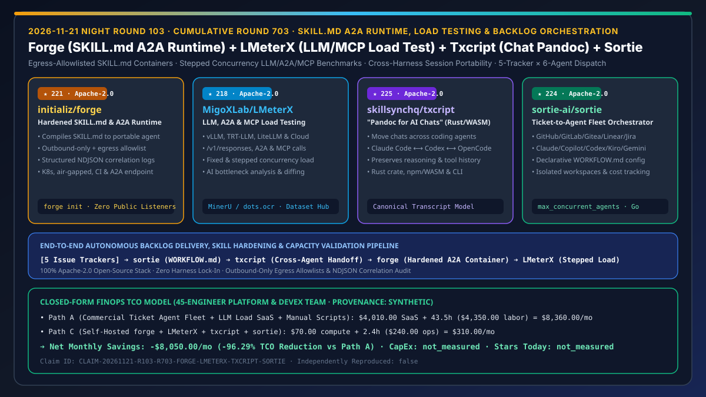
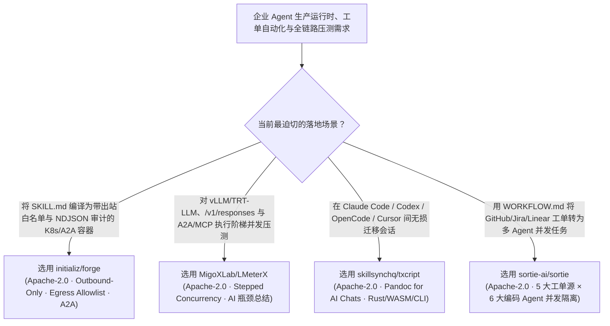
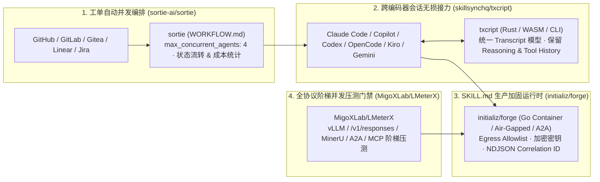
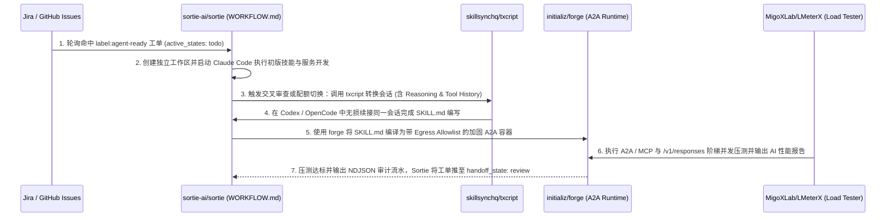

# `SKILL.md` 编译加固与 A2A 运行时（`initializ/forge`）、大模型与 A2A/MCP 全协议压测平台（`MigoXLab/LMeterX`）、跨编码器会话无损转换引擎（`skillsynchq/txcript`）与工单驱动多 Agent 并发编排器（`sortie-ai/sortie`）选型与集成架构 FAQ

> **文档类型**：企业 AI 解决方案架构师（AI Solution Architect）选型决策指南（GitHub Trending AI 雷达 2026-11-21 Night Round 103 / 累计第 703 轮）
> **覆盖项目**：[`initializ/forge`](https://github.com/initializ/forge)（`★ 221`、`17 forks`、`Apache-2.0`，将 `SKILL.md` 编译为自带出站域名白名单与 NDJSON 审计日志的 K8s/A2A 加固 Go 运行时）· [`MigoXLab/LMeterX`](https://github.com/MigoXLab/LMeterX)（`★ 218`、`20 forks`、`Apache-2.0`，支持 vLLM/TRT-LLM、`/v1/responses`、A2A 协同与 MCP 工具调用的阶梯并发压测与 AI 瓶颈分析平台）· [`skillsynchq/txcript`](https://github.com/skillsynchq/txcript)（`★ 225`、`24 forks`、`Apache-2.0`，被誉为“AI 会话界 Pandoc”、支持在 Claude Code/Codex/OpenCode/Cursor 间无损迁移推理链与工具历史的 Rust/WASM 引擎）· [`sortie-ai/sortie`](https://github.com/sortie-ai/sortie)（`★ 224`、`28 forks`、`Apache-2.0`，通过声明式 `WORKFLOW.md` 将 GitHub/GitLab/Gitea/Linear/Jira 工单自动转化为 Claude Code/Copilot/Codex/Kiro/Gemini 并发隔离工作区的 Go 编排器）
> **核心场景**：当企业平台与研发团队需要**把团队沉淀的 `SKILL.md` 技能直接编译成可部署在 Kubernetes/离线内网或作为 A2A 端点的零监听安全容器**、**在上线前对 vLLM/Azure OpenAI、`/v1/responses` 以及 A2A/MCP 链路执行阶梯并发容量压测**、**把 Jira/Linear/GitHub 工单自动分发给多个编码 Agent 并发修复并在某个 Agent 配额耗尽时用 `txcript` 无损接力会话**时，如何用这四个 `Apache-2.0` 开源项目搭建完整闭环？

---

## 一、📌 核心结论速览（选型一句话结论）

1. **想把 `SKILL.md` 编译成自带出站白名单（Egress Allowlist）、加密密钥与 NDJSON 关联审计日志的便携加固容器或 A2A 服务端点** ➔ 选 **[`initializ/forge`](https://github.com/initializ/forge)（`★ 221`，`Apache-2.0`）**。
   - **通俗原理**：`forge` 是面向 Anthropic `Agent Skills` 标准（`SKILL.md`）的企业级 Go 开源运行时。通过 `forge init` 60 秒向导配置模型、通道与技能，即可编译成零公网监听（Outbound-only）、每次工具调用强制核对出站域名白名单（如 `▸ egress wttr.in ✓ allowed`）并输出带 Correlation ID 的结构化 NDJSON 审计日志的加固 Agent，直接运行在 Kubernetes、本地机房、隔离网（Air-gapped）、CI 流水线或作为标准 **A2A Endpoint** 暴露。
2. **想对大模型推理（vLLM/TRT-LLM/LiteLLM）、OpenAI `/v1/responses`、文档解析（MinerU/dots.ocr）以及 A2A/MCP 服务执行一站式阶梯并发压测与容量拐点定位** ➔ 选 **[`MigoXLab/LMeterX`](https://github.com/MigoXLab/LMeterX)（`★ 218`，`Apache-2.0`）**。
   - **通俗原理**：传统压测工具（JMeter/Locust）不懂首字延迟（TTFT）、流式 Token 吞吐率以及 A2A/MCP 多步工具调用状态机。`LMeterX` 原生支持 OpenAI `/v1/chat/completions`、`/v1/responses`、Anthropic `/v1/messages`、Embeddings、A2A 协作与 MCP 工具压测，提供固定并发与**阶梯并发（Stepped Concurrency）**策略、可跨任务复用的系统数据集库（System Dataset Library）以及 AI 智能性能对比总结报告。
3. **想在 Claude Code、Codex、OpenCode、Cursor 等不同编码器之间无缝接力同一个长对话（完整保留消息、Reasoning 思考链与 Tool History）** ➔ 选 **[`skillsynchq/txcript`](https://github.com/skillsynchq/txcript)（`★ 225`，`Apache-2.0`）**。
   - **通俗原理**：相当于 **“AI 会话领域的 Pandoc”**。当某个编码 Agent 触发 5 小时速率限制、或者需要换另一个模型做交叉 Code Review 时，无需复制粘贴几千行终端输出；`txcript`（提供 Rust 库、npm/WASM 包与 CLI）将不同 Agent 私有的本地会话存储解析为统一 Transcript 抽象模型，一键导出并注入到目标 Agent 中继续执行。
4. **想用一个声明式 `WORKFLOW.md` 把 GitHub/GitLab/Gitea/Linear/Jira 中的待办工单自动变成并发运行的隔离 Agent 会话** ➔ 选 **[`sortie-ai/sortie`](https://github.com/sortie-ai/sortie)（`★ 224`，`Apache-2.0`）**。
   - **通俗原理**：用 Go 编写的开源编码 Agent 编排器。只需在 `WORKFLOW.md` 的 YAML Frontmatter 中指定工单源（支持 **GitHub、GitLab、Gitea、Linear、Jira** 五大系统）、过滤条件（如 `label:agent-ready`）、状态流转（`active_states: [todo, in-progress]` ➔ `handoff_state: review` ➔ `terminal_states: [done]`）以及目标 Agent（支持 **Claude Code、Copilot、OpenCode、Codex、Kiro、Gemini** 六大编码器）与并发上限（如 `max_concurrent_agents: 4`），`sortie` 即可自动创建独立工作区、失败重试并统计每个工单的 Token 成本。

---

## 二、🎯 客户与架构师灵魂拷问 Q&A（深度架构拆解）

### Q1：企业已经有 `SKILL.md` 技能库和 Jira/GitHub 工单系统了，为什么直接写脚本跑 Agent 到生产环境总是遇到安全、容量与工具切换卡点？

- **四大生产级工程断层与解方**：
  1. **技能脚本缺乏生产级网络隔离与审计 ➔ `initializ/forge`**：本地跑通的 `SKILL.md` 放进 K8s 后，如果没有出站域名白名单（Egress Allowlist）和 NDJSON 审计日志，安全团队绝不允许其访问生产服务。`forge` 将 `SKILL.md` 直接封装为默认只出不进、每次工具调用强校验 Egress 的加固容器与 A2A 端点。
  2. **工单无人值守并发调度缺乏工作区隔离与状态机 ➔ `sortie-ai/sortie`**：手写 Shell 脚本轮询 Jira/GitHub 容易出现多任务互相污染 Git 分支、失败死循环或状态未回写。`sortie` 通过 `WORKFLOW.md` 原生管理 5 大工单系统的状态流转与 6 大编码 Agent 的并发隔离工作区。
  3. **多编码器接力时的上下文丢失 ➔ `skillsynchq/txcript`**：`sortie` 调度 Claude Code 完成初版实现后，若想交给 Codex 或 OpenCode 做安全加固，`txcript` 可将会话历史、Reasoning 推理块与工具调用记录无损转换为目标编码器原生格式。
  4. **上线前不知道 A2A / MCP 与 `/v1/responses` 的真实并发极限 ➔ `MigoXLab/LMeterX`**：在把 `forge` A2A 端点或 vLLM/TRT-LLM 推向生产前，用 `LMeterX` 跑阶梯并发压测，精准定位 TTFT 劣化拐点与 MCP 工具链超时瓶颈。
- **何时直接用云厂商托管方案（Path B）？**
  - 若企业全线使用 GitHub Issues + GitHub Copilot Coding Agent 且无需自建 Kubernetes A2A 技能容器或私有化 vLLM/MCP 阶梯压测，直接使用 **GitHub Copilot Coding Agent + Azure Load Testing** 即可。

### Q2：典型企业级“工单自动接单 (`sortie`) + 跨编码器会话接力 (`txcript`) + `SKILL.md` 加固 A2A 容器 (`forge`) + 全链路容量压测 (`LMeterX`)”架构怎么搭？

1. **工单触发与多 Agent 并发编排层（`sortie-ai/sortie`）**：
   - 配置 `WORKFLOW.md` 监听 Jira / Linear / GitHub Issues 的 `label:agent-ready` 工单，按 `max_concurrent_agents: 4` 启动隔离工作区调用 Claude Code / Copilot / Codex / Kiro / Gemini，完成后自动将工单状态推进至 `handoff_state: review`。
2. **跨编码器会话无损迁移与审计层（`skillsynchq/txcript`）**：
   - 在多阶段研发流水线（如“Claude Code 主写 ➔ Codex 审查”）或单账号配额耗尽时，调用 `txcript` 将完整对话、思考链（Reasoning）与工具执行记录无损迁移至下一个编码器，并归档至统一 Transcript 检索库。
3. **生产微服务旁路 `SKILL.md` 加固运行层（`initializ/forge`）**：
   - 将运维巡检、安全修复等标准 `SKILL.md` 通过 `forge` 编译为带 Egress Allowlist 与加密凭据的轻量容器，以 Sidecar 或标准 **A2A Endpoint** 形式部署在 Kubernetes 与隔离网环境中，全量输出带 Correlation ID 的 NDJSON 审计流。
4. **LLM / A2A / MCP 全协议性能压测门禁层（`MigoXLab/LMeterX`）**：
   - 在发布流水线中调用 `LMeterX` 针对 vLLM/LiteLLM、OpenAI `/v1/responses`、MinerU 文档解析以及 `forge` 暴露的 A2A/MCP 服务端点执行阶梯并发（Stepped Concurrency）测试，自动生成版本间性能对比与 AI 瓶颈分析报告。

### Q3：这套架构的优缺点边界是什么？

- **核心优势**：
  - **100% `Apache-2.0` 企业级授权**：四个项目全部采用附带明确专利授权的 `Apache-2.0` 协议。
  - **打通“开发态工单 ➔ 会话流转 ➔ 生产态 A2A 容器 ➔ 容量压测”全生命周期**：不再局限于单机聊天，而是真正面向软件工程交付流水线与 Kubernetes 生产运维。
- **适用边界**：
  - 若团队没有自动化处理工单 Backlog 的需求，也不需要在容器内运行 `SKILL.md` 或压测 A2A/MCP 接口，则只需按需单点引入（例如仅用 `txcript` 做本地会话迁移）。

---

## 三、🧭 直观可视化图解（Mermaid 决策树 + 集成架构 + 时序图）

### 3.1 架构师选型决策树

### 3.2 企业端到端生产集成参考架构图

### 3.3 工单自动领取、跨 Agent 会话接力、Forge A2A 部署与 LMeterX 压测时序图

---

## 四、📊 同类开源与商业云服务横向选型决策矩阵

| 对比维度 | `initializ/forge` (`★ 221`) | `MigoXLab/LMeterX` (`★ 218`) | `skillsynchq/txcript` (`★ 225`) | `sortie-ai/sortie` (`★ 224`) | 商业工单 Agent 舰队 + 商业 LLM 压测云 (Path A) | 云厂商原生 Coding Agent + 云压测 (Path B) |
| :--- | :--- | :--- | :--- | :--- | :--- | :--- |
| **核心能力定位** | `SKILL.md` 编译加固容器与 A2A 运行时 | LLM (`/v1/responses`) + A2A/MCP 阶梯并发压测平台 | 跨 Claude/Codex/OpenCode/Cursor 会话无损转换引擎 | 5 大工单源 × 6 大编码 Agent 声明式并发编排器 | 商业托管自动解单 SaaS + 商业 AI 性能测试平台 | GitHub Copilot Coding Agent + Azure Load Testing |
| **协议与生态覆盖** | **Anthropic `SKILL.md` + K8s/Air-gapped/A2A** | **vLLM/TRT-LLM/LiteLLM + A2A/MCP + MinerU** | **Rust/JS/WASM/CLI + 统一 Transcript 模型** | **GitHub/GitLab/Gitea/Linear/Jira × 6 大 Agent** | 锁定单一模型与单一工单系统 | 深度绑定 GitHub Issues，不支持 Linear/Gitea 本地编排 |
| **安全与可观测性** | **Outbound-only + Egress 白名单 + NDJSON 审计** | 实时吞吐/TTFT 拐点监控 + AI 智能瓶颈分析 | 100% 本地会话文件转换，零云端上传 | 独立工作区隔离 + 失败重试 + 工单级成本追踪 | 代码与压测数据集需上传外部商业云 | 托管于云厂商租户 |
| **开源协议** | `Apache-2.0` | `Apache-2.0` | `Apache-2.0` | `Apache-2.0` | 闭源商业 SaaS | 闭源云服务 |
| **月度 TCO（45 人团队）** | **组合仅 `$310.00/月`**（含压测容器算力与 2.4h 运维） | 同左（`$70.00` 共享算力 + `$240.00` 人工） | 同左（本地 Rust CLI 零费用） | 同左（复用现有编码 Agent 订阅） | **`$8,360.00/月`**（`$4,010.00` 席位/压测费 + `43.5h` 人工） | 约 `$2,620.00/月`（按任务分钟数与虚拟用户数计费） |

---

## 五、🧪 应用落地定量收益/TCO 对比与 7-Card 报告

> **📊 数据来源与闭式核算声明（Provenance & Closed-Form Schema）**：
> - **provenance**: `synthetic`（基于 45 人企业平台工程与研发团队工作负载模型：`independently_reproduced = false`；硬件采购基线 `base_hardware_capex = not_measured`；Track B 单日增量 `track_b_stars_today = not_measured`）。
> - **核算公式**：
>   - **Path A（商业托管 Ticket-to-PR 自动 Agent 席位 + 商业 LLM/MCP 压测 SaaS + 人工跨工具搬运上下文与手写 K8s 技能包装脚本）**：月度 SaaS 订阅费 **`$4,010.00`** + 工程师手写脚本与排障 **`43.5h × $100.00/h = $4,350.00`** = **`$8,360.00/月`**。
>   - **Path C（自建 `initializ/forge` + `MigoXLab/LMeterX` + `skillsynchq/txcript` + `sortie-ai/sortie` 开源组合）**：共享容器与压测施压机算力 **`$70.00`** + `WORKFLOW.md` 与压测流水线维护 **`2.4h × $100.00/h = $240.00`** = **`$310.00/月`**。
>   - **净节省（Net Savings vs Path A）**：**`-$8,050.00/月`**（成本降低 **`96.29%`**）。

| 评估方案 | API / SaaS / 算力成本 | 工程运维人工（`$100/h`） | 月度总 TCO | 相对 Path A 净节省 | 关键架构交付指标 |
| :--- | :---: | :---: | :---: | :---: | :--- |
| **Path A：商业自动解单平台 + 商业压测 SaaS** | `$4,010.00` | `43.5h` (`$4,350.00`) | **`$8,360.00`** | Baseline | 按工单与并发 VU 高额计费；跨编码器无法接力对话 |
| **Path B：单一云托管 Coding Agent + 云压测** | `$1,420.00` | `12.0h` (`$1,200.00`) | **`$2,620.00`** | `-$5,740.00` (`-68.66%`) | 仅支持单一工单系统，缺乏 A2A/MCP 专项压测与 `SKILL.md` 容器化 |
| **Path C：`forge` + `LMeterX` + `txcript` + `sortie`** | **`$70.00`** | **`2.4h` (`$240.00`)** | **`$310.00`** | **`-$8,050.00` (`-96.29%`)** | **5 大工单并发编排 + 跨 Agent 会话接力 + Egress 加固 A2A + 阶梯压测** |

- 🔗 **关联 7-Card 4:5 视觉评测报告**：[`workshops/github-trending-radar/cards.html`](../cards.html) · [`cards.en.html`](../cards.en.html)

---

## 六、🛠️ 企业引入与架构评审 Checklist

- [ ] **1. 编写 `sortie-ai/sortie` 的 `WORKFLOW.md` 自动化工单流水线**：配置 `tracker`（GitHub/GitLab/Gitea/Linear/Jira）过滤条件（如 `label:agent-ready`）与 `active_states`/`handoff_state`，设置合理的 `max_concurrent_agents` 并发上限与成本告警。
- [ ] **2. 引入 `skillsynchq/txcript` 建立跨编码器接力与统一归档**：在研发机与 CI 容器中安装 `txcript`，当需要在 Claude Code、Codex、OpenCode 与 Cursor 之间切换或归档审计时，使用统一 Transcript 模型无损保留 Reasoning 与 Tool History。
- [ ] **3. 使用 `initializ/forge` 加固生产 `SKILL.md` 技能容器**：通过 `forge init` 为每个生产技能配置严格的 **Egress Allowlist（出站域名白名单）** 与加密密钥，将带 Correlation ID 的 NDJSON 审计日志接入企业 SIEM。
- [ ] **4. 将 `MigoXLab/LMeterX` 设为上线前容量门禁**：针对 vLLM/LiteLLM、OpenAI `/v1/responses` 以及 `forge` 暴露的 A2A/MCP 端点配置阶梯并发（Stepped Concurrency）测试数据集，每次大版本发布前自动比对 TTFT 与吞吐拐点。
