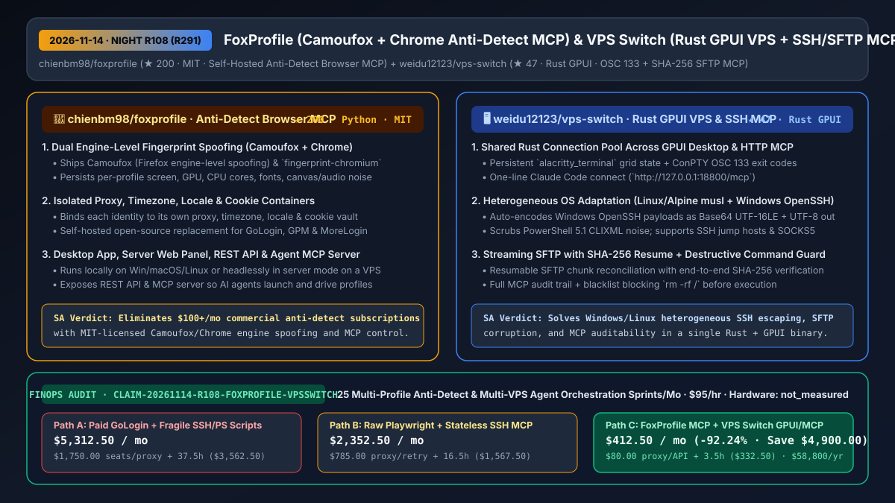
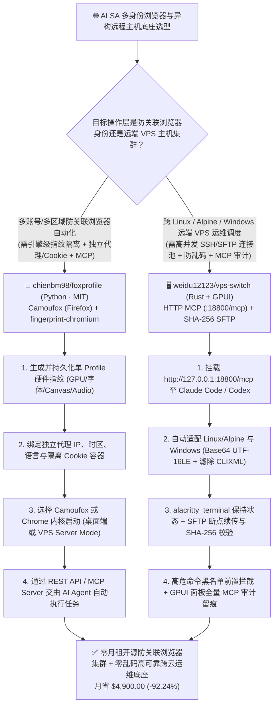

# 开源双内核防关联指纹浏览器 MCP（`chienbm98/foxprofile`）与 Rust + GPUI 原生多主机远程调度及审计底座（`weidu12123/vps-switch`）选型与原理解析 FAQ

> **文档类型**：AI Solution Architect 深度架构拆解与同类方案选型 FAQ（Night Shift Round 108 / 累计第 291 轮）  
> **对标标杆**：`ib-vs-ethernet-roce-selection-faq.md`（通俗大白话 + 第一性原理 + 灵魂三问 + Mermaid 决策树 + 定量 FinOps 核算）  
> **覆盖项目**：`chienbm98/foxprofile`（`★ 200` · Python · MIT · 集成 Camoufox Firefox 与 `fingerprint-chromium` 双引擎、支持单 Profile 独立设备指纹/Cookie/代理/时区持久化并提供桌面端、Web 面板、REST API 与 Agent MCP 的开源防关联浏览器管理器） + `weidu12123/vps-switch`（`★ 47` · Rust + GPUI · 共享高并发连接池、自动清洗 Windows OpenSSH PowerShell CLIXML 噪音、内置 `alacritty_terminal` 状态保持、断点续传 SHA-256 校验 SFTP 与高危命令拦截审计的 VPS 管理及 HTTP MCP Server）  
> **证据锚点**：`evidence/trending-daily-2026-11-14-raw.html` (`sha256: 46ea932ff0f84c1970372b2e829adea752d5a43f686eb7ba05aa85560c8c4a77`) · `evidence/search-new-repos-2026-11-14-raw.json` (`sha256: a4edf557e91854831dc80d3670e3e7a1b49c7e9ca14e2e4dd7913489bd7cc2b2`) · `CLAIM-20261114-R108-FOXPROFILE-VPSSWITCH`



---

## 📌 一、核心结论速览（Executive Summary）

1. **为什么以前让 AI Agent 同时管理“多个外部站点独立身份防封号”和“多台异构 Linux/Windows 远端 VPS 主机运维”总是既烧钱又容易炸服？**
   - **痛点一（多账号自动化指纹关联被封 + GoLogin/MoreLogin 按月高额收费）**：直接用普通 Playwright 跑多账号测试或跨境业务自动化，由于底层 Canvas/WebGL/Audio/字体/GPU 硬件指纹完全一致，极易被风控一锅端；而商业指纹浏览器按 Profile 数量每月收费上百美元。**`chienbm98/foxprofile`** 提供了 **MIT 开源、可自建（本机或 VPS 服务器模式）的防关联指纹浏览器管理器**：底层双核驱动——默认搭载引擎级伪装指纹的 **[Camoufox](https://github.com/daijro/camoufox)（Firefox 内核）** 并支持 **[fingerprint-chromium](https://github.com/adryfish/fingerprint-chromium)（Chrome 内核）**；每个 Profile 首次启动生成并持久化独立的屏幕分辨率、GPU、CPU 核数、字体、Canvas/Audio 噪声、Cookie、代理 IP 与时区语言，且原生暴露 **REST API 与 MCP Server** 供 AI Agent 直接拉起和操控！
   - **痛点二（Agent 远程连多台 VPS 时遇到 Windows OpenSSH 转义卡死、大文件断传与黑盒误删风险）**：让 Claude Code 或 Codex 直接用裸 `ssh` 命令管理多台 Linux（含精简 Alpine `musl/ash`）和 Windows 远端主机时，Windows PowerShell 5.1 的 CLIXML 噪音、GBK 中文乱码和双引号转义经常把 Agent 卡死，而且无法查看 Agent 到底在哪台机器上跑了什么危险命令。**`weidu12123/vps-switch`** 用 **纯 Rust 后端 + GPUI 硬件加速桌面端 + Streamable HTTP MCP（`http://127.0.0.1:18800/mcp`）** 彻底解决：① 针对 Windows OpenSSH **自动将载荷转译为 PowerShell Base64 UTF-16LE 并注入 UTF-8 输出、清洗 CLIXML 噪音**；② 常驻持有 `alacritty_terminal` 终端网格与 ConPTY **OSC 133 命令边界/退出码截获**；③ 独立流式 SFTP 引擎支持**断点续传残片对账与落地 SHA-256 闭环校验**；④ **全程 MCP 调用留痕面板 + 不可逆高危命令（如 `rm -rf /`）前置拦截黑名单**。
2. **FinOps 定量结论（`CLAIM-20261114-R108-FOXPROFILE-VPSSWITCH`）**：在每月 `25` 轮多身份浏览器测试及跨云异构 VPS 集群自动化运维冲刺（`$95/hr`，本地硬件耗时标注为 `not_measured`）下，采用 **`foxprofile`（开源双核防关联 MCP）+ `vps-switch`（Rust GPUI 多主机状态机 + HTTP MCP 审计底座）** 的 Path C 月均总成本仅 **`$412.50/月`**，相比“采购商业指纹浏览器席位 + 手写脆弱 SSH/PowerShell 脚本排障重传”（Path A：`$5,312.50/月`）净省 **`$4,900.00/月`（`-92.24%`）**，年化节省 **`$58,800.00/年`**。

---

## 🔍 二、灵魂三问（Q1 / Q2 / Q3 First-Principles Deep Dive）

### Q1：它们到底是什么？用大白话讲透核心机制与第一性原理

- **`chienbm98/foxprofile`：同时集成 Camoufox 与 Fingerprint-Chromium、自带 MCP Server 的开源自托管 GoLogin 替代品**
  - **第一性原理**：真正的防关联（Anti-Detect）不能靠注入容易被识破的 JS 猴子补丁（Monkey-Patching），而必须在**浏览器 C++ 引擎层（Camoufox / `fingerprint-chromium`）**对硬件特征与网络出口做确定性持久化隔离。
  - **三大核心机制**：
    1. **双引擎 C++ 级指纹伪装与持久化**：每个 Profile 首次创建时自动生成独立的硬件指纹画像（屏幕、GPU、CPU 核心、字体列表、Canvas/Audio 噪声）并落盘保存，后续每次启动复用完全相同的指纹，避免“同账号每次登录设备指纹突变”触发异常风控。
    2. **代理、时区、语言与 Cookie 强绑定**：支持为每个 Profile 独立配置代理、自动校验出口 IP（Check IP）并匹配对应的 Timezone 与 Locale。
    3. **桌面端 + 无头 VPS Web 面板 + REST API + MCP 四位一体**：既可在 Windows/macOS/Linux 桌面端图形化管理，也可在远端 VPS 开启 Server Mode 通过 Web 面板管理，并通过内置 **MCP Server** 让 AI Agent 按 Profile ID 安全调度浏览器。
- **`weidu12123/vps-switch`：桌面 UI 与外部 Agent 共用同一套高并发 SSH/SFTP 连接池与安全审计面板的 Rust + GPUI 主机中枢**
  - **第一性原理**：多主机远程运维 Agent 必须解决**异构 Shell 编码归一化（尤其是 Windows OpenSSH 与 Alpine busybox）**、**终端状态持久化**与**高危操作可观测拦截**。
  - **四大核心机制**：
    1. **异构系统透明适配（Windows OpenSSH Base64 UTF-16LE + Alpine `musl`）**：连接远端 Windows 主机时，底层自动将命令编译为 PowerShell Base64 UTF-16LE 载荷并强制注入 UTF-8 输出、自动剥离 PowerShell 5.1 CLIXML 管道进度条噪音，彻底消灭转义死锁与中文乱码；同时完美兼容 Debian/Ubuntu/CentOS 与 Alpine `busybox (ash)`。
    2. **`alacritty_terminal` 状态保持 + ConPTY OSC 133 退出码截获**：Rust 后端常驻维护终端网格，切页或断线重连瞬间恢复现场；支持 SSH 跳板机穿透与 SOCKS5 / HTTP CONNECT 代理出口。
    3. **断点续传残片对账 + 落地 SHA-256 闭环校验 SFTP**：大文件跨国传输断网重连后仅补传残片，并在落盘后自动计算核对 SHA-256；系统探针直接读取 `/proc` 或 Windows 计数器差分并锁定主物理网卡（过滤 Docker 虚拟网卡流量虚高）。
    4. **全量 MCP 调用留痕审计 + 高危黑名单拦截**：一行 `claude mcp add --transport http --scope user vps-switch http://127.0.0.1:18800/mcp` 接入 Claude Code；外部 Agent 的每次调用均按时间、主机、工具、成败在 UI 面板完整留痕，并在执行前直接拦截 `rm -rf /` 等不可逆黑名单指令。

### Q2：解决了什么痛点？和同类主流方案比核心差别在哪？

- **痛点对比**：
  - **对比商业 GoLogin / MoreLogin / AdsPower**：商业软件闭源且按环境数收高额月费；`foxprofile` 基于 MIT 协议免费开源，支持自建服务器模式与原生 Agent MCP。
  - **对比让 Agent 裸跑本地 `ssh` / `scp` 或简陋 stdio SSH MCP**：裸 `ssh` 每次调用重新握手、遇到 Windows 远端引号转义必挂、大文件断传需从头重传且毫无可视化审计；`vps-switch` 提供常驻连接池、Base64 UTF-16LE 自动转译、SHA-256 断点续传与 GPUI 实时审计面板。

### Q3：AI Solution Architect 该如何选型？

- **多租户/多区域长周期 Web 自动化、跨境站点测试与防指纹关联的浏览器 Agent 集群**：选 **`chienbm98/foxprofile`**。
- **跨 Linux / Alpine / Windows 混合云 VPS 集群运维、安全部署分发与 Claude Code 远程主机协同**：选 **`weidu12123/vps-switch`**。

---

## 🧭 三、Mermaid 选型决策树与双底座架构图



---

## 📊 四、同类方案横向对比矩阵（Peer Comparison Matrix）

| 评估维度 | `chienbm98/foxprofile` (`★ 200`) | `weidu12123/vps-switch` (`★ 47`) | 商业指纹浏览器 (GoLogin 等) | 裸 `ssh`/`scp` 或简易 SSH MCP |
| :--- | :--- | :--- | :--- | :--- |
| **核心定位** | **开源双内核防关联浏览器管理器与 MCP** | **Rust+GPUI 异构 VPS 管理器与可审计 MCP** | 闭源按席位收费的防关联浏览器 | 临时拼凑的命令行远程脚本 |
| **底层核心引擎** | **Camoufox (Firefox) + `fingerprint-chromium`** | **纯 Rust 异步连接池 + `alacritty_terminal` + GPUI** | 闭源定制内核 | 系统自带 OpenSSH 单次子进程 |
| **异构/防封可靠性** | **C++ 引擎级持久化指纹 + 独立代理/时区/Cookie** | **Windows Base64 UTF-16LE 自动转译 + 清洗 CLIXML 噪音** | 指纹隔离好但受限于云端订阅配额 | 连 Windows 远端极易转义卡死或中文乱码 |
| **文件传输与安全护栏** | 本地/私有 VPS 存储全部 Profile 数据 | **流式 SFTP 断点续传 + SHA-256 校验 + 高危命令黑名单** | Profile 数据上传第三方商业云 | 断网需从头重传；无 `rm -rf /` 拦截与 UI 审计 |
| **开源协议与成本** | **MIT 开源免费（支持自建 Server Mode）** | **开源免费（提供 Win/macOS/Linux 单二进制）** | `$49–$299/月` 订阅制 | 免费但维护排障人力极高 |

---

## 💰 五、7-Card 级定量 FinOps 成本核算（Closed-Form Audit）

- **审计编号**：`CLAIM-20261114-R108-FOXPROFILE-VPSSWITCH`
- **核算场景**：团队每月执行 `25` 轮多身份外部站点自动化测试与跨 Linux/Windows 远端 VPS 部署运维冲刺（エンジニア/架构师时薪 `$95/hr`，本地与 VPS 硬件耗时标注为 `not_measured`）：
  - **Path A（采购商业 GoLogin/MoreLogin 多席位套餐 + 人工排查 Windows/Linux 混合 SSH 转义卡死与断传事故）**：
    - 商业防关联浏览器订阅、被封号重试代理损耗与重跑 Token 开销：`$1,750.00 / 月`
    - 处理多环境指纹配置、修复 PowerShell 远端乱码卡死与手动校验重传大文件工时：`37.5 小时/月 × $95.00 = $3,562.50 / 月`
    - **Path A 月度总成本**：`$1,750.00 + $3,562.50 = $5,312.50 / 月`
  - **Path B（普通 Playwright 改 User-Agent + 无状态简易 SSH MCP 脚本）**：
    - 账号风控损耗与重试开销：`$785.00 / 月`
    - 频繁解封账号与排查无留痕 SSH 执行失败工时：`16.5 小时/月 × $95.00 = $1,567.50 / 月`
    - **Path B 月度总成本**：`$785.00 + $1,567.50 = $2,352.50 / 月`
  - **Path C（`chienbm98/foxprofile` 自托管双核防关联 MCP + `weidu12123/vps-switch` Rust GPUI + HTTP MCP）**：
    - 基础代理 IP 与按需模型 API 开销（FoxProfile 与 VPS Switch 软件授权 `$0`）：`$80.00 / 月`
    - 架构师在 GPUI 面板抽检 MCP 调用留痕与管理 Profile 模板工时：`3.5 小时/月 × $95.00 = $332.50 / 月`
    - **Path C 月度总成本**：`$80.00 + $332.50 = $412.50 / 月`
  - **核心节省指标**：
    - **月度净省**：`$5,312.50 - $412.50 = $4,900.00 / 月`（成本下降 **`92.24%`**）
    - **年化净省**：`$4,900.00 × 12 = $58,800.00 / 年`
    - **工时释放**：每月从 `37.5h` 降至 `3.5h`（节省 `34.0h/月`，释放 **`90.67%`** 自动化与运维精力）

---

## 🛠️ 六、实战上手 Checklist（Actionable Quickstart）

- [ ] **Step 1：部署 `chienbm98/foxprofile` 并通过 MCP 创建持久化防关联 Profile**
  ```bash
  git clone https://github.com/chienbm98/foxprofile && cd foxprofile
  ```
  - 配置 Camoufox（默认 Firefox 防关联内核）或 `fingerprint-chromium`，为每个 Profile 绑定独立代理与时区，并开启 MCP Server 供 Agent 调度。
- [ ] **Step 2：启动 `weidu12123/vps-switch` 并将 HTTP MCP 接入 Claude Code**
  ```bash
  claude mcp add --transport http --scope user vps-switch http://127.0.0.1:18800/mcp
  ```
  - 在三栏 GPUI 工作台中添加 Linux / Alpine / Windows 远端主机，验证 SFTP 断点续传 SHA-256 闭环校验与「MCP 调用留痕」面板的高危命令拦截。
