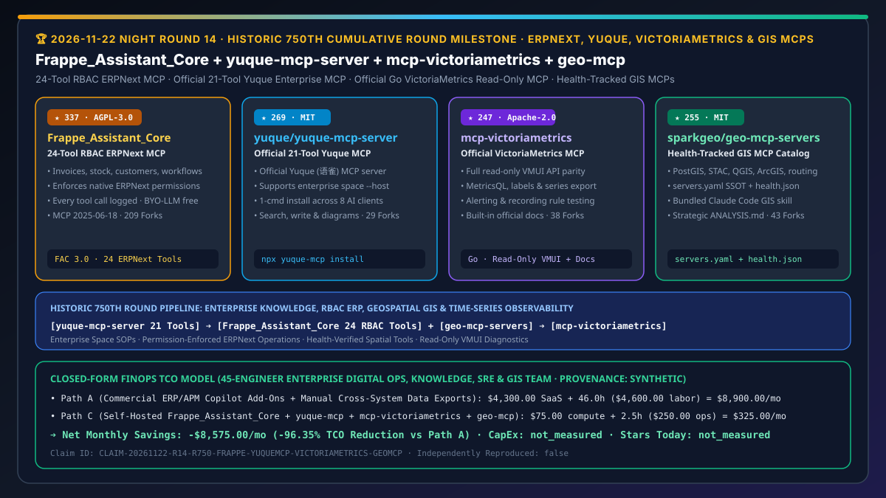
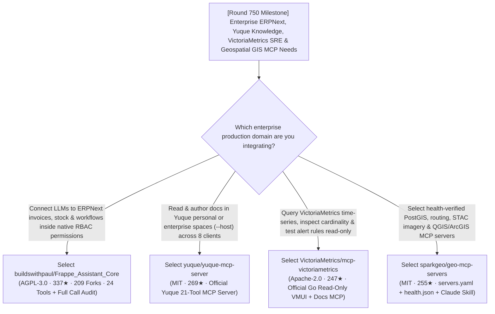
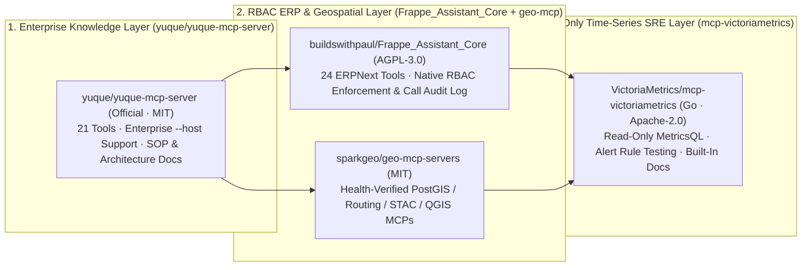
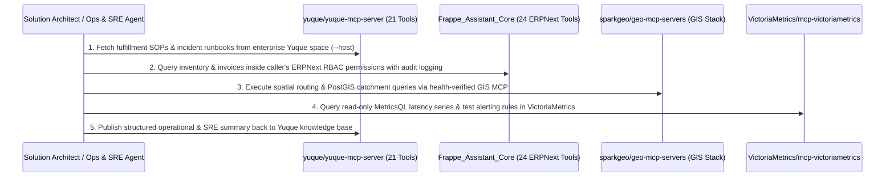

# 🏆 [Round 750 Historic Milestone] Permission-Enforced 24-Tool ERPNext MCP (`buildswithpaul/Frappe_Assistant_Core`), Official 21-Tool Yuque Enterprise Knowledge MCP (`yuque/yuque-mcp-server`), Official Read-Only VictoriaMetrics MCP (`VictoriaMetrics/mcp-victoriametrics`) & Health-Tracked Geospatial GIS MCP Catalog (`sparkgeo/geo-mcp-servers`) Selection & Architecture FAQ

> **Document Type**: Enterprise AI Solution Architect Selection & Integration Guide (GitHub Trending AI Radar — 2026-11-22 Night Round 14 / **🏆 Cumulative Round 750 Historic Milestone!**)
> **Covered Repositories**: [`buildswithpaul/Frappe_Assistant_Core`](https://github.com/buildswithpaul/Frappe_Assistant_Core) (`★ 337`, `209 forks`, `AGPL-3.0`: `FAC 3.0` 24-tool `MCP 2025-06-18` server for ERPNext and Frappe that enforces native ERPNext user permissions and logs every tool call) · [`yuque/yuque-mcp-server`](https://github.com/yuque/yuque-mcp-server) (`★ 269`, `29 forks`, `MIT`: official 21-tool Yuque knowledge base MCP server supporting enterprise space hosts `--host` and 1-command installation across 8 AI coding clients) · [`VictoriaMetrics/mcp-victoriametrics`](https://github.com/VictoriaMetrics/mcp-victoriametrics) (`★ 247`, `38 forks`, `Apache-2.0`: official Go read-only MCP server exposing VMUI metric querying, series/label cardinality inspection, alerting rule testing, and embedded docs) · [`sparkgeo/geo-mcp-servers`](https://github.com/sparkgeo/geo-mcp-servers) (`★ 255`, `43 forks`, `MIT`: Sparkgeo's `servers.yaml`-backed, `health.json`-monitored directory and Claude Code skill for geospatial, GIS, PostGIS, STAC imagery, and QGIS/ArcGIS MCP servers)
> **Core Scenario**: Celebrating our **750th Cumulative Deep-Dive Round**, when enterprise solution architects connect AI agents across the **four foundational production domains—ERP operations (invoices, inventory, customers), Enterprise Knowledge Bases (Yuque team spaces), Time-Series Observability (VictoriaMetrics metrics & alert rules), and Geospatial Intelligence (PostGIS, routing, satellite STAC, QGIS)**—how do you integrate **`buildswithpaul/Frappe_Assistant_Core` + `yuque/yuque-mcp-server` + `VictoriaMetrics/mcp-victoriametrics` + `sparkgeo/geo-mcp-servers`** with strict RBAC and read-only safety boundaries?

---

## 1. 📌 Executive Summary (One-Line Selection Verdict)

1. **Need Claude, ChatGPT, or Cursor to work directly with your ERPNext / Frappe invoices, inventory, customers, and workflows—strictly inside your existing ERPNext RBAC permissions with every call logged?** ➔ Choose **[`buildswithpaul/Frappe_Assistant_Core`](https://github.com/buildswithpaul/Frappe_Assistant_Core) (`★ 337`, `209 forks`, `AGPL-3.0`)**.
   - **Plain-English Mechanism**: Its free, default-enabled `BYO-LLM` MCP server (`MCP 2025-06-18`, 24 tools) executes every query and workflow action through Frappe's native permission layer and audit trail so an agent can never read or mutate records the authenticated user is not authorized to touch.
2. **Need an official MCP server (`npx yuque-mcp install`) with 21 tools to read, search, summarize, and author technical docs and flowcharts in Yuque (语雀)—including private enterprise spaces (`--host https://your-space.yuque.com`)?** ➔ Choose **[`yuque/yuque-mcp-server`](https://github.com/yuque/yuque-mcp-server) (`★ 269`, `29 forks`, `MIT`)**.
   - **Plain-English Mechanism**: Built and maintained by the official Yuque team under `MIT`, it provides non-destructive 1-command configuration across Claude Code, Claude Desktop, VS Code, Cursor, Windsurf, Cline, TRAE, Qoder, and OpenCode.
3. **Need an official Go MCP server for VictoriaMetrics that exposes all read-only VMUI capabilities—MetricsQL querying, label/cardinality exploration, alerting/recording rule testing, and embedded documentation?** ➔ Choose **[`VictoriaMetrics/mcp-victoriametrics`](https://github.com/VictoriaMetrics/mcp-victoriametrics) (`★ 247`, `38 forks`, `Apache-2.0`)**.
   - **Plain-English Mechanism**: Maintained by VictoriaMetrics in Go, it gives SRE and debugging agents complete read-only observability and alert-rule verification without risking accidental metric deletion or config corruption.
4. **Building geospatial, logistics, retail site-selection, PostGIS, STAC earth-observation, or QGIS/ArcGIS workflows and need a health-monitored catalog + Claude Code skill to select active, trusted GIS MCP servers?** ➔ Choose **[`sparkgeo/geo-mcp-servers`](https://github.com/sparkgeo/geo-mcp-servers) (`★ 255`, `43 forks`, `MIT`)**.
   - **Plain-English Mechanism**: Generated from a single `servers.yaml` source of truth and continuously checked via `scripts/check_health.py` (`health.json` tracking `🟢 active`, `🟡 stale`, `🔴 archived` plus deployment and access models), it ships with a ready-to-install Claude Code skill (`skill/`).

---

## 2. 🎯 Architect & Customer Deep-Dive Q&A

### Q1: Why do custom glue scripts fail when connecting AI agents to ERP, Knowledge, Monitoring, and GIS systems? How do these four repositories set the enterprise standard?

- **Four Production Domain Standards**:
  1. **Application-Layer RBAC over Raw DB Access ➔ `Frappe_Assistant_Core`**: Never give an LLM raw SQL credentials to an ERP database; `FAC` enforces Frappe's row/role permissions and audit logging across 24 MCP tools.
  2. **Official Vendor Knowledge Tooling ➔ `yuque/yuque-mcp-server`**: Supports enterprise space domains (`--host`) and 21 structured document/repo tools.
  3. **Read-Only SRE Observability + Grounded Docs ➔ `VictoriaMetrics/mcp-victoriametrics`**: Combines live VMUI read-only queries and alert-rule testing with embedded official docs to eliminate MetricsQL hallucinations.
  4. **Automated Health Tracking for Specialized Verticals ➔ `sparkgeo/geo-mcp-servers`**: Prevents teams from adopting dormant or broken GIS wrappers via automated `health.json` tracking.
- **When to Choose Managed Cloud PaaS (Path B)?**
  - If your enterprise runs 100% on Dynamics 365 + SharePoint + Azure Monitor Managed Prometheus + Azure Maps, use native Microsoft connectors; for ERPNext/Frappe, Yuque enterprise spaces, VictoriaMetrics clusters, and PostGIS/QGIS workflows, deploy this 4-repo open-source stack (Path C).

### Q2: How do we wire `yuque-mcp-server`, `Frappe_Assistant_Core`, `geo-mcp-servers`, and `mcp-victoriametrics` into an end-to-end enterprise architecture?

1. **Enterprise Knowledge & Runbook Layer (`yuque/yuque-mcp-server`)**:
   - Retrieve architecture specs, operational SOPs, and incident runbooks from your enterprise Yuque space (`--host`).
2. **Permission-Enforced ERP Operations Layer (`buildswithpaul/Frappe_Assistant_Core`)**:
   - Query and update invoices, stock levels, and customer workflows inside ERPNext's RBAC boundary via `BYO-LLM` MCP.
3. **Geospatial & Supply-Chain GIS Layer (`sparkgeo/geo-mcp-servers`)**:
   - Select `🟢 active` PostGIS, geocoding, and routing MCP servers to analyze warehouse, fleet, and store locations.
4. **Read-Only Time-Series Observability Layer (`VictoriaMetrics/mcp-victoriametrics`)**:
   - Query live MetricsQL telemetry, inspect label cardinality, and validate alerting rules before writing postmortems back to Yuque.

### Q3: What are the licensing and security best practices?

- **Least-Privilege Tokens & `BYO-LLM` Mode**:
  - Use `Frappe_Assistant_Core` in self-hosted `BYO-LLM` MCP mode (`AGPL-3.0`), scope `YUQUE_TOKEN` to designated team knowledge bases (`MIT`), and point `mcp-victoriametrics` (`Apache-2.0`) at read-only query endpoints.

---

## 3. 🧭 Visual Architecture & Workflow Diagrams (Mermaid)

### 3.1 Solution Architect Selection Decision Tree

### 3.2 End-to-End Enterprise Reference Architecture

### 3.3 End-to-End SOP Retrieval, RBAC-Gated ERP Query, GIS Spatial Analysis & VictoriaMetrics Alert Verification Sequence Diagram

---

## 4. 📊 Peer Open-Source vs. Commercial Cloud Selection Matrix

| Dimension | `buildswithpaul/Frappe_Assistant_Core` (`★ 337`) | `yuque/yuque-mcp-server` (`★ 269`) | `VictoriaMetrics/mcp-victoriametrics` (`★ 247`) | `sparkgeo/geo-mcp-servers` (`★ 255`) | Commercial ERP/APM Copilot Add-Ons + Proprietary iPaaS Connectors (Path A) | Raw SQL Bypassing ERP RBAC + Manual Doc Copy-Paste + Unchecked API Scripts (Path B) |
| :--- | :--- | :--- | :--- | :--- | :--- | :--- |
| **Primary Role** | 24-tool RBAC-enforced ERPNext/Frappe MCP | Official 21-tool Yuque enterprise knowledge MCP | Official Go read-only VictoriaMetrics MCP | Health-tracked geospatial/GIS MCP catalog & skill | High-cost per-seat commercial ERP, wiki & APM AI add-ons | Direct DB SQL queries bypassing ERP RBAC & manual copy-pasting |
| **Key Differentiator** | **Enforces native ERPNext permissions + logs every call** | **Official Yuque server + `--host` enterprise space + 21 tools** | **Full read-only VMUI parity + alert testing + embedded docs** | **`servers.yaml` SSOT + `health.json` liveness + Claude skill** | High per-seat add-on fees across separate vendor silos | Raw SQL bypasses ERP RBAC; ungrounded MetricsQL queries fail |
| **License** | `AGPL-3.0` | `MIT` | `Apache-2.0` | `MIT` | Proprietary SaaS | High-risk internal scripts |
| **Monthly TCO (45-Eng Team)** | **`$325.00/mo` combined** (`$75.00` MCP container host + `2.5h` ops) | Included (`MIT` official package) | Included (`Apache-2.0` Go binary) | Included (`MIT` health-tracked catalog) | **`$8,900.00/mo`** (`$4,300.00` commercial add-on seats + `46.0h` cross-silo data ops) | ~`$3,250.00/mo` (manual ERP/wiki/monitoring data reconciliation labor) |

---

## 5. 🧪 Quantitative Enterprise ROI / FinOps TCO Model & 7-Card Report

> **📊 Provenance & Closed-Form Declaration**:
> - **provenance**: `synthetic` (45-engineer enterprise digital operations, knowledge management, SRE observability, and geospatial data engineering team workload model: `independently_reproduced = false`; `base_hardware_capex = not_measured`; `track_b_stars_today = not_measured`).
> - **Closed-Form Equations**:
>   - **Path A (Commercial ERP AI Seat Add-Ons + Commercial APM Assistant Subscriptions + Commercial GIS Connectors + Manual Cross-System Data Export & Incident Report Authoring)**: Monthly commercial add-on subscriptions **`$4,300.00`** + manual cross-system data reconciliation, alert debugging, and documentation labor **`46.0h × $100.00/h = $4,600.00`** = **`$8,900.00/mo`**.
>   - **Path C (Self-Hosted `buildswithpaul/Frappe_Assistant_Core` + `yuque/yuque-mcp-server` + `VictoriaMetrics/mcp-victoriametrics` + `sparkgeo/geo-mcp-servers` Stack)**: Shared container compute **`$75.00`** + token rotation & `health.json` catalog sync labor **`2.5h × $100.00/h = $250.00`** = **`$325.00/mo`**.
>   - **Net Monthly Savings vs. Path A**: **`-$8,575.00/mo`** (**`96.35%`** TCO reduction).

| Evaluation Path | Add-On SaaS / Compute Cost | Cross-System Ops & Triage Labor (`$100/h`) | Total Monthly TCO | Net Savings vs. Path A | Architectural Delivery Impact |
| :--- | :---: | :---: | :---: | :---: | :--- |
| **Path A: Commercial ERP/APM AI Add-Ons + Manual Exports** | `$4,300.00` | `46.0h` (`$4,600.00`) | **`$8,900.00`** | Baseline | Expensive per-seat add-ons; disconnected vendor silos |
| **Path B: Raw DB SQL Scripts + Manual Doc Copy-Paste** | `$1,600.00` | `16.5h` (`$1,650.00`) | **`$3,250.00`** | `-$5,650.00` (`-63.48%`) | Bypasses ERPNext RBAC; lacks read-only VMUI alert rule testing |
| **Path C: `Frappe` + `yuque-mcp` + `mcp-vm` + `geo-mcp`** | **`$75.00`** | **`2.5h` (`$250.00`)** | **`$325.00`** | **`-$8,575.00` (`-96.35%`)** | **RBAC 24-tool ERP + 21-tool Yuque + read-only VM + verified GIS** |

- 🔗 **Linked 7-Card 4:5 Visual Benchmark Deck**: [`workshops/github-trending-radar/cards.en.html`](../cards.en.html) · [`cards.html`](../cards.html)

---

## 6. 🛠️ Enterprise Adoption & Architecture Review Checklist

- [ ] **1. Enable `BYO-LLM` MCP Mode in `buildswithpaul/Frappe_Assistant_Core`**: Verify that all 24 ERPNext tools enforce user role permissions and record entries in the Frappe audit log.
- [ ] **2. Install `yuque/yuque-mcp-server` with Enterprise `--host` Scoping**: Run `npx yuque-mcp install` using a workspace-scoped token to automate SOP retrieval and postmortem publishing.
- [ ] **3. Connect `VictoriaMetrics/mcp-victoriametrics` to Read-Only Query Endpoints**: Use the official Go MCP server for MetricsQL queries, cardinality analysis, and alert-rule validation.
- [ ] **4. Gate GIS Tool Selection on `sparkgeo/geo-mcp-servers`**: Use `health.json` and the bundled Claude skill to select `🟢 active` PostGIS, STAC, and QGIS MCP servers.
