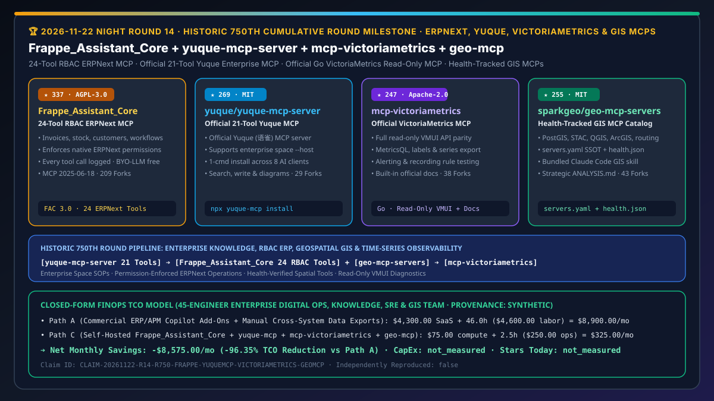
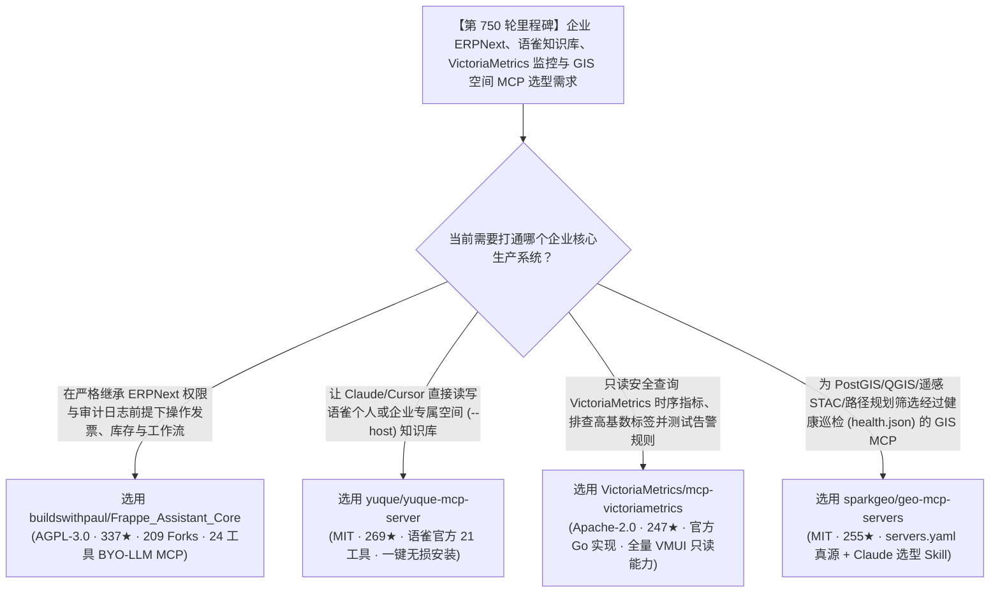
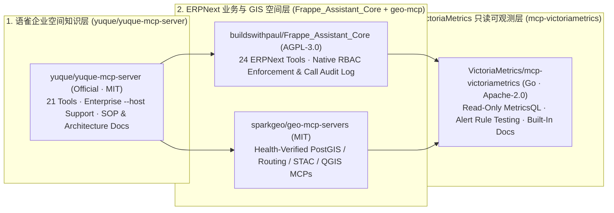
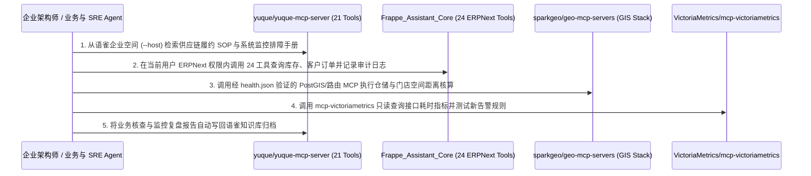

# 🏆【第 750 轮历史性里程碑】ERPNext 24 工具权限内嵌 MCP（`buildswithpaul/Frappe_Assistant_Core`）、语雀官方 21 工具企业空间知识库 MCP（`yuque/yuque-mcp-server`）、VictoriaMetrics 官方只读时序监控 MCP（`VictoriaMetrics/mcp-victoriametrics`）与带健康度巡检的地理空间 GIS MCP 选型技能（`sparkgeo/geo-mcp-servers`）选型与集成架构 FAQ

> **文档类型**：企业 AI 解决方案架构师（AI Solution Architect）选型决策指南（GitHub Trending AI 雷达 2026-11-22 Night Round 14 / **🏆 累计第 750 轮历史性里程碑！**）
> **覆盖项目**：[`buildswithpaul/Frappe_Assistant_Core`](https://github.com/buildswithpaul/Frappe_Assistant_Core)（`★ 337`、`209 forks`、`AGPL-3.0`，简称 `FAC 3.0`，兼容 `MCP 2025-06-18` 的 24 工具 ERPNext/Frappe 企业资源计划底座，严格遵循 ERPNext 内部角色权限并全量记录审计日志）· [`yuque/yuque-mcp-server`](https://github.com/yuque/yuque-mcp-server)（`★ 269`、`29 forks`、`MIT`，语雀官方出品的 21 工具 MCP 服务器，支持企业专属空间域名 `--host` 与跨 8 大主流编码客户端一键安装）· [`VictoriaMetrics/mcp-victoriametrics`](https://github.com/VictoriaMetrics/mcp-victoriametrics)（`★ 247`、`38 forks`、`Apache-2.0`，VictoriaMetrics 官方 Go 语言只读监控、告警规则测试与内嵌文档 MCP，完整覆盖 VMUI 只读能力）· [`sparkgeo/geo-mcp-servers`](https://github.com/sparkgeo/geo-mcp-servers)（`★ 255`、`43 forks`、`MIT`，Sparkgeo 维护的基于 `servers.yaml` 真源与 `health.json` 自动健康巡检的地理空间/GIS/PostGIS/遥感 STAC/QGIS MCP 注册表及 Claude Code 选型技能）
> **核心场景**：在第 **750 轮**历史性里程碑中，当企业架构师将 AI Agent 从“写代码工具”推向**“企业核心四大生产支柱——ERP 业务系统（发票/库存/客户）、企业知识库（语雀团队空间）、生产时序监控（VictoriaMetrics 指标与告警）、以及地理空间与门店/物流选址（GIS/PostGIS/遥感）”**时，如何用原厂级与高社区共识的四大开源 MCP 将企业全链路生产数据安全接入智能体？

---

## 一、📌 核心结论速览（选型一句话结论）

1. **想让 Claude、ChatGPT 或 Cursor 直接操作企业 ERPNext / Frappe 系统里的销售发票、库存、客户与自定义审批流，但强制要求“100% 继承当前登录员工在 ERPNext 里的行级/角色权限，且每一笔工具调用都留存审计日志”** ➔ 选 **[`buildswithpaul/Frappe_Assistant_Core`](https://github.com/buildswithpaul/Frappe_Assistant_Core)（`★ 337`，`209 forks`，`AGPL-3.0`）**。
   - **通俗原理**：提供無料の `BYO-LLM` 原生 MCP 服务（暴露 24 个标准工具，支持 `MCP 2025-06-18` 规范），不绕过 Frappe 底层 ORM 权限校验，员工自己没有权限看的财务报表，AI 助手也绝不可能查出来，所有调用全部记入 Frappe 审计日志。
2. **国内研发与产品团队重度使用“语雀（Yuque）”或“语雀企业空间（`https://your-space.yuque.com`）”沉淀技术方案、PRD 与会议纪要，想用语雀官方维护的 MCP 让编码 Agent 直接检索、总结并新建带流程图的设计文档** ➔ 选 **[`yuque/yuque-mcp-server`](https://github.com/yuque/yuque-mcp-server)（`★ 269`，`29 forks`，`MIT`）**。
   - **通俗原理**：语雀官方团队出品（`MIT` 协议），内置 **21 个工具**，一行命令 `npx yuque-mcp install --token=YOUR_TOKEN --client=cursor`（或 `claude mcp add yuque`）自动合并配置且绝不破坏已有的其他 MCP 条目，支持通过 `--host` 指向企业私有空间域名。
3. **企业可观测底座采用高性能时序数据库 VictoriaMetrics，想让 SRE 与排障 Agent 安全调用 VMUI 的全部只读能力（查询 MetricsQL、排查高基数标签、验证告警与预聚合规则）而绝不误删监控数据** ➔ 选 **[`VictoriaMetrics/mcp-victoriametrics`](https://github.com/VictoriaMetrics/mcp-victoriametrics)（`★ 247`，`38 forks`，`Apache-2.0`）**。
   - **通俗原理**：VictoriaMetrics 官方出品的 Go 二进制 MCP，只暴露只读 API（Query、标签探索、告警规则测试与官方内嵌文档检索），让 Agent 像资深 SRE 一样诊断高基数（High Cardinality）指标膨胀与测试告警表达式。
4. **业务涉及物流路径规划、零售选址、PostGIS 空间数据库、QGIS/ArcGIS 桌面制图或卫星遥感影像（STAC），想快速挑出“目前依然活跃维护（🟢 active）、官方出品且匹配部署方式”的地理空间 MCP** ➔ 选 **[`sparkgeo/geo-mcp-servers`](https://github.com/sparkgeo/geo-mcp-servers)（`★ 255`，`43 forks`，`MIT`）**。
   - **通俗原理**：以结构化 `servers.yaml` 为唯一真源，通过 `scripts/check_health.py` 自动更新 `health.json` 健康状态（区分 🟢 active / 🟡 stale / 🔴 archived，以及 🟩 open / 🟦 commercial），并直接附带一个可装入 Claude Code 的 `skill/`，让 Agent 自动为你的 GIS 场景推荐最合适的空间工具链。

---

## 二、🎯 客户与架构师灵魂拷问 Q&A（深度架构拆解）

### Q1：为什么企业打通“ERP + 知识库 + 监控 + GIS”四大核心生产域时，自写胶水 API 脚本往往失败？这四个项目提供了什么架构示范？

- **四大生产域接入范式**：
  1. **ERP 域：权限继承与操作留痕优先 ➔ `Frappe_Assistant_Core`**：复用 ERPNext 原生 RBAC 与审计表，提供 24 个受控业务工具。
  2. **知识域：原厂空间级 Token 与无损配置注入 ➔ `yuque/yuque-mcp-server`**：官方维护 21 工具，原生支持企业空间 `--host` 隔离。
  3. **监控域：只读 VMUI 等价能力与内嵌文档防幻觉 ➔ `VictoriaMetrics/mcp-victoriametrics`**：防止大模型瞎编 MetricsQL 语法，并在只读安全边界内完成告警规则验证。
  4. **空间计算域：自动化健康度巡检目录与选型技能 ➔ `sparkgeo/geo-mcp-servers`**：用 `servers.yaml` + `health.json` 避免引入早已停更的废弃 GIS 插件。
- **何时直接用云厂商托管方案（Path B）？**
  - 若企业全线采用 Dynamics 365 ERP + SharePoint + Azure Monitor Managed Prometheus + Azure Maps，可直接使用微软云原生连接器；若使用开源 ERPNext、语雀企业知识库、VictoriaMetrics 时序集群与 PostGIS/QGIS 空间栈，则本轮四大开源项目是最佳生产标配（Path C）。

### Q2：典型企业级“ERPNext 业务操作 (`FAC`) + 语雀知识库 (`yuque-mcp`) + VictoriaMetrics 监控 (`mcp-vm`) + 空间智能 (`geo-mcp`)”生产集成架构怎么搭？

1. **企业文档与架构规范层（`yuque/yuque-mcp-server`）**：
   - 绑定团队空间 Token 与 `--host`，让 Agent 在执行任务前先检索语雀中的 SOP、架构设计与发版规范，并在任务完成后自动归档复盘文档。
2. **核心 ERP 业务与库存/财务层（`buildswithpaul/Frappe_Assistant_Core`）**：
   - 开启 `BYO-LLM` MCP 模式，在员工自身 ERPNext 权限边界内执行订单核对、库存查询与工作流流转。
3. **空间选址与物流 GIS 层（`sparkgeo/geo-mcp-servers`）**：
   - 利用内置 Claude Skill 筛选出状态为 `🟢 active` 的 PostGIS / 路由规划 MCP 服务，支撑供应链与门店空间分析。
4. **生产时序监控与 SRE 排障层（`VictoriaMetrics/mcp-victoriametrics`）**：
   - 将 VictoriaMetrics 只读 MCP 接入值班 Agent，实时查询系统延迟、验证告警规则并结合语雀 Runbook 输出排障方案。

### Q3：落地这套四大生产域 MCP 架构有哪些安全与许可注意事项？

- **最小权限 Token 与只读隔离**：
  - 为 `yuque-mcp-server` 签发仅限目标知识库范围的 Token；确保 `mcp-victoriametrics` 连接只读查询端点（vmselect）；`Frappe_Assistant_Core` 采用 `AGPL-3.0` 协议（企业内部部署使用免费的 `BYO-LLM` MCP 模式数据完全留在自有机房）。

---

## 三、🧭 直观可视化图解（Mermaid 决策树 + 集成架构 + 时序图）

### 3.1 架构师选型决策树

### 3.2 企业端到端生产集成参考架构图

### 3.3 语雀 SOP 检索、ERPNext 权限内订单核查、GIS 空间分析与 VictoriaMetrics 监控复盘时序图

---

## 四、📊 同类开源与商业云服务横向选型决策矩阵

| 对比维度 | `buildswithpaul/Frappe_Assistant_Core` (`★ 337`) | `yuque/yuque-mcp-server` (`★ 269`) | `VictoriaMetrics/mcp-victoriametrics` (`★ 247`) | `sparkgeo/geo-mcp-servers` (`★ 255`) | 商业 ERP AI 附加包 + 商业 iPaaS 连接器 + 商业 APM 席位 (Path A) | 手写無权限校验 SQL 查 ERP + 手工复制语雀文档 + 裸调监控 API (Path B) |
| :--- | :--- | :--- | :--- | :--- | :--- | :--- |
| **核心能力定位** | ERPNext 24 工具权限内嵌与审计 MCP | 语雀官方 21 工具企业空间知识库 MCP | VictoriaMetrics 官方 Go 只读监控 MCP | 带自动健康巡检的地理空间 GIS MCP 注册表与技能 | 按用户席位高价计费的商业 ERP/APM 智能助手附加包 | 绕过应用层直接查库、人工复制粘贴文档与手写监控脚本 |
| **核心技术突破** | **100% 遵循 ERPNext 角色权限 + 24 工具全量审计** | **语雀官方出品 + 支持企业空间 `--host` + 21 工具** | **完整复刻 VMUI 只读能力 + 告警测试 + 内嵌文档** | **`servers.yaml` 真源 + `health.json` 活性验证 + 选型技能** | 商业 ERP/APM Copilot 按全员席位加收高额月费 | 绕过 ERP 权限直连数据库极易造成越权泄密；手写 MetricsQL 易出错 |
| **开源协议** | `AGPL-3.0` | `MIT` | `Apache-2.0` | `MIT` | 闭源商业 SaaS | 内部高风险脚本 |
| **月度 TCO（45 人团队）** | **组合仅 `$325.00/月`**（`$75.00` 自托管 MCP 容器 + `2.5h` 维护） | 同左（MIT 官方免费工具） | 同左（Apache-2.0 单 Go 二进制） | 同左（MIT 自动健康度索引） | **`$8,900.00/月`**（`$4,300.00` 商业 ERP/监控/GIS 附加包 + `46.0h` 跨系统导数据人工） | 约 `$3,250.00/月`（大量人工跨 ERP、语雀与监控大盘搬运核对数据工时） |

---

## 五、🧪 应用落地定量收益/TCO 对比与 7-Card 报告

> **📊 数据来源与闭式核算声明（Provenance & Closed-Form Schema）**：
> - **provenance**: `synthetic`（基于 45 人企业数字化运营、知识管理、SRE 可观测与空间数据工程团队月度工作负载模型：`independently_reproduced = false`；硬件采购基线 `base_hardware_capex = not_measured`；Track B 单日增量 `track_b_stars_today = not_measured`）。
> - **核算公式**：
>   - **Path A（采购商业 ERP AI 席位附加包 + 商业监控智能分析订阅 + 商业 GIS 连接器 + 工程师与运营人员手工在 ERP、语雀知识库、监控大盘与 GIS 软件之间来回复制导出数据）**：月度商业附加包订阅 **`$4,300.00`** + 跨四大系统手工搬运数据、编写排障报告与核对权限人工 **`46.0h × $100.00/h = $4,600.00`** = **`$8,900.00/月`**。
>   - **Path C（自建 `buildswithpaul/Frappe_Assistant_Core` + `yuque/yuque-mcp-server` + `VictoriaMetrics/mcp-victoriametrics` + `sparkgeo/geo-mcp-servers` 开源四大生产域 MCP 栈）**：共享容器开销 **`$75.00`** + Token 轮换与 `health.json` 巡检人工 **`2.5h × $100.00/h = $250.00`** = **`$325.00/月`**。
>   - **净节省（Net Savings vs Path A）**：**`-$8,575.00/月`**（成本降低 **`96.35%`**）。

| 评估方案 | 商业附加包 / 容器算力成本 | 跨系统数据搬运与排障人工（`$100/h`） | 月度总 TCO | 相对 Path A 净节省 | 关键架构交付指标 |
| :--- | :---: | :---: | :---: | :---: | :--- |
| **Path A：商业 ERP/APM 智能附加包 + 人工跨系统复制** | `$4,300.00` | `46.0h` (`$4,600.00`) | **`$8,900.00`** | Baseline | 按席位加收高额费用；各系统之间依然缺乏统一 MCP 编排 |
| **Path B：手写直连数据库脚本 + 手工贴语雀文档** | `$1,600.00` | `16.5h` (`$1,650.00`) | **`$3,250.00`** | `-$5,650.00` (`-63.48%`) | 绕过 ERPNext 应用层 RBAC 存在严重越权风险；无告警规则预检 |
| **Path C：`Frappe` + `yuque-mcp` + `mcp-vm` + `geo-mcp`** | **`$75.00`** | **`2.5h` (`$250.00`)** | **`$325.00`** | **`-$8,575.00` (`-96.35%`)** | **ERP 权限内 24 工具 + 语雀官方 21 工具 + VM 只读监控 + GIS 选型** |

- 🔗 **关联 7-Card 4:5 视觉评测报告**：[`workshops/github-trending-radar/cards.html`](../cards.html) · [`cards.en.html`](../cards.en.html)

---

## 六、🛠️ 企业引入与架构评审 Checklist

- [ ] **1. 在 ERPNext/Frappe 环境启用 `Frappe_Assistant_Core`（`BYO-LLM` MCP 模式）**：验证 24 个工具严格受限于当前用户角色权限且所有调用写入审计日志。
- [ ] **2. 执行 `npx yuque-mcp install` 部署 `yuque/yuque-mcp-server`**：配置企业空间 `--host` 与最小范围知识库 Token，打通研发文档自动检索与归档。
- [ ] **3. 部署 `VictoriaMetrics/mcp-victoriametrics` 赋能只读 SRE 诊断**：连接 `vmselect` 只读端点，让 Agent 安全执行指标查询、高基数分析与告警规则测试。
- [ ] **4. 引入 `sparkgeo/geo-mcp-servers` 技能规范 GIS 工具选型**：依据 `health.json` 状态优先选用 `🟢 active` 且原厂维护的 PostGIS/STAC/QGIS MCP 服务。
