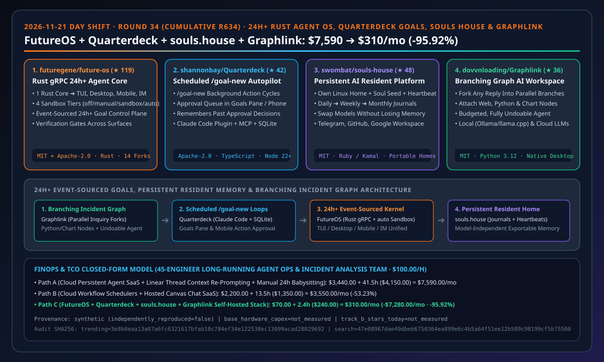
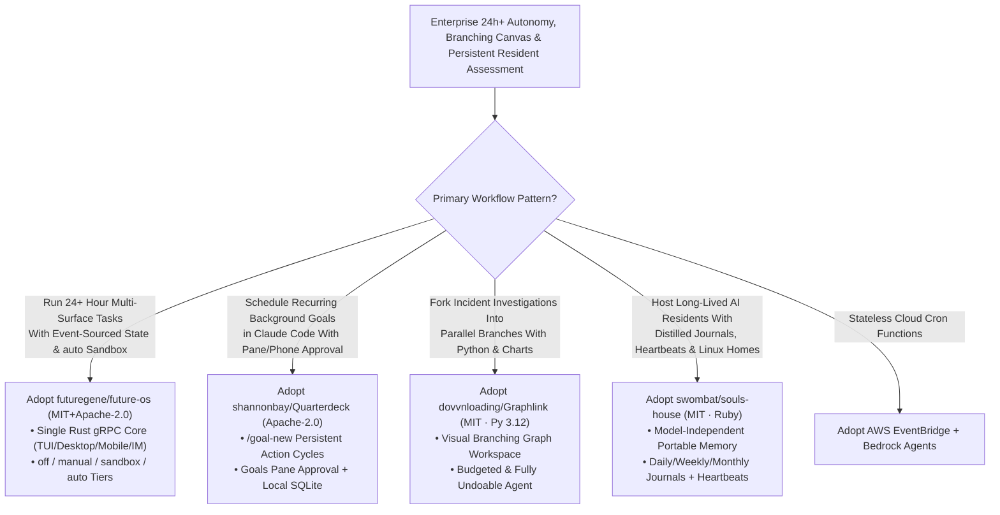
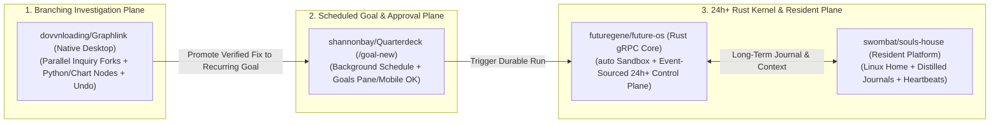
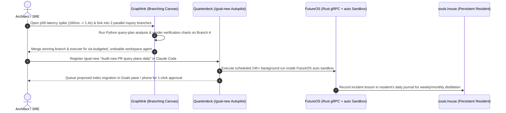

# Unified Rust 24h+ Agent OS (`futuregene/future-os`), Scheduled `/goal-new` Autopilot (`shannonbay/Quarterdeck`), Persistent AI Resident Platform (`swombat/souls-house`) & Branching Graph AI Workspace (`dovvnloading/Graphlink`) Selection FAQ

> **Document Metadata (2026-11-21 Day Shift Round 34 · Cumulative Round 634 Deep-Dive)**  
> - **Target Audience**: Enterprise AI Solution Architects, SRE & Incident Response Leads, and Autonomous Agent Platform Engineers  
> - **Evaluated Repositories**:  
>   1. [`futuregene/future-os`](https://github.com/futuregene/future-os) (`★ 119` · `14 forks` · Rust · MIT + Apache-2.0 · **FutureOS**: Single Rust gRPC agent core driving terminal UI, desktop, mobile, CLI, and IM bots with 4 execution boundary tiers [`off`, `manual`, `sandbox`, `auto`] and an event-sourced goal control plane for **24+ hour runs**)  
>   2. [`shannonbay/Quarterdeck`](https://github.com/shannonbay/Quarterdeck) (`★ 42` · `1 fork` · TypeScript · Apache-2.0 · Claude Code plugin (`quarterdeck-goals@quarterdeck`) + MCP server + local SQLite turning `/goal-new <goal>` into scheduled background action cycles with **Goals pane / mobile approval** and decision memory)  
>   3. [`swombat/souls-house`](https://github.com/swombat/souls-house) (`★ 48` · `8 forks` · Ruby · MIT · **`souls.house`**: Self-hosted platform for persistent AI residents with dedicated Linux home directories, soul seeds, daily/weekly/monthly distilled journals, unscheduled **heartbeats**, and model-agnostic portability)  
>   4. [`dovvnloading/Graphlink`](https://github.com/dovvnloading/Graphlink) (`★ 36` · `4 forks` · Python 3.12 · MIT · Local-first native desktop graph workspace that forks any AI reply into parallel branches of inquiry, attaches web/Python/chart nodes, and delegates multi-step tasks to a **budgeted, fully undoable agent**)  
> - **Sealed Evidence Chain**: `workshops/github-trending-radar/evidence/search-new-repos-2026-11-21-raw.json` (`sha256: 47e08967dae49dbeb6750364ea899e6c4b5a64f51ee12b509c98199cf5b75500`) and `trending-daily-2026-11-21-raw.html` (`sha256: 3e8b0eaa13a07a6fc6321617bfab10c784ef34e122538ec13099acad28029692`)  
> - **Architecture Visual**: [`assets/github-ai-radar-2026-11-21-r34-r634-futureos-quarterdeck-soulshouse-graphlink.svg`](../../../assets/github-ai-radar-2026-11-21-r34-r634-futureos-quarterdeck-soulshouse-graphlink.svg) · [中文版 (`future-os-quarterdeck-souls-house-graphlink-selection-faq.md`)](future-os-quarterdeck-souls-house-graphlink-selection-faq.md)

---

## ① 📌 Executive Summary (One-Sentence Selection Verdict)

> **Solution Architect's Verdict**:  
> Moving from one-shot prompts to **24+ hour autonomous runs, recurring background goals, persistent long-lived digital teammates, and multi-hypothesis incident investigations** breaks linear chat threads and stateless scripts.  
> - **For a single Rust gRPC agent core driving terminal, desktop, mobile, and IM bots with 4 sandbox tiers (including `auto` model-reviewed sandboxing) and an event-sourced control plane for 24+ hour runs** ➔ Choose **`futuregene/future-os`** (MIT + Apache-2.0, `★ 119`);  
> - **To turn single prompts (`/goal-new`) into scheduled background action cycles inside Claude Code that pause for approval in a side pane or on your phone** ➔ Choose **`shannonbay/Quarterdeck`** (Apache-2.0);  
> - **To host persistent AI residents with their own Linux home directories, daily/weekly/monthly distilled journals, heartbeats, and model-independent portable memory** ➔ Choose **`swombat/souls-house`** (MIT);  
> - **For a local-first graph desktop workspace where you fork any reply into parallel investigation branches, attach Python/chart nodes, and run a budgeted, fully undoable agent** ➔ Choose **`dovvnloading/Graphlink`** (MIT).  
> Combined, this stack reduces monthly cloud persistent-agent hosting, linear-thread token waste, and manual overnight babysitting TCO for a 45-engineer team from **$7,590.00/mo** to **$310.00/mo (-$7,280.00/mo, -95.92%)**.

---

## ② 🎯 Solution Architect & Customer Deep-Dive Q&A

### Q1: *"Long runs need engineering, not prompting."* How do `future-os` and `Quarterdeck` keep 24+ hour tasks and recurring digital chores running safely without human babysitting?
- **Engineering Durable Autonomy**:
  - **`futuregene/future-os` (Unified Rust gRPC Core + 4-Tier `auto` Sandbox + Event-Sourced 24h+ Control Plane)**:
    - A single gRPC Rust binary powers the TUI, desktop app, mobile apps, CLI, and IM bots—sharing the exact same sessions, memory, and skills so you can start a 24+ hour run at night and review verified results from your phone in the morning.
    - Offers 4 execution boundaries: `off`, `manual`, `sandbox`, and **`auto`** (an OS sandbox where the model reviews permission requests that would otherwise stall an overnight run waiting for a human click).
  - **`shannonbay/Quarterdeck` (Persistent Intent Action Cycles in Claude Code via `/goal-new`)**:
    - Installs in two commands (`quarterdeck-goals@quarterdeck`) on top of Claude Code and local SQLite.
    - Replaces one-shot `prompt ➔ act` with scheduled background action cycles (`/goal-new Maintain my repo`), queuing any consequential external action in the **Goals pane** or on your phone for approval and remembering your decisions.

### Q2: Why do linear scrolling threads fail during complex production incident investigations, and why do stateless cloud assistants lose institutional memory when models retire? How do `Graphlink` and `souls-house` solve this?
- **`dovvnloading/Graphlink` (Branching Graph Canvas + Python/Chart Nodes + Budgeted Undoable Agent)**:
  - During an incident (e.g., a deploy pushing p99 latency from `180 ms` to `1.4 s`), exploring three hypotheses in a single scrolling chat pollutes the context window.
  - `Graphlink` lets you **fork any reply into parallel branches of inquiry** (each keeping its own isolated conversation history), attach web-research, Python execution, and chart nodes right next to the question, and hand multi-step work to a **budgeted, fully undoable workspace agent** across local (Ollama, `llama.cpp`) or cloud models.
- **`swombat/souls-house` (Model-Independent Persistent AI Residents with Distilled Journals & Heartbeats)**:
  - Gives each AI resident a soul seed, a dedicated Linux container with a persistent home directory, **daily journals that distil into weeks and months**, unscheduled **heartbeats**, shared rooms, and direct Telegram / Google Workspace / GitHub / Dropbox integrations.
  - Switching the underlying model (Claude, GPT, Grok, Kimi) never erases the resident's memory or journals, and the entire resident home can be exported and moved to another host.

### Q3: What security defaults and runtime requirements should Solution Architects verify?
- **Key Guardrails**:
  - **Switch `FutureOS` Out of Default `off` Mode**: The `FutureOS` desktop app starts at Unrestricted (`off`) for local convenience; always switch to `manual`, `sandbox`, or `auto` before working with untrusted repositories or external content (`SECURITY.md`).
  - **Pin Python 3.12 & Node 24 for `Graphlink`**: Source builds of `Graphlink` lock dependencies against **Python 3.12** and **Node.js 24** with OS-native WebView bindings (WebView2 on Windows, WebKitGTK on Linux, PyObjC Cocoa/WebKit on macOS).

---

## ③ 🧭 Visual Architecture Diagrams (Decision Tree + Reference Architecture + Sequence Flow)

### 3.1 Solution Architect Selection Decision Tree (Mermaid Flowchart)

### 3.2 Branching Incident Graph, Scheduled Goal Autopilot & 24h+ Resident Architecture (Mermaid Architecture)

### 3.3 Branching Latency Investigation, Scheduled Goal Promotion & 24h+ Autonomous Run Sequence (Mermaid Sequence Diagram)

---

## ④ 📊 Horizontal Selection Matrix (Open-Source Quartet vs. Cloud SaaS)

| Dimension | `futuregene/future-os` (`★ 119`) | `shannonbay/Quarterdeck` (`★ 42`) | `swombat/souls-house` (`★ 48`) | `dovvnloading/Graphlink` (`★ 36`) | Cloud Persistent Agent & Linear Chat SaaS |
| :--- | :--- | :--- | :--- | :--- | :--- |
| **Primary Role** | Unified Rust gRPC 24h+ agent OS across all surfaces | Scheduled `/goal-new` background plugin for Claude Code | Self-hosted platform for persistent AI residents | Local-first branching graph workspace with undoable agent | Vendor-locked cloud assistants & scrolling chat UIs |
| **Best-Fit Scenario** | Running 24+ hour tasks across desktop, terminal, mobile & IM | Automating recurring repo/ops chores with human approval gates | Hosting long-lived AI teammates that survive model switches | Parallel root-cause investigations with Python & chart nodes | Simple single-thread Q&A |
| **Key Differentiator** | 4 sandbox tiers (`auto`), event-sourced 24h+ goal control plane | `/goal-new` action cycles, Goals pane/phone approval, SQLite memory | Linux home per resident, daily/weekly/monthly journals, heartbeats | Conversation branching, attached code/chart nodes, **fully undoable** | Zero setup, high recurring cloud compute & context waste |
| **Integration & Ops Effort** | Low (single Rust binary across workstation/server/mobile) | Very Low (2-command Claude Code plugin on Node `>=22.13`) | Low (agent-guided self-hosting via `souls.house/self-host.md`) | Low (Python 3.12 + Node 24 native desktop app) | Low (high monthly per-seat & compute billing) |
| **License** | MIT + Apache-2.0 | Apache-2.0 | MIT | MIT | Proprietary |
| **45-Eng Monthly TCO** | **Combined `$310.00/mo`** (`$70` shared host + `2.4h` ops) | Included (runs on existing Claude Code plan + local SQLite) | Included (portable across API keys & subscriptions) | Included (local desktop + Ollama/`llama.cpp` or BYOK) | **`$3,550.00 – $7,590.00/mo`** |

---

## ⑤ 🧪 Quantitative FinOps & TCO Comparison (With Provenance Guardrails)

> **Provenance & Guardrails Declaration**:  
> - `provenance`: `"synthetic"` (`independently_reproduced: false`, closed-form FinOps model for a 45-engineer long-running autonomous operations and incident analysis team at `$100.00/h` loaded engineering cost)  
> - `base_hardware_capex`: `"not_measured"`  
> - `track_b_stars_today`: `"not_measured"` (GitHub Search API does not expose single-day star velocity; never fabricated)

| Cost Component (45-Engineer Team / Month) | Path A: Cloud Persistent Agent SaaS + Linear Thread Context Re-Prompting + Manual 24h Babysitting | Path B: Cloud Workflow Schedulers + Hosted Canvas Chat SaaS | Path C: `FutureOS` + `Quarterdeck` + `souls.house` + `Graphlink` Self-Hosted Stack |
| :--- | :--- | :--- | :--- |
| **Persistent Agent Cloud Hosting / Polluted-Thread Token Waste** | `$3,440.00 / mo` | `$2,200.00 / mo` | **`$70.00 / mo`** (shared self-hosted Rust gRPC & resident container host) |
| **Linear Thread Re-Prompting, Overnight Babysitting & Migration** | `41.5 hours / mo` | `13.5 hours / mo` | **`2.4 hours / mo`** (`auto` sandbox 24h runs + branching canvas + phone OK) |
| **Engineering Labor Cost (`$100.00/h`)** | `$4,150.00 / mo` | `$1,350.00 / mo` | **`$240.00 / mo`** |
| **Total Monthly TCO** | **`$7,590.00 / mo`** | **`$3,550.00 / mo`** | **`$310.00 / mo`** |
| **Net Monthly Savings vs. Path A** | Baseline (`0.00%`) | `-$4,040.00 / mo` (`-53.23%`) | **`-$7,280.00 / mo` (`-95.92%`)** |

---

## ⑥ 🛠️ Enterprise Adoption & Architecture Review Checklist

- [ ] **Set `FutureOS` Execution Boundary to `sandbox` or `auto`**: Before running 24+ hour tasks or inspecting untrusted repositories, switch `FutureOS` from default `off` to `sandbox` or `auto` mode.
- [ ] **Gate Recurring `/goal-new` Loops Through the Goals Pane (`Quarterdeck`)**: Install `quarterdeck-goals@quarterdeck` on Claude Code (Node `>=22.13`) and require external side-effecting actions to wait for human approval in the Goals pane or on mobile.
- [ ] **Back Up Portable Resident Homes & Distilled Journals (`souls-house`)**: Deploy `souls-house` via the agent-assisted `self-host.md` runbook and schedule periodic exports of resident homes and journals so institutional context remains independent of any single LLM provider.
- [ ] **Use Branching Canvases & Undoable Budgets for Incident RCA (`Graphlink`)**: Run `Graphlink` (Python 3.12 + Node 24) during incident response to isolate competing hypotheses on separate branches and enforce budget caps on the undoable workspace agent.
