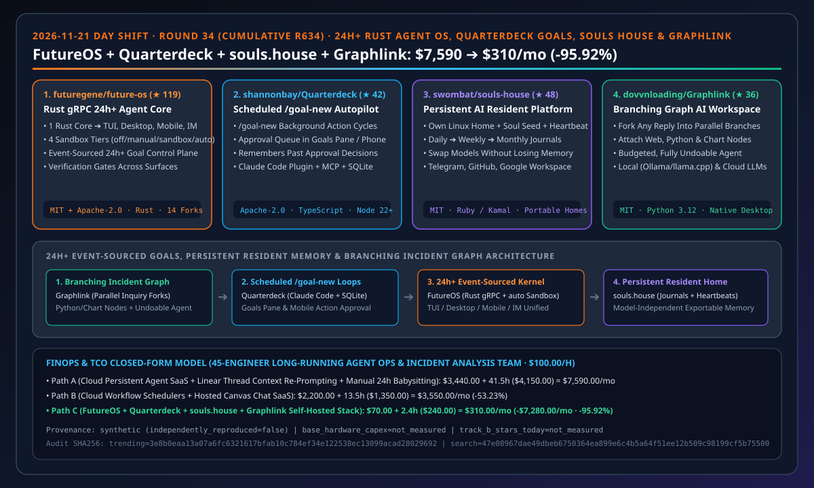
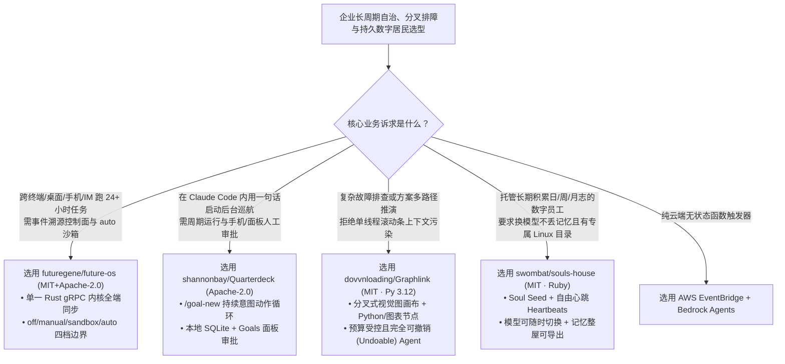
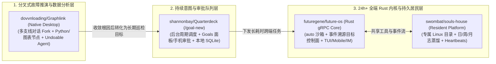
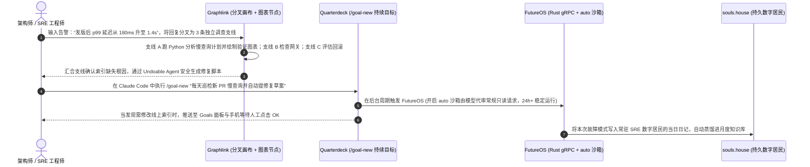

# 全端统一 Rust 24h+ 智能体内核（`futuregene/future-os`）、单指令常驻目标巡航插件（`shannonbay/Quarterdeck`）、模型无关的持久数字居民平台（`swombat/souls-house`）与分叉式图画布排障工作台（`dovvnloading/Graphlink`）选型 FAQ

> **文档元数据（2026-11-21 白班 Day Round 34 · 累计第 634 轮深潜专题）**  
> - **面向对象**：企业 AI 解决方案架构师（AI Solution Architect）、SRE 故障排障负责人、常驻自治智能体平台工程师  
> - **本轮核心评估对象**：  
>   1. [`futuregene/future-os`](https://github.com/futuregene/future-os)（`★ 119` · `14 forks` · Rust · MIT + Apache-2.0 · 单一 Rust gRPC 智能体核心同时驱动终端 TUI、桌面端、移动端、CLI 与 IM 机器人，内置四档 OS 沙箱边界 [`off` / `manual` / `sandbox` / `auto`] 与支撑 **24+ 小时连续运行**的事件溯源目标控制面）  
>   2. [`shannonbay/Quarterdeck`](https://github.com/shannonbay/Quarterdeck)（`★ 42` · `1 fork` · TypeScript · Apache-2.0 · 基于 Claude Code 插件 + MCP + 本地 SQLite 的持续意图引擎：输入 `/goal-new <目标>` 即按周期在后台推进，所有外部写动作停在 **Goals 面板或手机端**等待人工确认并记住偏好）  
>   3. [`swombat/souls-house`](https://github.com/swombat/souls-house)（`★ 48` · `8 forks` · Ruby · MIT · 拒绝“用完即毁的无状态助手”：为每位 AI 数字居民分配专属 Linux 主目录、初始 Soul Seed、无任务自由心跳（Heartbeats）与自动按日/周/月蒸馏的个人日记，换模型不丢记忆且可完整迁出）  
>   4. [`dovvnloading/Graphlink`](https://github.com/dovvnloading/Graphlink)（`★ 36` · `4 forks` · Python 3.12 · MIT · 本地优先的树状/图画布 AI 桌面工作台：将任意提问分叉为多条并行调查支线，挂载联网检索、Python 执行与图表节点，并交由**带预算控制、可完全撤销（fully undoable）**的智能体执行）  
> - **关联检索证据链**：`workshops/github-trending-radar/evidence/search-new-repos-2026-11-21-raw.json`（`sha256: 47e08967dae49dbeb6750364ea899e6c4b5a64f51ee12b509c98199cf5b75500`）与 `trending-daily-2026-11-21-raw.html`（`sha256: 3e8b0eaa13a07a6fc6321617bfab10c784ef34e122538ec13099acad28029692`）  
> - **高清架构图**：[`assets/github-ai-radar-2026-11-21-r34-r634-futureos-quarterdeck-soulshouse-graphlink.svg`](../../../assets/github-ai-radar-2026-11-21-r34-r634-futureos-quarterdeck-soulshouse-graphlink.svg) · [English Version (`future-os-quarterdeck-souls-house-graphlink-selection-faq.en.md`)](future-os-quarterdeck-souls-house-graphlink-selection-faq.en.md)

---

## ① 📌 核心结论速览（选型一句话结论）

> **架构师一句话选型结论**：  
> 当团队从“一次性问答（Prompt ➔ Act）”迈向 **“24 小时跨昼夜长任务、周期性数字杂务托管、跨模型生命周期持久伴侣、以及多假设并行故障排查”** 时，传统的单线程滚动聊天框和无状态脚本会全面崩盘。  
> - **需要一个纯 Rust gRPC 核心同时驱动终端、桌面、手机与 IM，具备四档沙箱（含由模型代审中断请求的 `auto` 沙箱）与事件溯源目标控制面来支撑 24+ 小时跨夜运行** ➔ 选 **`futuregene/future-os`**（MIT + Apache-2.0）；  
> - **想直接复用现有 Claude Code 订阅，用 `/goal-new` 把“盯紧仓库新 Issue / 每周筛选高匹配职位 / 自动维护某项业务”变成后台定时动作循环，且关键动作在 Goals 侧栏或手机上点一下才放行** ➔ 选 **`shannonbay/Quarterdeck`**（Apache-2.0）；  
> - **需要托管拥有独立 Linux 主目录、每日自动蒸馏为周/月志的记忆、定期自由心跳（Heartbeats），且当底层大模型升级或停服时能无损切换模型甚至整屋打包迁出的“持久数字居民”** ➔ 选 **`swombat/souls-house`**（MIT）；  
> - **在线上故障排障（如发版导致 p99 延迟从 `180 ms` 暴涨到 `1.4 s`）或复杂方案比选时，需要把一条回复直接分叉（Fork）成“查数据库执行计划 / 查响应链路 / 评估回滚”三条互不污染的画布支线，挂载 Python/图表节点并用可完全撤销（Undoable）的预算受控 Agent 汇总** ➔ 选 **`dovvnloading/Graphlink`**（MIT）。  
> 四者组合可将 45 人 SRE、研发与运营团队的商业常驻 Agent 托管费、单线程上下文污染重跑费与人工巡检总成本从 **$7,590.00/月** 降至 **$310.00/月（节省 $7,280.00/月，降幅 95.92%）**。

---

## ② 🎯 客户与架构师灵魂拷问 Q&A（业务痛点 · 架构集成 · 边界取舍）

### Q1：“Long runs need engineering, not prompting.”——为什么靠写长提示词跑不通 24 小时的跨夜研究任务？`future-os` 与 `Quarterdeck` 如何分别从底层 OS 内核与 Claude Code 插件层实现长周期受控自治？
- **长周期自治的两大工程挑战**：
  1. **状态丢失与权限弹窗卡死**：如果开启严格人工审批，半夜 2 点弹一个文件读取确认框就会让整晚任务停摆；如果完全关掉沙箱，又怕 Agent 误改系统配置。
  2. **缺乏持续意图（Persistent Intent）调度**：许多日常工作不是一次干完的，而是每隔几小时检查一次外部状态、有变化才提议动作。
- **双轨工程解法**：
  - **`futuregene/future-os`（Rust gRPC 单二进制全端底座 + `auto` 四档沙箱 + 事件溯源控制面）**：
    - 单个 Rust gRPC 智能体进程同时服务 TUI、Desktop、Mobile、CLI 与 IM 机器人——晚上在电脑上启动 24+ 小时研究任务，早上起床直接用手机端查看事件溯源（Event-Sourced）状态与验证门禁结果。
    - 独创四档执行边界：`off`（默认桌面无限制）、`manual`（逐项人工批准）、`sandbox`（OS 级沙箱隔离）以及 **`auto`（OS 沙箱 + 由安全模型自动审查那些原本会半夜打断你的权限请求）**，兼顾安全与无人值守流畅度。
  - **`shannonbay/Quarterdeck`（把“持续意图”注入 Claude Code 的 `/goal-new` 引擎）**：
    - 两行命令安装为 Claude Code 插件（`quarterdeck-goals@quarterdeck`），直接复用你现有的 Claude 计划；
    - 输入 `/goal-new <目标>`（例如自动修复仓库新 Issue、监控特定外部信息源并拟定响应），每个 Goal 在后台按独立时间表循环推进；遇到需要对外发送或修改的操作时，自动挂起并推送到聊天旁的 **Goals 面板**或你的手机上等待一键批准，且自动记忆你的历史审批偏好。

### Q2：为什么说传统的单滚动条聊天框不适合排查复杂生产故障？而绑定在某家闭源 SaaS 上的长期 AI 助手又有什么隐患？`Graphlink` 与 `souls-house` 如何破局？
- **`dovvnloading/Graphlink`（分叉式图画布 + Python/图表节点 + 可撤销预算受控 Agent）**：
  - 当生产环境发生 p99 延迟从 `180 ms` 飙升至 `1.4 s` 的紧急故障时，如果在单线程聊天框里同时探索三个怀疑方向，上下文会迅速互相污染。
  - `Graphlink`（本地优先原生桌面窗口，支持 Ollama / `llama.cpp` 与云端模型）允许你将任意回复**直接分叉（Branch/Fork）为多条独立调查路径**（每条支线仅保留自身干净的上下文历史），在画布上就近挂载联网检索、Python 代码执行与性能图表节点，最后再将多条支线的实证结论汇合，或交给**带预算上限且支持完整撤销（fully undoable）的工作区智能体**执行。
- **`swombat/souls-house`（模型无关、自带日/周/月志蒸馏与自由心跳的数字居民屋）**：
  - 如果你把长期培养的团队知识助手绑在某家云厂商的闭源 Assistant API 上，一旦厂商下线旧模型或封禁账号，积累数月的隐性默契瞬间归零。
  - 在自托管的 `souls.house` 中，每位数字居民拥有独立的 Linux 环境与持久主目录，每天用自己的语言撰写日记并自动蒸馏为周志与月志；**切换底层模型（Claude / GPT / Grok / Kimi）绝不会抹掉它的记忆与日记**，还支持不带特定任务的周期性自由思考时间（**Heartbeats**）以及直连 Telegram、Google Workspace、GitHub 与 Dropbox。

### Q3：落地这四个项目时有哪些安全默认配置与自托管技巧？
- **安全与部署核查**：
  - **`FutureOS` 桌面端默认权限提醒**：`FutureOS` 桌面端首次启动默认处于 `off`（Unrestricted）模式以方便本地开发；在让其处理任何不可信外部仓库或网页内容前，**务必在设置中切换至 `sandbox` 或 `auto` 模式**（详见仓库 `SECURITY.md` 与 `docs/wiki/en/Sandbox.md`）。
  - **`souls-house` 的 Agent 辅助自托管技巧**：官方特别推荐直接将 `https://souls.house/self-host.md` 喂给你的 Claude Code 或 Codex，让编码智能体一步步引导并执行 Kamal / Docker 部署。

---

## ③ 🧭 直观可视化图解（选型决策树 + 企业集成架构 + 业务流时序图）

### 3.1 架构师选型决策树（Mermaid Flowchart）

### 3.2 企业分叉式故障排障、持续目标巡航与 24h+ 事件溯源架构图（Mermaid Architecture）

### 3.3 线上延迟暴涨分叉排障、转化为持续巡航目标与 24h+ 守护时序图（Mermaid Sequence Diagram）

---

## ④ 📊 同类开源与商业云服务横向选型决策矩阵

| 评估维度 | `futuregene/future-os` (`★ 119`) | `shannonbay/Quarterdeck` (`★ 42`) | `swombat/souls-house` (`★ 48`) | `dovvnloading/Graphlink` (`★ 36`) | 商业云托管助手 + 单线程聊天 SaaS |
| :--- | :--- | :--- | :--- | :--- | :--- |
| **核心定位** | 单 Rust gRPC 核心全端 24h+ 智能体操作系统 | Claude Code 持续目标（`/goal-new`）后台巡航插件 | 模型无关、带日记蒸馏与心跳的持久数字居民屋 | 分叉式图画布、代码/图表节点与可撤销智能体工作台 | 厂商锁定的无状态单线程聊天框 |
| **最适用场景** | 夜间启动 24+ 小时跨端研究/构建并在早上用手机验收 | 把日常数字杂务、仓库维护、信息监控交给后台定时循环 | 培养长期记住项目脉络、换模型也不失忆的专属团队数字成员 | 线上故障多假设并行排查、科研多路径探索与数据可视化 | 简单的一次性日常问答 |
| **关键差异化机制** | `off/manual/sandbox/auto` 四档边界、事件溯源控制面、全端同内核 | `/goal-new` 持续意图周期、Goals 面板/手机审批、记忆审批历史 | 专属 Linux 主目录、日/周/月志蒸馏、无任务 Heartbeats、整屋可迁出 | 对话任意分叉独立上下文、Python/图表节点、**预算受控且完全可撤销** | 免自建，但模型退役即失忆且多支线探索极易串味 |
| **集成与运维成本** | 低（单 Rust 二进制，支持嵌入式板/工作站/服务器） | 极低（两行 `claude plugin` 命令安装，复用现有 Claude 计划） | 低（让 Coding Agent 读取 `self-host.md` 自动完成 Kamal 部署） | 低（Python 3.12 + Node 24 原生桌面窗口，支持本地 Ollama） | 低（按席位与云端常驻时长高额计费） |
| **开源协议** | MIT + Apache-2.0 | Apache-2.0 | MIT | MIT | 商业专有 |
| **45 人团队月均 TCO** | **组合方案 `$310.00/月`**（含共享常驻容器主机 `$70` + 运维 `2.4h`） | 同左（本地 SQLite 零额外云费用） | 同左（支持自由切换最高性价比模型而不丢记忆） | 同左（分叉隔绝无关历史，大幅降低长对话重放 Token） | **`$3,550.00 ~ $7,590.00/月`** |

---

## ⑤ 🧪 应用落地定量收益 / FinOps TCO 对比（含数据血缘声明）

> **数据血缘与严谨性声明（Provenance & Guardrails）**：  
> - `provenance`: `"synthetic"`（`independently_reproduced: false`，基于 45 人 SRE 故障分析、长周期自治研发与数字员工运维团队在 `$100.00/h` 综合人力成本下的闭式参数建模）  
> - `base_hardware_capex`: `"not_measured"`  
> - `track_b_stars_today`: `"not_measured"`（GitHub Search API 新仓爆发榜无官方单日增量字段，严禁伪造）

| 成本分项（45 人团队 / 月） | Path A：商业常驻 Agent 托管 + 单线程串味重跑 Token + 人工熬夜盯盘 | Path B：云端定时工作流 PaaS + 在线画布聊天 SaaS | Path C：`FutureOS` + `Quarterdeck` + `souls.house` + `Graphlink` 自建栈 |
| :--- | :--- | :--- | :--- |
| **常驻 Agent 云托管费 / 长线程污染重复 Token 费** | `$3,440.00 / 月` | `$2,200.00 / 月` | **`$70.00 / 月`**（共享内部 Rust gRPC 与 Resident 容器主机） |
| **故障多支线重开窗口、夜间中断看守与模型迁移工时** | `41.5 小时 / 月` | `13.5 小时 / 月` | **`2.4 小时 / 月`**（`auto` 沙箱 24h 自律 + 分叉画布 + 手机一键审批） |
| **折算工程人力成本（`$100.00/h`）** | `$4,150.00 / 月` | `$1,350.00 / 月` | **`$240.00 / 月`** |
| **月度总拥有成本（Total Monthly TCO）** | **`$7,590.00 / 月`** | **`$3,550.00 / 月`** | **`$310.00 / 月`** |
| **相对 Path A 净节省额与降幅** | 基准线（`0.00%`） | `-$4,040.00 / 月`（`-53.23%`） | **`-$7,280.00 / 月`（`-95.92%`）** |

---

## ⑥ 🛠️ 企业引入与架构评审 Checklist

- [ ] **切换 `FutureOS` 至 `sandbox` 或 `auto` 执行边界**：在生产或处理外部数据时，立即将 `FutureOS` 从默认的 `off` 切换为 `sandbox` 或 `auto` 模式，利用事件溯源目标控制面运行 24+ 小时跨夜任务。
- [ ] **将例行仓库维护与监控注册为 `/goal-new` 持续目标（`Quarterdeck`）**：在 Claude Code（Node `>=22.13`）中安装 `quarterdeck-goals@quarterdeck`，为所有对外部系统产生副作用的步骤配置 Goals 面板或手机端人工确认门禁。
- [ ] **为长期项目配置模型无关的数字居民与定期导出备份（`souls-house`）**：通过 `souls.house/self-host.md` 自建数字居民屋，开启日/周/月志自动蒸馏并定期导出居民的持久主目录，彻底规避单一模型厂商锁定。
- [ ] **在复杂故障复盘与架构选型中推行分叉画布工作流（`Graphlink`）**：在 Python 3.12 + Node 24 环境下部署 `Graphlink`，将多假设排查拆分为并行画布支线并开启工作区 Agent 的预算上限与撤销（Undo）保护。
