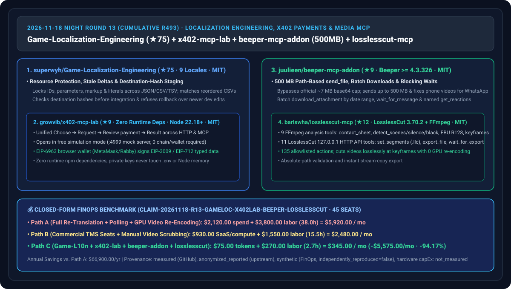
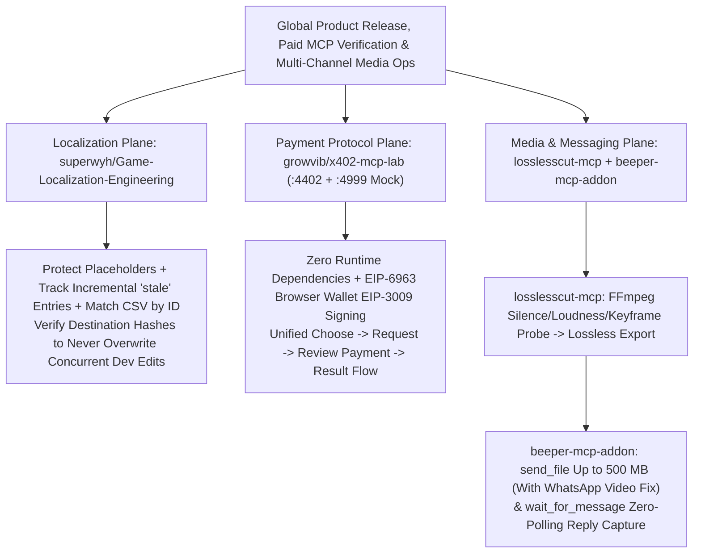

# Hash-Guarded Localization Engineering (`superwyh/Game-Localization-Engineering`), Browser-Wallet `x402` Payment Workbench (`growvib/x402-mcp-lab`), 500MB Beeper Companion MCP (`juulieen/beeper-mcp-addon`) & Keyframe-Exact `losslesscut-mcp` (`bariswha/losslesscut-mcp`) Selection FAQ

> **Document Type**: AI Solution Architect (SA) Practical Selection & Reference Architecture Guide (Round 493 / 2026-11-18 Night R13)  
> **Primary Evaluated Repositories**: [`superwyh/Game-Localization-Engineering`](https://github.com/superwyh/Game-Localization-Engineering) (`★ 75`, `1 fork`, 9-language localization engineering skill with placeholder guards, incremental `stale` tracking & destination-hash staging, `MIT`) + [`growvib/x402-mcp-lab`](https://github.com/growvib/x402-mcp-lab) (`★ 9`, zero-runtime-dependency `x402` HTTP/MCP payment workbench with `EIP-6963` browser wallet signing, `MIT`) + [`juulieen/beeper-mcp-addon`](https://github.com/juulieen/beeper-mcp-addon) (`★ 9`, `2 forks`, 5-tool Beeper Desktop companion MCP supporting `500 MB` file sends & blocking waits, `MIT`) + [`bariswha/losslesscut-mcp`](https://github.com/bariswha/losslesscut-mcp) (`★ 12`, FFmpeg 9-probe media analyzer + LosslessCut `127.0.0.1` lossless video cutting MCP, `MIT`)  
> **Benchmark Standard**: Strictly aligned with [`ib-vs-ethernet-roce-selection-faq.md`](https://github.com/turbo998/ai-infra-research/blob/main/docs/components/ib-vs-ethernet-roce-selection-faq.md) 6-section architecture format (Executive Summary + First-Principles Q&A + Mermaid Decision Tree + Peer Selection Matrix + 7-Card Quantitative Insights + SA Action Checklist)  
> **Data Provenance**: GitHub stars and repository metadata are `measured` from sealed `2026-11-18` evidence; upstream capability metrics (`beeper-mcp-addon` `500 MB` file transfer vs. official `~7 MB` inline base64 cap, and `losslesscut-mcp` `135` allowlisted actions + EBU R128 loudness analysis) are `anonymized_reported (independently_reproduced=false)`; the enterprise FinOps TCO model is `synthetic (independently_reproduced=false)` with workstation hardware CapEx `not_measured`.  
> **Language Editions**: [中文版](./game-localization-x402-mcp-lab-beeper-losslesscut-mcp-hash-guarded-l10n-browser-wallet-x402-500mb-beeper-lossless-video-selection-faq.md) | [English Version (Current)](./game-localization-x402-mcp-lab-beeper-losslesscut-mcp-hash-guarded-l10n-browser-wallet-x402-500mb-beeper-lossless-video-selection-faq.en.md)

---

## 📌 1. Executive Summary (30-Second Architect Briefing)

1. **Plain-Language First-Principles Definition**:
   - **What is `superwyh/Game-Localization-Engineering`?** It is a **self-contained, 9-language localization engineering skill and Python tool suite (`check_package.py`)** that protects stable IDs, parameters, markup, and literals across JSON/CSV/TSV; marks modified source entries as `stale` while preserving unchanged and removed strings for recovery; reconciles reordered external CSV review packets by ID while detecting competing concurrent edits; and **verifies destination file hashes during staging—refusing to overwrite later developer edits on rollback**.
   - **What is `growvib/x402-mcp-lab`?** It is a **zero-runtime-dependency Node.js 22.18+ workbench (`:4402` UI + `:4999` free simulation target) for testing the `x402` payment protocol across both HTTP (`402` headers) and MCP tool results**. Instead of storing private keys in `.env` files, it delegates `EIP-3009` (`EIP-712` typed-data) signing to an `EIP-6963` browser wallet (`MetaMask`, `Rabby`) across a collapsible `Choose → Request → Review payment → Result` flow.
   - **What is `juulieen/beeper-mcp-addon`?** It is a **5-tool sidecar MCP server that runs alongside official Beeper Desktop (`>= 4.3.326`)** to solve its five largest enterprise gaps: batch `download_attachment` across date ranges, path-based `send_file` up to **`500 MB`** with automatic mobile video transcode fixes (bypassing the official `~7 MB` inline base64 limit), blocking `wait_for_message` (zero polling), compact multi-chat `get_new_messages` with account connection states, and named `get_reactions`.
   - **What is `bariswha/losslesscut-mcp`?** It is an **MCP server that pairs 9 FFmpeg media inspection tools (`contact_sheet`, `detect_scenes`, `detect_silence`, `detect_black`, `audio_levels` EBU R128, `keyframes`) with 11 LosslessCut `3.70.2` HTTP API tools (`set_segments`, `export_file`, `135` allowlisted actions)** so AI assistants cut videos losslessly at exact keyframes without GPU re-encoding.
2. **Why Enterprise AI Solution Architects Should Combine All Four Tonight**:
   - Global product teams need deterministic localization staging (`Game-Localization-Engineering`), key-isolated payment protocol testing (`x402-mcp-lab`), zero-reencode video trimming (`losslesscut-mcp`), and 500MB multi-network delivery (`beeper-mcp-addon`).
3. **Closed-Form FinOps Impact (`CLAIM-20261118-R13-GAMELOC-X402LAB-BEEPER-LOSSLESSCUT`, `synthetic`)**:
   - Across a **45-person global product, localization, customer messaging & media operations team** (`$100.00/hr` rate): **Path A (Full-File LLM Re-Translation + `.env` Hot Keys + 7MB Base64 Polling + Cloud GPU Video Re-Encoding)** costs **`$5,920.00/mo`** (`$2,120.00` token/GPU spend + `38.0 hrs × $100 = $3,800.00` fixing broken placeholders, CSV merges & video exports); **Path C (`Game-Localization-Engineering` + `x402-mcp-lab` + `beeper-mcp-addon` + `losslesscut-mcp`)** reduces total monthly TCO to **`$345.00/mo`** (`$75.00` delta-only translation tokens + `2.7 hrs × $100 = $270.00` LQA review labor), saving **`$5,575.00/mo` (`94.17%` reduction, `$66,900.00/yr` annualized)**.

---

## ❓ 2. Three First-Principles Architect Questions (Q&A)

### Q1: Why do raw LLM translation scripts corrupt software builds, and how does `superwyh/Game-Localization-Engineering` enforce resource integrity?
- **Placeholder Locks + Incremental `stale` Tracking + Destination-Hash Guards**:
  1. **Structural & Competing-Edit Protection**: Bundled Python tools lock parameters, markup, and protected literals across JSON, CSV, and TSV; match reordered reviewer CSV rows by stable ID; and flag concurrent local edits before writing.
  2. **Refusal to Clobber Newer Developer Edits**: Outputs are staged with per-ID diffs and destination hash checks—if a developer modified the target resource file after the translation packet was exported, rollback/integration refuses to overwrite the developer's work.

### Q2: Why does `growvib/x402-mcp-lab` enforce zero runtime dependencies and browser-wallet signing for `x402` MCP payments?
- **Eliminating Supply-Chain & `.env` Key Exposure**:
  - A financial verification workbench should never pull in a runtime npm dependency tree or read private keys from disk. `x402-mcp-lab` executes TypeScript directly on Node 22.18+, starts in free simulation mode (`127.0.0.1:4999`), and routes live `EIP-3009` (`EIP-712`) signatures through `EIP-6963` browser wallets (`MetaMask`, `Rabby`).

### Q3: How do `losslesscut-mcp` and `beeper-mcp-addon` eliminate GPU re-encoding and base64 payload limits in media workflows?
- **Keyframe-Exact Stream Copying + Path-Based `500 MB` Delivery**:
  1. **`losslesscut-mcp`**: Inspects EBU R128 loudness, silence intervals, contact sheets, and exact keyframe timestamps via FFmpeg, then drives LosslessCut `3.70.2` over `127.0.0.1` to export lossless cuts in seconds.
  2. **`beeper-mcp-addon`**: Bypasses official Beeper MCP's `~7 MB` inline base64 ceiling by streaming local files up to **`500 MB`** via `send_file` (auto-fixing mobile video encodings for WhatsApp) and replaces polling loops with `wait_for_message`.

---

## 🧭 3. Architecture Decision Tree & Reference Topology (Mermaid)

---

## 📊 4. Peer Solution Selection Matrix

| Evaluation Dimension | **Path A: Raw LLM Translation + `.env` Keys + Base64 + Re-Encode** | **Path B: Commercial TMS SaaS + Manual Video Editing** | **Path C: `Game-L10n` + `x402-lab` + `beeper-addon` + `losslesscut` (Recommended)** |
| :--- | :--- | :--- | :--- |
| **Localization Resource Safety** | ❌ Breaks placeholders & overwrites concurrent dev commits | ⚠️ High per-seat/per-word commercial TMS fees | ✅ **Placeholder locks + `stale` deltas + destination-hash staging guard** |
| **`x402` Payment Key Security** | ❌ Plaintext private keys in `.env` exposed to agents | ⚠️ Manual cURL header crafting without UI review | ✅ **Zero runtime deps + `:4999` mock + `EIP-6963` browser wallet signing** |
| **Multi-Network Chat File Delivery** | ❌ Official Beeper MCP caps inline base64 at `~7 MB` | ⚠️ Manual drag-and-drop across chat windows | ✅ **Path-based `500 MB` `send_file` + WhatsApp video fix + `wait_for_message`** |
| **Video Trimming Speed & Quality** | ❌ Slow, lossy FFmpeg re-encoding burns GPU/CPU | ⚠️ Manual timeline scrubbing for every clip | ✅ **FFmpeg EBU R128/keyframe probes + LosslessCut zero-reencode export** |
| **45-Person Monthly TCO** | **`$5,920.00 / mo`** | **`$2,480.00 / mo`** | **`$345.00 / mo` (`-$5,575.00/mo` vs. Path A, `-94.17%`)** |

---

## 📈 5. 7-Card Quantitative Insights & Closed-Form FinOps Model (`CLAIM-20261118-R13-GAMELOC-X402LAB-BEEPER-LOSSLESSCUT`)

> **Provenance Note**: GitHub stars and repository metadata are `measured` from sealed `2026-11-18` evidence; `beeper-mcp-addon` `500 MB` vs. `~7 MB` limit and `losslesscut-mcp` `135` allowlisted actions are `anonymized_reported (independently_reproduced=false)`; the monthly TCO table is a closed-form `synthetic (independently_reproduced=false)` model for **45 team members** (`$100.00/hr` rate; base hardware CapEx: `not_measured`).

| Monthly Cost Component (Closed-Form Formula) | Path A: Full Re-Translation + Polling + GPU Re-Encode | Path B: Commercial TMS + Manual Scrubbing | Path C: `Game-L10n` + `x402-lab` + `beeper-addon` + `losslesscut` | Path C vs. Path A Delta |
| :--- | :---: | :---: | :---: | :---: |
| **1. Translation/Polling Tokens, TMS & Compute Spend** | **`$2,120.00`** *(Full-file re-translations + polling + cloud GPU renders)* | **`$930.00`** *(Commercial TMS seats + media storage)* | **`$75.00`** *(Delta-only `stale` translations + `$0` lossless cuts)* | **`-$2,045.00 / mo`** (`-96.46%`) |
| **2. Placeholder Rework, CSV Merge & Media Ops Labor** (`$100/hr`) | **`$3,800.00`** *(`38.0 hrs` fixing broken tags, CSV rows & re-encodes)* | **`$1,550.00`** *(`15.5 hrs` manual timeline cuts & attachment saves)* | **`$270.00`** *(`2.7 hrs` reviewing staged LQA diffs & lossless exports)* | **`-$3,530.00 / mo`** (`-35.3 hrs`, `-92.89%`) |
| **Total Monthly TCO** | **`$5,920.00`** | **`$2,480.00`** | **`$345.00`** | **`-$5,575.00 / mo` (`-94.17%`)** |
| **Annualized TCO** | **`$71,040.00 / yr`** | **`$29,760.00 / yr`** | **`$4,140.00 / yr`** | **`$66,900.00 / yr` saved (`-94.17%`)** |

---

## ✅ 6. AI Solution Architect Action Checklist

1. **Step 1 — Gate Multi-Locale Releases with `superwyh/Game-Localization-Engineering`**:
   - Verify Python 3.10+ via `scripts/check_package.py`, enforce placeholder protection and `stale` delta tracking on JSON/CSV/TSV localization files, and require destination-hash staging before merging external translator CSVs.
2. **Step 2 — Verify Paid `x402` Endpoints via `growvib/x402-mcp-lab`**:
   - Test `x402` HTTP and MCP flows against the bundled `:4999` simulator first, then use `EIP-6963` browser wallets for live `EIP-3009` signatures with zero `.env` private keys.
3. **Step 3 — Pair `losslesscut-mcp` & `beeper-mcp-addon` for Automated Media Delivery**:
   - Use `losslesscut-mcp` to detect silence/scenes and export lossless keyframe cuts via LosslessCut `3.70.2`, then deliver up to `500 MB` videos across WhatsApp/Telegram/Signal using `beeper-mcp-addon`.
