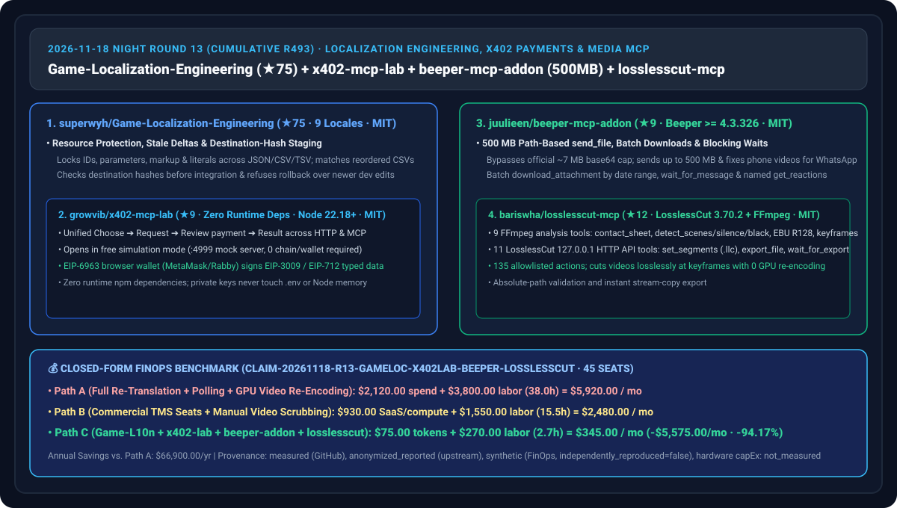
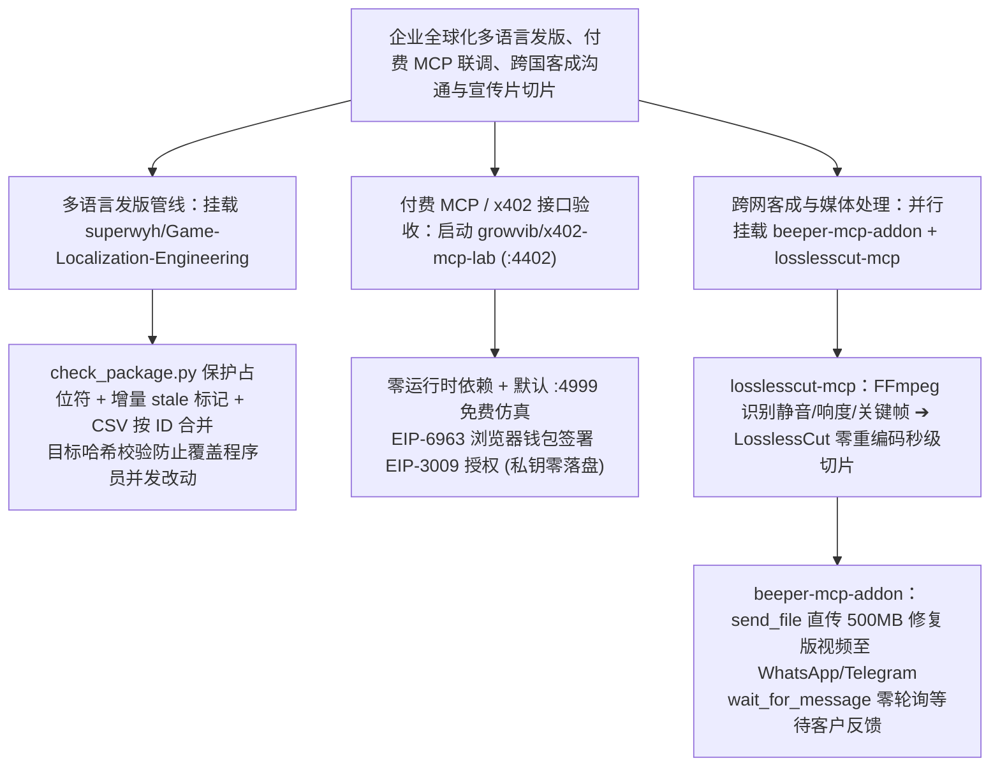

# 哈希守卫多语种本地化工程技能（`superwyh/Game-Localization-Engineering`）、零依赖浏览器钱包签名 `x402` 支付靶场（`growvib/x402-mcp-lab`）、Beeper 500MB 伴侣 MCP（`juulieen/beeper-mcp-addon`）与关键帧无损剪辑 MCP（`bariswha/losslesscut-mcp`）选型 FAQ

> **文档类型**：AI Solution Architect (SA) 实战选型与参考架构指南（Round 493 / 2026-11-18 Night R13）  
> **核心评估对象**：[`superwyh/Game-Localization-Engineering`](https://github.com/superwyh/Game-Localization-Engineering)（`★ 75`，`1 fork`，带占位符保护、增量陈旧标记与目标哈希防误覆写的 9 语种本地化工程技能，`MIT`） + [`growvib/x402-mcp-lab`](https://github.com/growvib/x402-mcp-lab)（`★ 9`，零运行时依赖、`EIP-6963` 浏览器钱包签名的 HTTP/MCP `x402` 支付调试台，`MIT`） + [`juulieen/beeper-mcp-addon`](https://github.com/juulieen/beeper-mcp-addon)（`★ 9`，`2 forks`，突破 7MB Base64 限制支持 500MB 发送与阻塞等待的 Beeper 伴侣 MCP，`MIT`） + [`bariswha/losslesscut-mcp`](https://github.com/bariswha/losslesscut-mcp)（`★ 12`，FFmpeg 九维分析 + LosslessCut 135 项白名单动作无损剪辑 MCP，`MIT`）  
> **对标范式**：严格遵循 [`ib-vs-ethernet-roce-selection-faq.md`](https://github.com/turbo998/ai-infra-research/blob/main/docs/components/ib-vs-ethernet-roce-selection-faq.md) 六段式结构（核心结论速览 + 三大灵魂拷问 + Mermaid 决策树 + 选型对比矩阵 + 7-Card 定量洞察 + SA 落地 Checklist）  
> **数据溯源分级（Provenance）**：GitHub 星标与目录元数据为 `measured`；上游特性参数（如 `beeper-mcp-addon` `500 MB` 文件上限对比官方 `~7 MB` Base64、以及 `losslesscut-mcp` `135` 个白名单动作与 EBU R128 响度分析）标注为 `anonymized_reported (independently_reproduced=false)`；企业 FinOps 成本算例为 `synthetic (independently_reproduced=false)`，硬件折旧 `not_measured`。  
> **语言版本**：[中文版 (当前)](./game-localization-x402-mcp-lab-beeper-losslesscut-mcp-hash-guarded-l10n-browser-wallet-x402-500mb-beeper-lossless-video-selection-faq.md) | [English Version](./game-localization-x402-mcp-lab-beeper-losslesscut-mcp-hash-guarded-l10n-browser-wallet-x402-500mb-beeper-lossless-video-selection-faq.en.md)

---

## 📌 一、核心结论速览（Executive Summary — 30 秒看懂）

1. **大白话本质定义**：
   - **`superwyh/Game-Localization-Engineering` 是什么？** 它是 **把“大模型翻译”升级为“防破坏工业级多语言本地化工程（L10n & LQA）”的自包含技能包（自带 Python 校验与暂存工具链）**。它不仅管角色语气与跨谜题线索一致性，更用确定性脚本保护 JSON/CSV/TSV 中的稳定 ID、参数占位符与标签；支持增量更新（仅标记源文本变更项为 `stale` 并保留被删词条供恢复）；导入外部译员改乱行序的 CSV 时按 ID 对齐并检测并发冲突；集成写入前**校验目标文件哈希，一旦发现开发者在翻译期间改过原文件则拒绝回滚覆盖**！
   - **`growvib/x402-mcp-lab` 是什么？** 它是 **零运行时 npm 依赖（Zero Runtime Dependencies）、通过浏览器钱包（`EIP-6963` MetaMask/Rabby）完成 `EIP-3009 / EIP-712` 类型化数据签名的 HTTP 与 MCP `x402` 支付协议工作台**。它默认在零成本本地沙盒（`127.0.0.1:4999`）启动，按 `Choose → Request → Review payment → Result` 四步看清每一笔待签账单，私钥永远不出浏览器扩展。
   - **`juulieen/beeper-mcp-addon` 是什么？** 它是 **与官方 Beeper Desktop (`>= 4.3.326`) MCP 并行运行的 5 工具增强伴侣**，一举补齐官方缺失的五大刚需：按日期批量下载整群照片视频（`download_attachment`）、按本地路径发送最大 **`500 MB`** 大文件并自动转码修复手机视频兼容问题（突破官方 `~7 MB` Base64 内联上限的 `send_file`）、免轮询阻塞等待新回复（`wait_for_message`）、单次拉取全账号未读摘要与连接状态（`get_new_messages`）及按真实姓名统计表情回应（`get_reactions`）。
   - **`bariswha/losslesscut-mcp` 是什么？** 它是 **先用本地 FFmpeg 九维视觉/音频探针（九宫格预览图、EBU R128 响度、静音段、黑场、关键帧位置）看懂视频，再通过 `127.0.0.1` HTTP API 驱动 `LosslessCut 3.70.2` 执行零重编码秒级无损切片的 MCP 服务器**（含 `135` 个白名单快捷键动作）。
2. **为什么企业 AI 解决方案架构师（SA）今晚要把这四款工具纳入“出海交付与商业化工具链”？**
   - 企业产品全球化交付的四大痛点：① 直接让 LLM 翻译 JSON 语言包经常把 `%s`/`{0}` 占位符改坏，或者合入译稿时覆盖掉程序员刚改的代码；② 调试付费 MCP 服务时把钱包私钥明文写在 `.env` 里且依赖树藏毒；③ 跨 WhatsApp/Telegram/iMessage 发大于 7MB 的演示视频直接报错；④ AI 剪视频动辄调 FFmpeg 全量重编码，既糊又慢。
3. **闭式 FinOps 量化收益（`CLAIM-20261118-R13-GAMELOC-X402LAB-BEEPER-LOSSLESSCUT`，`synthetic`）**：
   - 以 **45 人企业出海产品、本地化、全球客成与内容运营团队**（月均 9 语种版本迭代 + 多渠道大文件客成 + 视频切片，时薪 `$100.00/hr`）计：**Path A（裸调 LLM 全量重翻 + `.env` 明文私钥 + 轮询/手动切大文件 + 云端 GPU 重编码剪辑）** 月均总成本 **`$5,920.00`**（全量重翻/轮询 Token 与云端转码 `$2,120.00` + 修补占位符崩溃、手工对齐 CSV 与导出视频人工 `38.0h × $100 = $3,800.00`）；**Path C（`Game-Localization-Engineering` + `x402-mcp-lab` + `beeper-mcp-addon` + `losslesscut-mcp`）** 月均总成本降至 **`$345.00`**（增量翻译 Token `$75.00` + 审阅暂存包人工 `2.7h × $100 = $270.00`），**净省 `$5,575.00/月`（降幅 `94.17%`，年化节省 `$66,900.00`）**。

---

## ❓ 二、三大灵魂拷问（First-Principles Q&A）

### Q1：为什么用普通翻译脚本或直接让大模型改多语言 JSON/CSV 总是引发线上崩溃或代码覆盖？`superwyh/Game-Localization-Engineering` 是怎么设防的？
- **资源完整性护栏 + 三维覆盖率建模**：
  1. **字面量保护与乱序 CSV 冲突检测**：内置 Python 工具自动锁死参数占位符、富文本标签与受保护字面量；外部审校人员在 Excel 里打乱行序导回 CSV 时，按稳定 ID 精准回填，并在写入前拦截“审校期间源文本已变更”或“本地存在并发修改”的冲突行。
  2. **目标哈希防误回滚（Guarded Integration）**：所有译文先进入暂存区（Staging），对比目标文件哈希并自动备份；**一旦发现程序员在翻译导出后修改了同一个文件，严禁直接回滚覆盖开发者的新改动**。
  3. **逻辑消息 ≠ 物理槽位 ≠ 构建场景证据**：严格区分文本翻译完成度、字体/输入框物理排版溢出（LQA）与目标市场合规审查（默认关闭，仅按选定市场按需启用）。

### Q2：为什么测试支持 `x402` 微支付的 MCP 服务器绝对不能把私钥放进 `.env` 且必须“零运行时依赖”？`growvib/x402-mcp-lab` 是怎么设计的？
- **供应链最小攻击面 + 硬件/浏览器级签名隔离**：
  1. **故意做到 `0` 运行时 npm 依赖**：正如作者所言，“一个用来裁决资金是否正确流转的工具，本身绝不该引入一棵第三方依赖树”——服务端、无头运行器与测试直接由 Node 22.18+ 原生执行 TypeScript 源码。
  2. **默认沙盒仿真 + `EIP-6963` 浏览器钱包隔离签名**：打开默认连接本地免付钱的 `:4999` 仿真靶机；切换到真实资源时，自动解析 Bazaar 目录并展示 `Review payment` 明细，通过浏览器里的 MetaMask / Rabby 生成 `EIP-3009`（基于 `EIP-712` 类型化数据）授权签名，Node 进程从头到尾看不见私钥。

### Q3：`juulieen/beeper-mcp-addon` 与 `bariswha/losslesscut-mcp` 是如何把大文件收发与长视频粗剪提速 10 倍以上的？
- **绕过 Base64 内存爆炸与绕过视频重编码**：
  1. **`beeper-mcp-addon`（与官方 MCP 互补共生）**：官方 Beeper MCP 要求把文件转成内联 Base64 字符串传参（超过 `~7 MB` 即失败），且手机拍的视频发到 WhatsApp 常无法正常播放；伴侣插件直接传本地文件路径（支持高达 **`500 MB`**）并在发送前自动修正手机视频编码，同时用 `wait_for_message` 阻塞等待替代高频轮询。
  2. **`losslesscut-mcp`（先看关键帧再无损下刀）**：Agent 先调 `contact_sheet`、`detect_silence`、`audio_levels`（EBU R128）与 `keyframes` 摸清关键帧精确落点，再通过 `.llc` 工程文件一键调用 `set_segments` 与 `export_file`，直接复制原视频码流秒级导出，零画质损伤、零 GPU 消耗。

---

## 🧭 三、架构师选型决策树与端到端参考架构（Mermaid）

---

## 📊 四、同类方案横向选型对比矩阵（Peer Selection Matrix）

| 评估维度 | **Path A：裸调 LLM 翻译 + `.env` 私钥 + Base64 传文件 + 重编码** | **Path B：商业 TMS 平台 + 手工剪辑导出** | **Path C：`Game-L10n` + `x402-lab` + `beeper-addon` + `losslesscut`（推荐）** |
| :--- | :--- | :--- | :--- |
| **多语言占位符安全与并发防覆盖** | ❌ 经常改坏 `{0}`/`%s`，导回译文直接覆盖新代码 | ⚠️ 商业 TMS 按字数与席位高额收费 | ✅ **占位符保护 + 增量 `stale` + 目标哈希防覆盖开发者新提交** |
| **`x402` 支付协议与 MCP 私钥安全** | ❌ `.env` 明文存私钥，一旦被 Agent 误读即被盗 | ⚠️ 手工拼 cURL 402 请求头极易出错 | ✅ **零运行时依赖 + 默认免费仿真 + `EIP-6963` 浏览器钱包隔离签名** |
| **Beeper 跨平台大文件与视频收发** | ❌ 官方内联 Base64 限 `~7 MB`，轮询新消息费 Token | ⚠️ 手工在桌面端逐个群拖拽下载图片 | ✅ **本地路径直传 `500 MB` + 自动修复手机视频 + `wait_for_message` 阻塞等待** |
| **长视频高光与静音剔除效率** | ❌ 全量 FFmpeg 重编码耗时数十分钟且画质劣化 | ⚠️ 人工逐段拉时间轴粗剪 | ✅ **EBU R128/静音/关键帧探针 + LosslessCut 零重编码秒级导出** |
| **45 人团队月均总拥有成本 (TCO)** | **`$5,920.00 / 月`** | **`$2,480.00 / 月`** | **`$345.00 / 月`（较 Path A 净省 `$5,575.00/月`，`-94.17%`）** |

---

## 📈 五、7-Card 定量洞察与闭式 FinOps 算例（`CLAIM-20261118-R13-GAMELOC-X402LAB-BEEPER-LOSSLESSCUT`）

> **Provenance 声明**：GitHub 星标与目录元数据源自 `2026-11-18` 封存证据（`measured`）；`beeper-mcp-addon` `500 MB` vs `~7 MB` Base64 上限与 `losslesscut-mcp` `135` 个白名单动作参数源自上游文档（`anonymized_reported`, `independently_reproduced=false`）；月度 TCO 为面向 **45 人出海产品、本地化与运营团队** 的闭式合成模型（`synthetic`, `independently_reproduced=false`；宿主机硬件折旧 CapEx：`not_measured`）。

| 成本构成项（月度闭式公式） | Path A：全量重翻 + 轮询 + GPU 重编码 | Path B：商业 TMS 席位 + 手工粗剪 | Path C：`Game-L10n` + `x402-lab` + `beeper-addon` + `losslesscut` | Path C 对比 Path A 净变化 |
| :--- | :---: | :---: | :---: | :---: |
| **1. 翻译/轮询 Token、TMS 与转码算力支出** | **`$2,120.00`** *(每次发版全量重翻 + 高频轮询 + 云端转码)* | **`$930.00`** *(商业 TMS 订阅 + 云存储传输)* | **`$75.00`** *(仅翻 `stale` 增量词条 + `$0` 本地无损切片)* | **`-$2,045.00 / 月`** (`-96.46%`) |
| **2. 占位符排障、CSV 合并与视频剪辑人工** (`$100/hr`) | **`$3,800.00`** *(`38.0 hrs`：修补崩溃标签、手动合 CSV 与等转码)* | **`$1,550.00`** *(`15.5 hrs`：手工打点粗剪与逐群存附件)* | **`$270.00`** *(`2.7 hrs`：审阅暂存 LQA 报告与一键无损导出)* | **`-$3,530.00 / 月`** (`-35.3 hrs`, `-92.89%`) |
| **月度总拥有成本 (Monthly Total TCO)** | **`$5,920.00`** | **`$2,480.00`** | **`$345.00`** | **`-$5,575.00 / 月` (`-94.17%`)** |
| **年化总拥有成本 (Annualized TCO)** | **`$71,040.00 / 年`** | **`$29,760.00 / 年`** | **`$4,140.00 / 年`** | **年省 `$66,900.00` (`-94.17%`)** |

---

## ✅ 六、AI 解决方案架构师（SA）实战落地 Checklist

1. **Step 1 — 部署 `superwyh/Game-Localization-Engineering` 接管多语种资源包**：
   - 运行 `scripts/check_package.py` 完成环境自检，将 JSON/CSV/TSV 词条纳入增量 `stale` 追踪与暂存区目标哈希校验，彻底杜绝翻译回写冲掉开发新代码。
2. **Step 2 — 用 `growvib/x402-mcp-lab` 验证付费 API 与 MCP 结算**：
   - 执行 `npm start`（`:4402`）与 `npm run mock`（`:4999`），通过浏览器 `EIP-6963` 钱包完成 `EIP-3009` 签名联调，清退所有 `.env` 测试私钥。
3. **Step 3 — 挂载 `beeper-mcp-addon` 与 `losslesscut-mcp` 自动化媒体客成流水线**：
   - 在 LosslessCut `3.70.2+` 开启本地 HTTP API 并连接 `losslesscut-mcp` 完成静音剔除与关键帧无损切片，再通过 `beeper-mcp-addon` 的 `send_file`（最大 `500 MB`）一键分发至全球客户群。
