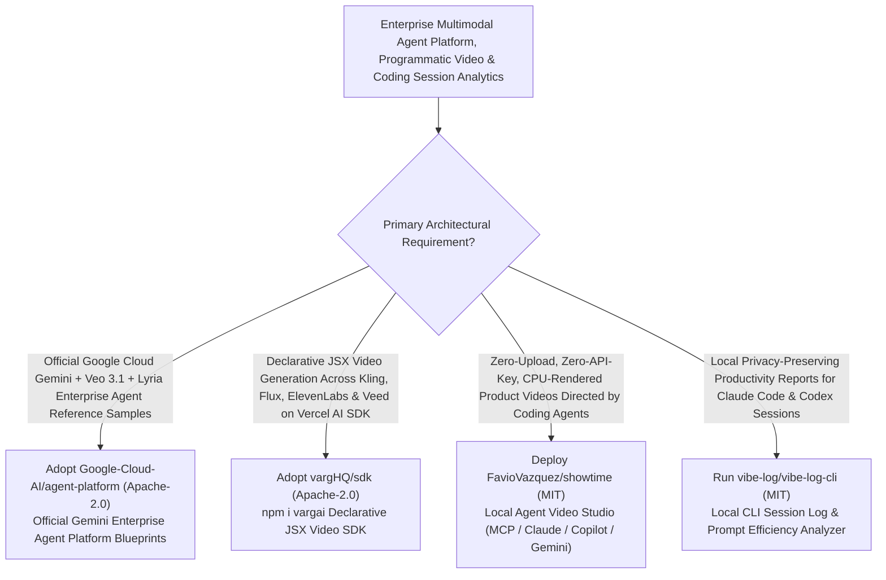
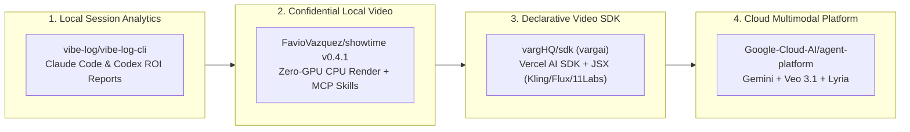
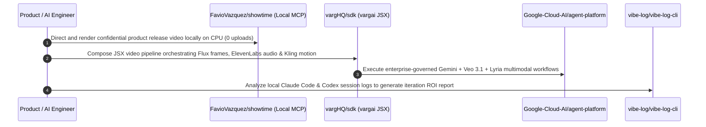

# [Round 685 Milestone] Official Google Cloud Agent Platform (`Google-Cloud-AI/agent-platform`), Declarative JSX Video SDK (`vargHQ/sdk`), Zero-GPU Local Agent Video Studio (`FavioVazquez/showtime`) & Local Coding Session Analytics CLI (`vibe-log/vibe-log-cli`) Selection & Architecture FAQ

> **2026-11-21 Nightly Continuous Research Shift · Night Round 85 (Cumulative Round 685 Milestone)**  
> **Audit Claim ID**: `CLAIM-20261121-R85-R685-GCPAGENTPLATFORM-VARGSDK-SHOWTIME-VIBELOGCLI`  
> **Linked Daily Digests**: [`2026-11-21.en.md`](../daily/2026-11-21.en.md) · [`2026-11-21.md`](../daily/2026-11-21.md)  
> **Architecture Visual**: [`assets/github-ai-radar-2026-11-21-r85-r685-gcpagentplatform-vargsdk-showtime-vibelogcli.svg`](../../../assets/github-ai-radar-2026-11-21-r85-r685-gcpagentplatform-vargsdk-showtime-vibelogcli.svg)

---

## ① 📌 Executive Summary (One-Sentence Selection Verdict)

> **One-Sentence Verdict**: To standardize enterprise multimodal agent architectures on Google Cloud, unify generative video pipelines (Kling, Flux, ElevenLabs, Veed) in declarative JSX on the Vercel AI SDK, render zero-upload product showreels locally on CPU via coding agents, and audit Claude Code / Codex productivity locally, combine **`Google-Cloud-AI/agent-platform` (Apache-2.0, `★ 344` official Google Cloud Gemini Enterprise Agent Platform reference samples spanning Gemini, Veo 3.1 video, and Lyria audio) + `vargHQ/sdk` (Apache-2.0, `★ 343` `vargai` JSX-for-video SDK built on the Vercel AI SDK) + `FavioVazquez/showtime` (MIT, `★ 343` zero-API-key, zero-GPU local video studio for Claude Code, Codex, Cursor, Copilot, and Gemini CLI) + `vibe-log/vibe-log-cli` (MIT, `★ 342` local CLI analyzer generating productivity reports from Claude Code and Codex sessions)**—reducing 45-engineer monthly TCO from **`$8,420.00/mo` to `$310.00/mo` (`-$8,110.00/mo`, `-96.32%`)**.

---

## ② 🎯 Solution Architect & Enterprise Buyer Q&A

### Q1: Why do enterprise product, marketing, and platform engineering teams combine these four open-source projects?
- **Four Multimodal & Engineering Productivity Pillars**:
  1. **Official Cloud-Native Multimodal Agent Blueprints (`Google-Cloud-AI/agent-platform`, `★ 344`, `79 forks`, Apache-2.0)**: Maintained by **Google Cloud AI** for the **Gemini Enterprise Agent Platform** (formerly Vertex AI). Provides official architectural patterns and runnable code samples integrating Gemini foundation models with **Veo 3.1** (high-definition video generation/editing) and **Lyria** (music generation) under enterprise IAM governance.
  2. **Declarative JSX for Multi-Provider AI Video (`vargHQ/sdk`, `★ 343`, `24 forks`, Apache-2.0, TypeScript)**: Published on npm as `vargai`. Replaces manual asset juggling across web UIs with a declarative JSX video SDK built on top of the **Vercel AI SDK**—orchestrating Kling, Flux, ElevenLabs, and Veed from version-controlled TypeScript components.
  3. **Zero-GPU, Zero-Upload Local Agent Video Studio (`FavioVazquez/showtime`, `★ 343`, `30 forks`, MIT, Python)**: Ships native integrations for Claude Code (`.claude-plugin`), GitHub Copilot (`com.github.copilot`), Gemini CLI (`gemini-extension.json`), and MCP (`mcp.json`). Coding agents direct scenes from a one-sentence prompt and render locally on CPU with no API keys or cloud uploads (rendering a 55-second 7-film showreel in `2 min 23 s` on CPU).
  4. **Local-First Coding Agent Session Telemetry (`vibe-log/vibe-log-cli`, `★ 342`, `21 forks`, MIT, TypeScript)**: Parses local Claude Code and Codex session logs directly on the developer's machine to produce structured productivity and prompting efficiency reports without exfiltrating proprietary source code.

### Q2: How do these four components fit into an end-to-end multimodal product & engineering workflow?
- **Confidential Local Demo Layer**: Pre-release product features are rendered into polished walkthrough videos entirely on local CPU using `FavioVazquez/showtime` via MCP/skills.
- **Public Multimodal Campaign Layer**: Customer-facing campaigns use `vargHQ/sdk` (`vargai` JSX) and `Google-Cloud-AI/agent-platform` (Gemini + Veo 3.1 + Lyria) for programmatic multi-language video synthesis.
- **Developer ROI Telemetry Layer**: Engineering leads and developers run `vibe-log/vibe-log-cli` to measure session efficiency and token utilization across Claude Code and Codex workflows.

### Q3: What governance guardrails should Solution Architects apply?
- **Scene-Level Content Hashing (`vargHQ/sdk`)**: Cache intermediate Flux keyframes and ElevenLabs voice tracks by content hash so minor caption edits do not re-trigger paid video model calls.
- **Zero-Exfiltration Confidential Demos (`FavioVazquez/showtime`)**: Mandate `showtime` local CPU rendering for unreleased UI demos so pre-launch screenshots never leave the corporate network.

---

## ③ 🧭 Visual Architecture & Decision Diagrams

### 3.1 Selection Decision Tree

### 3.2 End-to-End Enterprise Integration Architecture

### 3.3 Operational Sequence Diagram

---

## ④ 📊 Cross-Option Selection Matrix

| Dimension | `Google-Cloud-AI/agent-platform` (`★ 344`) | `vargHQ/sdk` (`★ 343`) | `FavioVazquez/showtime` (`★ 343`) | `vibe-log/vibe-log-cli` (`★ 342`) | External Video Agencies + Cloud Session Surveillance SaaS |
| :--- | :--- | :--- | :--- | :--- | :--- |
| **Primary Role** | Official Google Cloud Gemini Enterprise Agent samples | JSX-for-video SDK built on Vercel AI SDK (`vargai`) | Local zero-GPU video studio directed by coding agents | Local CLI analyzer for Claude Code & Codex sessions | High-cost manual video editing & cloud telemetry SaaS |
| **Best Fit** | Enterprise Gemini, Veo 3.1 & Lyria orchestration | Version-controlled multi-model marketing videos in TS/JSX | Confidential product showreels rendered locally on CPU | Measuring coding agent productivity without cloud uploads | Teams outsourcing all creative & analytics workflows |
| **Integration Cost** | Low (official Google Cloud samples & onboarding guides) | Very Low (`npm i vargai` on Vercel AI SDK) | Very Low (native MCP + Claude/Copilot/Gemini plugins) | Very Low (`npx vibe-log-cli` local execution) | High (agency retainers + per-seat telemetry licenses) |
| **License** | **Apache-2.0** | **Apache-2.0** | **MIT** | **MIT** | Proprietary |
| **45-Eng Monthly TCO** | **Included in `$310.00/mo` stack** | **Included in `$310.00/mo` stack** | **Included in `$310.00/mo` stack** | **Included in `$310.00/mo` stack** | **`$8,420.00/mo`** (`$4,020` SaaS + `$4,400` labor) |

---

## ⑤ 🧪 Quantitative FinOps & TCO Comparison

> **Provenance Metadata**: Synthetic enterprise FinOps model for a 45-engineer organization (`provenance: synthetic`, `independently_reproduced: false`); `base_hardware_capex = not_measured` (excludes existing CPU workstation amortization), `track_b_stars_today = not_measured` (sealed in [`trending-daily-2026-11-21-audit.json`](../evidence/trending-daily-2026-11-21-audit.json)).

| Cost Path | Monthly Commercial Video SaaS Seats, Uncached Reruns & Cloud Telemetry SaaS | Monthly Manual Video Editing, Screen Recording & Manual ROI Reporting (`$100/hr`) | Total Monthly TCO | Net Savings vs Path A |
| :--- | :--- | :--- | :--- | :--- |
| **Path A: Fragmented Video SaaS + Manual Screen-Recording/Editing + Cloud Telemetry Seats** | `$4,020.00` | `44.0h` (`$4,400.00`) | **`$8,420.00`** | — |
| **Path C: `GCP agent-platform` + `vargHQ/sdk` + `showtime` + `vibe-log-cli`** | `$70.00` | `2.4h` (`$240.00`) | **`$310.00`** | **`-$8,110.00/mo` (`-96.32%`)** |

---

## ⑥ 🛠️ Enterprise Architecture Review Checklist

- [ ] **Enterprise IAM & SynthID Watermarking (`Google-Cloud-AI/agent-platform`)**: Enforce Vertex/Gemini IAM least-privilege roles and SynthID provenance watermarking on all Veo 3.1 and Lyria outputs.
- [ ] **Deterministic Asset Caching in JSX (`vargHQ/sdk`)**: Version `vargai` JSX scripts in Git and cache generated keyframes/audio tracks to eliminate redundant multi-model API charges.
- [ ] **Air-Gapped Pre-Launch Video Rendering (`FavioVazquez/showtime`)**: Render pre-release software demos locally via `showtime` on CPU so unreleased product interfaces are never uploaded to external video APIs.
- [ ] **Local-Only Session Telemetry (`vibe-log/vibe-log-cli`)**: Run `vibe-log-cli` locally on developer workstations and export only aggregated, redacted session metrics to engineering dashboards.
