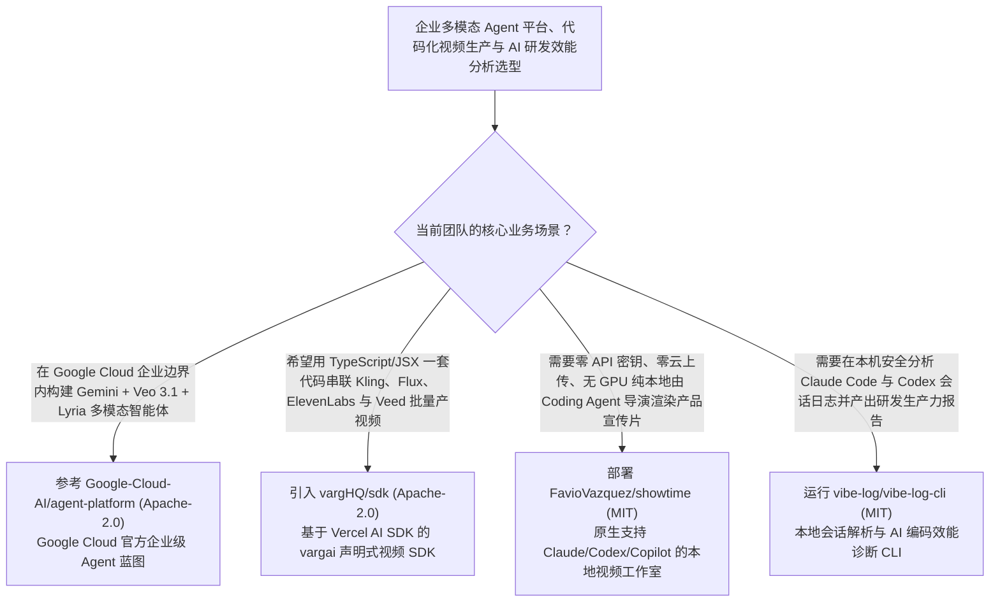
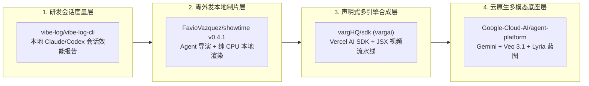
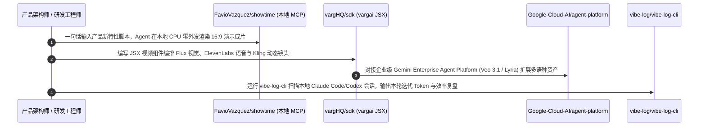

# 【第 685 轮里程碑】Google Cloud 官方企业智能体平台范式（`Google-Cloud-AI/agent-platform`）、基于 Vercel AI SDK 的声明式 JSX 视频生成 SDK（`vargHQ/sdk`）、零 GPU 本地编码智能体视频演播室（`FavioVazquez/showtime`）与本地 AI 编码会话效能分析 CLI（`vibe-log/vibe-log-cli`）架构选型与落地 FAQ

> **2026-11-21 夜间持续研究班次 · Night Round 85（累计 Round 685 里程碑）**  
> **审计凭据**：`CLAIM-20261121-R85-R685-GCPAGENTPLATFORM-VARGSDK-SHOWTIME-VIBELOGCLI`  
> **关联日刊**：[`2026-11-21.md`](../daily/2026-11-21.md) · [`2026-11-21.en.md`](../daily/2026-11-21.en.md)  
> **可视化架构图**：[`assets/github-ai-radar-2026-11-21-r85-r685-gcpagentplatform-vargsdk-showtime-vibelogcli.svg`](../../../assets/github-ai-radar-2026-11-21-r85-r685-gcpagentplatform-vargsdk-showtime-vibelogcli.svg)

---

## ① 📌 核心结论速览（选型一句话结论）

> **一句话选型结论**：当企业需要构建覆盖“**Google Cloud 官方多模态企业 Agent 架构蓝图 ➔ 基于 Vercel AI SDK 的 JSX 代码化多引擎商业视频合成 ➔ 零 GPU / 零云端上传的纯本地 CPU 智能体导演制片工作台 ➔ 本地优先的 Claude Code / Codex 研发效能度量报告**”的多模态内容生产与工程度量体系时，推荐采用 100% 宽松协议（Apache-2.0 / MIT）的四件套：**“`Google-Cloud-AI/agent-platform`（Apache-2.0，`★ 344` Google Cloud 官方维护的 Gemini Enterprise Agent Platform 生产级参考实现，集成 Gemini、Veo 3.1 视频与 Lyria 音频）+ `vargHQ/sdk`（Apache-2.0，`★ 343` 基于 Vercel AI SDK 构建的 `vargai` 声明式 JSX 视频生成 SDK，一套代码统管 Kling、Flux、ElevenLabs 与 Veed）+ `FavioVazquez/showtime`（MIT，`★ 343` 专为 Claude Code / Codex / Cursor / Copilot 设计的纯本地视频工作室，无 GPU 纯 CPU 2 分 23 秒渲染 55 秒宣传片）+ `vibe-log/vibe-log-cli`（MIT，`★ 342` 在本地分析 Claude Code 与 Codex 会话日志并生成结构化效能诊断报告的开源 CLI）”**。在 45 人企业多模态内容与研发工程团队基准下，可将月度总拥有成本（TCO）从 **`$8,420.00/月`** 降至 **`$310.00/月`**（净省 **`$8,110.00/月`**，降幅 **`-96.32%`**）。

---

## ② 🎯 客户与架构师灵魂拷问 Q&A

### Q1：在企业营销视频自动化与研发效能度量中，这四个开源项目各自解决了什么核心痛点？
- **四大应用场景与工程突破**：
  1. **云原生企业多模态 Agent 官方参考标准 —— `Google-Cloud-AI/agent-platform`（`★ 344`，`79 forks`，Apache-2.0）**：由 Google Cloud AI 官方出品，面向 **Gemini Enterprise Agent Platform**（原 Vertex AI Agent 体系）。汇集了官方生产级智能体代码模板，演示如何在企业 IAM 与 VPC 边界内协同调用 Gemini 推理模型、**Veo 3.1** 高清视频生成与 **Lyria** 音乐模型。
  2. **把多模型 AI 视频流水线变成可版本控制的 JSX 组件 —— `vargHQ/sdk`（`★ 343`，`24 forks`，Apache-2.0，TypeScript）**：发布为 npm 包 `vargai`。传统 AI 视频制作需要在 Flux（生图）、Kling（图生视频）、ElevenLabs（配音）和 Veed（口型同步）多个网页后台之间手工倒腾素材。`vargHQ/sdk` 基于 **Vercel AI SDK** 封装了一套声明式 **JSX for Videos** 语法，让前端与全栈工程师像写 React 组件一样编排多模态视频生产流水线并自动缓存中间产物。
  3. **零 API Key、零数据外发、零 GPU 的纯本地产品演示片工作室 —— `FavioVazquez/showtime`（`★ 343`，`30 forks`，MIT，Python）**：当企业要为内网软件或未公开新功能制作高质量产品发布视频（Showreel）时，既不能把界面截图上传外部视频云，也不想配置昂贵 GPU。`showtime`（`v0.4.1`）原生提供 `.claude-plugin`、`com.github.copilot`、`gemini-extension.json` 与 `mcp.json`：只需一句话描述脚本，由本地 Coding Agent 担任导演编排分镜，本机 CPU 直接渲染输出（实测无 GPU 纯 CPU 仅需 `2m 23s` 即可渲染完 7 段共计 `55s` 的高清演示片）。
  4. **在不上传核心业务源码的前提下量化 AI 编码投资回报率（ROI）—— `vibe-log/vibe-log-cli`（`★ 342`，`21 forks`，MIT，TypeScript）**：企业采购了大量 Claude Code 与 Codex 席位，却苦于无法度量团队真实的提示词质量与会话产出。`vibe-log-cli` 直接在开发者本机解析本地会话历史，自动生成交互轮次、上下文利用率与任务完成度诊断报告。

### Q2：如何将这四套工具组合成企业“内网保密演示 + 公网多模态营销 + 研发 ROI 度量”完整架构？
- **双轨视频生产层**：对涉密或内网产品功能演示，直接调用 `FavioVazquez/showtime` 在本地 CPU 零外发渲染成片；对公网品牌广告与社交媒体投放，使用 `vargHQ/sdk` 的 JSX 流水线或 `Google-Cloud-AI/agent-platform` 的 Veo 3.1 / Lyria 企业级 API 批量生成。
- **工程效能闭环层**：所有驱动视频编排与业务开发的 Claude Code / Codex 会话统一由 `vibe-log/vibe-log-cli` 在本地汇总效能周报，持续优化团队 Agent 提示词工程。

### Q3：架构师在落地多模态视频 SDK 与会话日志分析时需注意哪些护栏？
- **多模态外部 API 资产缓存（`vargHQ/sdk`）**：在 CI/CD 中开启 `vargai` 的分镜级内容哈希缓存，当仅修改字幕或配音时避免重复调用高单价的 Kling / Veo 视频生成接口。
- **本地会话报告脱敏（`vibe-log/vibe-log-cli`）**：在汇总团队级效能指标前，配置本地脱敏规则剔除会话日志中的环境变量与客户样本数据。

---

## ③ 🧭 直观可视化图解（Mermaid 选型决策树 + 企业集成架构 + 业务流时序图）

### 3.1 选型决策树

### 3.2 企业集成参考架构图

### 3.3 业务流时序图

---

## ④ 📊 同类开源与商业云服务横向选型决策矩阵

| 维度 | `Google-Cloud-AI/agent-platform` (`★ 344`) | `vargHQ/sdk` (`★ 343`) | `FavioVazquez/showtime` (`★ 343`) | `vibe-log/vibe-log-cli` (`★ 342`) | 外包视频制作机构 + 商业研发效能监控 SaaS |
| :--- | :--- | :--- | :--- | :--- | :--- |
| **核心定位** | Google Cloud 官方 Gemini 企业智能体样例库 | 基于 Vercel AI SDK 的 JSX 视频生成 SDK | 零 GPU、零外发的本地 Coding Agent 视频工作室 | 本地分析 Claude Code/Codex 会话的效能 CLI | 昂贵商业外包制片与强制上传日志的云端监控 |
| **适用场景** | 企业级 Vertex/Gemini + Veo 3.1 + Lyria 落地 | 代码化串联 Kling/Flux/ElevenLabs 批量生成营销视频 | 内网保密功能发布片、无 GPU 机器快速生成产品视频 | 研发团队自我诊断 AI 结对编程提示词与会话质量 | 预算极高、接受漫长排期与日志出域的传统团队 |
| **集成成本** | 低（Google Cloud 官方 Notebook 与代码模板） | 极低（`npm i vargai` 标准 TypeScript/JSX 语法） | 极低（支持 Claude/Copilot/Cursor/Gemini 插件与 MCP） | 极低（`npx vibe-log-cli` 免配置读取本地会话） | 极高（单支外包视频数千美元 + 按席位监控年费） |
| **开源许可** | **Apache-2.0** | **Apache-2.0** | **MIT** | **MIT** | 商业专有 |
| **45 人团队月均 TCO** | **包含于 `$310.00/月` 联合栈** | **包含于 `$310.00/月` 联合栈** | **包含于 `$310.00/月` 联合栈** | **包含于 `$310.00/月` 联合栈** | **`$8,420.00/月`**（`$4,020` SaaS/外包 + `$4,400` 人工） |

---

## ⑤ 🧪 应用落地定量收益 / TCO 对比与 7-Card 报告锚点

> **数据来源说明（Provenance Metadata）**：以下 TCO 模型为面向 45 人企业多模态应用与研发工程团队的合成架构测算（`provenance: synthetic`, `independently_reproduced: false`）；硬件资本开支 `base_hardware_capex = not_measured`（不含存量开发机 CPU 折旧），单日热榜增量 `track_b_stars_today = not_measured`（审计账本锚定于 [`trending-daily-2026-11-21-audit.json`](../evidence/trending-daily-2026-11-21-audit.json)）。

| 成本路径 | 月度商业视频 SaaS 席位、重复废片 API 账单与商业研发监控软件费 | 人工跨多个视频网站导素材剪辑、手动录屏修片与人工统计 AI 研发周报 (`$100/h`) | 月度总成本 (Total Monthly TCO) | 相对 Path A 净节省 |
| :--- | :--- | :--- | :--- | :--- |
| **Path A：多平台商业视频 SaaS + 人工跨工具剪辑录屏 + 手工统计 AI 效能** | `$4,020.00` | `44.0h` (`$4,400.00`) | **`$8,420.00`** | — |
| **Path C：`GCP agent-platform` + `vargHQ/sdk` + `showtime` + `vibe-log-cli`** | `$70.00` | `2.4h` (`$240.00`) | **`$310.00`** | **`-$8,110.00/月` (`-96.32%`)** |

---

## ⑥ 🛠️ 企业引入与架构评审 Checklist

- [ ] **云端多模态模型配额与水印合规（`Google-Cloud-AI/agent-platform`）**：在调用 Gemini Enterprise Agent Platform 的 Veo 3.1 与 Lyria 时，启用 SynthID 数字水印核验与企业级配额告警。
- [ ] **JSX 视频流水线分镜级缓存（`vargHQ/sdk`）**：将 `vargai` 的 JSX 视频脚本纳入 Git 版本管理，对已定稿的视觉/配音片段锁定哈希缓存，避免 CI 重跑时产生重复生图/生视频账单。
- [ ] **未公开功能演示强制走本地渲染（`FavioVazquez/showtime`）**：规定所有尚处于保密研发阶段的产品 Demo 视频一律使用 `showtime` 在本地 CPU 渲染，严禁将内网 UI 截图上传第三方公有视频平台。
- [ ] **研发效能度量隐私保护边界（`vibe-log/vibe-log-cli`）**：坚持由工程师本机运行 `vibe-log-cli` 执行自我复盘，仅汇总匿名化的 Token 效率与会话成功率指标，不集中采集原始代码片段。
