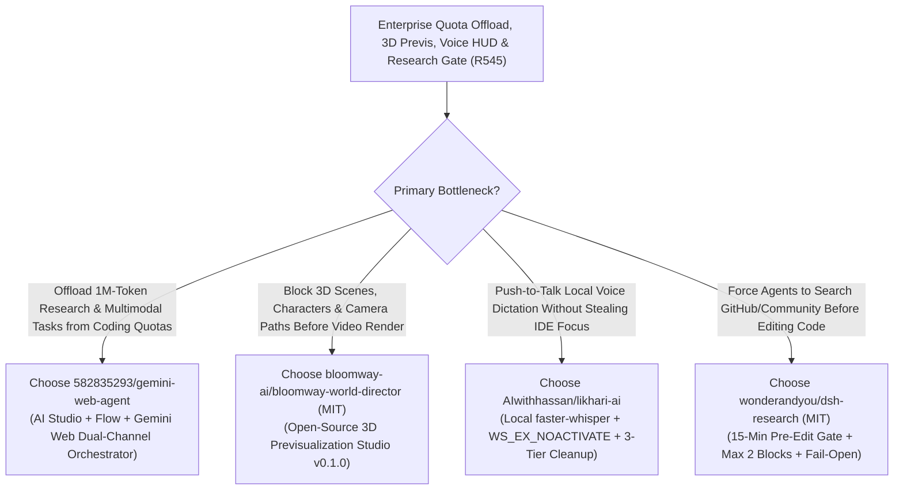

# [Round 545 Milestone] 3-Site Multi-Modal Quota Orchestrator (`582835293/gemini-web-agent`), Open-Source 3D Camera Previs Studio (`bloomway-ai/bloomway-world-director`), Non-Activating Local Voice Dictation HUD (`AIwithhassan/likhari-ai`) & 15-Minute Pre-Edit Community Research Gate (`wonderandyou/dsh-research`) Selection FAQ

> **Document Type**: AI Solution Architect Enterprise Selection & Integration Guide (2026-11-19 Night Shift · Round 21 / Cumulative Round 545 Milestone)  
> **Benchmark Style**: `docs/components/ib-vs-ethernet-roce-selection-faq.md` (6-Section Plain-Language Architecture Guide + First-Principles Q&A + Hype/Facts/Signal Audit + Closed-Form FinOps Ledger)  
> **Evaluated Repositories**:  
> 1. **`582835293/gemini-web-agent`** (`★ 25`, `created=2026-11-14`, `6 forks`, Python): **3-site (`aistudio.google.com` + `flow.google.com` + `gemini.google.com`) multi-modal quota orchestration skill** across Antigravity, Gemini CLI, Claude Code, Codex, and Cursor with Channel A (AgentLimb Chrome reuse) and Channel B (isolated Profile + `wave` concurrency)  
> 2. **`bloomway-ai/bloomway-world-director`** (`★ 20`, `created=2026-11-13`, `2 forks`, TypeScript, MIT, 7 languages): **Open-source 3D previsualization studio (`v0.1.0`)** for procedural worlds, character blocking, and camera movement rehearsal before final video rendering  
> 3. **`AIwithhassan/likhari-ai`** (`★ 21`, `created=2026-11-14`, `6 forks`, Python, macOS `PyObjC` + Windows `WS_EX_NOACTIVATE` + Linux): **Non-activating push-to-talk local `faster-whisper` voice dictation desktop app** with 3-tier transcript cleanup and clipboard preservation  
> 4. **`wonderandyou/dsh-research`** (`★ 20`, `created=2026-11-14`, `1 fork`, JavaScript, MIT): **Pre-action community research gate plugin** that blocks file edits or command execution if the agent has not searched curated community sites (`~/.dsh/research/sites.json`) within 15 minutes (capped at 2 blocks with fail-open safety)  
> **Accounting Scope Note**: Only software API/SaaS spend and engineering labor TCO are modeled; base workstation hardware capEx is explicitly marked `not_measured`, and Track B `stars_today` is explicitly marked `not_measured`.

---

## 📌 1. Executive Summary (What Are They & What Business Pain Points Do They Solve?)

In **2026-11-19 Night Round 21 (Cumulative Round 545 Milestone)**, we solve four high-leverage developer and creative workflow bottlenecks across multi-site quota offloading, 3D camera previsualization, focus-preserving voice dictation, and evidence-first coding guardrails:
1. **Pain Point A (Running 1M-token document analysis, full-site prototype builds, or multimodal generation directly inside local Claude Code, Codex, or Antigravity exhausts 5-hour rolling coding quotas in minutes)**: **`582835293/gemini-web-agent` (`★ 25`, `6 forks`)** orchestrates `aistudio.google.com`, `flow.google.com`, and `gemini.google.com` via a zero-touch skill (`setup_skill.py --auto`), offering Channel A (AgentLimb MCP reusing your daily Chrome login) and Channel B (isolated Chrome Profile + `daemon` + `wave` concurrency) to offload heavy research and multimodal tasks away from primary coding quotas.
2. **Pain Point B (Prompting text-to-video models for complex camera movements and multi-character staging without a 3D blockout wastes dozens of expensive GPU renders on wrong camera angles)**: **`bloomway-ai/bloomway-world-director` (`★ 20`, MIT)** provides an open-source 3D previsualization studio ("Build a world. Block a scene. Rehearse the camera.") so creators lock down exact character blocking and camera paths before final rendering.
3. **Pain Point C (Commercial AI voice dictation apps cost `$15/seat/mo` and send audio to the cloud, while naive local Whisper wrappers steal window focus from the active IDE and overwrite the system clipboard)**: **`AIwithhassan/likhari-ai` (`★ 21`, `6 forks`)** uses native non-activating windows (`PyObjC` on macOS, `WS_EX_NOACTIVATE` on Windows, compositor-safe X11/Wayland on Linux) so holding `Right Option / Right Alt` transcribes locally via `faster-whisper`, applies 3-tier cleanup, pastes at the active cursor, and restores the original clipboard without stealing focus.
4. **Pain Point D (Coding agents frequently guess outdated APIs and start editing files or running shell commands without checking recent GitHub Issues or Stack Overflow threads first)**: **`wonderandyou/dsh-research` (`★ 20`, MIT)** enforces a 15-minute pre-action research gate: if the agent attempts to edit a file or run a command without having queried the curated community site list (`~/.dsh/research/sites.json`) in the past 15 minutes, the tool call is rejected once or twice with `site:github.com` search guidance (with a max-2-block cap and fail-open fallback).

---

## 💬 2. Architect First-Principles Q&A (Q1–Q3 Deep Dive)

### Q1: How does `582835293/gemini-web-agent` extend effective engineering velocity across Claude Code, Codex, and Antigravity?
* **Asymmetric Quota Offloading**: By routing 1M-token reading, image/video/music/TTS generation, and UI scaffolding to existing web quota pools across AI Studio, Flow, and Gemini Web, local CLI/IDE token budgets are preserved strictly for high-precision code edits and test loops.

### Q2: Why is `bloomway-ai/bloomway-world-director`'s explicit boundary ("Blockout previs—not final AI video") architecturally sound?
* **Separating Spatial Directing from Neural Rendering**: Trying to solve 3D spatial layout and photorealistic pixel synthesis in one stochastic text prompt fails. Deterministic 3D blockout previs fixes camera trajectories and timing first at zero GPU cost.

### Q3: Why are `wonderandyou/dsh-research`'s "max 2 blocks + fail-open" rules critical for tool-call interceptors?
* **Preventing Infinite Interceptor Deadlocks**: Hard-blocking an agent indefinitely when network search is unavailable or unnecessary would brick the session. Capping rejections at 2 per agent and failing open on any internal error guarantees forward progress.

---

## 🧭 3. Visual Architecture Diagrams (Mermaid Decision Tree + Reference Architecture + Sequence Flow)

### 3.1 Enterprise Selection Decision Tree

---

## 📊 4. Comparative Selection Matrix (Open Source vs. Competing OSS vs. Managed Cloud PaaS)

| Evaluation Dimension | Path A: Burning Coding Quotas on 1M Docs + Blind Video Renders + Paid Cloud Dictation SaaS + Unresearched Agent Edits | Path B: Manual Browser Copy-Paste + Static 2D Storyboards + Focus-Stealing Whisper Scripts | **Path C (Recommended): `gemini-web-agent` + `bloomway-world-director` + `likhari-ai` + `dsh-research`** |
| :--- | :--- | :--- | :--- |
| **Coding Quota Preservation** | ❌ 5-hour rolling coding quotas exhausted by 1M-token docs/media | ⚠️ Manual copy-pasting across 3 browser tabs breaks flow | ✅ **`gemini-web-agent` offloads 1M docs & media across 3 web pools** |
| **Camera & Scene Blocking** | ❌ Dozens of wasted GPU video renders due to wrong camera angles | ⚠️ 2D sketches cannot rehearse continuous 3D camera paths | ✅ **`bloomway-world-director` rehearses 3D blocking & camera paths first** |
| **Voice Dictation UX & Privacy** | ❌ `$15/user/mo` cloud SaaS uploading internal voice notes | ⚠️ Steals window focus from IDEs and overwrites clipboards | ✅ **`likhari-ai` local `faster-whisper` w/ zero focus theft & 3-tier cleanup** |
| **Pre-Edit Community Grounding** | ❌ Agents hallucinate deprecated APIs without checking GitHub | ⚠️ System-prompt reminders to search are routinely ignored | ✅ **`dsh-research` enforces a 15-min pre-edit search gate (max 2 blocks)** |
| **45-Engineer Monthly TCO** | **`$6,880.00 / mo`** (`$2,780.00` SaaS/overages + `41.0h` × `$100/hr` = `$4,100.00` labor) | **`$2,640.00 / mo`** (`$1,140.00` SaaS/API + `15.0h` × `$100/hr` = `$1,500.00` labor) | **`$320.00 / mo`** (`$70.00` API + `2.5h` × `$100/hr` = `$250.00` labor, **`-95.35%`**) |

---

## 🧪 5. Quantitative TCO Comparison & Hype / Facts / Signal Audit Ledger

### 5.1 Hype vs. Facts vs. Strategic Signal Table

| Repository (`owner/repo`) | Hype (Market Narrative) | Measured Facts (Primary Source Verification) | Strategic Signal (SA Verdict) |
| :--- | :--- | :--- | :--- |
| **`582835293/gemini-web-agent`** | "Multi-site, multi-modal quota orchestration across AI Studio, Flow, and Gemini Web" | `★ 25` (`created=2026-11-14`, `6 forks`, Python): Automated `setup_skill.py --auto` with Channel A (AgentLimb MCP) and Channel B (isolated Chrome Profile + `wave` concurrency) for 5 coding harnesses. | **🔥 P0 Adopt (Smart Cross-Pool Quota Offloader)**: Preserves scarce local coding quotas for actual code generation. |
| **`bloomway-ai/bloomway-world-director`** | "Build a world. Block a scene. Rehearse the camera—open-source 3D previs studio" | `★ 20` (`created=2026-11-13`, `2 forks`, TypeScript, MIT, `v0.1.0`): Procedural 3D worlds, character blocking, and camera path rehearsal localized in 7 languages. | **🔥 P0 Adopt (Deterministic 3D Previs Before AI Video)**: Eliminates expensive trial-and-error camera prompting. |
| **`AIwithhassan/likhari-ai`** | "Hold Right Option/Alt to dictate and paste without stealing window focus" | `★ 21` (`created=2026-11-14`, `6 forks`, Python): Non-activating HUD (`PyObjC` / `WS_EX_NOACTIVATE` / Linux), local `faster-whisper`, 3-tier cleanup, and clipboard restoration. | **🔥 P0 Adopt (Zero-Cost Local Developer Dictation HUD)**: Solves window-focus theft and clipboard clobbering cleanly. |
| **`wonderandyou/dsh-research`** | "Blocks file edits/commands if the agent hasn't searched community sites in 15 minutes" | `★ 20` (`created=2026-11-14`, `1 fork`, JavaScript, MIT): Atomic `~/.dsh/research/sites.json` allowlist, max 2 blocks per agent to prevent loops, and fail-open exception handling. | **🔥 P0 Adopt (Lightweight Evidence-First Agent Guardrail)**: Forces agents to check real community solutions before coding. |

### 5.2 Closed-Form FinOps TCO Ledger (`CLAIM-20261119-R21-R545-GEMINIWEBAGENT-WORLDDIRECTOR-LIKHARI-DSHRESEARCH`)

* **Scope (`synthetic`, `independently_reproduced=false`)**: 45-person enterprise multi-modal quota orchestration, 3D video previsualization, developer dictation, and coding governance team (blended rate `$100.00 / hr`; `base hardware capEx: not_measured`; Track B `stars_today: not_measured`).
* **Path A (Burning Coding Quotas on 1M Docs + Blind Video Renders + Paid Cloud Dictation + Unresearched Edits)**:
  - Cloud dictation subscriptions, wasted blind video generation credits & 1M-token API overages: **`$2,780.00 / mo`**
  - Waiting on exhausted 5-hr coding quotas, re-shooting unblocked AI video camera angles & debugging blind agent code hallucinations (`41.0 hrs / mo` × `$100.00 / hr`): **`$4,100.00 / mo`**
  - **Path A Monthly Total**: `$2,780.00 + $4,100.00` = **`$6,880.00 / mo`**
* **Path B (Manual Tab Copy-Paste + 2D Storyboards + Basic Whisper Scripts)**:
  - SaaS & API spend: **`$1,140.00 / mo`**
  - Manual tab switching & window-focus recovery (`15.0 hrs / mo` × `$100.00 / hr`): **`$1,500.00 / mo`**
  - **Path B Monthly Total**: `$1,140.00 + $1,500.00` = **`$2,640.00 / mo`**
* **Path C (`gemini-web-agent` + `bloomway-world-director` + `likhari-ai` + `dsh-research` Integrated Stack)**:
  - Residual API spend after offloading 1M-context/media tasks (`likhari-ai`, `world-director` & `dsh-research` $0 local): **`$70.00 / mo`**
  - Approving 3D camera previs & reviewing community-grounded agent PRs (`2.5 hrs / mo` × `$100.00 / hr`): **`$250.00 / mo`**
  - **Path C Monthly Total**: `$70.00 + $250.00` = **`$320.00 / mo`**
  - **Monthly Net Savings vs. Path A**: `$6,880.00 - $320.00` = **`$6,560.00 / mo`** (**`-95.35%`** reduction, **`$78,720.00 / yr`** annual savings, freeing **`38.5 hrs / mo`** of engineering time).

---

## 🛠️ 6. Enterprise Adoption & Architecture Review Checklist

- [ ] **1. Offload 1M-token research and multimodal tasks via `582835293/gemini-web-agent`**: Preserve local 5-hour coding quotas for code edits and tests.
- [ ] **2. Block scenes and camera paths in `bloomway-ai/bloomway-world-director` before video generation**: Lock down 3D trajectories at zero GPU cost.
- [ ] **3. Roll out `AIwithhassan/likhari-ai` for local push-to-talk dictation**: Verify `WS_EX_NOACTIVATE` / `PyObjC` non-activating HUD and clipboard restoration.
- [ ] **4. Enforce a 15-minute pre-edit research gate (`wonderandyou/dsh-research`)**: Require community search before edits while keeping the 2-block cap and fail-open safety.
