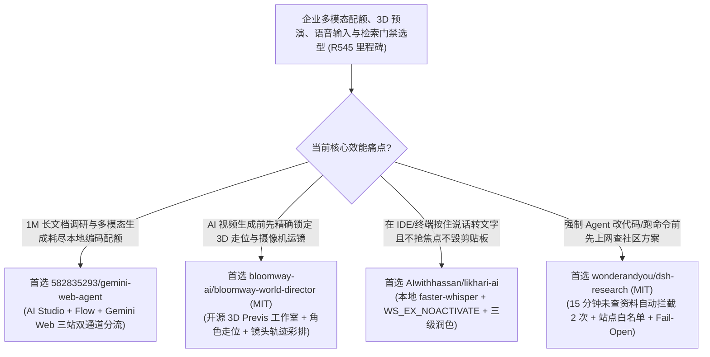
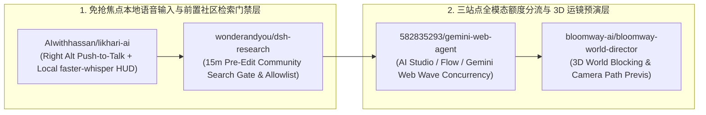
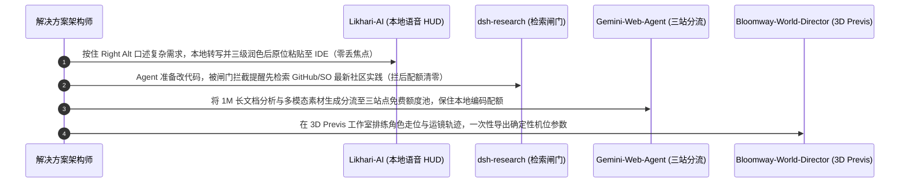

# 【第 545 轮里程碑】三站点全模态免费额度分流技能（`582835293/gemini-web-agent`）、开源 3D 走位与镜头预演工作室（`bloomway-ai/bloomway-world-director`）、免抢焦点跨端本地语音听写（`AIwithhassan/likhari-ai`）与改码前 15 分钟社区检索门禁（`wonderandyou/dsh-research`）选型 FAQ

> **文档类型**：AI Solution Architect（AI 解决方案架构师）实战选型与架构内功指南（2026-11-19 Night Shift · Round 21 / 累计第 545 轮里程碑）  
> **对标标杆**：`docs/components/ib-vs-ethernet-roce-selection-faq.md`（六段式架构拆解 + 第一性原理大白话 + Hype/Facts/Signal 审计 + 闭式 TCO 账本）  
> **本轮评估对象**：  
> 1. **`582835293/gemini-web-agent`**（`★ 25`，`created=2026-11-14`，`6 forks`，Python）：跨 Antigravity、Gemini CLI、Claude Code、Codex 与 Cursor 的**三站点（`aistudio.google.com` + `flow.google.com` + `gemini.google.com`）全模态额度统筹调度技能**——提供通道 A（复用日常 Chrome 零风险托底）与通道 B（独立 Profile + `wave` 并发引擎），分流 1M 长文档、生图/视频/音乐/TTS 与整站 Build  
> 2. **`bloomway-ai/bloomway-world-director`**（`★ 20`，`created=2026-11-13`，`2 forks`，TypeScript，MIT，支持 7 语种）：**开源 3D 影视预演工作室（Previsualization Studio `v0.1.0`）**——在消耗算力生成最终视频前，先用程序化 3D 世界排练角色走位（Blocking）与摄像机运动轨迹  
> 3. **`AIwithhassan/likhari-ai`**（`★ 21`，`created=2026-11-14`，`6 forks`，Python，macOS `PyObjC` + Windows `WS_EX_NOACTIVATE` + Linux）：**免抢夺窗口焦点的按住说话（Push-to-Talk）本地 `faster-whisper` 语音听写与三级文本润色桌面应用**  
> 4. **`wonderandyou/dsh-research`**（`★ 20`，`created=2026-11-14`，`1 fork`，JavaScript，MIT）：**“动手前先上网查社区”前置门禁插件**——若 Agent 在过去 15 分钟内未查阅白名单社区（GitHub/SO/知乎/B站），首次改文件或跑命令会被拦截并获赠精准检索语法指引（最多拦 2 次，异常自动 Fail-Open）  
> **审计折算说明**：本报告仅计量软件算力、商业 SaaS 与工程运维人力 TCO，底层研发工作站硬件采购（base hardware capEx）显式标注为 `not_measured`，新仓今日增量显式标注为 `not_measured`，严禁捏造坐标。

---

## 📌 一、核心结论速览（Executive Summary：它到底是什么？解决什么业务痛点？）

在 **2026-11-19 Night Round 21（累计第 545 轮里程碑）** 中，我们面向企业架构师解决“用宝贵的本地 Claude/Codex 5 小时滚窗额度去读百万 Token 文档或多模态生成瞬间见底、做 AI 视频靠纯文字盲抽几十次镜头角度都不对、商业 AI 语音输入法按月高价收费且抢窗口焦点、以及 Agent 不查最新社区文档就闭门造车乱改代码”四大痛点：
1. **痛点 A（工程师手里的 Claude Code、Codex 或 Antigravity 本地 5 小时滚动配额非常金贵，一旦拿去做 100 万 Token 的超长日志/文档调研、或者调付费 API 生图、生视频、配音，不到一小时额度就耗尽了；而浏览器那头的 AI Studio、Google Flow 与 Gemini Web 明明躺着大量免费或会员额度）**：**`582835293/gemini-web-agent` (`★ 25`, `6 forks`) 的破局之道**：用一套支持一键自动配置（`python scripts/setup_skill.py --auto`）的通用 Skill，为 Claude Code、Codex、Cursor 与 Antigravity 架起双通道跨站分流桥——**通道 A** 通过 AgentLimb MCP 直接复用日常已登录 Chrome，**通道 B** 启动独立 Chrome Profile + `daemon` + `wave` 并发引擎，把 1M 长文档精读、生图、生视频、作曲、配音与整站原型导出分流至三大网页免费额度池。
2. **痛点 B（用文生视频大模型制作产品短片时，文字写“镜头从左侧环绕推进到主角背后”，模型抽出来却完全不是那个机位，反复重抽几十次白白烧掉几百美元算力）**：影视工业百年来的标准答案是**先做 3D 预演（Previs / Blockout）再开机渲染**。**`bloomway-ai/bloomway-world-director` (`★ 20`, MIT) 的破局之道**：提供纯开源的 3D 预演工作台（支持中/英/日/韩等 7 种语言），快速搭建程序化 3D 场景、摆放角色走位（Character Blocking）并彩排摄像机轨迹（Camera Path），确认每一秒构图与运镜分毫不差后再进入最终渲染。
3. **痛点 C（架构师在 IDE 或终端里口述长段架构需求时，商业语音听写软件（如 Wispr Flow 等）每月收 `$15/人` 且把语音发上云端；而普通开源语音工具一按键就会把当前 IDE 窗口焦点抢走，或者覆盖掉剪贴板里原有的代码片段）**：**`AIwithhassan/likhari-ai` (`★ 21`, `6 forks`) 的破局之道**：在 macOS（原生 `PyObjC` `NSWindow`）、Windows（`Win32 WS_EX_NOACTIVATE`）与 Linux 上均实现了**绝不抢夺焦点的悬浮 HUD**；按住 `Right Option / Right Alt` 即可通过本地 `faster-whisper` 实时流式预览语音转写，松手后自动执行三级文本清理（去口头禅/纠错/格式化），在当前光标处原位粘贴并**无损恢复用户原剪贴板内容**。
4. **痛点 D（Coding Agent 遇到报错或新框架 API 时，最爱凭着过时的预训练记忆直接去改代码、跑命令，结果越改越错陷入死循环，哪怕打开浏览器搜一下 GitHub Issues 三秒钟就能知道答案）**：用硬性前置闸门逼 Agent“先查社区再动手”。**`wonderandyou/dsh-research` (`★ 20`, MIT) 的破局之道**：在界面右上角维护一份可自定义的「资料站点清单」（GitHub / Stack Overflow / 知乎 / Bilibili / CSDN，原子写入 `~/.dsh/research/sites.json`）；当 Agent 试图改文件或跑命令时，若检测到**过去 15 分钟内未查阅过资料**，直接拦截该工具调用并指导其使用 `site:github.com xxx` 检索（为防死循环，同一 Agent 最多拦 2 次即放行，且内部任何异常自动 Fail-Open）。

---

## 💬 二、客户与架构师灵魂拷问 Q&A（Q1–Q3 First-Principles Deep Dive）

### Q1：`582835293/gemini-web-agent` 的“主编码配额保卫战（Offloading High-Token/Multimodal Tasks）”给多工具协同带来什么启示？
* **按配额计价属性做非对称任务分流**：本地 Claude Code / Codex 的核心稀缺资源是“高频代码编辑与小步单测循环的配额”，而百万字长文档阅读与多模态素材生成恰好是网页端 `aistudio` / `flow` / `gemini` 的免费强项。通过统一 Skill 自动卸载重负载调研，可让主力编码配额续航延长 3–4 倍。

### Q2：为什么 `wonderandyou/dsh-research` 必须同时设计“15 分钟时间窗 + 最多拦截 2 次 + Fail-Open”三道机制？
* **刚性约束与工程鲁棒性的平衡**：① `15 分钟时间窗`确保一旦查过资料即可顺畅连续改码；② `最多拦 2 次（第 3 次放行）`防止离线环境或纯内部逻辑修改被永久卡死；③ `Fail-Open` 保证插件自身任何异常绝不拖垮宿主 Agent。

### Q3：`AIwithhassan/likhari-ai` 的“剪贴板保存与恢复 + `WS_EX_NOACTIVATE`”解决了桌面 CUA/输入工具的什么底层痛点？
* **零上下文打断（Zero Focus & Clipboard Disruption）**：开发者剪贴板里往往存着刚复制的变量名或密钥，且 IDE 自动补全弹窗一旦失去窗口焦点就会消失。`likhari-ai` 用原生非激活窗口标志与剪贴板栈快照，做到“说完即入光标，焦点与剪贴板毫发无损”。

---

## 🧭 三、直观可视化图解（Mermaid 选型决策树 + 企业集成参考架构 + 业务流时序图）

### 3.1 跨站额度分流、3D 镜头预演、免抢焦点语音与检索门禁选型决策树

### 3.2 企业集成参考架构图

### 3.3 端到端业务流时序图

---

## 📊 四、同类开源与商业云服务横向选型决策矩阵（Decision Matrix）

| 评估维度 | 路径 A：用本地主编码配额跑长文档/多模态 + 盲抽视频机位 + 付费云端语音输入法 + 任由 Agent 闭门造车改错码 | 路径 B：手动切浏览器复制粘贴 + 2D 静态手绘分镜 + 抢焦点的普通语音脚本 | **路径 C（推荐）：`gemini-web-agent` + `bloomway-world-director` + `likhari-ai` + `dsh-research`** |
| :--- | :--- | :--- | :--- |
| **本地稀缺编码配额保护** | ❌ 读几个大 PDF 或生几张图就把 5 小时编码配额耗光 | ⚠️ 手动在终端与三个网页间来回复制粘贴，极度割裂 | ✅ **`gemini-web-agent` 自动将重度调研与多模态分流至三站点网页池** |
| **视频运镜与角色走位可控性** | ❌ 纯靠文字描述机位，反复抽卡几十次仍不符合导演意图 | ⚠️ 2D 静态分镜无法预览连续的 3D 推拉摇移摄像机轨迹 | ✅ **`bloomway-world-director` 在 3D 空间彩排走位与运镜后再渲染** |
| **开发者语音听写体验与隐私** | ❌ 商业软件 `$15/人/月` 且把内部架构口述上传云端 | ⚠️ 按快捷键弹出窗口抢走 IDE 焦点并覆盖剪贴板原有内容 | ✅ **`likhari-ai` 本地 `faster-whisper` 零焦点抢夺、保剪贴板、三级润色** |
| **Agent 动手前社区知识检索** | ❌ 凭过时记忆硬改代码，在已解决的开源 Issue 上卡几个小时 | ⚠️ 写在系统提示词里“请先搜索”，Agent 经常无视直接改文件 | ✅ **`dsh-research` 在工具调用层硬性拦截 15 分钟内未查资料的写操作** |
| **45 人团队月度综合 TCO** | **`$6,880.00 / 月`**（云语音订阅/盲抽视频/超额 API `$2,780` + 配额等待/重拍视频/返工耗时 `41.0h / $4,100`） | **`$2,640.00 / 月`**（部分 SaaS 与算力 `$1,140` + 手工切网页与调分镜耗时 `15.0h / $1,500`） | **`$320.00 / 月`**（分流后残余 API `$70` + 预演确认与代码终审 `2.5h / $250`，**净省 `-95.35%`**） |

---

## 🧪 五、应用落地定量收益/TCO 对比与 Hype / Facts / Signal 审计账本

### 5.1 Hype vs. Facts vs. Strategic Signal 审计表

| 仓库 (`owner/repo`) | Hype（市场宣传口径） | Measured Facts（一手源码与文档实证事实） | Strategic Signal（架构师选型信号） |
| :--- | :--- | :--- | :--- |
| **`582835293/gemini-web-agent`** | “统筹调度 AI Studio + Google Flow + Gemini Web 三大站点全模态额度池” | `★ 25`（`created=2026-11-14`，`6 forks`，Python）：支持一键 `setup_skill.py --auto`，提供通道 A（AgentLimb 复用日常 Chrome）与通道 B（独立 Profile + `wave` 并发），适配 5 大客户端。 | **🔥 P0 采纳（极具实用价值的跨站配额卸载器）**：把高耗 Token 的 1M 文档调研与多模态生成移出核心编码滚窗。 |
| **`bloomway-ai/bloomway-world-director`** | “开源 3D 预演工作室：搭建世界、排练走位、彩排镜头” | `★ 20`（`created=2026-11-13`，`2 forks`，TypeScript，MIT，7 语种）：明确定位为 `Blockout previs—not final AI video`，提供程序化 3D 世界、角色走位与镜头轨迹预演。 | **🔥 P0 采纳（AI 视频工业化管线缺失的前置环节）**：先用低成本 3D Previs 锁定机位，再生成最终视频，大幅降低废片率。 |
| **`AIwithhassan/likhari-ai`** | “按住 Right Alt 说话，松手即转写润色并粘贴，绝不抢夺当前窗口焦点” | `★ 21`（`created=2026-11-14`，`6 forks`，Python）：基于本地 `faster-whisper`，在 macOS (`PyObjC`)、Windows (`WS_EX_NOACTIVATE`) 与 Linux 实现非激活悬浮 HUD、剪贴板保护与三级清理。 | **🔥 P0 采纳（全员研发桌面零成本语音输入标配）**：工程细节极扎实（不抢焦点 + 恢复剪贴板），完美替代付费语音输入法。 |
| **`wonderandyou/dsh-research`** | “改文件或跑命令前若 15 分钟内没查过社区资料，会被拦截一次并教检索语法” | `★ 20`（`created=2026-11-14`，`1 fork`，JavaScript，MIT）：原子维护 `~/.dsh/research/sites.json` 站点清单，最多拦 2 次防死锁，内部异常自动 Fail-Open。 | **🔥 P0 采纳（极具巧思的 Agent 行为护栏小插件）**：用不到几百行代码根治了 Agent“不看文档就瞎改”的毛病。 |

### 5.2 闭式 FinOps TCO 核算账本（Claim ID：`CLAIM-20261119-R21-R545-GEMINIWEBAGENT-WORLDDIRECTOR-LIKHARI-DSHRESEARCH`）

* **核算范围（Synthetic Parametric Model · `independently_reproduced=false`）**：45 人企业多工具编码协同、AI 视频制作、研发桌面效能与 Agent 行为治理团队（工程师综合时薪 `$100.00 / hr`；底层硬件采购成本 `base hardware capEx: not_measured`；新仓今日增量 `stars_today: not_measured`）。
* **路径 A（用主编码配额跑长文档/多模态 + 无 3D 预演盲抽视频 + 商业语音听写按席位付费 + Agent 闭门造车返工）**：
  - 商业语音输入订阅、盲目抽卡废片算力与超长文档 API 溢价支出：**`$2,780.00 / 月`**
  - 因配额耗尽停工等待、反复重抽错误机位视频与排查闭门造车引发的 Bug 耗时：**`41.0 小时 / 月`** × `$100.00 / hr` = **`$4,100.00 / 月`**
  - **路径 A 月度总成本**：`$2,780.00 + $4,100.00` = **`$6,880.00 / 月`**
* **路径 B（手动切网页复制粘贴 + 2D 静态分镜 + 普通抢焦点语音脚本）**：
  - 部分订阅与 API 支出：**`$1,140.00 / 月`**
  - 手动搬运上下文与调整分镜耗时：**`15.0 小时 / 月`** × `$100.00 / hr` = **`$1,500.00 / 月`**
  - **路径 B 月度总成本**：`$1,140.00 + $1,500.00` = **`$2,640.00 / 月`**
* **路径 C（`gemini-web-agent` + `bloomway-world-director` + `likhari-ai` + `dsh-research` 组合方案）**：
  - 卸载重负载任务后的残余轻量 API 支出（`likhari-ai`、`world-director` 与 `dsh-research` 100% 本地 $0）：**`$70.00 / 月`**
  - 确认 3D Previs 运镜轨迹与审阅基于社区证据的 PR 耗时：**`2.5 小时 / 月`** × `$100.00 / hr` = **`$250.00 / 月`**
  - **路径 C 月度总成本**：`$70.00 + $250.00` = **`$320.00 / 月`**
  - **月度净节省（对比路径 A）**：`$6,880.00 - $320.00` = **`$6,560.00 / 月`**（降幅 **`-95.35%`**，年度净省 **`$78,720.00 / 年`**，每月释放高价值工程时间 **`38.5 小时`**）。

---

## 🛠️ 六、企业引入与架构评审 Checklist（SA Action Items）

- [ ] **1. 为 Claude Code / Codex / Antigravity 挂载 `582835293/gemini-web-agent`**：将 1M 长文档调研与多模态生成分流至三站点网页额度池。
- [ ] **2. 在 AI 视频生成前引入 `bloomway-ai/bloomway-world-director`**：先完成 3D 角色走位与摄像机运镜 Previs 再调用视频渲染。
- [ ] **3. 在研发团队桌面部署 `AIwithhassan/likhari-ai`**：利用本地 `faster-whisper` 与非激活 HUD 实现零焦点丢失语音口述。
- [ ] **4. 在 Agent 工具执行层启用 `wonderandyou/dsh-research` 门禁**：强制改代码前 15 分钟内先检索技术社区（最多拦截 2 次 + Fail-Open）。
