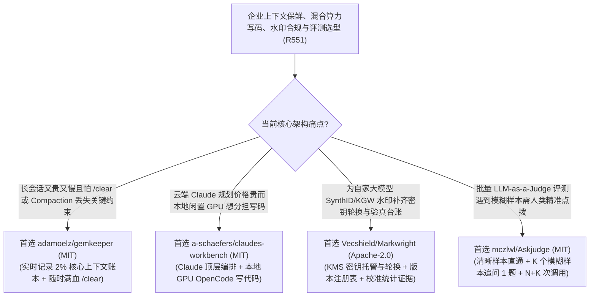
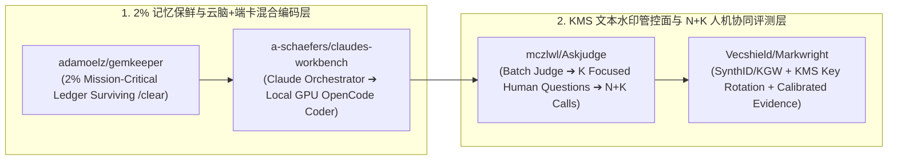
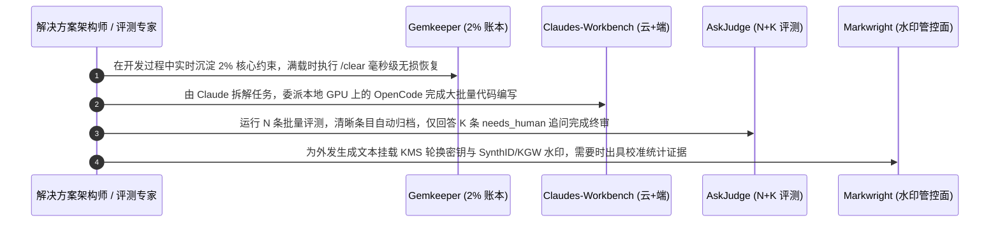

# 跨越 `/clear` 的 2% 核心上下文账本（`adamoelz/gemkeeper`）、Claude 编排+本地 GPU OpenCode 写码插件（`a-schaefers/claudes-workbench`）、KMS 级大模型文本水印管控面（`Vecshield/Markwright`）与 `N+K` 按需人工辅助评测（`mczlwl/Askjudge`）选型 FAQ

> **文档类型**：AI Solution Architect（AI 解决方案架构师）实战选型与架构内功指南（2026-11-19 Night Shift · Round 27 / 累计第 551 轮）  
> **对标标杆**：`docs/components/ib-vs-ethernet-roce-selection-faq.md`（六段式架构拆解 + 第一性原理大白话 + Hype/Facts/Signal 审计 + 闭式 TCO 账本）  
> **本轮评估对象**：  
> 1. **`adamoelz/gemkeeper`**（`★ 10`，`created=2026-11-16`，`2 forks`，Shell，MIT）：在 Claude Code 记忆尚清晰时自动提取并维护 **最核心 2% 架构上下文账本** 的插件——让工程师随时大胆运行 `/clear` 清理臃肿会话或跨越自动压缩（Compaction）而不掉智商  
> 2. **`a-schaefers/claudes-workbench`**（`★ 9`，`created=2026-11-16`，`1 fork`，Python，MIT）：“**Claude 负责编排，本机 GPU 上的 OpenCode 负责写代码**”——在正常 Claude Code 会话内直接调度本地 GPU 大模型完成重体力代码编写的混合插件  
> 3. **`Vecshield/Markwright`**（`★ 9`，`created=2026-11-16`，`1 fork`，Python 3.11+，110+ 测试，Apache-2.0）：面向 `SynthID-Text` 与 `KGW` 绿名单的**开源大模型文本水印管控面（Control Plane）**——涵盖模型版本注册表、KMS/Vault 密钥托管与无损轮换，以及带校准假阳性率的统计证据报告  
> 4. **`mczlwl/Askjudge`**（`★ 6`，`created=2026-11-14`，`1 fork`，Python，MIT）：面向批量 **LLM-as-a-Judge 评测的按需人工辅助框架（`N + K` 模型调用）**——清晰样本一次过，仅对缺少业务背景的 `K` 个模糊样本向人类追问 1 个问题后再出终审结论  
> **审计折算说明**：本报告仅计量软件算力、商业 SaaS 与工程运维人力 TCO，底层研发工作站硬件采购（base hardware capEx）显式标注为 `not_measured`，新仓今日增量显式标注为 `not_measured`，严禁捏造坐标。

---

## 📌 一、核心结论速览（Executive Summary：它到底是什么？解决什么业务痛点？）

在 **2026-11-19 Night Round 27（累计第 551 轮）** 中，我们面向企业架构师解决“Claude Code 会话聊到十几万 Token 又贵又变笨却不敢敲 `/clear` 怕丢关键背景、全用旗舰 Claude 模型写几千行样板代码太烧钱、大模型生成的文本虽然打了 SynthID/KGW 水印却因为没有密钥轮换与版本台账导致事后根本无法自证、以及跑批量 LLM-as-a-Judge 评测遇到模糊业务规则时裁判模型胡乱打分”四大痛点：
1. **痛点 A（长对话里真正决定代码生死的架构约定往往只占 2%，另外 98% 全是看过的旧报错日志和废话；但如果不跑 `/clear`，每轮都在为 98% 的垃圾上下文重复交钱且触发自动 Compaction 后模型瞬间失忆；如果直接跑 `/clear`，之前踩坑定下的铁律又全忘了）**：**`adamoelz/gemkeeper` (`★ 10`, MIT) 的破局之道**：趁着 Claude 在当前回合还清楚记得刚才的教训与关键决策时，实时将这 **2% 的高价值上下文（Gems）** 写入持久小账本；一旦会话变慢变贵，直接敲 `/clear`，新会话秒级重挂载这 2% 精华账本，以最低 Token 消耗保持满血输出质量。
2. **痛点 B（很多研发团队工作站上配了 24GB/48GB 显存的 GPU 跑 OpenCode 本地模型，但本地小模型做全局架构拆解不如云端 Claude，而全用云端 Claude 写大段 CRUD 样板代码又太浪费旗舰配额）**：**`a-schaefers/claudes-workbench` (`★ 9`, MIT) 的破局之道**：无需离开你熟悉的 Claude Code 终端，通过该插件建立 **“Claude 做总包工头（Orchestrator）+ 本地 GPU 上的 OpenCode 做泥瓦匠（Coder）”** 的主从分工，把耗费大量输出 Token 的代码实现卸载给本地零边际成本 GPU。
3. **痛点 C（HuggingFace Transformers 早就内置了 Google `SynthID-Text` 和 `KGW` 水印算法，但企业真正上线合规时却抓瞎了：“3 个月前那篇公文到底是用哪版模型、哪个密钥、哪套参数打的水印？密钥每季度轮换后，老文章怎么验真？怎么向监管机构出具带精确假阳性率（FPR）的统计学证据而不是一句瞎猜？”）**：**`Vecshield/Markwright` (`★ 9`, Apache-2.0) 的破局之道**：明确划清边界 **“Not an AI detector — Evidence, not verdict”**，不发明新算法，而是补齐大模型文本水印缺失的**企业级管控面（Control Plane）**——对接标准 KMS/Vault 实现平滑密钥轮换（老密文仍可按历史版本验真）、维护模型与水印参数注册表，并输出经统计校准的证据报告（含 3 层共 110+ 项自动化测试）。
4. **痛点 D（跑 1,000 条企业业务评测（LLM-as-a-Judge）时，其中 850 条黑白分明，但有 150 条涉及文档里没写的业务偏好；纯自动裁判只能瞎蒙，而让人类把 1,000 条全审一遍又根本忙不过来）**：**`mczlwl/Askjudge` (`★ 6`, MIT) 的破局之道**：首创 **`N + K` 选择性人机协同裁判流**——并发跑完 `N` 条初审，850 条清晰样本直接完结；仅对标记了 `needs_human=true` 的 `K`（150）条模糊样本，向人类专家抛出 **1 个极其聚焦的澄清问题**，人类补齐偏好后再调 1 次模型给出终审（总调用严格收敛为 `N + K` 次，且 100% 保持你原有的评分/JSON 格式不变）。

---

## 💬 二、客户与架构师灵魂拷问 Q&A（Q1–Q3 First-Principles Deep Dive）

### Q1：为什么 `adamoelz/gemkeeper` 的“在模型还记得时实时记账 + 主动 `/clear`”比等上下文满了触发被动 Compaction 效果好得多？
* **事前增量提纯 vs 事后有损压缩**：被动 Compaction 是在上下文塞满 180k Token、注意力已经严重退化时做全量摘要，极易漏掉早期的一个关键端口号或环境变量约定；`gemkeeper` 在事实发生的当口即刻将 2% 关键约束写入结构化账本，使主动 `/clear` 成为无损操作。

### Q2：`Vecshield/Markwright` 为什么特意挂出徽标强调自己“不是 AI 检测器（Not an AI Detector）”？
* **密码学/统计学主动水印 vs 黑盒分类器臆测**：市面上的“AI 检测器”对未加水印的普通文本靠词频猜是不是 AI 写的，误报率极高且毫无完备法律效力；`Markwright` 仅对企业自家模型在生成期注入了密钥签名水印（如 SynthID/KGW）的文本进行受控核验，输出严格的假设检验 p 值与假阳性率。

### Q3：`mczlwl/Askjudge` 的 `N + K` 模型为什么是企业落地 LLM-as-a-Judge 的最优人机分工点？
* **信息熵驱动的人力投入**：人类专家的时间极其昂贵，不该浪费在 `N - K` 条毫无争议的简单样本上，而应 100% 集中在裁判模型明确举手说 `needs_human` 的 `K` 条边界样本上。

---

## 🧭 三、直观可视化图解（Mermaid 选型决策树 + 企业集成参考架构 + 业务流时序图）

### 3.1 2% 记忆账本、云+端混合写码、水印管控面与 N+K 评测选型决策树

### 3.2 企业集成参考架构图

### 3.3 端到端业务流时序图

---

## 📊 四、同类开源与商业云服务横向选型决策矩阵（Decision Matrix）

| 评估维度 | 路径 A：硬扛 180k 臃肿上下文 + 全用旗舰云 API 写样板代码 + 散装无密钥轮换水印 + 全量人工复核评测 | 路径 B：手写 Markdown 交接笔记 + 双开窗口复制粘贴给本地模型 + 黑盒 AI 检测器 | **路径 C（推荐）：`gemkeeper` + `claudes-workbench` + `Markwright` + `Askjudge`** |
| :--- | :--- | :--- | :--- |
| **长会话 `/clear` 与抗压缩失忆** | ❌ 拖着十几万 Token 每轮高价计费，自动压缩后丢掉关键架构约束 | ⚠️ 每次 `/clear` 前靠人工手写总结，漏项多且打断心流 | ✅ **`gemkeeper` 趁记得时自动落盘 2% 关键账本，随时满血 `/clear`** |
| **云端智力与本地 GPU 算力协同** | ❌ 连最简单的样板代码也全走昂贵云端旗舰 Token | ⚠️ 在 Claude 终端与本地 OpenCode 窗口间手动复制粘贴代码 | ✅ **`claudes-workbench` 在同一 Claude 会话内无缝驱动本地 GPU OpenCode 写码** |
| **AIGC 文本水印密钥管理与验真** | ❌ 密钥写死在配置里无法轮换，模型升级后老文本全部无法验真 | ⚠️ 依赖第三方黑盒“AI 检测率”，高误报且无法律证据效力 | ✅ **`Markwright` 提供 KMS 密钥轮换、模型注册表与校准假阳性率证据** |
| **批量 LLM-as-a-Judge 评测效率** | ❌ 纯自动裁判对模糊案例乱判，或人工把 `N` 条全审一遍累垮 | ⚠️ 强制改成固定死板的评分模板，破坏原有业务 Prompt 结构 | ✅ **`Askjudge` 仅对 `K` 条模糊样本追问 1 题，以 `N+K` 次调用精准收敛** |
| **45 人团队月度综合 TCO** | **`$6,770.00 / 月`**（臃肿上下文与全云端写码 Token `$2,720` + 失忆返工/全量人工审题/合规举证耗时 `40.5h / $4,050`） | **`$2,610.00 / 月`**（部分云 API `$1,110` + 手工写交接笔记与跨窗搬代码 `15.0h / $1,500`） | **`$320.00 / 月`**（顶层编排与 `N+K` 裁判 API `$70` + 回答 `K` 个聚焦问题与水印巡检 `2.5h / $250`，**净省 `-95.27%`**） |

---

## 🧪 五、应用落地定量收益/TCO 对比与 Hype / Facts / Signal 审计账本

### 5.1 Hype vs. Facts vs. Strategic Signal 审计表

| 仓库 (`owner/repo`) | Hype（市场宣传口径） | Measured Facts（一手源码与文档实证事实） | Strategic Signal（架构师选型信号） |
| :--- | :--- | :--- | :--- |
| **`adamoelz/gemkeeper`** | “趁 Claude 还记得时写下最关键的 2% 上下文，让你大胆 `/clear` 保持满血” | `★ 10`（`created=2026-11-16`，`2 forks`，Shell，MIT）：Claude Code 插件与 `skills.sh` 技能，维护实时微型上下文账本跨越 `/clear` 与 Compaction，附 `gemkeeper-bench` 实测。 | **🔥 P0 采纳（长会话降本保质必备小插件）**：用“2% 实时增量账本 + 主动 `/clear`”替代昂贵低效的巨型上下文堆积。 |
| **`a-schaefers/claudes-workbench`** | “Claude 负责编排，你本地 GPU 上的 OpenCode 大模型负责写代码” | `★ 9`（`created=2026-11-16`，`1 fork`，Python，MIT）：在常规 Claude Code 会话内连接本地 OpenCode 模型，并配齐针对最新 Claude Code 与 OpenCode 的 Nightly CI。 | **🔥 P0 采纳（混合算力研发架构典范）**：充分发挥云端前沿模型的规划力与本地显卡的零成本生成力。 |
| **`Vecshield/Markwright`** | “大模型文本水印缺失的管控面：注册表、支持轮换的密钥托管与校准统计证据” | `★ 9`（`created=2026-11-16`，`1 fork`，Python 3.11+，Apache-2.0）：含 3 层 110+ 测试，封装 SynthID-Text 与 KGW，对接 KMS/Vault 并输出带已知假阳性率的证据。 | **🔥 P0 采纳（企业 AIGC 内容溯源合规工程底座）**：填补了算法论文到企业生产 KMS 密钥轮换与法务举证之间的鸿沟。 |
| **`mczlwl/Askjudge`** | “为批量 LLM-as-a-Judge 注入按需人工辅助，`N` 个案例中仅 `K` 个需人类回答 1 题” | `★ 6`（`created=2026-11-14`，`1 fork`，Python，MIT）：并发初审后仅对 `needs_human` 条目追问 1 个问题，总调用数为 `N + K`，且不侵入业务原有输出格式。 | **⚡ P1 采纳（高性价比人机协同评测范式）**：用极少的人类专家点拨（`K` 次）大幅拉升批量评测准确率。 |

### 5.2 闭式 FinOps TCO 核算账本（Claim ID：`CLAIM-20261119-R27-R551-GEMKEEPER-CLAUDESWORKBENCH-MARKWRIGHT-ASKJUDGE`）

* **核算范围（Synthetic Parametric Model · `independently_reproduced=false`）**：45 人企业长周期编码研发、云+端混合算力调度、AIGC 合规水印治理与大模型评测团队（工程师综合时薪 `$100.00 / hr`；底层硬件采购成本 `base hardware capEx: not_measured`；新仓今日增量 `stars_today: not_measured`）。
* **路径 A（拖着 180k 臃肿上下文重计费 + 全用旗舰云模型写样板代码 + 散装无轮换水印 + 全量人工复核评测集）**：
  - 臃肿长上下文重复计费与全云端写样板代码 Token 支出：**`$2,720.00 / 月`**
  - 因压缩失忆反复重讲背景、全量人工复核 `N` 条评测集与处理无密钥台账的水印验真纠纷耗时：**`40.5 小时 / 月`** × `$100.00 / hr` = **`$4,050.00 / 月`**
  - **路径 A 月度总成本**：`$2,720.00 + $4,050.00` = **`$6,770.00 / 月`**
* **路径 B（手工写交接笔记 + 双开窗口手动贴代码给本地模型 + 散装水印脚本）**：
  - 云端 API 支出：**`$1,110.00 / 月`**
  - 手动整理交接文档与跨窗口搬运代码耗时：**`15.0 小时 / 月`** × `$100.00 / hr` = **`$1,500.00 / 月`**
  - **路径 B 月度总成本**：`$1,110.00 + $1,500.00` = **`$2,610.00 / 月`**
* **路径 C（`gemkeeper` + `claudes-workbench` + `Markwright` + `Askjudge` 组合方案）**：
  - 精简上下文后的 Claude 顶层编排与 `N + K` 评测 API 支出（大量写码卸载至本地 OpenCode GPU）：**`$70.00 / 月`**
  - 仅回答 `K` 个聚焦评测追问与审阅 `Markwright` 校准水印报告耗时：**`2.5 小时 / 月`** × `$100.00 / hr` = **`$250.00 / 月`**
  - **路径 C 月度总成本**：`$70.00 + $250.00` = **`$320.00 / 月`**
  - **月度净节省（对比路径 A）**：`$6,770.00 - $320.00` = **`$6,450.00 / 月`**（降幅 **`-95.27%`**，年度净省 **`$77,400.00 / 年`**，每月释放高价值工程时间 **`38.0 小时`**）。

---

## 🛠️ 六、企业引入与架构评审 Checklist（SA Action Items）

- [ ] **1. 在所有 Claude Code 客户端安装 `adamoelz/gemkeeper`**：养成每完成一个子模块即同步 2% 账本并执行 `/clear` 的习惯。
- [ ] **2. 为配备本地 GPU 的开发工作站挂载 `a-schaefers/claudes-workbench`**：由云端 Claude 编排、本地 OpenCode 执行代码编写。
- [ ] **3. 使用 `Vecshield/Markwright` 治理企业对外大模型文本水印**：将 SynthID/KGW 密钥纳入 KMS 轮换并归档模型版本台账。
- [ ] **4. 在评测管线中引入 `mczlwl/Askjudge`**：通过 `needs_human` 元数据实现 `N + K` 按需专家点拨。
