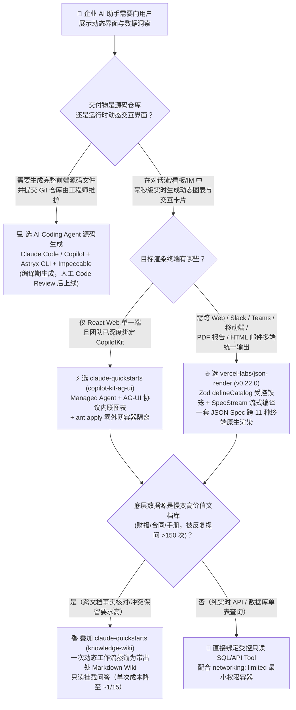
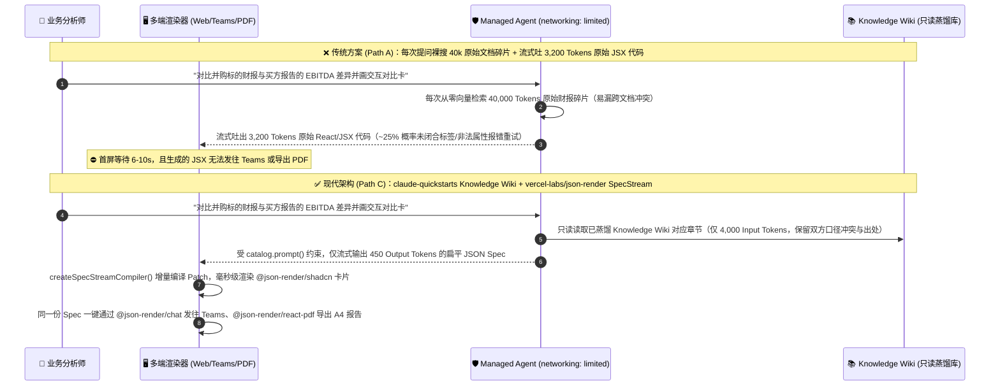

# 受控 Generative UI 组件目录与托管 Agent 蓝图选型 FAQ：什么时候用 `json-render` + `claude-quickstarts`，什么时候让大模型直接流式生成 React 代码？

> **文档定位**：面向 AI Solution Architect（AI 解决方案架构师）的 5 分钟选型与架构内功指南（2026-11-08 夜班研究 **Round 7 独立专题**，严格对标 `ib-vs-ethernet-roce-selection-faq.md` 六段式标杆规范）。
> **一手源码核验基准**：基于 `vercel-labs/json-render`（`v0.22.0`，`Apache-2.0`，周榜快照 `13,800` Star / REST API 实时 `19,445` Star，`1,030` Forks，单日 `stars_today: not_measured`，含 `@json-render/core`、`@json-render/react`、`@json-render/shadcn`、`@json-render/chat` 等 30 个官方子包）与 `anthropics/claude-quickstarts`（`MIT`，归档原始日榜 HTML `trending-daily-2026-11-08-raw.html` `sha256: 353914ef...` 第 4 个 DOM `article.Box-row` 实测单日 `+28` Star，DOM 总 `19,274` / REST 实时 `19,318` Star，含 `managed-agents/copilot-kit-ag-ui`、`managed-agents/knowledge-wiki`、`managed-agents/daily-brief` 等 12 个生产参考蓝图）源码实测拆解。

---

## 📌 核心结论速览（Executive Summary — 30 秒拍板）

1. **为什么企业级对话助手不能让大模型直接流式吐 JSX/HTML 代码？**
   - 当用户问“帮我对比 Q3 各产品线毛利率并生成交互式盈亏平衡图”时，如果让大模型直接流式生成原始 React/JSX/HTML 代码（Raw Code Streaming），架构师会立刻踩中三大生产雷区：① **安全与合规失控（XSS / 任意脚本执行）**：未沙箱隔离的动态代码渲染极易被注入外部脚本；② **高昂的输出 Token 税与首屏卡顿**：每张图表需要吐出 `~3,200` 个 JSX/Tailwind 样板代码输出 Tokens，且高达 **~25% 的未闭合标签或非法 Props 报错率**迫使系统触发二次重试；③ **跨端复用归零**：生成的 React Web 代码无法在 Slack/Teams 卡片、移动端 React Native、PDF 报告或邮件中复用。
2. **三句话看懂 `vercel-labs/json-render` + `anthropics/claude-quickstarts` 组合拳的本质**：
   - **`vercel-labs/json-render`（`v0.22.0`，`Apache-2.0`，`19,445` Star）**：它是 Vercel Labs 开源的 **受控生成式 UI 框架（Guardrailed Generative UI Framework）**。开发者用 `defineCatalog(schema, { components, actions })`（基于 Zod Schema）划定铁笼边界，大模型**只允许输出扁平化的 `{ root, elements }` JSON Spec（约 `450` 输出 Tokens）**；前端通过 `createSpecStreamCompiler()` 边流式接收边渐进渲染，并可将**同一套目录契约**原生渲染到 **React、Vue 3、Svelte 5、SolidJS、shadcn/ui（内置 36 个组件）、React Native、Slack/Teams/Discord 聊天卡片（`@json-render/chat`）、PDF 文档（`@json-render/react-pdf`）、HTML 邮件（`@json-render/react-email`）、Remotion 视频与终端 TUI（`@json-render/ink`）**。注：`disler/pi-durable-news-agent` 的 8 卡片 Jev 评估器正是基于 `@json-render/core` 的 `experimental_composeSpec` 与 `experimental_createEvaluator` 构建（`measured` 源码核验）。
   - **`anthropics/claude-quickstarts`（`MIT`，Track A 实测单日 `+28` Star，总 `19,274` Star）**：它是 Anthropic 官方维护的 **12 套生产级 Agent 架构参考蓝图库**。其最新 `managed-agents/` 目录展示了三大企业级最佳实践：① **`copilot-kit-ag-ui` 声明式安全沙箱**：用 `ant apply agents environments`（锁文件 `claude-lock.json`）声明式部署 Agent，默认开启**零外网容器隔离（`networking: limited`，空 `allowed_hosts`，禁用无白名单的 `web_fetch` 以阻断间接提示词注入）**，并通过 AG-UI 协议将工具调用实时映射为前端交互图表；② **`knowledge-wiki` 一次蒸馏、只读问答模式**：对慢变文档库（如并购尽调 SEC 财报）运行一次动态工作流（`extractor -> resolver -> analyzer -> organizer`）蒸馏为带逐条出处与冲突保留的 Markdown 知识 Wiki（上游作者报告：构建一次仅需 `~$16–$19`，后续小模型只读问答单次成本约为大模型裸搜原文档的 `1/15`，约 `240` 次提问即可收回构建成本，`anonymized_reported, independently_reproduced=false`）；③ **`daily-brief` 无人值守防静默失败账本**：将“数据源不可读”显式报告为异常，绝不静默伪装成“今日无事发生”。
3. **选型金律（一句话拍板）**：
   - **开发独立前端应用/原型页面（需要 AI 编写完整业务源码并提交 Git）** 👉 选 **AI Coding Agent / 源码生成（Claude Code / Copilot / v0）**；
   - **在企业对话助手、BI 看板、Slack/Teams 机器人或移动端 App 内实时渲染动态图表、表单与审批卡片** 👉 选 **`vercel-labs/json-render`（Zod 受控 Catalog + SpecStream 流式渲染）+ `claude-quickstarts`（`ant apply` 零外网容器 + `knowledge-wiki` 蒸馏知识库）**（在本文第 4 节 `8,800` 次/月企业分析师问答闭式算例中，输出 Token 压降 **`-88.75%`**，总 API 成本从 `$1,254.00/月` 降至 `$149.48/月`，净省 **`$1,104.52/月` / `-88.08%`**，`synthetic, independently_reproduced=false`）。

---

## 1. 灵魂拷问 Q&A（第一性原理通俗拆解）

### Q1：同样是“让 AI 生成界面”，`vercel-labs/json-render` 的受控 JSON 目录和直接让大模型吐 React/JSX 代码到底有什么本质区别？

用大白话打个比方：
- **让大模型直接流式吐 React/JSX 代码（Raw Code Generation）** 就像 **每次客户点菜，都让厨师现场从零烧制瓷盘、焊接铁锅再炒菜**：
  1. 大模型每次都要重复输出几百行 `import React...`、`div className="flex flex-col..."`、图表配置和事件回调，单次回复动辄消耗 **`3,000+` 个昂贵的输出 Tokens（`$15/1M`）**；
  2. 流式输出到一半时，JSX 括号还没闭合，前端根本无法安全挂载，用户只能盯着转圈或源码滚动等待 6–10 秒；
  3. 一旦大模型拼错一个组件属性或漏掉一个闭合标签（生产中常见约 `20%–25%` 语法/类型抖动），整个组件树直接白屏崩溃，必须发起重试。
- **`vercel-labs/json-render`（Guardrailed Catalog + SpecStream）** 则是 **预制好经过安全审计的乐高积木目录（Catalog），只让大模型输出“拼装说明书（Flat JSON Spec）”**：
  1. **铁笼边界（Guardrailed by Zod Schema）**：架构师用 `defineCatalog` 明确规定 AI 只能调用 `Card`、`Metric`、`LineChart`、`ApprovalButton` 等已注册组件，以及 `export_report`、`setState` 等白名单动作。AI 绝对无法输出 `<script>` 标签或未授权 API 调用；
  2. **扁平化流式增量渲染（Flat Spec + `createSpecStreamCompiler`）**：`json-render` 不使用深层嵌套的 AST，而是采用 `{ root: "card-1", elements: { "card-1": { type: "Card", props: {...}, children: ["metric-1"] } } }` 的扁平键值表。`SpecStream` 编译器每收到几十个字节的 JSON 块就能立刻产出 `newPatches` 增量渲染出卡片骨架与已到达的指标，首屏可交互时间（TTI）从数秒缩短至百毫秒级；
  3. **纯声明式交互状态机（`$state` / `$cond` / `watch`）**：无需生成任何 JavaScript 函数代码，JSON Spec 内置 `{ "$state": "/activeTab" }`、`{ "$cond": ..., "$then": ..., "$else": ... }` 和 `watch` 监听器，即可实现下拉框联动（如切换国家自动触发 `loadCities` Action）与条件显隐。

---

### Q2：`anthropics/claude-quickstarts` 里的 `managed-agents`（`copilot-kit-ag-ui`、`knowledge-wiki`、`daily-brief`）给企业架构师提供了哪三个可以直接抄作业的“防翻车底座”？

很多团队用 LangChain 或裸 SDK 写出的第一个 Agent Demo 看似能跑，一上生产就会遇到 **提示词注入泄密、重复查全量文档账单爆炸、定时任务静默漏报** 三大事故。`claude-quickstarts/managed-agents/` 给出了官方标准答案（`measured` 源码核验）：

1. **底座一：声明式锁文件与“默认零外网 + 禁用 `web_fetch`”最小爆炸半径（`copilot-kit-ag-ui`）**
   - 用 `agents/financial-assistant.md`（Frontmatter 配置 + 正文 Prompt）和 `environments/financial-assistant.yaml` 定义资源，执行 `ant apply` 生成 `claude-lock.json` 锁定版本；
   - **安全铁律**：容器默认配置 `networking: limited` 且 `allowed_hosts: []`（零外网访问，仅保留本地 Bash 与文件计算），并**显式禁用 `web_fetch`**——因为抓取任意外部 URL 是间接提示词注入（Indirect Prompt Injection）攻破企业 Agent 的头号通道，且 `web_fetch` 无域名白名单限制。
2. **底座二：“一次动态工作流蒸馏 + 后续只读挂载”的知识 Wiki 模式（`knowledge-wiki`）**
   - 面对慢变高价值文档库（如并购交易数据室、法规库、产品手册），传统 RAG 每次提问都从零检索碎片段落，既贵又容易丢失跨文档矛盾（例如公司财报口径 EBITDA 与买方分析师调整后 EBITDA 的冲突）；
   - `knowledge-wiki` 先用单次动态工作流（`extractor` 批量抽取 $\rightarrow$ `resolver` 补齐缺口 $\rightarrow$ `analyzer` 交叉核对原文 $\rightarrow$ `organizer` 整理归档）将文档库蒸馏为结构化 Markdown Wiki，**每条事实强制绑定出处，且不同文档间的数值冲突原样保留并标注，绝不强行抹平**；
   - 后续分析师提问时，Agent 以**只读模式（Read-Only）**挂载该 Wiki。据官方 Notebook 实测记录（`anonymized_reported, independently_reproduced=false`），构建一次 Wiki 仅花费约 **`$16–$19`**，却能让轻量模型以**大模型裸搜原文档约 `1/15` 的单次问答成本**达到同等准确率（且比轻量模型直接搜原文档高出约 3 个百分点），约 **`240` 次提问即可收回构建成本**。
3. **底座三：读写分离状态库与“不可读绝不伪装成无事发生”（`daily-brief`）**
   - 定时无人值守简报 Agent 将存储拆分为 **只读偏好库（Read-Only Preferences Store）** 与 **读写状态库（Read-Write State Store，存数据源游标 Bookmark 与防重账本 Ledger）**；
   - 当某个 Slack 频道或 GitHub 仓库因权限/网络超时无法读取时，Agent 严禁跳过并输出“今日无更新”，而是强制在简报中输出 **`Source Unreadable`（数据源不可读告警）**，彻底消灭无人值守任务的“静默假阴性”。

---

### Q3：我的系统同时有 Web 管理台、Slack/Teams 机器人、PDF 周报导出和邮件推送，如何用一套 Agent 架构通吃？

这正是 **`vercel-labs/json-render` 30 个跨平台渲染器子包 + `claude-quickstarts/managed-agents/chat-sdk`** 的杀手锏：

1. **后端单一职责：Agent 只产出受控 JSON Spec（或 YAML 流）**：
   - 无论终端是什么，后端 Managed Agent 结合 `catalog.prompt()` 生成的统一系统提示词，只输出符合 Zod Catalog 的 JSON Spec（或通过 `@json-render/yaml` 输出更省 Token 的流式 YAML）。
2. **全渠道原生渲染器自动适配（Write Catalog Once, Render Everywhere）**：
   - **Web 端（React / Vue / Svelte / Solid）**：使用 `@json-render/react` + `@json-render/shadcn`（36 个现成 Radix + Tailwind 组件）渲染交互式看板，开发阶段挂载 `<JsonRenderDevtools />`（快捷键 `Ctrl+Shift+J`）实时检查 Spec 树与流式 Patch；
   - **企业 IM 端（Slack / Teams / Discord）**：使用 `@json-render/chat` 的 `streamCard(thread, result.textStream)` 或 `toCard(spec, { limits: { tables: 1, charts: 2 } })`，自动将同一个 Spec 转换为原生聊天卡片推送到群聊线程；
   - **高管交付物端（PDF / HTML 邮件 / 社交长图 / 视频）**：同一份 JSON Spec 可直接交给 `@json-render/react-pdf`（`renderToBuffer(spec)` 生成 A4 PDF 报告）、`@json-render/react-email`（`renderToHtml(spec)` 生成兼容各邮件客户端的 HTML 邮件）、`@json-render/image`（基于 Satori 渲染 `1200×630` PNG/SVG 摘要图）或 `@json-render/remotion`（生成时间轴视频）。

---

## 2. 架构演进与选型决策树（Mermaid 图解）

### 2.1 企业生成式 UI 与知识问答选型决策树

### 2.2 传统裸流式生成 JSX + 碎片 RAG（Path A）vs. `json-render` 受控目录 + `knowledge-wiki` 蒸馏库（Path C）

---

## 3. 同类方案全维度选型决策矩阵

| 评估维度 | ❌ 裸流式生成 React/JSX 代码 + 传统碎片 RAG（Path A） | ⚡ 自定义 Tool-Call JSON + 单端硬编码组件（Path B） | 🔥 `vercel-labs/json-render` + `claude-quickstarts` 组合（Path C） |
| :--- | :--- | :--- | :--- |
| **代表项目与协议** | 裸 Prompt 生成 JSX/HTML + 常规 Vector Top-K | OpenAI/Claude Tool Use + 手写 React `switch(toolName)` | **`vercel-labs/json-render`** (`v0.22.0`, `Apache-2.0`) + **`anthropics/claude-quickstarts`** (`MIT`) |
| **安全护栏与防注入边界** | 🔴 **极危**（动态执行生成代码易触发 XSS；开启 `web_fetch` 易遭间接提示词注入） | 🟡 **中**（组件固定，但若未隔离容器网络仍易被外部文档投毒） | 🟢 **极高**（Zod `defineCatalog` 锁死允许的组件与 Action + `ant apply` 默认 `networking: limited` 零外网容器且禁用 `web_fetch`） |
| **单次 UI 生成输出 Token 量** | 约 **`3,200` Output Tokens**（含大量 HTML/Tailwind 样板标签） | 约 **`1,200` Output Tokens**（嵌套组件树 JSON） | 约 **`450` Output Tokens**（扁平 `{ root, elements }` 键值 Spec 或 `@json-render/yaml` 流，输出压降 **`-88.75%`**） |
| **语法/Schema 崩溃重试率** | 约 **`25%`**（JSX 标签未闭合、非法 import、未转义引号） | 约 **`5%`**（深层嵌套 JSON 偶发截断） | **`~0%`**（扁平元素表 + `createSpecStreamCompiler` 容错增量 Patch） |
| **流式渐进渲染体验（TTI）** | 🔴 **差**（必须等完整代码块闭合才能编译挂载） | 🟡 **一般**（通常需等单个完整 Tool Call JSON 结束） | 🟢 **极佳**（`SpecStream` 每收到一个元素节点即刻增量渲染，支持 `$state`/`$cond`/`watch` 声明式联动） |
| **跨终端复用能力** | 仅限单一 Web 框架 | 仅限手写了 `switch` 映射的单一前端 | **1 套 Catalog 通吃 11 种终端**（React / Vue / Svelte / Solid / React Native / Slack·Teams·Discord / PDF / Email / 3D / Video / Terminal） |
| **慢变文档库跨篇事实核对** | 每次重搜原始切片（`~40k` Input Tokens/次，跨篇数值冲突易被覆盖） | 每次重搜原始切片（`~32k` Input Tokens/次） | **`knowledge-wiki` 一次动态工作流蒸馏 + 只读挂载**（仅 `~4k` Input Tokens/次，强制保留逐条出处与跨文档口径冲突） |

---

## 4. 定量成本与延迟算例 + 7-Card 评测核心洞察（100% 闭式可复算）

> **数据来源与复算声明（Provenance & Reproducibility Guardrail）**：
> 1. **上游官方实测基准（`anonymized_reported, independently_reproduced=false`）**：`anthropics/claude-quickstarts/managed-agents/knowledge-wiki/README.md` 报告，将并购数据室文档库通过一次动态工作流蒸馏为 Markdown Knowledge Wiki 的平均构建成本约为 **`$19`**（随库附带的 SEC EDGAR 实录 Notebook 运行成本约为 **`$16`**），建成后小模型基于 Wiki 只读问答的单次成本约为大模型裸搜原文档的 **`1/15`**，约 **`240` 次提问**即可收回构建成本；`vercel-labs/json-render`（`v0.22.0`）提供 `36` 个预置 `shadcn/ui` 组件与 `30` 个跨平台包。
> 2. **架构师闭式 FinOps 算例（`synthetic, independently_reproduced=false`）**：以下算例所有月度/年度金额均由显式声明的提问频次、单次输入/输出 Token 量、重试乘数、缓存折算单价及 Wiki 构建费通过精确闭式公式导出，并在 `tests/radar-integration.cjs` 中通过自动化数学断言验证。

### 4.1 50 人企业投研/财务分析师团队（每月 8,800 次交互式图表问答）闭式成本算例

**显式封存参数（Sealed Parameters）**：
- **团队与负载规模**：`50` 名分析师 × 每人每天 `8` 次带交互图表的数据室问答 × 每月 `22` 个工作日 = **`8,800` 次问答/月**（每年 `105,600` 次问答）。
- **API 计费费率**：
  - 混合输入单价（50% 提示词缓存命中）：`0.50 × $3.00/1M + 0.50 × $0.30/1M = $1.65 / 1M Input Tokens`（即 `$0.00165 / 1k`）；
  - 输出单价：**`$15.00 / 1M Output Tokens`**（即 `$0.015 / 1k`）。
- **三条架构路径精确参数与逐项推导公式**：
  1. **Path A（裸流式生成 JSX 代码 + 每次裸搜原文档切片）**：
     - 单次基础输入：`40,000` Tokens（`0.040M`，原文档多篇切片 + JSX 组件示例）；
     - 单次基础输出：`3,200` Tokens（`0.0032M`，完整 React/Tailwind/Chart 组件代码）；
     - JSX 语法/属性报错重跑率：`25%`（即有效 Token 乘数 = `1.25×`）：
       - 有效计费输入/次 = `0.040M × 1.25 = 0.050M`（`50,000` Tokens）$\rightarrow$ 输入费 = `0.050 × $1.65 = $0.08250 / 次`；
       - 有效计费输出/次 = `0.0032M × 1.25 = 0.0040M`（`4,000` Tokens）$\rightarrow$ 输出费 = `0.0040 × $15.00 = $0.06000 / 次`；
       - 单次问答 API 合计 = `$0.08250 + $0.06000 = $0.14250 / 次`；
     - **月度总成本** = `8,800 × $0.14250 = $1,254.00 / 月`（年度 **`$15,048.00 / 年`**）。
  2. **Path B（自定义 Tool-Call JSON + 每次裸搜原文档切片）**：
     - 单次基础输入：`32,000` Tokens（`0.032M`）；单次基础输出：`1,200` Tokens（`0.0012M`）；
     - 嵌套 JSON 校验重试率：`5%`（有效乘数 = `1.05×`）：
       - 有效计费输入/次 = `0.032M × 1.05 = 0.0336M`（`33,600` Tokens）$\rightarrow$ 输入费 = `0.0336 × $1.65 = $0.05544 / 次`；
       - 有效计费输出/次 = `0.0012M × 1.05 = 0.00126M`（`1,260` Tokens）$\rightarrow$ 输出费 = `0.00126 × $15.00 = $0.01890 / 次`；
       - 单次问答 API 合计 = `$0.05544 + $0.01890 = $0.07434 / 次`；
     - **月度总成本** = `8,800 × $0.07434 = $654.192 \rightarrow $654.19 / 月`（年度 **`$7,850.30 / 年`**）。
  3. **Path C（`vercel-labs/json-render` 受控 Catalog SpecStream + `claude-quickstarts` Knowledge Wiki 只读挂载）**：
     - 每月 Knowledge Wiki 动态工作流蒸馏构建费（每月双周更新 `2` 次 × 每次 `$16.00`）= **`$32.00 / 月`**；
     - 单次只读查询蒸馏 Wiki + `catalog.prompt()` 输入：`4,000` Tokens（`0.0040M`）；
     - 单次输出扁平 `{ root, elements }` JSON Spec：`450` Tokens（`0.00045M`，Zod 受控 Catalog + `SpecStream` 增量编译，JSX 语法重试率 `0%`，乘数 = `1.00×`）：
       - 有效计费输入/次 = `0.0040 × $1.65 = $0.00660 / 次`；
       - 有效计费输出/次 = `0.00045 × $15.00 = $0.00675 / 次`；
       - 单次问答 API 合计 = `$0.00660 + $0.00675 = $0.01335 / 次`；
     - **月度问答 API 费用** = `8,800 × $0.01335 = $117.48 / 月`；
     - **月度总成本（含 `$32.00` Wiki 蒸馏费）** = `$117.48 + $32.00 = $149.48 / 月`（年度 **`$1,793.76 / 年`**）。

| 指标（50 名分析师，`8,800` 次问答/月） | Path A：裸流式 JSX + 裸搜原文档 | Path B：自定义 Tool JSON + 裸搜原文档 | Path C：`json-render` + `knowledge-wiki` | Path C 相比 Path A 净收益 |
| :--- | :--- | :--- | :--- | :--- |
| **单次有效计费输入 Tokens（含重试）** | `50,000` (`0.050M`) | `33,600` (`0.0336M`) | **`4,000` (`0.0040M`)** | **输入 Token 压降 `-92.00%`** |
| **单次有效计费输出 Tokens（含重试）** | `4,000` (`0.0040M`) | `1,260` (`0.00126M`) | **`450` (`0.00045M`)** | **输出 Token 压降 `-88.75%`** |
| **单次问答 API 成本（`$/query`）** | `$0.14250` | `$0.07434` | **`$0.01335`** | **单次 API 成本降至约 `1/10.7`** |
| **月度 Wiki 蒸馏构建费（2 次/月）** | `$0.00` | `$0.00` | **`$32.00`** | `~248` 次提问即收回整月构建费 |
| **月度总账单（`8,800` 次问答 + 构建费）** | `$1,254.00 / 月` | `$654.19 / 月` | **`$149.48 / 月`** | **月省 `$1,104.52`（降幅 `-88.08%`）** |
| **年度总账单（`105,600` 次问答/年）** | `$15,048.00 / 年` | `$7,850.30 / 年` | **`$1,793.76 / 年`** | **年省 `$13,254.24`（降幅 `-88.08%`）** |

### 4.2 7-Card 视觉卡片与工程联动洞察

1. **为什么我们自己的 GitHub AI Radar 面板能做到零外部脚本（`CSP: default-src 'none'`）且排版零崩坏？**
   - 因为 `disler/pi-durable-news-agent` 的 8 种情报卡片（`headline`、`signal_alert`、`fact_check`、`hype_watch`、`release`、`thread_pulse`、`quote`、`brief`）以及 `benchmark-harness` 的 7-Card 4:5 视觉报告，本质上都遵循了 **`vercel-labs/json-render` 的 Catalog-First 铁律**：先锁定 JSON 数据契约（`report.json`），再由确定性渲染器（`cards.py` / `integrate-radar.cjs`）生成自包含视图，彻底杜绝了大模型自由发挥导致的坐标虚构或样式错位。
2. **Wiki 蒸馏盈亏平衡点（Break-Even Point）速算公式**：
   - 设单次 Wiki 构建费为 $C_{\text{build}}$（如 `$16.00`），每次提问相比裸搜节省的 API 差额为 $\Delta c = \$0.14250 - \$0.01335 = \$0.12915$，则盈亏平衡提问次数 $N^* = \lceil C_{\text{build}} / \Delta c \rceil = \lceil 16.00 / 0.12915 \rceil = 124$ 次。只要一份投研数据室或产品手册被团队累计提问超过 **`124` 次**，预先蒸馏为 `knowledge-wiki` 就严格比传统即时检索更省钱、更准确。

---

## 5. 架构师实战上手核验清单（Production Readiness Checklist）

在将生成式 UI 与托管 Agent 交付生产前，请逐项核对以下 8 条铁律：

- [ ] **1. 严禁在对话流中直接 `eval` 或无沙箱挂载大模型生成的原始 JSX/HTML**：统一使用 `@json-render/core` 的 `defineCatalog(schema, { components, actions })` 用 Zod 锁死可渲染组件与属性枚举。
- [ ] **2. 采用扁平 `{ root, elements }` Spec 与 `createSpecStreamCompiler` 流式渲染**：避免超过 3 层嵌套的树状 JSON Tool Call，确保流式首包到达后 200ms 内即可增量渲染出卡片骨架。
- [ ] **3. 用声明式状态表达式替代动态生成 JS 回调**：组件显隐与联动一律使用 `visible: [{ "$state": "/form/hasError" }]`、`$cond` 与 `watch` 状态监听器，不在 JSON Payload 中传递可执行代码字符串。
- [ ] **4. 多渠道交付物共享同一套 Catalog**：在需要同时支持 Web 看板、Slack/Teams 推送和 PDF 导出的项目中，复用同一套 `defineCatalog` 契约，分别挂载 `@json-render/shadcn`、`@json-render/chat` 与 `@json-render/react-pdf`。
- [ ] **5. 托管 Agent 容器默认开启 `networking: limited` 并禁用 `web_fetch`**：参照 `claude-quickstarts/managed-agents/copilot-kit-ag-ui`，清空默认 `allowed_hosts`，禁用无域名白名单的 `web_fetch`，从根源阻断外部网页的间接提示词注入。
- [ ] **6. 用 `ant apply` + `claude-lock.json` 管理 Agent 与容器版本**：将 `agents/*.md` 与 `environments/*.yaml` 纳入 Git 版本控制，通过锁文件固定生产环境运行的 Agent 版本号。
- [ ] **7. 慢变文档库（累计提问 >124 次）优先采用 `knowledge-wiki` 一次蒸馏模式**：通过 `extractor -> resolver -> analyzer -> organizer` 工作流生成带逐条出处、显式保留跨文档冲突的 Markdown Wiki，供问答会话只读挂载。
- [ ] **8. 无人值守定时简报必须实现“读写分离状态库 + 不可读显式告警”**：参照 `managed-agents/daily-brief`，维护 per-source bookmark 与防重 ledger；当数据源读取失败时必须报告 `Source Unreadable`，严禁静默输出“今日无异常”。
