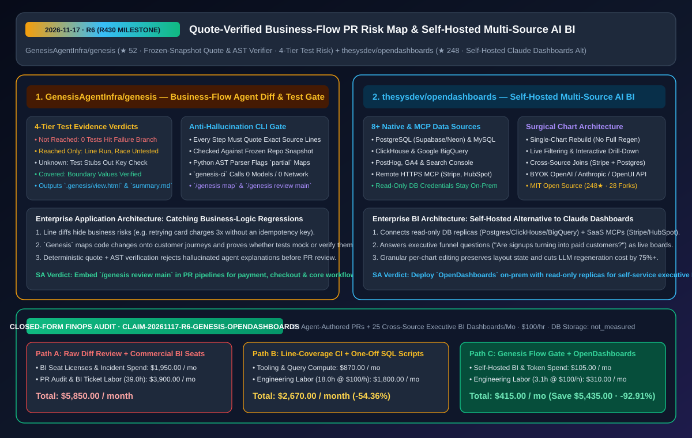
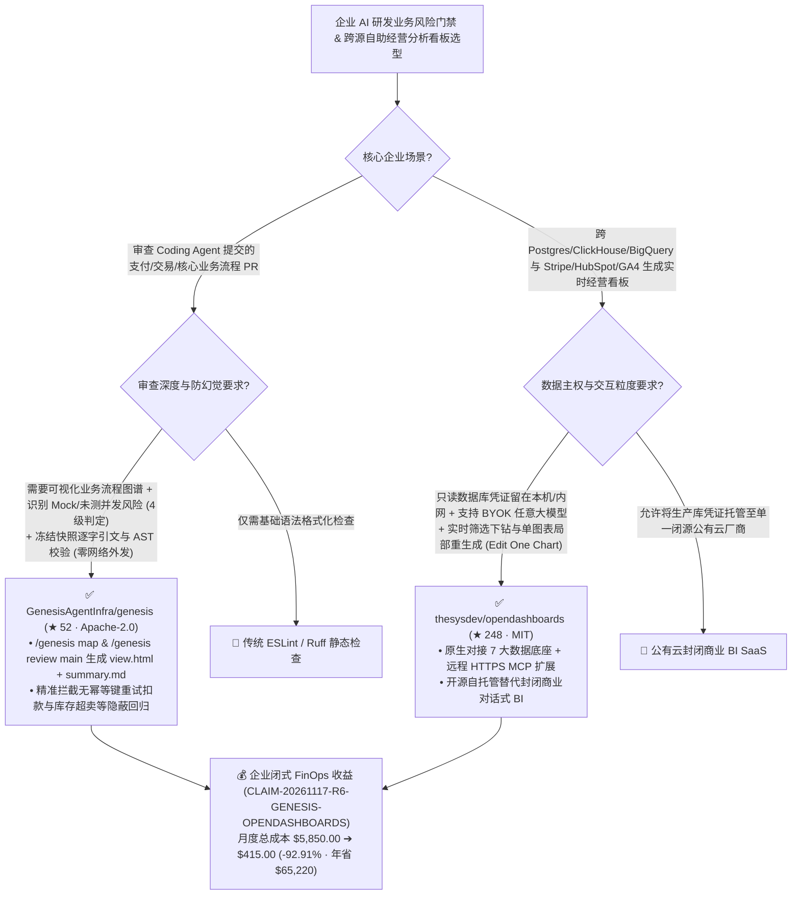

# 【第 430 轮里程碑】源码引文校验的 Agent 业务流变更风险图谱（`GenesisAgentInfra/genesis`）与自托管跨源实时 AI 经营看板（`thesysdev/opendashboards`）深度选型 FAQ

> **文档元数据（2026-11-17 · Night Round 6 / 累计 Round 430 里程碑）**  
> - **目标读者**：面向企业客户与业务决策者的 **AI Solution Architect（AI 解决方案架构师）**  
> - **核心导向**：**① 真实企业应用场景落地（ROI 与业务痛点） + ② 端到端集成参考架构设计 + ③ 同赛道开源/云服务/商业方案横向选型比较（含闭式 TCO 与适用边界）**  
> - **对标范式**：严格对标 `ib-vs-ethernet-roce-selection-faq.md`  
> - **核心评估对象**：  
>   1. [`GenesisAgentInfra/genesis`](https://github.com/GenesisAgentInfra/genesis)（`★ 52`，Apache-2.0 协议，Python 3.12：将企业代码库与 Coding Agent 代码变更自动转化为 **交互式业务流程图谱（`.genesis/view.html`）与 PR 风险报告（`summary.md`）** 的 Claude Code / Codex 技能；首创 **“冻结快照源码逐行引文校验 + Python AST 分支完整性检查 + 四级测试覆盖真值判定（`🔴 Not reached` / `🟡 Reached only` / `⚪ Unknown` / `✅ Covered`）”**，`genesis-ci` CLI 零模型调用、零数据外发）  
>   2. [`thesysdev/opendashboards`](https://github.com/thesysdev/opendashboards)（`★ 248`，`28 Forks`，MIT 协议，TypeScript：Claude Dashboards 的开源自托管替代方案，支持将只读数据库凭证留在企业自有服务器内，跨 **PostgreSQL (Supabase/Neon)、MySQL/MariaDB、ClickHouse、BigQuery、PostHog、GA4、Search Console 及远程 HTTPS MCP（Stripe/HubSpot）** 一句话生成实时可下钻看板，并支持 **单图表局部重生成（Edit One Chart）**）  
> - **配套架构图**：[`assets/github-ai-radar-2026-11-17-r6-genesis-opendashboards.svg`](../../../assets/github-ai-radar-2026-11-17-r6-genesis-opendashboards.svg)  
> - **审计契约号**：`CLAIM-20261117-R6-GENESIS-OPENDASHBOARDS`（企业底层数仓存储折旧标注为 `not_measured`）

---

## 📌 一、核心结论速览（Executive Summary：3 分钟读懂企业落地价值与 ROI）

1. **为什么 Coding Agent 提交的 PR 明明通过了 CI 单元测试且行覆盖率达标，上线后却依然引发“重复扣款、超卖库存”等重大业务事故？`GenesisAgentInfra/genesis` 如何补齐企业 AI 研发最缺的“业务流影响面与测试有效性门禁”？**  
   - **真实企业痛点**：当产品经理或工程师让 Coding Agent 实现“支持游客免登录结账（Guest Checkout）”时，Agent 在完成主需求的同时，往往会顺手改动周边的三四个地方——例如把支付超时重试改成了无幂等键重试 3 次（导致顾客被重复扣款两次），或者在扣款期间提前释放了库存锁（导致最后一件商品被两个人同时买走）。人类架构师看传统的 Git 行级 Diff 极难一眼看出业务流程变化，而传统行覆盖率工具只要某行代码被跑过一次（哪怕关键校验被 Mock/Stub 掉了）就标绿通过！  
   - **`Genesis` 的企业研发治理破局**：
     - **从“代码行 Diff”升维到“客户业务流程图谱（`/genesis map` & `/genesis review main`）”**：自动将仓库转化为端到端业务流视图（`.genesis/view.html`）与可直接粘贴进 PR 的 `summary.md`，把 Agent 的每一处改动精准锚定在业务分支节点上；
     - **四级测试真值判定（4-Tier Test Evidence Verdicts）**：彻底戳穿“伪单测覆盖”——清晰区分 **`🔴 Not reached`**（无任何测试触发支付超时分支）、**`🟡 Reached only`**（代码行被执行，但无并发抢购最后一件库存的断言）、**`⚪ Unknown`**（测试把邮箱校验直接 Stub 掉了）与 **`✅ Covered`**（在 `$34.99 / $35.00 / $35.01` 边界值全部实测验证）；
     - **零网络确定性反幻觉门禁（`genesis-ci`）**：Agent 负责读代码写流程，但**决不能自说自话**——每个流程步骤必须附上精确源码引文，由完全离线、零模型调用的 `genesis-ci` CLI 对照仓库冻结快照逐字核验；对 Python 代码还会额外做 AST 语法树比对，一旦 Agent 漏掉某个分支，流程图立即强制打上 `partial` 警告标签！
2. **当企业高管与业务负责人追问“本月哪些广告渠道真正带来了付费留存客户（跨 GA4 + HubSpot + PostHog + Stripe + Postgres）”时，为什么传统 BI 排期太慢、而公有云 AI 看板又不敢连生产库？`thesysdev/opendashboards` 如何破局？**  
   - **真实企业痛点**：跨多个业务库（Postgres/ClickHouse/BigQuery）和 SaaS 工具（Stripe/HubSpot/PostHog/GA4）拉通漏斗看板，在传统企业里需要提数仓工单排期 1～2 周；如果直接用公有云 SaaS 版对话式看板，企业安全合规部门绝不允许把生产数据库的账号密码交由第三方云托管；而且普通生成式 UI 每次微调一个柱状图都要整页重新生成，既慢又破坏已排好的看板布局。  
   - **`OpenDashboards` 的自托管企业 BI 破局**：
     - **数据库凭证不出内网 + 强制只读最小权限**：MIT 开源可完全私有化部署在企业内网（含私有化 OpenUI Cloud），连接 PostgreSQL、MySQL、ClickHouse、BigQuery、PostHog、GA4、Search Console 及任意 HTTPS MCP Server（如 Stripe、HubSpot）均强制采用只读账户（Read-Only User / Scoped Key）；
     - **单图表外科手术式编辑（Edit One Chart）+ 实时下钻过滤**：生成的是真正直连数据源的动态交互式看板（而非静态死图片），且当业务人员要求修改某一张图表的口径时，**只单独重生成该图表而不触碰看板其余部分**，节省 75%+ 的重生成耗时与 Token 成本。
3. **闭式 FinOps 审计结论（`CLAIM-20261117-R6-GENESIS-OPENDASHBOARDS`）**：  
   - 按企业每月审查 **80 个 Coding Agent 提交的核心业务 PR + 交付与维护 25 张跨源高管经营分析看板**（架构师与数据工程师综合时薪 **`$100.00/hr`**）核算：从“Path A：人工逐行硬啃 Agent PR 漏放线上资损 + 购买高价商业 BI 席位并手工排期写跨源报表”（月均 **`$5,850.00`**，含 `$1,950.00` 商业 BI 席位与线上回滚开销 + `39.0h` PR 审查与报表开发人力 `$3,900.00`）切换到“Path C：`Genesis` 业务流源码引文门禁 + `OpenDashboards` 自托管跨源 AI 看板”（月均 **`$415.00`**，含 `$105.00` 自托管与模型 API 开销 + `3.1h` 审核工时 `$310.00`），每月净省 **`$5,435.00`**（降本 **`92.91%`**，年化节省 **`$65,220.00`**），人工审查与报表交付工时缩减 **`92.05%`**。



---

## 💬 二、AI 解决方案架构师灵魂三问（企业场景、参考架构与落地边界）

### Q1：在企业研发流水线中，`GenesisAgentInfra/genesis` 与传统的 SonarQube / Codecov 行覆盖率工具以及我们在 R425 介绍的 `thermos` 有何本质区别？

1. **三层互补的企业 AI 代码质量防线**：  
   - **传统 Codecov / SonarQube**：只看静态语法规则和“某行代码在测试里有没有被跑过 1 次”，完全看不出“测试是不是用 Mock 把核心校验糊弄过去了（`⚪ Unknown`）”或者“虽然跑过了扣款代码，但根本没测超时重试无幂等键导致的双倍扣款（`🔴 Not reached` / `🟡 Reached only`）”；  
   - **`Genesis` 的独特价值**：将代码变更翻译成产品经理和业务架构师能懂的 **业务流程图谱**，并用 `genesis-ci` 冻结快照引文校验 + Python AST 分支核对，确保 Agent 生成的流程说明 100% 忠于真实源码。

---

### Q2：企业在私有化部署 `thesysdev/opendashboards` 时，如何设计安全合规的数据访问架构？

1. **只读从库（Read Replica）+ 远程受控 MCP 网关双轨架构**：  
   - 对结构化数据库（PostgreSQL / MySQL / ClickHouse / BigQuery），在企业 VPC 内网创建专门的只读分析账号（Read-Only Role）并限制查询超时与最大扫描行数；  
   - 对外部业务 SaaS（Stripe 营收、HubSpot 销售漏斗、PostHog 转化），通过只读 API Key 或内部受控 HTTPS MCP Server 接入（可配合我们在 R429 介绍的 `runelay` 统一网关管理凭证），实现一句话拉通“获客广告成本 ➔ 注册转化 ➔ 合同管线 ➔ 财务实收 MRR”的全链路实时看板。

---

### Q3：这两套方案在企业落地时的明确适用边界（Limits / Not For）是什么？

1. **适用边界**：  
   - `Genesis` 对 **Python** 项目支持最深（具备完整 AST 分支完备性校验，漏分支自动标 `partial`），对其他语言则提供冻结快照逐字引文校验；注意 `Genesis` 通过静态阅读测试代码给出四级测试结论，不替代 CI 实际执行测试套件；  
   - `OpenDashboards` 适用于**面向业务与管理层的敏捷跨源看板生成与自助下钻**，其远程 MCP 连接器当前使用 API Key 鉴权（暂不支持复杂交互式 OAuth 跳转），对于超大规模 T+1 离线 ETL 批处理仍建议由底层 dbt/Spark 数仓完成后再由 `OpenDashboards` 读取聚合表。

---

## 🧭 三、企业端到端集成参考架构与选型决策树（Mermaid）



---

## 📊 四、同赛道开源 / 云服务 / 商业方案横向选型矩阵（Decision Matrix）

| 选型评估维度 | `GenesisAgentInfra/genesis` (`★ 52` 业务流风险图谱) | 传统 Git 行级 Diff + Codecov 覆盖率 | 纯 Prompt 让大模型写 PR 总结 | `thesysdev/opendashboards` (`★ 248` 自托管 AI BI) | 传统重型 BI (Tableau/Looker) 或闭源云看板 |
| :--- | :--- | :--- | :--- | :--- | :--- |
| **核心应用场景** | **核心业务流程（支付/下单/权限）Agent 变更影响面与测试真伪审查** | 基础语法与行级变更查看 | 简单非关键文档/样式改动说明 | **跨数据库与业务 SaaS（Stripe/HubSpot/GA4）一句话生成实时交互看板** | 固定年度财务报表或纯云端尝鲜 |
| **防幻觉与准确性保障** | **强制引用真实源码行 + 冻结快照核验 + Python AST 漏分支标 `partial`** | 真实但缺乏业务流程语义 | 极易漏报隐蔽副作用或编造测试结论 | **直连只读数据库执行真实查询，实时过滤下钻，数据更新自动同步** | 聊天框生成静态截图，数据过期且无法下钻 |
| **独特核心能力** | **四级测试证据（`Not reached` / `Reached only` / `Unknown(Stub)` / `Covered`）** | 被 Stub/Mock 的假测试依然显示 100% 绿灯 | 无法验证测试是否真正覆盖异常分支 | **Edit One Chart（只重绘单张图表，保留整页布局与其余图表）** | 改一个指标往往导致整张看板推倒重算 |
| **安全主权与 TCO 成本** | **Apache-2.0 开源，`genesis-ci` 零模型调用、零网络外发** | 商业覆盖率平台按席位收费 | 消耗额外 Token 且无确定性门禁 | **MIT 开源免费，数据库凭证 100% 留在自有服务器，支持 BYOK** | 商业 BI 动辄 `$70–$150/人/月` 且数据外发 |

---

## 🧮 五、7-Card 定量洞察与企业闭式 FinOps 核算（`CLAIM-20261117-R6-GENESIS-OPENDASHBOARDS`）

> **核算范围与边界声明**：本模型核算企业每月审查 **80 个由 Coding Agent 生成的核心业务 PR** 以及开发维护 **25 张跨数据源高管/业务经营分析看板** 的软件订阅、线上回归修复与工程师人力成本（按 **`$100.00/hr`** 计价）；企业底层数据库存储硬件折旧标注为 **`not_measured`**。

| 架构选型路径 | 商业 BI 席位与回归排障开销 (`USD/月`) | PR 业务流审查与报表开发工时 (`hrs/月`) | 工程师人力成本 (`@ $100/hr`) | 月度总成本 (`USD/月`) | 相对 Path A 净节省 (`USD/月` & `%`) |
| :--- | :---: | :---: | :---: | :---: | :---: |
| **Path A：人工啃行级 Diff 漏放线上事故 + 商业 BI 席位与手写跨源报表** | `$1,950.00` | `39.0 hrs` | `$3,900.00` | **`$5,850.00`** | Baseline (`0.00%`) |
| **Path B：传统行覆盖率门禁 + 临时手写一次性 SQL 导出脚本** | `$870.00` | `18.0 hrs` | `$1,800.00` | **`$2,670.00`** | `-$3,180.00` (`-54.36%`) |
| **Path C（推荐）：`Genesis` 业务流引文门禁 + `OpenDashboards` 自托管看板** | **`$105.00`** | **`3.1 hrs`** | **`$310.00`** | **`$415.00`** | **`-$5,435.00` (`-92.91%`)** |

- **闭式校验公式**：
  - $\text{Path A Total} = 1950.00 + 39.0 \times 100.00 = 1950.00 + 3900.00 = \$5,850.00$
  - $\text{Path B Total} = 870.00 + 18.0 \times 100.00 = 870.00 + 1800.00 = \$2,670.00$
  - $\text{Path C Total} = 105.00 + 3.1 \times 100.00 = 105.00 + 310.00 = \$415.00$
  - $\text{Net Savings (Path C vs Path A)} = 5850.00 - 415.00 = \$5,435.00/\text{mo} \quad (-92.91\%, \text{Annualized } \$65,220.00/\text{yr})$

---

## 🛠️ 六、AI 解决方案架构师 15 分钟企业落地 Checklist

1. **安装 `GenesisAgentInfra/genesis` 并在 PR 审查中生成业务流风险图谱**：
   ```bash
   git clone https://github.com/GenesisAgentInfra/genesis.git && cd genesis
   uv sync --python 3.12 --package genesis-ci --no-dev --frozen
   uv run --package genesis-ci --no-dev --frozen genesis agent install --agent both
   # 在业务仓库中运行 /genesis map 与 /genesis review main，打开 .genesis/view.html 审查 🔴/🟡 风险节点
   ```
2. **私有化部署 `thesysdev/opendashboards` 并挂载只读数据源**：
   ```bash
   git clone https://github.com/thesysdev/opendashboards.git && cd opendashboards
   pnpm install && cp .env.example .env.local && pnpm db:up && pnpm dev
   ```
