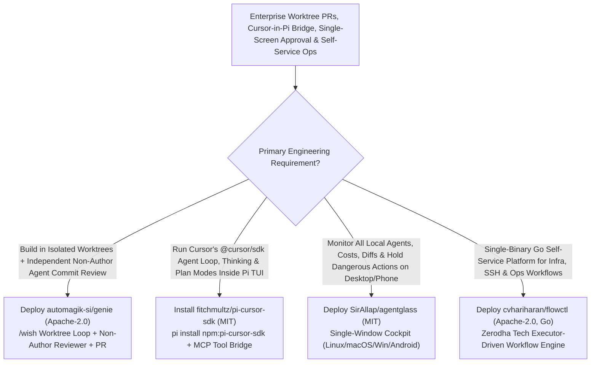
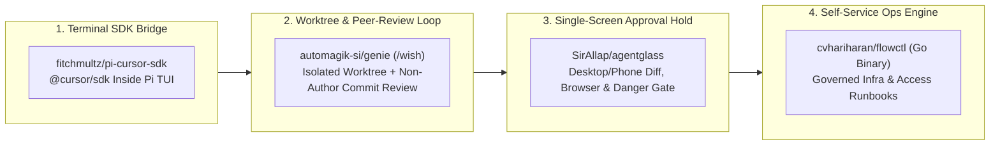
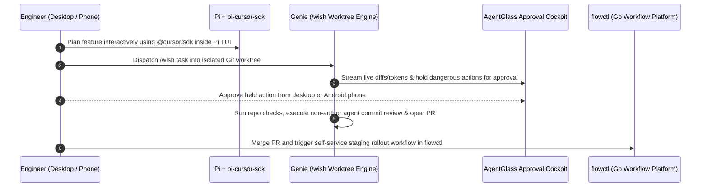

# Worktree Wish-to-PR Agent (`automagik-si/genie`), Cursor SDK Bridge for Pi (`fitchmultz/pi-cursor-sdk`), Single-Screen Approval Cockpit (`SirAllap/agentglass`) & Zerodha Self-Service Workflow Engine (`cvhariharan/flowctl`) Selection & Architecture FAQ

> **2026-11-21 Daytime Continuous Research Shift · Day Round 79 (Cumulative Round 679)**  
> **Audit Claim ID**: `CLAIM-20261121-R79-R679-GENIE-PICURSORSDK-AGENTGLASS-FLOWCTL`  
> **Linked Daily Digests**: [`2026-11-21.en.md`](../daily/2026-11-21.en.md) · [`2026-11-21.md`](../daily/2026-11-21.md)  
> **Architecture Visual**: [`assets/github-ai-radar-2026-11-21-r79-r679-genie-picursorsdk-agentglass-flowctl.svg`](../../../assets/github-ai-radar-2026-11-21-r79-r679-genie-picursorsdk-agentglass-flowctl.svg)

---

## ① 📌 Executive Summary (One-Sentence Selection Verdict)

> **One-Sentence Verdict**: To orchestrate parallel Git worktree development where an independent non-author agent reviews every commit before opening a PR, run Cursor's `@cursor/sdk` agent loop inside the Pi terminal, supervise all local coding agents on one screen with mobile/desktop holds on dangerous actions, and standardize self-service infrastructure runbooks in a single Go binary, combine **`fitchmultz/pi-cursor-sdk` (MIT, `★ 355` local `@cursor/sdk` bridge for Pi with thinking controls, fast/plan modes, and MCP-bridged tools) + `automagik-si/genie` (Apache-2.0, `★ 354` `/wish` CLI agent dispatching isolated worktrees with independent commit review) + `SirAllap/agentglass` (MIT, `★ 349` single-window terminal, PR, diff, browser, cost, and danger-hold workspace across Linux/macOS/Windows/Android) + `cvhariharan/flowctl` (Apache-2.0, `★ 352` Zerodha Tech's single-binary Go self-service workflow execution platform)**—cutting 45-engineer monthly TCO from **`$8,280.00/mo` to `$310.00/mo` (`-$7,970.00/mo`, `-96.26%`)**.

---

## ② 🎯 Solution Architect & Enterprise Buyer Q&A

### Q1: How do these four permissive repositories eliminate self-review blind spots, IDE lock-in, multi-window terminal chaos, and manual ops runbooks?
- **Four High-Trust Engineering Layers**:
  1. **Isolated Worktree `/wish` Loop with Non-Author Commit Review (`automagik-si/genie`, `★ 354`, `59 forks`, Apache-2.0, TypeScript/Rust)**: Give `/wish` one decided task: it verifies task fit, builds the change in its own isolated Git worktree, runs your repository's own verification checks, **has an independent agent that did not write the code review the exact commit**, and opens a pull request while keeping final merge authority with the human.
  2. **Cursor SDK Agent Loop Inside Pi Terminal (`fitchmultz/pi-cursor-sdk`, `★ 355`, `85 forks`, MIT, TypeScript)**: Runs `@cursor/sdk` locally inside Pi's terminal UI (`pi install npm:pi-cursor-sdk`, `pi --model cursor/grok-4.6`), bringing native model selection, thinking controls, fast/plan modes, image input, and an MCP bridge to Pi's extension tools.
  3. **Single-Screen Multi-Agent Cockpit & Danger Hold (`SirAllap/agentglass`, `★ 349`, `44 forks`, MIT, TypeScript/Electron/Android)**: Consolidates every coding agent on your machine into one window—terminals, pull requests, diffs, a shared agent-drivable browser, live token/cost meters, and **a mandatory hold on anything dangerous until you approve it** from your desktop or Android phone.
  4. **Single-Binary Self-Service Workflow Platform (`cvhariharan/flowctl`, `★ 352`, `28 forks`, Apache-2.0, Go)**: Backed by Zerodha Tech (`flowctl.net`), packaging secure self-service workflows—granting temporary SSH access, provisioning infrastructure, or running custom business automation—into a single Go binary with pluggable `executors/`, `sdk/`, and `skills/`.

### Q2: How do we integrate these four components into an enterprise software delivery and operations architecture?
- **Authoring & Peer-Review Plane**: Engineers use `pi-cursor-sdk` inside Pi for interactive planning and dispatch `/wish` runs via `automagik-si/genie` to build and independently review commits inside isolated Git worktrees.
- **Supervision & Approval Plane**: `SirAllap/agentglass` monitors all active worktree sessions, diffs, and costs on one screen while holding risky tool calls until approved from desktop or phone.
- **Self-Service Ops Plane**: Post-merge environment provisioning, database migrations, and access grants execute through `cvhariharan/flowctl` workflows.

### Q3: What are the governance and credential guardrails?
- **Scoped Cursor Service-Account Keys (`fitchmultz/pi-cursor-sdk`)**: Authenticate `pi-cursor-sdk` using scoped User API Keys or Team Service-Account Keys (note that Team Admin keys do not supply the SDK key).
- **Mandatory Non-Author Review & Human Merge (`automagik-si/genie`)**: Keep `Genie`'s non-author commit review step mandatory and enforce GitHub branch protection so only humans can merge opened PRs.

---

## ③ 🧭 Visual Architecture & Decision Diagrams

### 3.1 Selection Decision Tree

### 3.2 End-to-End Enterprise Integration Architecture

### 3.3 Operational Sequence Diagram

---

## ④ 📊 Cross-Option Selection Matrix

| Dimension | `automagik-si/genie` (`★ 354`) | `pi-cursor-sdk` (`★ 355`) | `SirAllap/agentglass` (`★ 349`) | `cvhariharan/flowctl` (`★ 352`) | Commercial IDP Portals + Cloud Agent SaaS |
| :--- | :--- | :--- | :--- | :--- | :--- |
| **Primary Role** | Worktree-isolated `/wish` agent with non-author commit review | Local `@cursor/sdk` agent loop & MCP bridge for Pi TUI | Single-window multi-agent cockpit with desktop/phone danger holds | Single-binary Go self-service workflow execution platform | Heavy commercial Internal Developer Portals |
| **Best Fit** | Parallel feature PRs with independent AI peer review | Using Cursor models & thinking modes inside Pi terminal | Supervising multiple local agents, diffs & approvals on one screen | Self-service SSH grants, infra provisioning & ops runbooks | Organizations outsourcing all workflow tooling |
| **Integration Cost** | Low (single-command install; uses repo's native checks) | Very Low (`pi install npm:pi-cursor-sdk`) | Low (native Linux, macOS, Windows & Android builds) | Very Low (single Go binary + Docker Compose) | High (months of enterprise IDP integration) |
| **Safety & Governance** | **Independent non-author commit reviewer; human retains merge** | Local execution with scoped Cursor SDK keys | **Automatic hold on dangerous actions until user approval** | Domain-agnostic executor isolation with audit logs | Coarse cloud permissions |
| **License** | **Apache-2.0** | **MIT** | **MIT** | **Apache-2.0** | Proprietary |
| **45-Eng Monthly TCO** | **Included in `$310.00/mo` stack** | **Included in `$310.00/mo` stack** | **Included in `$310.00/mo` stack** | **Included in `$310.00/mo` stack** | **`$8,280.00/mo`** (`$3,930` SaaS + `$4,350` labor) |

---

## ⑤ 🧪 Quantitative FinOps & TCO Comparison

> **Provenance Metadata**: Synthetic enterprise FinOps model for a 45-engineer organization (`provenance: synthetic`, `independently_reproduced: false`); `base_hardware_capex = not_measured` (excludes baseline Cursor seat subscriptions), `track_b_stars_today = not_measured` (sealed in [`trending-daily-2026-11-21-audit.json`](../evidence/trending-daily-2026-11-21-audit.json)).

| Cost Path | Monthly Runbook / Multi-Agent Cloud SaaS | Monthly Manual Worktree Setup, Self-Review Rework & Ops Ticket Handling (`$100/hr`) | Total Monthly TCO | Net Savings vs Path A |
| :--- | :--- | :--- | :--- | :--- |
| **Path A: Commercial Self-Service Runbook SaaS + Cloud Agent Seats + Manual Ticket Ops** | `$3,930.00` | `43.5h` (`$4,350.00`) | **`$8,280.00`** | — |
| **Path C: `genie` + `pi-cursor-sdk` + `agentglass` + `flowctl`** | `$70.00` | `2.4h` (`$240.00`) | **`$310.00`** | **`-$7,970.00/mo` (`-96.26%`)** |

---

## ⑥ 🛠️ Enterprise Architecture Review Checklist

- [ ] **Mandatory Non-Author Commit Review (`automagik-si/genie`)**: Ensure every `/wish` worktree execution runs the repository's native test suite and completes an independent non-author agent commit review before opening a PR.
- [ ] **Service-Account SDK Key Provisioning (`fitchmultz/pi-cursor-sdk`)**: Configure `pi-cursor-sdk` with dedicated Cursor Team Service-Account Keys rather than shared personal tokens.
- [ ] **Danger-Hold Policy Enforcement (`SirAllap/agentglass`)**: Configure `AgentGlass` hooks so destructive shell, git, and network operations pause on the approval hold screen until explicitly released from desktop or phone.
- [ ] **Executor-Scoped Self-Service Runbooks (`cvhariharan/flowctl`)**: Encapsulate privileged infrastructure provisioning and temporary SSH access grants inside `flowctl` executors rather than granting agents raw cloud admin keys.
