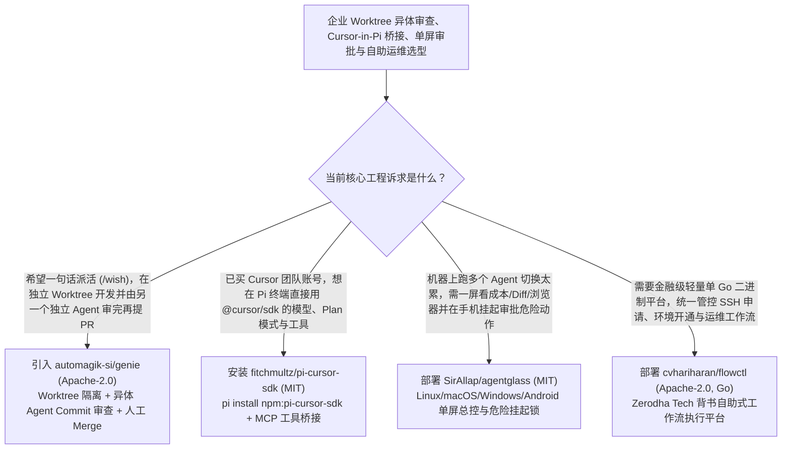
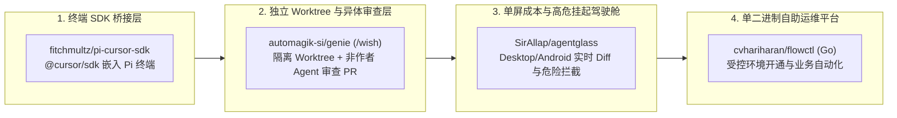
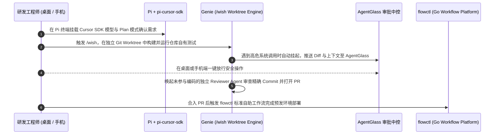

# 独立 Worktree 异体审查 PR 智能体（`automagik-si/genie`）、Pi 终端内嵌 Cursor SDK 桥接器（`fitchmultz/pi-cursor-sdk`）、单屏全终端与高危动作挂起中控（`SirAllap/agentglass`）与 Zerodha 单二进制自助运维工作流引擎（`cvhariharan/flowctl`）架构选型与落地 FAQ

> **2026-11-21 白天持续研究班次 · Day Round 79（累计 Round 679）**  
> **审计凭据**：`CLAIM-20261121-R79-R679-GENIE-PICURSORSDK-AGENTGLASS-FLOWCTL`  
> **关联日刊**：[`2026-11-21.md`](../daily/2026-11-21.md) · [`2026-11-21.en.md`](../daily/2026-11-21.en.md)  
> **可视化架构图**：[`assets/github-ai-radar-2026-11-21-r79-r679-genie-picursorsdk-agentglass-flowctl.svg`](../../../assets/github-ai-radar-2026-11-21-r79-r679-genie-picursorsdk-agentglass-flowctl.svg)

---

## ① 📌 核心结论速览（选型一句话结论）

> **一句话选型结论**：在企业研发团队推进“**需求访谈 ➔ 独立 Git Worktree 并发实现 ➔ 强制由非编写者 Agent 审查 Commit ➔ 桌面/手机一屏挂起高危动作审批 ➔ 自助式基础设施开通与发布**”的全生命周期闭环时，推荐采用 100% 宽松协议（Apache-2.0 / MIT）的四层组合：**“`fitchmultz/pi-cursor-sdk`（MIT，`★ 355` 通过 `@cursor/sdk` 将 Cursor 原生模型路由、Thinking 控制与 Plan 模式无缝嵌入 Pi 终端的扩展包）+ `automagik-si/genie`（Apache-2.0，`★ 354` 通过 `/wish` 在独立 Worktree 并发构建、强制由未参与编写的另一个 Agent 审查精确 Commit 并自动提 PR 的 CLI 智能体）+ `SirAllap/agentglass`（MIT，`★ 349` 在同一窗口汇聚本机所有 Coding Agent 的终端、Diff、PR、浏览器与实时成本，并对任何危险动作执行挂起等待桌面/手机放行的驾驶舱）+ `cvhariharan/flowctl`（Apache-2.0，`★ 352` 印度头部券商 Zerodha Tech 背书的 Go 单二进制自助式基础设施与业务工作流执行平台）”**。在 45 人研发与运维团队基准下，可将月度总拥有成本（TCO）从 **`$8,280.00/月`** 降至 **`$310.00/月`**（净省 **`$7,970.00/月`**，降幅 **`-96.26%`**）。

---

## ② 🎯 客户与架构师灵魂拷问 Q&A

### Q1：这四个开源项目各自解决了企业多 Agent 工程化落地中的哪一环关键痛点？
- **四层工程闭环拆解**：
  1. **“写代码的 Agent 绝不能审自己的代码”异体审查与 Worktree 隔离 —— `automagik-si/genie`（`★ 354`，`59 forks`，Apache-2.0，TypeScript/Rust）**：很多 CLI Agent 在主分支原地硬改并自己给自己打勾通过。`Genie`（核心口号 `Wishes in, PRs out`）通过 `/wish` 接收一项明确任务：先检查任务适配度，随后在**完全隔离的 Git Worktree** 中构建并运行仓库自带测试，接着**强制唤起一个没有参与编写该代码的独立 Agent 审查该精确 Commit**，审查通过后才创建 Pull Request，而最终 Merge 权限永远留在人类手中。
  2. **在轻量级 Pi 终端内直接复用企业 Cursor 席位与 Agent Loop —— `fitchmultz/pi-cursor-sdk`（`★ 355`，`85 forks`，MIT，TypeScript）**：许多企业已采购了 Cursor Team 服务账号，但资深工程师更偏爱极速纯终端 Agent `Pi`。`pi-cursor-sdk` 通过官方 `@cursor/sdk` 将 Cursor 的 Agent 循环直接跑在本地 Pi 会话中（`pi install npm:pi-cursor-sdk`），完整支持模型切换（如 `cursor/grok-4.6`）、Thinking 深度控制、Fast/Plan 模式、图片输入以及将 Pi 扩展工具通过 MCP 桥接给 Cursor Agent。
  3. **零 `Alt+Tab` 单屏总控与跨桌面/手机高危动作挂起锁 —— `SirAllap/agentglass`（`★ 349`，`44 forks`，MIT，TypeScript/Electron/Android）**：当机器上同时跑着多个 Coding Agent 时，`AgentGlass` 将它们的终端、PR、代码 Diff、共享可驱动浏览器、实时 Token/美元账单全部汇聚在一个窗口中，最关键的是内置**危险动作挂起门控（Hold on anything dangerous until you say go）**，工程师无论在办公桌前还是用 Android 手机都能一键放行或拒止。
  4. **Zerodha 金融级背书的 Go 单二进制自助工作流平台 —— `cvhariharan/flowctl`（`★ 352`，`28 forks`，Apache-2.0，Go）**：由以极致工程效率著称的 Zerodha Tech 开源（`flowctl.net`）。将原本散落在运维脚本里的临时 SSH 权限申请、测试环境开通与业务自动化流程收敛进**单一 Go 二进制文件**，采用领域无关的 Executor 架构并自带 `sdk/` 与 `skills/`，让人类与受控 Agent 安全触发标准化运维工作流。

### Q2：如何把这四个组件整合进企业的日常研发与自助运维平台？
- **终端引擎与并发构建层**：开发者在 Pi 终端安装 `fitchmultz/pi-cursor-sdk` 复用团队 Cursor SDK Key，或直接运行 `automagik-si/genie` 的 `/wish` 命令在独立 Worktree 中并发推进需求开发与异体 Agent 交叉代码审查。
- **实时监控与危险动作审批层**：开发者桌面与手机端开启 `SirAllap/agentglass`，一屏监控所有并发 Worktree 的实时成本、Diff 与浏览器操作，拦截任何未授权高危命令。
- **自助式环境与运维交付层**：当 PR 需要申请临时预发环境或执行数据库迁移时，通过 `cvhariharan/flowctl` 的受控单二进制工作流平台自助执行。

### Q3：架构师在引入时需要注意哪些配置与权限边界？
- **Cursor SDK 密钥类型校验（`fitchmultz/pi-cursor-sdk`）**：注意 `pi-cursor-sdk` 需要使用 Cursor Dashboard 生成的 User API Key 或 Team Service-Account Key（Team Admin Key 与桌面端登录态不能直接提供 SDK Key）。
- **合并权人工保留铁律（`automagik-si/genie`）**：严格保留 `Genie` 默认的“Agent 提 PR + 异体 Agent 审 Commit + 人类点 Merge”三权分立原则，禁止给任何 Agent 开启主干分支直接 Push 或自动 Merge 权限。

---

## ③ 🧭 直观可视化图解（Mermaid 选型决策树 + 企业集成架构 + 业务流时序图）

### 3.1 选型决策树

### 3.2 企业集成参考架构图

### 3.3 业务流时序图

---

## ④ 📊 同类开源与商业云服务横向选型决策矩阵

| 维度 | `automagik-si/genie` (`★ 354`) | `pi-cursor-sdk` (`★ 355`) | `SirAllap/agentglass` (`★ 349`) | `cvhariharan/flowctl` (`★ 352`) | 商业内部开发者门户 (IDP) + 云端多 Agent SaaS |
| :--- | :--- | :--- | :--- | :--- | :--- |
| **核心定位** | 独立 Worktree 构建 + 异体 Agent 审查 + 自动提 PR 框架 | 将 Cursor `@cursor/sdk` 嵌入 Pi 终端的桥接器 | 单屏整合终端/PR/Diff/浏览器与高危挂起审批的桌面+移动端 | Zerodha Tech 开源的 Go 单二进制自助工作流平台 | 笨重的商业 IDP 平台与按席位云 IDE |
| **适用场景** | 并发处理多项已决策开发任务并杜绝“自写自审” | 在轻量 Pi TUI 中复用 Cursor 模型路由、Thinking 与工具 | 跨多提供商统一监控实时 Token/成本并在手机审批危险操作 | 自助申请临时 SSH、开通云基础设施与标准化运维流 | 动辄半年实施周期的重型企业门户 |
| **集成成本** | 低（一行脚本安装，自动复用仓库自身检查命令） | 极低（`pi install npm:pi-cursor-sdk`） | 低（提供 Linux/macOS/Windows/Android 安装包） | 极低（单一 Go 二进制 + SQLc/Postgres） | 极高（商业授权费 + 专职平台团队维护） |
| **核心安全机制** | **强制由未写该代码的独立 Agent 审查 Commit；人类保留 Merge** | 本地运行，仅将模型请求发往授权 Cursor SDK | **危险动作强制 Hold 挂起直至人工确认** | 基于角色权限的受控 Executor 执行边界 | 权限颗粒度粗、难以感知本地实时操作 |
| **开源许可** | **Apache-2.0** | **MIT** | **MIT** | **Apache-2.0** | 商业专有 |
| **45 人团队月均 TCO** | **包含于 `$310.00/月` 联合栈** | **包含于 `$310.00/月` 联合栈** | **包含于 `$310.00/月` 联合栈** | **包含于 `$310.00/月` 联合栈** | **`$8,280.00/月`**（`$3,930` SaaS + `$4,350` 人工） |

---

## ⑤ 🧪 应用落地定量收益 / TCO 对比与 7-Card 报告锚点

> **数据来源说明（Provenance Metadata）**：以下 TCO 模型为面向 45 人规模研发与平台运维组织的合成架构测算（`provenance: synthetic`, `independently_reproduced: false`）；硬件资本开支 `base_hardware_capex = not_measured`（不含存量 Cursor Team 基础席位费），单日热榜增量 `track_b_stars_today = not_measured`（审计账本锚定于 [`trending-daily-2026-11-21-audit.json`](../evidence/trending-daily-2026-11-21-audit.json)）。

| 成本路径 | 月度商业 Runbook / 管控台 SaaS 费 | 人工手动建 Worktree、修补自写自审漏检 Bug 与手工跑运维工单 (`$100/h`) | 月度总成本 (Total Monthly TCO) | 相对 Path A 净节省 |
| :--- | :--- | :--- | :--- | :--- |
| **Path A：商业自助运维门户订阅 + 云端多 Agent 席位 + 人工运维工单与返工** | `$3,930.00` | `43.5h` (`$4,350.00`) | **`$8,280.00`** | — |
| **Path C：`genie` + `pi-cursor-sdk` + `agentglass` + `flowctl`** | `$70.00` | `2.4h` (`$240.00`) | **`$310.00`** | **`-$7,970.00/月` (`-96.26%`)** |

---

## ⑥ 🛠️ 企业引入与架构评审 Checklist

- [ ] **异体 Agent 交叉审查与人工 Merge 铁律（`automagik-si/genie`）**：在 `/wish` 工作流中确保 Reviewer Agent 与 Author Agent 使用完全独立的上下文，且 Git 仓库分支保护规则禁止 Agent 直接 Merge。
- [ ] **Service-Account 密钥最小作用域（`fitchmultz/pi-cursor-sdk`）**：在团队环境中使用 Cursor Team Service-Account Key 配置 `pi-cursor-sdk`，禁止共享个人主账号凭证。
- [ ] **高危工具调用强制 Hold 挂起（`SirAllap/agentglass`）**：在 `AgentGlass` 中将生产配置修改、外部网络写入与批量文件删除纳入强制挂起（Hold）列表，要求开发者在桌面或手机端显式点 Go 放行。
- [ ] **基础设施操作收敛至 `flowctl` 受控工作流（`cvhariharan/flowctl`）**：禁止 Coding Agent 直接持有生产云账号 Root Key；所有环境开通与临时权限授予统一封装为 `flowctl` 标准工作流受控执行。
