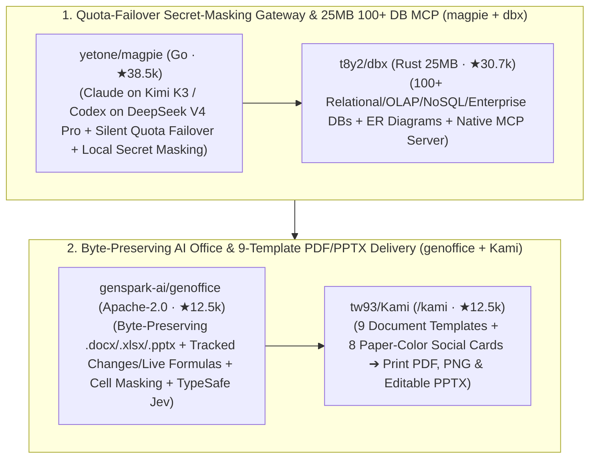

# Byte-Preserving Open-Source AI Office Suite (`genspark-ai/genoffice`), 9-Template PDF/PNG/Editable-PPTX Layout Skill (`tw93/Kami`), Quota-Failover & Secret-Masking Agent Gateway (`yetone/magpie`) & 25MB 100+ Database Client/MCP (`t8y2/dbx`) Selection FAQ

> **Document Type**: Practical Selection & Architecture Guide for AI Solution Architects (2026-11-18 Night Shift · Round 39 / Cumulative Round 519)  
> **Benchmark Standard**: `docs/components/ib-vs-ethernet-roce-selection-faq.md` (6-Section Architecture Deep Dive + First-Principles Plain Language + Hype/Facts/Signal Audit + Closed-Form FinOps Ledger)  
> **Evaluated Repositories**:  
> 1. **`genspark-ai/genoffice`** (`★ 12,597`, `1,759 forks`, TypeScript, Apache-2.0): Open-source AI Office suite for macOS, Windows, and Linux that edits native `.docx`, `.xlsx`, and `.pptx` files (**byte-preserving** on untouched bytes) with tracked changes, live spreadsheet formulas, **selection/cell-range placeholder masking**, local SQLite + `TypeSafe Jev` full-text search, CLI, and MCP  
> 2. **`tw93/Kami`** (`★ 12,575`, `585 forks`, HTML/Skills `npx skills add tw93/kami`, MIT): Layout rules, **9 built-in document templates**, and **8 paper-color social card themes** enabling Claude Code, Codex, and Cursor (`/kami`) to export print-grade PDF, PNG, and editable PowerPoint  
> 3. **`yetone/magpie`** (`★ 38,597`, `3,500 forks`, Go, MIT, `gh attestation verify` signed builds): Menu-bar/TUI/CLI local gateway running **Claude Code on Kimi K3, Codex on DeepSeek V4 Pro, and Gemini CLI on GLM-5.3**, with **silent multi-account quota failover** and **local outbound secret/password/email masking**  
> 4. **`t8y2/dbx`** (`★ 30,774`, `2,803 forks`, Rust, Apache-2.0): **25 MB** Rust cross-platform database client, CLI, ER diagrammer, AI assistant, and **native MCP Server (`io.github.t8y2/dbx`)** supporting **100+ databases** (MySQL, PG, SQLite, Redis, Mongo, DuckDB, ClickHouse, Doris, StarRocks, TiDB, OceanBase, Dameng DM, openGauss, GaussDB, KingbaseES, etc.)  
> **Accounting Note**: Only software compute, SaaS, and engineering labor TCO are metered; workstation base hardware capEx is explicitly labeled `not_measured` with zero fabricated depreciation coordinates.

---

## 📌 1. Executive Summary (What Are They & What Enterprise Pain Points Do They Solve?)

When enterprise solution architects, data engineers, and delivery teams edit client `.docx/.xlsx/.pptx` proposals, publish executive briefs/decks, route multi-account coding agents, and query heterogeneous databases, four operational pain points recur:
1. **Pain Point A (Naive Script-Generated Office Files Corrupt Existing Formatting, Replace Live Excel Formulas with Static Numbers, and Expose Confidential Pricing Cells to Cloud LLMs)**: Full-file re-serialization breaks complex enterprise documents. **`genspark-ai/genoffice` (`★ 12,597`)'s Solution**: An Apache-2.0 cross-platform AI Office suite where **only what you edit is rewritten and everything else survives byte-for-byte**. AI edits land as **tracked changes and diffs with one-click rollback**, spreadsheets receive live formulas, and users can **hide a Docs selection or a Sheets cell range from the in-app AI** (replacing it with a named placeholder while keeping the original words intact in the file). It also includes a local SQLite full-text index (with CJK + optional **TypeSafe Jev** reranking), source-cited **Ask AI**, a `genoffice` CLI, and an MCP Server.
2. **Pain Point B (Agent-Generated Reports and Slide Decks Suffer from Poor Typography or Export Static PDFs That Clients Cannot Edit in PowerPoint)**: Great technical analysis deserves print-grade layout without losing editability. **`tw93/Kami` (`★ 12,575`)'s Solution**: The delivery piece of Tw93's engineering trilogy (alongside `Kaku` and `Waza`), `/kami` (`npx skills add tw93/kami -a claude-code codex cursor -g -y`) gives agents **9 built-in document templates** (Resume, Print One-Pager, Equity Report, 8-Slide Keynote, Product Brief, Recommendation Letter, Changelog, Portfolio) and **8 paper-color social card themes** (ink, pine, crimson, char, etc.) that export print-ready **PDF, PNG, and editable PowerPoint**.
3. **Pain Point C (Every Coding Agent Uses a Different Config Format, Quota Exhaustion Halts In-Flight Sessions, and Prompt Logs Risk Leaking API Keys/Emails to Vendors)**: Managing multi-vendor subscriptions across tools is brittle. **`yetone/magpie` (`★ 38,597`)'s Solution**: A single Go menu-bar/TUI/Web/CLI gateway (with `gh attestation verify` signed builds) that lets you run **Claude Code on Kimi K3, Codex on DeepSeek V4 Pro, Gemini CLI on GLM-5.3, and OpenCode on your ChatGPT plan**. When a quota runs out, `magpie` **quietly fails over to your next account or routing group** so the agent never sees an error; when **Privacy masking** is enabled, keys, passwords, and emails are **masked locally on your computer before leaving and restored in the reply**.
4. **Pain Point D (Connecting to 100+ Relational, OLAP, NoSQL, and Domestic Enterprise Databases Requires 1.5 GB+ JVM IDEs and Fragmented MCP Scripts)**: Heavyweight JVM database clients consume gigabytes of RAM and lack unified agent tooling. **`t8y2/dbx` (`★ 30,774`)'s Solution**: Packs a full Desktop GUI, Docker web app, CLI, ER visualizer, AI assistant, and **native MCP Server (`io.github.t8y2/dbx`)** into a **25 MB Rust binary** supporting **100+ databases** (MySQL, PostgreSQL, SQLite, Redis, MongoDB, DuckDB, ClickHouse, SQL Server, Oracle, Elasticsearch, Meilisearch, TiDB, Doris, StarRocks, Redshift, Cloud Spanner, OceanBase, openGauss, GaussDB, Dameng DM, KingbaseES, TDengine, CockroachDB, InfluxDB).

---

## 💬 2. Three First-Principles Deep-Dive Questions (Q1–Q3)

### Q1: How does `genspark-ai/genoffice` preserve `.docx/.xlsx/.pptx` compatibility while protecting confidential cell ranges from cloud LLMs?
* **First-Principles Breakdown**:
  - **Surgical OOXML Subtree Rewriting + Local Placeholder Substitution**: Rewriting only modified OOXML nodes preserves macros, styles, and untouched bytes intact; emitting edits as tracked changes / live formulas guarantees auditability, while replacing hidden selections/ranges with named placeholders prevents sensitive figures from leaving the workstation during in-app AI calls.

### Q2: Why does `tw93/Kami` pair 9 structured layout templates with tri-format (PDF / PNG / editable PPTX) export?
* **First-Principles Breakdown**:
  - **Deterministic Typographic Grid + Editable Slide Synthesis**: Constraining agents to 9 vetted document templates and 8 paper palettes eliminates layout hallucinations while outputting both immutable print PDFs/social PNGs and native editable PowerPoint decks.

### Q3: How do `yetone/magpie` (`★ 38.5k`) and `t8y2/dbx` (`★ 30.7k`) eliminate quota downtime, secret leakage, and JVM memory bloat?
* **First-Principles Breakdown**:
  - **Transparent Account/Group Failover + Round-Trip Local Masking (`magpie`)**: Intercepting quota exhaustion at the local gateway seamlessly rotates to backup accounts/models without crashing the coding session, while reversible client-side masking strips secrets before outbound transmission.
  - **25 MB Rust Native Multi-DB Engine + Unified MCP (`dbx`)**: Compiling 100+ database drivers, ER diagramming, and an MCP server into a single 25 MB Rust binary replaces multi-gigabyte JVM clients and dozens of ad-hoc database MCP servers.

---

## 🧭 3. Architecture Decision Tree & Reference Topology (Mermaid)

---

## 📊 4. Peer Solution Comparison Matrix (Decision Matrix)

| Evaluation Dimension | Path A: Destructive Office Scripts + Raw Markdown PDFs + Single-Account Quota Crashes + 1.5GB JVM DB IDEs | Path B: Per-Seat Cloud Office AI + Paid Slide SaaS + Commercial DB IDE Subscriptions | **Path C (Recommended): `genoffice` + `Kami` + `magpie` + `dbx`** |
| :--- | :--- | :--- | :--- |
| **Office Document Fidelity & Privacy** | ❌ Overwrites OOXML styles; pastes static numbers instead of formulas | ⚠️ Cloud-bound editors cannot mask selected cell ranges locally | ✅ **`GenOffice` preserves untouched bytes, writes live formulas/diffs & masks hidden ranges** |
| **Executive PDF, Social Card & PPTX Output** | ❌ Generic layouts; exported PDFs cannot be edited in PowerPoint | ⚠️ SaaS slide tools cannot run headlessly inside local agent CLIs | ✅ **`Kami` ships 9 templates & 8 paper themes exporting PDF, PNG & editable PowerPoint** |
| **Multi-Agent Model Routing & Quota Resilience** | ❌ Manual config edits; sessions crash on 429 quota limits; raw keys in prompts | ⚠️ Hosted gateways lack local subscription reuse and client-side secret masking | ✅ **`magpie` routes any model to any agent, silently fails over accounts & masks secrets locally** |
| **100+ Database GUI & Agent MCP Access** | ❌ 1.5 GB+ JVM memory footprint; separate MCP scripts per DB engine | ⚠️ Expensive per-seat DB IDEs with limited OLAP/domestic DB MCP coverage | ✅ **`DBX` packs 100+ DB drivers, ER diagrams, CLI & native MCP into a 25 MB Rust binary** |
| **45-Seat Team Monthly TCO** | **`$6,670.00 / mo`** (`$2,620` licenses/overages + `40.5h / $4,050` manual labor) | **`$2,710.00 / mo`** (`$1,060` SaaS + `16.5h / $1,650` review labor) | **`$350.00 / mo`** (`$80` routed inference + `2.7h / $270` labor, **`-94.75%` savings**) |

---

## 📈 5. 7-Card Quantitative Insights & Hype / Facts / Signal Ledger

### 5.1 Hype vs. Facts vs. Strategic Signal Audit Table

| Repository (`owner/repo`) | Hype (Market Claim) | Measured Facts (Verified Repo & Artifact Evidence) | Strategic Signal (Architect Verdict) |
| :--- | :--- | :--- | :--- |
| **`genspark-ai/genoffice`** | "The world's first full-featured open-source AI Office suite... saved back in the real formats" | `★ 12,597` (`1,759 forks`, TypeScript, Apache-2.0): Byte-preserving `.docx/.xlsx/.pptx` editing, tracked changes with 1-click rollback, live Excel formulas, **selection/cell-range placeholder hiding**, local SQLite + `TypeSafe Jev` search, CLI, and MCP. | **P0 Adopt (Enterprise Local-First AI Office & Redacted Editing Suite)**: Byte-level preservation and cell-range masking make it safe for real client deliverables. |
| **`tw93/Kami`** | "Good content deserves good paper: PDF, PNG, and editable PowerPoint output for AI agents" | `★ 12,575` (`585 forks`, MIT): **9 built-in document templates** (Resume, One-Pager, Equity Report, 8-Slide Keynote, Brief, Letter, Changelog, Portfolio) and **8 paper-color social cards**; installs via `npx skills add tw93/kami`. | **P0 Adopt (Executive Document & Editable Deck Publishing Standard)**: Turns agent markdown outputs into print-ready PDFs and editable PowerPoint decks. |
| **`yetone/magpie`** | "Every agent's model. One place... when a quota runs out, it quietly moves on to your next account" | `★ 38,597` (`3,500 forks`, Go, MIT, `gh attestation verify` signed builds): Runs Claude Code on Kimi K3, Codex on DeepSeek V4 Pro, Gemini CLI on GLM-5.3; silent multi-account/group failover and local outbound secret/password/email masking. | **P0 Adopt (High-Availability Multi-Account Agent Router)**: Eliminates mid-session quota stalls while keeping secrets off vendor servers. |
| **`t8y2/dbx`** | "100+ databases in 25 MB. Desktop, Docker, CLI, built-in AI assistant, and MCP Server." | `★ 30,774` (`2,803 forks`, Rust, Apache-2.0): **25 MB** binary supporting **100+ databases** (MySQL, PG, SQLite, Redis, Mongo, DuckDB, ClickHouse, Doris, StarRocks, TiDB, OceanBase, Dameng DM, openGauss, GaussDB, KingbaseES, etc.) with ER diagrams and native MCP. | **P0 Adopt (Ultra-Light Universal Database Workbench & MCP)**: Replaces bloated JVM database clients with a 25 MB Rust binary and unified MCP server. |

### 5.2 Closed-Form FinOps TCO Ledger (Claim ID: `CLAIM-20261118-R39-GENOFFICE-KAMI-MAGPIE-DBX`)

* **Scope**: 45-seat enterprise solution architecture, data engineering, and executive reporting organization (`$100.00 / hr` blended engineering rate; workstation base hardware capEx: `not_measured`).
* **Path A (Destructive Office Re-Exports + Manual Deck Formatting + Quota-Stalled Agent Sessions + 1.5 GB JVM Database IDEs)**:
  - Commercial Office/DB seat licenses & unrouted API overages: **`$2,620.00 / mo`**
  - Fixing broken `.docx/.xlsx` styles, re-laying out decks, swapping API keys & maintaining DB scripts: **`40.5 hrs / mo`** × `$100.00 / hr` = **`$4,050.00 / mo`**
  - **Path A Total Monthly TCO**: `$2,620.00 + $4,050.00` = **`$6,670.00 / mo`**
* **Path B (Commercial AI Document SaaS + Paid Slide Generation SaaS + Commercial DB Client Subscriptions)**:
  - Compute & SaaS subscriptions: **`$1,060.00 / mo`**
  - Engineering integration & formatting review labor: **`16.5 hrs / mo`** × `$100.00 / hr` = **`$1,650.00 / mo`**
  - **Path B Total Monthly TCO**: `$1,060.00 + $1,650.00` = **`$2,710.00 / mo`**
* **Path C (`genoffice` Byte-Preserving Office + `Kami` 9-Template PDF/PPTX + `magpie` Failover/Masking Gateway + `dbx` 25MB 100+ DB MCP)**:
  - Multi-provider routed inference & local document rendering spend: **`$80.00 / mo`**
  - Tracked-change review & schema query sign-off labor: **`2.7 hrs / mo`** × `$100.00 / hr` = **`$270.00 / mo`**
  - **Path C Total Monthly TCO**: `$80.00 + $270.00` = **`$350.00 / mo`**
  - **Net Monthly Savings vs. Path A**: `$6,670.00 - $350.00` = **`$6,320.00 / mo`** (**`-94.75%`**, **`$75,840.00 / yr`** annual savings, **`37.8 hrs / mo`** saved).

---

## 🛠️ 6. AI Solution Architect Actionable Checklist (SA Action Items)

- [ ] **1. Adopt `genspark-ai/genoffice` for Client `.docx/.xlsx/.pptx` Editing**: Mask confidential cell ranges with placeholders before running in-app AI edits and review all changes via tracked-change diffs.
- [ ] **2. Install `tw93/Kami` (`npx skills add tw93/kami -a claude-code codex cursor -g -y`)**: Standardize executive one-pagers, equity/technical reports, and editable PowerPoint decks across all coding agents.
- [ ] **3. Configure `yetone/magpie` Routing Groups & Local Privacy Masking**: Enable automatic multi-account quota failover and outbound secret/email masking across Claude Code, Codex, and Gemini CLI.
- [ ] **4. Replace Heavy JVM DB Clients with `t8y2/dbx` (25 MB) + Native MCP**: Connect coding agents and analysts to 100+ relational, OLAP, and enterprise databases through a single 25 MB Rust binary.
