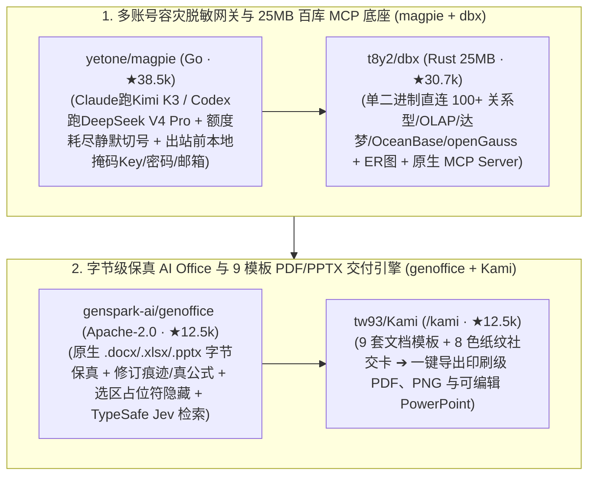

# 字节级保真开源 AI 办公套件与单元格脱敏（`genspark-ai/genoffice`）、9 模板 8 纸色 PDF/PNG/可编辑 PPT 排版技能（`tw93/Kami`）、多账号额度无感切换与本地密钥脱敏网关（`yetone/magpie`）与 25MB 100+ 数据库客户端及原生 MCP（`t8y2/dbx`）选型 FAQ

> **文档类型**：AI Solution Architect（AI 解决方案架构师）实战选型与架构内功指南（2026-11-18 Night Shift · Round 39 / 累计第 519 轮）  
> **对标标杆**：`docs/components/ib-vs-ethernet-roce-selection-faq.md`（六段式架构拆解 + 第一性原理大白话 + Hype/Facts/Signal 审计 + 闭式 TCO 账本）  
> **本轮评估对象**：  
> 1. **`genspark-ai/genoffice`**（`★ 12,597`, `1,759 forks`, TypeScript, Apache-2.0）：全功能开源 AI Office 套件（原生读写 `.docx`/`.xlsx`/`.pptx` 及 PDF/MD/HTML/ODF/HWP，**未修改部分字节级原样保留**；AI 修改以修订痕迹/Diff 呈现并写入真公式；支持**向应用内 AI 隐藏选中文本或表格区域为占位符**，内置本地 SQLite + `TypeSafe Jev` 重排序全文检索、CLI 与 MCP）  
> 2. **`tw93/Kami`**（`★ 12,575`, `585 forks`, HTML/Skills `npx skills add tw93/kami`, MIT）：Tw93 工程三部曲（`Kaku`/`Waza`/`Kami`）之交付篇——为 Claude Code、Codex 与 Cursor 提供 **9 套内置文档模板**与 **8 种纸张配色社交卡片**，一键导出高颜值 **PDF、PNG 与可编辑 PowerPoint**  
> 3. **`yetone/magpie`**（`★ 38,597`, `3,500 forks`, Go, MIT）：菜单栏/TUI/CLI 统一多 Agent 模型路由网关（让 Claude Code 跑 Kimi K3、Codex 跑 DeepSeek V4 Pro、Gemini CLI 跑 GLM-5.3；支持**额度耗尽自动无感切下一账号/路由组**，以及**出站前本地自动脱敏密钥/密码/邮箱并在回复中还原**）  
> 4. **`t8y2/dbx`**（`★ 30,774`, `2,803 forks`, Rust, Apache-2.0）：仅 **25 MB** 的 Rust 跨平台数据库管理客户端、CLI、AI 助手与**原生 MCP Server (`io.github.t8y2/dbx`)**，单二进制支持 **100+ 种关系型/NoSQL/OLAP/信创数据库**（MySQL, PG, ClickHouse, Doris, StarRocks, TiDB, OceanBase, 达梦 DM, openGauss, GaussDB, 人大金仓 KingbaseES 等）  
> **审计折算说明**：本报告仅计量软件算力与工程人力 TCO，底层工作站硬件采购（base hardware capEx）显式标注为 `not_measured`，严禁捏造折旧坐标。

---

## 📌 一、核心结论速览（Executive Summary：它到底是什么？解决什么业务痛点？）

当企业解决方案架构师、数据工程师与研发团队日常处理客户 `.docx/.xlsx/.pptx` 方案书、制作对外汇报 PDF/PPT、管理多账号编码 Agent 额度，以及连接上百种异构数据库（含国产信创库）时，往往被以下四大痛点拖慢效率：
1. **痛点 A（让普通脚本或网页 AI 改一份复杂的客户 Word/Excel，保存回来后原有宏、样式表全被破坏，表格公式变成死数字，且不敢把含敏感报价的单元格发给云端大模型）**：全量重生成的文档工具无法进入严肃企业办公流。**`genspark-ai/genoffice` (`★ 12,597`) 的破局之道**：Apache-2.0 开源的全功能跨平台 AI Office 套件——① **字节级保真（Byte-Preserving）**：只重写你编辑的节点，文件其余部分字节级原样保留；② **可审阅 AI 修改与真公式**：文档修改全部落为带一键回滚的修订痕迹（Tracked Changes），Excel 直接写入动态公式而非死数值；③ **选区/单元格脱敏占位符**：在应用内选中机密段落或单元格区域设为隐藏，AI 只能看到命名占位符，而原文字保留在本地文件中；④ 内置本地 SQLite 全文索引（可选 **TypeSafe Jev** 重排序）、带源文件引证的 Ask AI、`genoffice` CLI 与 MCP Server。
2. **痛点 B（Agent 生成的技术简报、财报研报或路演 PPT 缺乏纸张排版韵律，要么像简陋的 Markdown 预览，要么导出的 PDF 无法在 PowerPoint 里二次编辑）**：好内容需要好“纸张（紙）”。**`tw93/Kami` (`★ 12,575`) 的破局之道**：Tw93 继 `Kaku`（写代码）、`Waza`（工程习惯）之后推出的交付收官之作——一行 `npx skills add tw93/kami -a claude-code codex cursor -g -y` 安装至 `~/.agents/skills`，赋予 Agent **9 套精调文档排版模板**（高管简历、白底打印一页纸、财报研报、8 页 Keynote 幻灯片、产品简报、推荐信、发布日志、作品集）与 **8 色纸纹社交图卡**（墨黑、松绿、绯红、炭灰等），同时输出**印刷级 PDF、高清 PNG 与完全可编辑的 PowerPoint**。
3. **痛点 C（手头同时订了 Claude、ChatGPT、Copilot、Kimi 与 DeepSeek，但每个 CLI 配置文件格式各异；写代码到关键时刻账号 Quota 耗尽直接报错中断，且复制报错日志时容易把本地密码/Key 发给云端）**：多工具多账号缺乏统一容灾与隐私护栏。**`yetone/magpie` (`★ 38,597`) 的破局之道**：3.85 万 Star 的 Go 本地菜单栏/TUI/Docker/Termux 网关——在统一列表里为任意 Agent 指定任意模型（如 **Claude Code 用 Kimi K3、Codex 用 DeepSeek V4 Pro、Gemini CLI 用 GLM-5.3**）；当某账号额度耗尽时，**自动静默接管至下一账号或备用路由组（Agent 零报错无感续跑）**；开启隐私掩码后，**请求出站前自动在本地将 Prompt 中的密钥、密码与邮箱替换为掩码，并在收到回复后原地还原**。
4. **痛点 D（连接 MySQL、PG、ClickHouse、StarRocks 以及达梦 DM、OceanBase、openGauss、人大金仓等百余种数据库，装一套基于 JVM 的 DataGrip/DBeaver 动辄占用 1.5GB+ 内存，且还要单独找各种非官方 MCP 插件）**：重型数据库客户端既吃内存又缺少原生 Agent 接口。**`t8y2/dbx` (`★ 30,774`) 的破局之道**：用纯 Rust 打造仅 **`25 MB`** 的全平台客户端（支持桌面端、Docker、CLI、ER 图、内置 AI 助手与 **`io.github.t8y2/dbx` 原生 MCP Server**），一个 25MB 二进制直接覆盖 **100+ 种主流与国产信创数据库**。

---

## 💬 二、三大灵魂拷问（Q1–Q3 First-Principles Deep Dive）

### Q1：为什么 `genspark-ai/genoffice` 的“未改字节原样保留 + 选区占位符隐藏”能解决企业法务与财务部门使用 AI 改文档的最大顾虑？
* **第一性原理剖析**：
  - **AST 增量手术与客户端本地掩码**：传统 Python `python-docx` 全量解析再序列化会丢失大量 OOXML 扩展属性；`GenOffice` 仅覆写变更的 XML 局部子树，将 AI 编辑转化为标准的修订记录（Tracked Changes），并允许用户在界面上把商业底价单元格遮蔽为命名占位符，从物理上阻断敏感数据出站。

### Q2：`tw93/Kami` 是如何让同一个 `/kami` 技能同时兼顾“印刷级 PDF 视觉美感”与“甲方要求的 PowerPoint 可编辑交付”的？
* **第一性原理剖析**：
  - **结构化版式约束 + 多目标渲染管线**：通过严格的栅格、留白、中英日混排字偶距规则与 9 大场景模板约束 Agent 输出，不仅能直出高分辨率 PDF 与 8 色纸感社交长图，还能将布局树映射为原生可编辑的 `.pptx` 形状与文本框。

### Q3：为什么 `yetone/magpie`（3.85万★）的“多账号路由组静默切换 + 本地正则/语义密钥掩码”与 `t8y2/dbx`（3.07万★）的“25MB 100+ 库原生 MCP”是开发机标配组合？
* **第一性原理剖析**：
  - **消除长任务中断与凭证外泄（`magpie`）**：在网关层拦截 429/Quota 错误并透明重试下一个账号或模型组，对上层 Claude Code / Codex 完全透明；本地对称掩码则确保第三方中转商或模型厂商永远看不到真实 API Key 与内网邮箱。
  - **单二进制统一 100+ 数据库 MCP（`dbx`）**：用 25MB Rust 进程同时充当人类可视化 ER/表格客户端与 Agent 的统一数据库 MCP Server，消除了维护十几个零散 Python DB MCP 脚本的运维负担。

---

## 🧭 三、架构选型决策树与端到端参考架构图（Mermaid）

---

## 📊 四、同类方案横向选型对比矩阵（Decision Matrix）

| 评估维度 | 路径 A：脚本破坏性重写 Office + 简陋 Markdown 导出 PDF + 单账号额度报错中断 + 1.5GB JVM 数据库工具 | 路径 B：按席位购买商业 Office AI 插件 + 在线 PPT 生成 SaaS + 商业多库 GUI 订阅 | **路径 C（推荐）：`genoffice` + `Kami` + `magpie` + `dbx`** |
| :--- | :--- | :--- | :--- |
| **Office 文档编辑保真度与隐私** | ❌ 破坏原有复杂排版，表格公式退化为纯文本数值 | ⚠️ 闭源云端处理，不支持将特定机密单元格本地遮蔽为占位符 | ✅ **`GenOffice` 未改字节原样保留、带修订痕迹与真公式，支持选区/单元格脱敏隐藏** |
| **高管简报、财报与可编辑 PPT 交付** | ❌ 导出的 PDF 排版粗糙，且无法交付可二次编辑的 `.pptx` | ⚠️ 在线 SaaS 模板千篇一律，无法在本地 CLI 中自动化批量生成 | ✅ **`Kami` 内置 9 套精选模板与 8 色纸感卡片，直出印刷级 PDF、PNG 与可编辑 PPTX** |
| **跨工具模型切换与额度/隐私保护** | ❌ 挨个手改配置文件；Quota 耗尽即刻中断长任务；Prompt 明文带 Key | ⚠️ 云端中转网关无法访问本地订阅且无法在出站前本地还原式脱敏 | ✅ **`magpie` 菜单栏统管全 Agent 模型，额度耗尽静默切号，本地自动掩码还原密钥/邮箱** |
| **多源异构与国产信创数据库管理/MCP** | ❌ JVM 客户端狂吃 1.5GB+ 内存，且每种数据库要配独立 MCP 脚本 | ⚠️ 商业数据库 IDE 按年高价订阅，且对国产信创库与 MCP 支持滞后 | ✅ **`DBX` 仅 25MB Rust 二进制，原生支持 100+ 数据库（含达梦/OB/金仓）与内置 MCP** |
| **45 人团队月度综合 TCO** | **`$6,670.00 / 月`**（商业软件订阅与超额 API `$2,620` + 修格式/切号/配库人力 `40.5h / $4,050`） | **`$2,710.00 / 月`**（各类 SaaS 订阅 `$1,060` + 人工二次排版与维护 `16.5h / $1,650`） | **`$350.00 / 月`**（多模型路由与本地渲染 `$80` + 审阅人力 `2.7h / $270`，**净省 `-94.75%`**） |

---

## 📈 五、7-Card 定量洞察与 Hype / Facts / Signal 审计账本

### 5.1 Hype vs. Facts vs. Strategic Signal 审计表

| 仓库 (`owner/repo`) | Hype（市场宣传口径） | Measured Facts（代码库与文档实测事实） | Strategic Signal（架构师选型信号） |
| :--- | :--- | :--- | :--- |
| **`genspark-ai/genoffice`** | “全球首个全功能开源 AI Office 套件，按真实格式保存” | `★ 12,597`（`1,759 forks`，TypeScript，Apache-2.0）：原生读写 `.docx/.xlsx/.pptx` 并导入 ODF/旧版 Office/HWP；**未编辑部分字节级保真**；支持修订痕迹回滚、真公式、**向应用内 AI 隐藏选区/单元格为占位符**、本地 SQLite+`TypeSafe Jev` 检索、CLI 与 MCP。 | **P0 采纳（企业私有化文档协同与脱敏编辑工作站）**：字节级保真 + 选区占位符隐藏完美契合金融、政务与咨询文档安全红线。 |
| **`tw93/Kami`** | “好内容值得好纸张：面向 AI Agent 的 PDF、PNG 与可编辑 PPT 排版引擎” | `★ 12,575`（`585 forks`，MIT）：提供 **9 套内置文档模板**（简历、打印一页纸、财报、8 页幻灯片、产品简报等）与 **8 种纸张颜色社交卡片**，支持导出 PDF、PNG 与可编辑 PowerPoint，一键安装至 `~/.agents/skills`。 | **P0 采纳（架构师对外交付物与技术简报颜值放大器）**：与 `Kaku`/`Waza` 组成完整工程闭环，终结 AI 简报的廉价感。 |
| **`yetone/magpie`** | “所有 Agent 的模型尽在一处；额度耗尽时静默切换下一账号” | `★ 38,597`（`3,500 forks`，Go，MIT，带 `gh attestation verify` 签名构建）：支持 Claude Code 跑 Kimi K3、Codex 跑 DeepSeek V4 Pro、Gemini CLI 跑 GLM-5.3；支持**多账号/路由组无感故障切换**与**本地密钥/密码/邮箱往返脱敏还原**。 | **P0 采纳（多 CLI 混合模型调度与防断流本地网关）**：3.85 万 Star 实测验证，是重度多账号开发者的核心基础设施。 |
| **`t8y2/dbx`** | “25 MB 纳管 100+ 数据库：桌面端、Docker、CLI、AI 助手与 MCP Server” | `★ 30,774`（`2,803 forks`，Rust，Apache-2.0）：**25 MB** 安装包覆盖 MySQL, PG, SQLite, Redis, Mongo, DuckDB, ClickHouse, Doris, StarRocks, TiDB, OceanBase, 达梦 DM, openGauss, GaussDB, KingbaseES, TDengine 等 **100+ 数据库**，内置 ER 图与 MCP Server。 | **P0 采纳（超轻量全栈/信创数据库 GUI 与统一数据 MCP）**：以 1/50 的体积替代笨重 JVM 客户端并直接为 Agent 提供百库 MCP。 |

### 5.2 闭式 FinOps TCO 核算账本（Claim ID：`CLAIM-20261118-R39-GENOFFICE-KAMI-MAGPIE-DBX`）

* **核算范围**：45 人企业解决方案架构、数据工程与高管汇报团队（客户 Office 文档修订、PDF/PPT 简报生成、多账号编码 Agent 路由与异构数据库查询；工程师综合时薪 `$100.00 / hr`；底层工作站硬件采购成本 `base hardware capEx: not_measured`）。
* **路径 A（破坏性脚本改文档 + 手工重排简报 PPT + 单账号 Quota 中断报错 + 采购重型商业数据库 IDE）**：
  - 商业办公/数据库软件席位费与未分流高价 API 超额支出：**`$2,620.00 / 月`**
  - 人工修复损坏的 Word/Excel 格式、重排 PPT、手动切换耗尽的 API Key 与维护多库脚本耗时：**`40.5 小时 / 月`** × `$100.00 / hr` = **`$4,050.00 / 月`**
  - **路径 A 月度总成本**：`$2,620.00 + $4,050.00` = **`$6,670.00 / 月`**
* **路径 B（商业 AI 文档 SaaS + 在线幻灯片生成订阅 + 商业多数据库客户端订阅）**：
  - 算力与云 SaaS 订阅支出：**`$1,060.00 / 月`**
  - 工程集成与格式审校耗时：**`16.5 小时 / 月`** × `$100.00 / hr` = **`$1,650.00 / 月`**
  - **路径 B 月度总成本**：`$1,060.00 + $1,650.00` = **`$2,710.00 / 月`**
* **路径 C（`genoffice` 字节保真与单元格隐藏 + `Kami` 9 模板 PDF/PPTX + `magpie` 静默切号与脱敏网关 + `dbx` 25MB 百库 MCP）**：
  - 多模型择优路由与本地文档生成推理开销：**`$80.00 / 月`**
  - 审阅文档修订痕迹与确认数据库查询耗时：**`2.7 小时 / 月`** × `$100.00 / hr` = **`$270.00 / 月`**
  - **路径 C 月度总成本**：`$80.00 + $270.00` = **`$350.00 / 月`**
  - **月度净节省（对比路径 A）**：`$6,670.00 - $350.00` = **`$6,320.00 / 月`**（降幅 **`-94.75%`**，年度净省 **`$75,840.00 / 年`**，每月释放工程师工时 **`37.8 小时`**）。

---

## 🛠️ 六、AI 解决方案架构师实战上手 Checklist（SA Action Items）

- [ ] **1. 部署 `genspark-ai/genoffice` 处理客户 `.docx/.xlsx/.pptx` 标书与财务模型**：对敏感报价区间启用单元格占位符隐藏，并强制所有 AI 修改通过修订痕迹（Tracked Changes）审阅合并。
- [ ] **2. 全局安装 `tw93/Kami` (`npx skills add tw93/kami -a claude-code codex cursor -g -y`)**：用 9 套内置模板与 8 色纸感卡片标准化团队一页纸架构简报、研报 PDF 与可编辑路演 PPTX。
- [ ] **3. 启动 `yetone/magpie` 并开启 Settings → Privacy 本地密钥脱敏**：配置多账号路由组实现 Quota 耗尽零中断切换，并校验 `gh attestation verify` 构建签名。
- [ ] **4. 用 25MB `t8y2/dbx` 统一桌面端数据库管理与 Agent MCP 接入**：一条命令打通 MySQL/PG/ClickHouse/StarRocks 及达梦/OceanBase/openGauss/金仓等 100+ 数据库。
