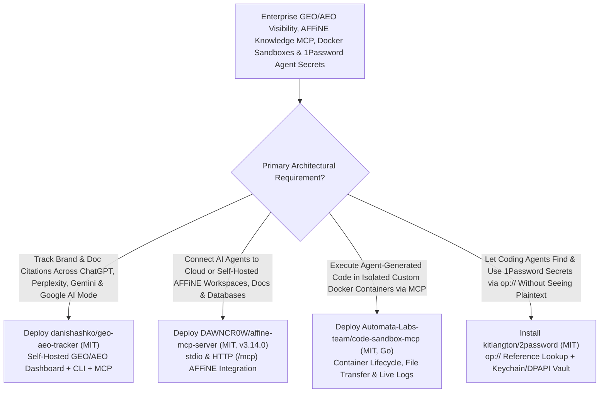
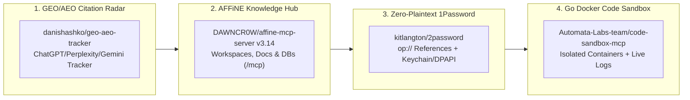
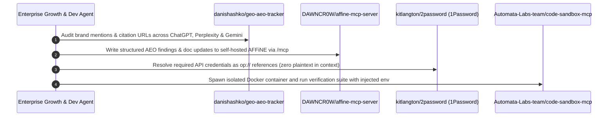

# Open-Source GEO/AEO Brand Tracker (`danishashko/geo-aeo-tracker`), AFFiNE Workspace & DB MCP (`DAWNCR0W/affine-mcp-server`), Go Docker Code Sandbox MCP (`Automata-Labs-team/code-sandbox-mcp`) & 1Password Secret-Reference Agent CLI (`kitlangton/2password`) Selection & Architecture FAQ

> **2026-11-21 Nightly Continuous Research Shift · Night Round 92 (Cumulative Round 692)**  
> **Audit Claim ID**: `CLAIM-20261121-R92-R692-GEOTRACKER-AFFINEMCP-CODESANDBOXMCP-2PASSWORD`  
> **Linked Daily Digests**: [`2026-11-21.en.md`](../daily/2026-11-21.en.md) · [`2026-11-21.md`](../daily/2026-11-21.md)  
> **Architecture Visual**: [`assets/github-ai-radar-2026-11-21-r92-r692-geotracker-affinemcp-codesandboxmcp-2password.svg`](../../../assets/github-ai-radar-2026-11-21-r92-r692-geotracker-affinemcp-codesandboxmcp-2password.svg)

---

## ① 📌 Executive Summary (One-Sentence Selection Verdict)

> **One-Sentence Verdict**: To track brand and documentation citations across ChatGPT, Perplexity, Gemini, and Google AI Mode, connect AI agents to cloud or self-hosted AFFiNE workspaces over stdio/HTTP MCP, execute untrusted agent code inside isolated Docker containers via Go MCP, and allow coding agents to find and inject 1Password `op://` secrets without ever exposing plaintext values in context, combine **`danishashko/geo-aeo-tracker` (MIT, `★ 334` / `77 forks` self-hosted GEO/AEO visibility dashboard, CLI, and MCP server) + `DAWNCR0W/affine-mcp-server` (MIT, `★ 332` / `90 forks` `v3.14.0` MCP server for AFFiNE workspaces, documents, and databases) + `Automata-Labs-team/code-sandbox-mcp` (MIT, `★ 328` Go MCP server managing isolated Docker code sandboxes with custom images and real-time log streaming) + `kitlangton/2password` (MIT, `★ 331` 1Password CLI/skill wrapper returning only `op://` references and storing service-account tokens in macOS Keychain or Windows DPAPI)**—cutting 45-engineer monthly TCO from **`$8,220.00/mo` to `$305.00/mo` (`-$7,915.00/mo`, `-96.29%`)**.

---

## ② 🎯 Solution Architect & Enterprise Buyer Q&A

### Q1: How do these four MIT-licensed tools solve visibility, knowledge management, and secret/execution security for AI agents?
- **Four High-Value Enterprise Capabilities**:
  1. **Self-Hosted GEO & AEO Brand Citation Tracking (`danishashko/geo-aeo-tracker`, `★ 334`, `77 forks`, MIT, TypeScript)**: Tracks how **ChatGPT, Perplexity, Gemini, and Google AI Mode** mention and cite your product or documentation. Ships a Next.js + Supabase dashboard, an npm CLI (`geo-aeo-tracker`), and an MCP server so growth and docs teams audit AI answer-engine visibility without paying thousands per month for proprietary AEO SaaS.
  2. **Full-Featured AFFiNE Workspace & Database MCP (`DAWNCR0W/affine-mcp-server`, `★ 332`, `90 forks`, MIT, JavaScript)**: At release `v3.14.0` (built on MCP TypeScript SDK `1.32.2`), exposes AFFiNE Cloud and self-hosted AFFiNE workspaces, documents, structured databases, and collaboration APIs over both `stdio` and HTTP (`/mcp`).
  3. **Containerized Code Execution Sandbox MCP (`Automata-Labs-team/code-sandbox-mcp`, `★ 328`, `38 forks`, MIT, Go)**: A multi-platform (Linux, macOS, Windows) Go MCP server that spawns isolated Docker containers using any custom Docker image, transfers files between host and container, runs shell commands inside the container, and streams real-time logs.
  4. **Zero-Plaintext 1Password Secret Broker for Coding Agents (`kitlangton/2password`, `★ 331`, `8 forks`, MIT, TypeScript)**: Teaches coding agents to find, use, and save secrets via 1Password without ever seeing the secret values: `2password find` returns only `op://` URI references, `2password env run .env.tpl` injects credentials directly into child processes, and dedicated agent vault service-account tokens persist encrypted in macOS Keychain or Windows DPAPI.

### Q2: How do Solution Architects combine these four components in an enterprise workflow?
- **AI Visibility & Knowledge Workspace Layer**: `danishashko/geo-aeo-tracker` monitors citation gaps across ChatGPT/Perplexity/Gemini and syncs actionable documentation tasks into self-hosted AFFiNE workspaces via `DAWNCR0W/affine-mcp-server`.
- **Zero-Plaintext Secret & Container Sandbox Layer**: Coding agents resolve test credentials as `op://` references via `kitlangton/2password` and execute generated code safely inside isolated Docker containers managed by `Automata-Labs-team/code-sandbox-mcp`.

### Q3: What security guardrails should Solution Architects enforce?
- **Dedicated Agent Vault in 1Password (`kitlangton/2password`)**: Provision a scoped 1Password vault and service account exclusively for coding agents (backed by Keychain/DPAPI) rather than granting access to personal employee vaults.
- **Ephemeral Container Quotas (`Automata-Labs-team/code-sandbox-mcp`)**: Enforce CPU/memory limits and network egress restrictions on Docker containers spawned by `code-sandbox-mcp`.

---

## ③ 🧭 Visual Architecture & Decision Diagrams

### 3.1 Selection Decision Tree

### 3.2 End-to-End Enterprise Integration Architecture

### 3.3 Operational Sequence Diagram

---

## ④ 📊 Cross-Option Selection Matrix

| Dimension | `geo-aeo-tracker` (`★ 334`, `77f`) | `affine-mcp-server` (`★ 332`, `90f`) | `code-sandbox-mcp` (`★ 328`, `38f`) | `kitlangton/2password` (`★ 331`) | Commercial AEO SaaS + Metered Cloud Sandboxes + Raw `.env` Files |
| :--- | :--- | :--- | :--- | :--- | :--- |
| **Primary Role** | Self-hosted GEO/AEO visibility tracker, CLI & MCP | AFFiNE `v3.14.0` workspace, doc & database MCP server | Go MCP server for isolated Docker code execution | 1Password `op://` secret broker & skill for coding agents | High-cost commercial AEO tools & insecure plaintext `.env` |
| **Best Fit** | Auditing brand citations across 4 major AI answer engines | Automating self-hosted AFFiNE knowledge bases & tables | Running untrusted agent scripts safely in local Docker | Giving agents credential access without leaking secrets | Teams paying per-prompt AEO SaaS & risking `.env` leaks |
| **Integration Cost** | Low (Next.js/Supabase or `npx geo-aeo-tracker` CLI) | Very Low (`stdio` or `/mcp` HTTP with `tool-manifest.json`) | Very Low (`install.sh` / `install.ps1` + local Docker) | Very Low (`bun add -g 2password` + `1Password CLI`) | High (monthly AEO subscriptions + secret rotation incidents) |
| **License** | **MIT** | **MIT** | **MIT** | **MIT** | Proprietary |
| **45-Eng Monthly TCO** | **Included in `$305.00/mo` stack** | **Included in `$305.00/mo` stack** | **Included in `$305.00/mo` stack** | **Included in `$305.00/mo` stack** | **`$8,220.00/mo`** (`$3,870` SaaS + `$4,350` labor) |

---

## ⑤ 🧪 Quantitative FinOps & TCO Comparison

> **Provenance Metadata**: Synthetic enterprise FinOps model for a 45-engineer organization (`provenance: synthetic`, `independently_reproduced: false`); `base_hardware_capex = not_measured` (excludes existing Docker host amortization), `track_b_stars_today = not_measured` (sealed in [`trending-daily-2026-11-21-audit.json`](../evidence/trending-daily-2026-11-21-audit.json)).

| Cost Path | Monthly Commercial GEO/AEO SaaS, Metered Cloud Sandboxes & Workspace API Fees | Monthly Manual AI Engine Brand Checks, Leaked `.env` Key Rotation & Host Cleanup (`$100/hr`) | Total Monthly TCO | Net Savings vs Path A |
| :--- | :--- | :--- | :--- | :--- |
| **Path A: Commercial AEO Tracking SaaS + Metered Cloud Sandboxes + Manual Key Rotation** | `$3,870.00` | `43.5h` (`$4,350.00`) | **`$8,220.00`** | — |
| **Path C: `geo-aeo-tracker` + `affine-mcp-server` + `code-sandbox-mcp` + `2password`** | `$65.00` | `2.4h` (`$240.00`) | **`$305.00`** | **`-$7,915.00/mo` (`-96.29%`)** |

---

## ⑥ 🛠️ Enterprise Architecture Review Checklist

- [ ] **Scheduled Multi-Engine Citation Audits (`danishashko/geo-aeo-tracker`)**: Run automated weekly GEO/AEO checks across ChatGPT, Perplexity, Gemini, and Google AI Mode to detect documentation citation regressions.
- [ ] **Scoped AFFiNE Service Accounts (`DAWNCR0W/affine-mcp-server`)**: Connect `affine-mcp-server` over HTTPS `/mcp` using workspace-scoped tokens with explicit read/write audit logging.
- [ ] **Non-Root Ephemeral Docker Containers (`Automata-Labs-team/code-sandbox-mcp`)**: Configure `code-sandbox-mcp` to use non-root container users and destroy sandbox containers after task completion.
- [ ] **Zero-Plaintext `.env.tpl` Enforcement (`kitlangton/2password`)**: Replace plaintext `.env` files with `op://` reference templates (`.env.tpl`) and store agent 1Password service-account tokens in OS Keychain / Windows DPAPI.
