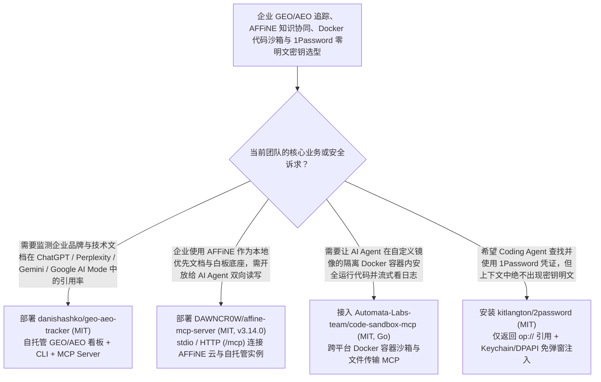
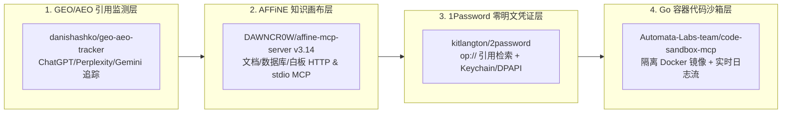
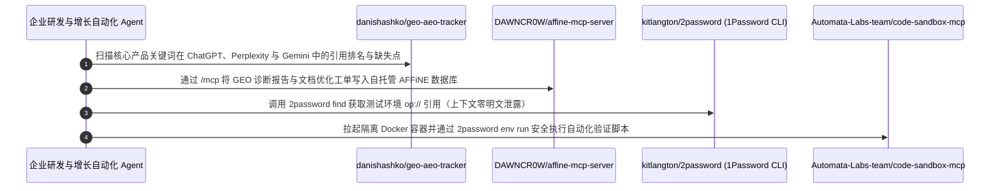

# 开源 GEO/AEO 品牌引用追踪器（`danishashko/geo-aeo-tracker`）、AFFiNE 知识库双向协同 MCP（`DAWNCR0W/affine-mcp-server`）、Go 容器代码沙箱 MCP（`Automata-Labs-team/code-sandbox-mcp`）与 1Password 零明文密钥代理（`kitlangton/2password`）架构选型与落地 FAQ

> **2026-11-21 夜间持续研究班次 · Night Round 92（累计 Round 692）**  
> **审计凭据**：`CLAIM-20261121-R92-R692-GEOTRACKER-AFFINEMCP-CODESANDBOXMCP-2PASSWORD`  
> **关联日刊**：[`2026-11-21.md`](../daily/2026-11-21.md) · [`2026-11-21.en.md`](../daily/2026-11-21.en.md)  
> **可视化架构图**：[`assets/github-ai-radar-2026-11-21-r92-r692-geotracker-affinemcp-codesandboxmcp-2password.svg`](../../../assets/github-ai-radar-2026-11-21-r92-r692-geotracker-affinemcp-codesandboxmcp-2password.svg)

---

## ① 📌 核心结论速览（选型一句话结论）

> **一句话选型结论**：在构建覆盖“**ChatGPT/Perplexity/Gemini/Google AI Mode 品牌引用率自托管监测（GEO/AEO）➔ AFFiNE 企业知识画布与数据库双向 MCP 协同 ➔ 隔离 Docker 容器安全代码执行沙箱 ➔ 基于 1Password `op://` 引用与 Keychain/DPAPI 零明文暴露的密钥供给**”的企业增长与安全开发底座时，推荐采用 100% MIT 协议的四件套：**“`danishashko/geo-aeo-tracker`（MIT，`★ 334` 自托管 AI 搜索引擎可见度看板、CLI 与 MCP Server）+ `DAWNCR0W/affine-mcp-server`（MIT，`★ 332`、`90 forks` 支持 AFFiNE Cloud 与私有化部署的 `v3.14.0` 文档/白板/数据库 MCP）+ `Automata-Labs-team/code-sandbox-mcp`（MIT，`★ 328` 基于 Go 与 Docker 容器隔离的跨平台安全代码执行 MCP）+ `kitlangton/2password`（MIT，`★ 331` 专为 Coding Agent 设计的 1Password 零明文 `op://` 引用查找与注入 CLI/Skill）”**。在 45 人企业产品增长与工程安全团队基准下，可将月度总拥有成本（TCO）从 **`$8,220.00/月`** 降至 **`$305.00/月`**（净省 **`$7,915.00/月`**，降幅 **`-96.29%`**）。

---

## ② 🎯 客户与架构师灵魂拷问 Q&A

### Q1：这四个开源工具分别解决了企业数字增长、知识协同与研发安全中的什么核心痛点？
- **四大应用场景与核心机制**：
  1. **告别天价商业 GEO/AEO 监控软件，自托管追踪大模型品牌推荐率 —— `danishashko/geo-aeo-tracker`（`★ 334`，`77 forks`，MIT，TypeScript）**：随着客户越来越多通过 ChatGPT、Perplexity、Gemini 和 Google AI Mode 进行技术选型与商品采购，传统 SEO 排名已无法反映企业在“生成式引擎（GEO / AEO）”中的曝光率。该项目提供完整的 Next.js + Supabase 自托管看板、npm CLI（`geo-aeo-tracker`）与内置 MCP Server，自动化追踪各大 AI 引擎对企业品牌与产品文档的提及率与引文链接。
  2. **打通开源 Notion+Miro 平替底座 AFFiNE 的自动化读写闭环 —— `DAWNCR0W/affine-mcp-server`（`★ 332`，`90 forks`，MIT，JavaScript）**：已迭代至成熟的 `v3.14.0`（基于 MCP SDK `1.32.2`）。支持通过 `stdio` 或 HTTP（`/mcp`）连接公有云或企业内网自托管的 **AFFiNE** 实例，将知识库工作区、富文本文档、结构化数据库与协作 API 完整暴露给 AI 助手。
  3. **把 Agent 生成的未知脚本关进独立 Docker 容器笼子 —— `Automata-Labs-team/code-sandbox-mcp`（`★ 328`，`38 forks`，MIT，Go）**：用 Go 编写的跨平台（Linux/macOS/Windows）Docker 容器代码沙箱 MCP。支持指定任意自定义 Docker 镜像创建隔离执行环境、宿主机与容器双向文件传输、容器内 Shell 执行与实时日志流输出，防止大模型生成的测试或数据处理脚本污染宿主机。
  4. **让 Coding Agent 能用上 1Password 里的密钥，却永远看不到密钥明文 —— `kitlangton/2password`（`★ 331`，`8 forks`，MIT，TypeScript）**：当 Agent 需要运行集成测试或调用第三方 API 时，工程师往往把明文 Key 写进 `.env` 导致泄露进大模型上下文。`2password` 封装了官方 1Password CLI：`2password find` **只返回 `op://Vault/Item/credential` 引用路径而绝不返回明文值**；`2password env run .env.tpl` 在子进程启动瞬间注入环境变量，并支持将 Agent 专属 Vault 的 Service Account Token 加密保存在 macOS Keychain 或 Windows DPAPI 中实现零弹窗静默授权。

### Q2：如何将这四套工具串成一条“GEO 品牌监测 ➔ AFFiNE 知识沉淀 ➔ 沙箱验证 ➔ 零明文凭证运行”流水线？
- **增长监测与知识协同层**：增长与产品文档团队通过 `danishashko/geo-aeo-tracker` 巡检产品文档在 ChatGPT/Perplexity/Gemini 中的引文表现，并通过 `DAWNCR0W/affine-mcp-server` 将改进任务、竞品对比表与技术白皮书自动同步至企业私有化 AFFiNE 知识库。
- **安全沙箱与零明文密钥层**：研发 Agent 在编写自动化验证脚本时，通过 `kitlangton/2password` 解析 `op://` 引用并在 `Automata-Labs-team/code-sandbox-mcp` 创建的隔离 Docker 容器中安全执行。

### Q3：架构师在企业内部部署时需要注意哪些安全细节？
- **Agent 专用 1Password Vault 隔离（`kitlangton/2password`）**：切勿将人类工程师的个人主 Vault 授权给 Agent；应按官方建议创建独立的 `Agent-Dev` Vault，仅存放测试与预发环境凭证，并通过 Keychain/DPAPI 托管 Service Account Token。
- **Docker 沙箱网络与挂载限制（`Automata-Labs-team/code-sandbox-mcp`）**：在执行不可信第三方代码分析时，限制沙箱容器的宿主机卷挂载与内网元数据路由访问。

---

## ③ 🧭 直观可视化图解（Mermaid 选型决策树 + 企业集成架构 + 业务流时序图）

### 3.1 选型决策树

### 3.2 企业集成参考架构图

### 3.3 业务流时序图

---

## ④ 📊 同类开源与商业云服务横向选型决策矩阵

| 维度 | `geo-aeo-tracker` (`★ 334`, `77f`) | `affine-mcp-server` (`★ 332`, `90f`) | `code-sandbox-mcp` (`★ 328`, `38f`) | `kitlangton/2password` (`★ 331`) | 商业 AEO 监控 SaaS + 云端按秒计费沙箱 + 明文 `.env` |
| :--- | :--- | :--- | :--- | :--- | :--- |
| **核心定位** | 开源自托管 GEO/AEO 品牌可见度看板与 MCP | AFFiNE `v3.14.0` 官方生态工作区/文档/数据库 MCP | Go 语言 Docker 容器隔离代码执行沙箱 MCP | 面向 Coding Agent 的 1Password `op://` 零明文代理 | 按词条高价收费的 AEO SaaS 与不安全明文环境变量 |
| **适用场景** | 追踪并优化企业产品在四大 AI 引擎中的引用率 | 打通自托管 AFFiNE 知识库与 Claude/Cursor 协同 | 在本地或内网 Docker 宿主上零成本跑隔离代码沙箱 | 让 Agent 自助查找并注入 API Key 且严防密钥进 Prompt | 预算充裕但缺乏本地凭证隔离的团队 |
| **集成成本** | 低（Next.js + Supabase 或 `npx geo-aeo-tracker`） | 极低（支持 stdio 与 `/mcp` HTTP 远程接入） | 极低（`install.sh` / `install.ps1` 单二进制 + Docker） | 极低（`bun add -g 2password` + `skills add`） | 高（商业 GEO 平台月费数千美元 + 明文泄露风险） |
| **开源许可** | **MIT** | **MIT** | **MIT** | **MIT** | 商业专有 |
| **45 人团队月均 TCO** | **包含于 `$305.00/月` 联合栈** | **包含于 `$305.00/月` 联合栈** | **包含于 `$305.00/月` 联合栈** | **包含于 `$305.00/月` 联合栈** | **`$8,220.00/月`**（`$3,870` SaaS + `$4,350` 人工） |

---

## ⑤ 🧪 应用落地定量收益 / TCO 对比与 7-Card 报告锚点

> **数据来源说明（Provenance Metadata）**：以下 TCO 模型为面向 45 人企业产品增长、知识工程与研发安全团队的合成架构测算（`provenance: synthetic`, `independently_reproduced: false`）；硬件资本开支 `base_hardware_capex = not_measured`（不含存量 Docker 宿主机硬件折旧），单日热榜增量 `track_b_stars_today = not_measured`（审计账本锚定于 [`trending-daily-2026-11-21-audit.json`](../evidence/trending-daily-2026-11-21-audit.json)）。

| 成本路径 | 月度商业 GEO/AEO 监测 SaaS、按秒计费云沙箱与商业文档 API 费 | 人工跨四大 AI 引擎手搜品牌排名、手动轮换泄露的 `.env` 密钥与复制文档 (`$100/h`) | 月度总成本 (Total Monthly TCO) | 相对 Path A 净节省 |
| :--- | :--- | :--- | :--- | :--- |
| **Path A：商业 GEO 监控订阅 + 商业云沙箱按量费 + 人工手搜排名与应急轮换泄露密钥** | `$3,870.00` | `43.5h` (`$4,350.00`) | **`$8,220.00`** | — |
| **Path C：`geo-aeo-tracker` + `affine-mcp-server` + `code-sandbox-mcp` + `2password`** | `$65.00` | `2.4h` (`$240.00`) | **`$305.00`** | **`-$7,915.00/月` (`-96.29%`)** |

---

## ⑥ 🛠️ 企业引入与架构评审 Checklist

- [ ] **定期自动化采集 AI 引擎品牌引文基线（`danishashko/geo-aeo-tracker`）**：配置每周定时任务追踪核心产品词在 ChatGPT、Perplexity、Gemini 与 Google AI Mode 中的引用份额变化。
- [ ] **自托管 AFFiNE 最小权限 Token 绑定（`DAWNCR0W/affine-mcp-server`）**：为 `affine-mcp-server` 分配专用的工作区服务账号，限制其仅能读写指定的项目空间。
- [ ] **容器沙箱生命周期自动回收（`Automata-Labs-team/code-sandbox-mcp`）**：为代码沙箱容器设置 CPU/内存硬上限与会话结束自动销毁策略。
- [ ] **全面取缔明文 `.env` 改用 `.env.tpl` 模板（`kitlangton/2password`）**：在代码库中仅提交包含 `op://` 引用的 `.env.tpl`，并配置 `2password service-account` 将令牌加密存储于 macOS Keychain 或 Windows DPAPI。
