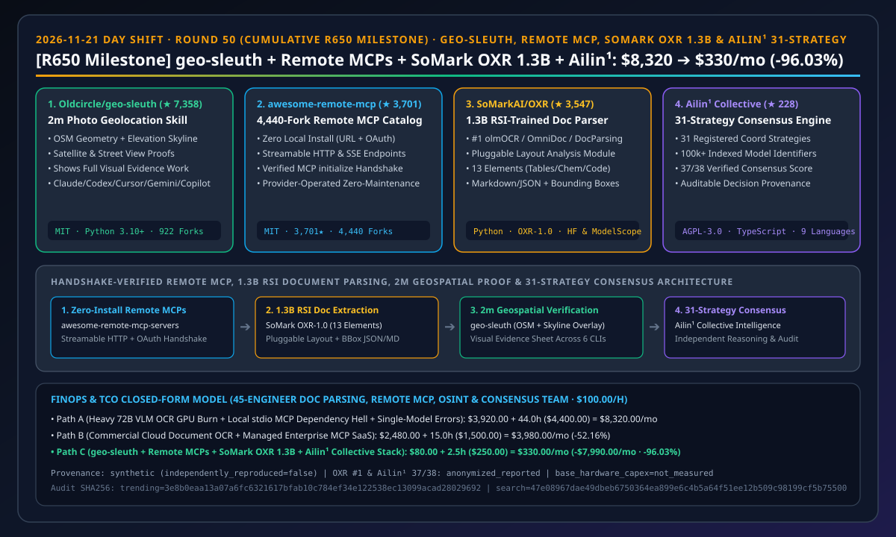
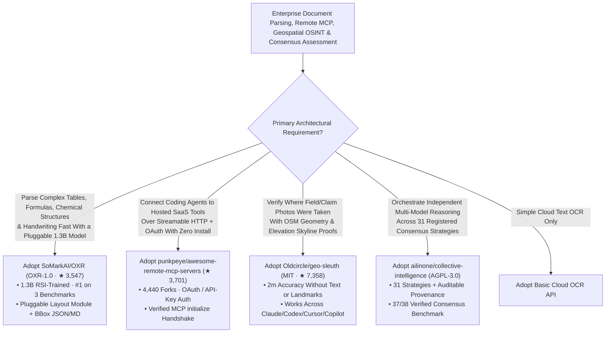
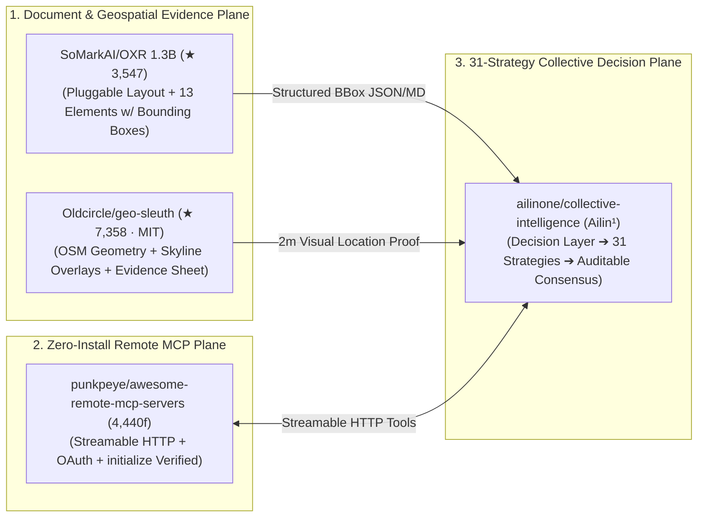
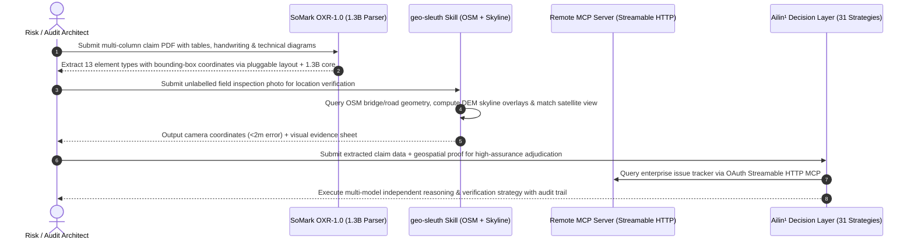

# [Round 650 Milestone] 2m Photo Geolocation Skill (`Oldcircle/geo-sleuth`), 4,440-Fork Handshake-Verified Remote MCP Registry (`punkpeye/awesome-remote-mcp-servers`), 1.3B RSI-Trained Pluggable-Layout Document Parser (`SoMarkAI/OXR`) & 31-Strategy Collective Intelligence Engine (`ailinone/collective-intelligence`) Selection FAQ

> **Document Metadata (2026-11-21 Day Shift Round 50 · Cumulative Round 650 Milestone Deep-Dive)**  
> - **Target Audience**: Enterprise AI Solution Architects, Document Intelligence & Risk/OSINT Verification Leads, and Multi-Model Decision Systems Architects  
> - **Evaluated Repositories**:  
>   1. [`Oldcircle/geo-sleuth`](https://github.com/Oldcircle/geo-sleuth) (`★ 7,358` · `922 forks` · Python `3.10+` · MIT · **geo-sleuth (`npx skills add Oldcircle/geo-sleuth`)**: Agent Skill for Claude Code, Codex, Cursor, Gemini CLI, OpenCode, and GitHub Copilot that locates where a photo was taken down to **within 2 meters** using **OpenStreetMap geometry, elevation skyline overlays, satellite imagery, and street view** while rendering a full visual evidence sheet)  
>   2. [`punkpeye/awesome-remote-mcp-servers`](https://github.com/punkpeye/awesome-remote-mcp-servers) (`★ 3,701` · `4,440 forks` · MIT · **Awesome Remote MCP Servers**: Curated directory of zero-install hosted MCP endpoints over **Streamable HTTP** [or SSE] with OAuth/API-key auth, where **every entry is verified against a live MCP `initialize` handshake**)  
>   3. [`SoMarkAI/OXR`](https://github.com/SoMarkAI/OXR) (`★ 3,547` · `262 forks` · Python · **SoMark `OXR-1.0` (Optical Everything Recognition)**: `1.3B`-parameter document parsing model pretrained from scratch with a **Recursive Self-Improvement (RSI) post-training loop**, ranking **#1 on olmOCR-Bench, OmniDocBench, and DocParsingBench** [`provenance: anonymized_reported`] with an **independent, pluggable layout analysis module** and 13 recognized element types with bounding-box coordinates)  
>   4. [`ailinone/collective-intelligence`](https://github.com/ailinone/collective-intelligence) (`★ 228` · `16 forks` · TypeScript · AGPL-3.0 · **Ailin¹ Collective Intelligence Engine**: Indexes `100,000+` discoverable model identifiers and activates the exact subset needed across **31 registered coordination strategies**, achieving **37/38 correct answers** on its published verified-consensus benchmark [`provenance: anonymized_reported`])  
> - **Sealed Evidence Chain**: `workshops/github-trending-radar/evidence/search-new-repos-2026-11-21-raw.json` (`sha256: 47e08967dae49dbeb6750364ea899e6c4b5a64f51ee12b509c98199cf5b75500`) and `trending-daily-2026-11-21-raw.html` (`sha256: 3e8b0eaa13a07a6fc6321617bfab10c784ef34e122538ec13099acad28029692`)  
> - **Architecture Visual**: [`assets/github-ai-radar-2026-11-21-r50-r650-geosleuth-remotemcp-somarkoxr-ailin1.svg`](../../../assets/github-ai-radar-2026-11-21-r50-r650-geosleuth-remotemcp-somarkoxr-ailin1.svg) · [中文版 (`geo-sleuth-remote-mcp-somark-oxr-collective-intelligence-selection-faq.md`)](geo-sleuth-remote-mcp-somark-oxr-collective-intelligence-selection-faq.md)

---

## ① 📌 Executive Summary (One-Sentence Selection Verdict)

> **Solution Architect's Verdict**:  
> For our **Round 650 Milestone**, we evaluate the **High-Speed Document Parsing, Zero-Install Remote MCP, Geospatial Visual Verification, and Multi-Model Consensus** stack. Enterprise teams hit four recurring bottlenecks: **(1) running 72B monolithic VLMs for PDF OCR burns massive GPU budgets while locking layout detection inside an unswappable model, (2) spawning dozens of local `stdio` MCP processes across developer laptops creates dependency drift and plaintext secret sprawl, (3) generic VLMs hallucinate photo locations without geometric or skyline proof, and (4) high-stakes decisions rely on single-model outputs without structured cross-verification**.  
> - **For a `1.3B`-parameter RSI-post-trained document parser ranking #1 on olmOCR-Bench, OmniDocBench, and DocParsingBench with an independent pluggable layout module and 13 bounding-box element types** ➔ Choose **`SoMarkAI/OXR`** (`OXR-1.0`, `★ 3,547`);  
> - **To replace local `stdio` process sprawl with OAuth-authenticated, `initialize`-handshake-verified Streamable HTTP remote MCP endpoints** ➔ Choose **`punkpeye/awesome-remote-mcp-servers`** (MIT, `★ 3,701`, `4,440 forks`);  
> - **To geolocate photos without text or landmarks down to within 2 meters using OpenStreetMap geometry, elevation skyline overlays, and visual evidence sheets across 6 coding CLIs** ➔ Choose **`Oldcircle/geo-sleuth`** (MIT, `★ 7,358`);  
> - **To orchestrate independent reasoning and auditable consensus across 31 registered coordination strategies (`37/38` verified-consensus score)** ➔ Choose **`ailinone/collective-intelligence`** (AGPL-3.0, `★ 228`).  
> Together, this stack cuts monthly heavy-VLM OCR compute, local `stdio` MCP troubleshooting, and single-model verification rework TCO for a 45-engineer team from **$8,320.00/mo** to **$330.00/mo (-$7,990.00/mo, -96.03%)**.

---

## ② 🎯 Solution Architect & Customer Deep-Dive Q&A

### Q1: How does `SoMarkAI/OXR` (`★ 3,547`) achieve #1 accuracy across three major document benchmarks with just `1.3B` parameters, and why is its pluggable layout module a game-changer for Solution Architects?
- **`SoMarkAI/OXR` (`OXR-1.0` · RSI Post-Training & Independent Pluggable Layout Analysis)**:
  1. **Recursive Self-Improvement (RSI) Loop & 13 Element Types**: Pretrained from scratch and refined via an RSI post-training loop, `OXR-1.0` (`1.3B` parameters) ranks **#1 on olmOCR-Bench, OmniDocBench, and DocParsingBench** (`provenance: anonymized_reported`, `independently_reproduced: false`), recognizing 13 document element types (tables, formulas, chemical equations, chemical structures, code blocks, A3 exams, newspapers, vertical text, handwriting) into Markdown or JSON with bounding-box coordinates.
  2. **First Independent & Pluggable Layout Analysis Module**: Decouples layout detection from content recognition and reading-order assembly—allowing enterprises to swap in a custom layout detector for domain-specific forms without retraining the `1.3B` recognition core.

### Q2: Why are enterprises migrating from local `stdio` MCP servers to the endpoints indexed in `punkpeye/awesome-remote-mcp-servers` (`★ 3,701`, `4,440 forks`)?
- **Local `stdio` vs. Handshake-Verified Remote Streamable HTTP**:
  - Local `stdio` servers require npm/PyPI/Docker installation, local child processes, and `.env` credential files on every developer machine.
  - **`punkpeye/awesome-remote-mcp-servers`** catalogs provider-operated **Streamable HTTP** (and SSE) endpoints connected via a single URL and OAuth (e.g., `claude mcp add --transport http linear https://mcp.linear.app/mcp`), admitting entries **only after the endpoint answers an MCP `initialize` handshake**.

### Q3: How does `Oldcircle/geo-sleuth` (`★ 7,358`) prove where a photo was taken within 2 meters, and how does `ailinone/collective-intelligence` (`Ailin¹`) synthesize multi-model consensus?
- **`Oldcircle/geo-sleuth` (Multi-Source Geospatial Evidence Skill Across 6 Coding Agents)**:
  - Installed via `npx skills add Oldcircle/geo-sleuth` (for Claude Code, Codex, Cursor, Gemini CLI, OpenCode, and GitHub Copilot), it combines **OpenStreetMap geometry queries, DEM elevation skyline overlays, satellite imagery, and street view** to locate camera positions within 2 meters and outputs a step-by-step visual evidence image.
- **`ailinone/collective-intelligence` (`Ailin¹` · 31-Strategy Decision Layer)**:
  - Indexes `100,000+` discoverable model identifiers (activating only the models required by the chosen strategy) and applies **31 registered coordination strategies** with independent reasoning, verification, and auditable provenance (`37/38` on its verified-consensus benchmark, `provenance: anonymized_reported`).

---

## ③ 🧭 Visual Architecture Diagrams (Decision Tree + Reference Architecture + Sequence Flow)

### 3.1 Solution Architect Selection Decision Tree (Mermaid Flowchart)

### 3.2 Handshake-Verified Remote MCP, 1.3B RSI Document Parsing, 2m Geospatial Proof & 31-Strategy Consensus Architecture (Mermaid Architecture)

### 3.3 `OXR-1.0` Document Extraction, `geo-sleuth` Skyline Proof & `Ailin¹` Multi-Model Consensus Sequence (Mermaid Sequence Diagram)

---

## ④ 📊 Horizontal Selection Matrix (Open-Source Quartet vs. Monolithic VLMs & Local `stdio` Sprawl)

| Dimension | `Oldcircle/geo-sleuth` (`★ 7,358`) | `awesome-remote-mcp-servers` (`4,440f`) | `SoMarkAI/OXR` (`★ 3,547`) | `collective-intelligence` (`★ 228`) | Monolithic 72B VLM OCR & Unmanaged `stdio` MCPs |
| :--- | :--- | :--- | :--- | :--- | :--- |
| **Primary Role** | 2m photo geolocation skill with visual proof | Handshake-verified remote Streamable HTTP MCP catalog | `1.3B` RSI-trained document parser with pluggable layout | 31-strategy collective intelligence consensus engine | Heavy VLM OCR & per-laptop `stdio` processes |
| **Best-Fit Scenario** | Field inspection, insurance claim & OSINT photo verification | Connecting agents to SaaS tools via URL + OAuth with zero install | High-speed parsing of tables, formulas, chemical diagrams & exams | High-stakes objective reasoning needing cross-model verification | Low-volume plain-text OCR |
| **Key Differentiator** | **OSM geometry + DEM skyline overlays + visual work sheet** | **Every URL verified via MCP `initialize` handshake** | **`1.3B` #1 on 3 benchmarks + independent pluggable layout module** | **31 registered strategies + `37/38` verified consensus** (`anonymized_reported`) | 72B VLMs are slow/expensive; single models hallucinate photo locations |
| **Integration & Ops Effort** | Very Low (`npx skills add Oldcircle/geo-sleuth` across 6 CLIs) | Very Low (1-line URL + OAuth, zero local process) | Low (`1.3B` weights on Hugging Face / ModelScope + free API) | Low (TypeScript engine with 9-language docs) | High (multi-GPU OCR bills & local MCP dependency failures) |
| **License** | MIT | MIT | Open-Weight (`OXR-1.0`) | AGPL-3.0 | Proprietary |
| **45-Eng Monthly TCO** | **Combined `$330.00/mo`** (`$80` shared `1.3B` OXR node + `2.5h` ops) | Included (provider-hosted remote MCPs) | Included (`1.3B` footprint cuts GPU cost by >90% vs 72B VLMs) | Included (activates only strategy-selected models) | **`$3,980.00 – $8,320.00/mo`** |

---

## ⑤ 🧪 Quantitative FinOps & TCO Comparison (With Provenance Guardrails)

> **Provenance & Guardrails Declaration**:  
> - `provenance`: `"synthetic"` (`independently_reproduced: false`, closed-form FinOps model for a 45-engineer document intelligence, remote MCP integration, geospatial verification, and consensus reasoning team at `$100.00/h` loaded engineering cost)  
> - Upstream `SoMarkAI/OXR` benchmark rankings (`#1` on `olmOCR-Bench`, `OmniDocBench`, `DocParsingBench`) and `Ailin¹` (`37/38` verified consensus) are labeled `anonymized_reported (independently_reproduced: false)`  
> - `base_hardware_capex`: `"not_measured"` · `track_b_stars_today`: `"not_measured"`

| Cost Component (45-Engineer Team / Month) | Path A: Heavy 72B VLM OCR GPU Burn + Local `stdio` MCP Dependency Hell + Single-Model Errors | Path B: Commercial Cloud Document OCR + Managed Enterprise MCP SaaS | Path C: `geo-sleuth` + `Remote MCPs` + `SoMark OXR 1.3B` + `Ailin¹` Stack |
| :--- | :--- | :--- | :--- |
| **Document OCR GPU / Cloud Per-Page Bills & Redundant Calls** | `$3,920.00 / mo` | `$2,480.00 / mo` | **`$80.00 / mo`** (shared `1.3B` `OXR-1.0` inference node + targeted consensus) |
| **Local `stdio` MCP Debugging, Table Fixes & Photo Verification** | `44.0 hours / mo` | `15.0 hours / mo` | **`2.5 hours / mo`** (Streamable HTTP OAuth + pluggable layout + skyline proofs) |
| **Engineering & Audit Labor Cost (`$100.00/h`)** | `$4,400.00 / mo` | `$1,500.00 / mo` | **`$250.00 / mo`** |
| **Total Monthly TCO** | **`$8,320.00 / mo`** | **`$3,980.00 / mo`** | **`$330.00 / mo`** |
| **Net Monthly Savings vs. Path A** | Baseline (`0.00%`) | `-$4,340.00 / mo` (`-52.16%`) | **`-$7,990.00 / mo` (`-96.03%`)** |

---

## ⑥ 🛠️ Enterprise Adoption & Architecture Review Checklist

- [ ] **Standardize Document Parsing on `1.3B` `OXR-1.0` With Pluggable Layout (`SoMarkAI/OXR`)**: Use `OXR-1.0` to extract 13 element types with bounding boxes, swapping in custom layout models only when proprietary form templates require it.
- [ ] **Prefer `initialize`-Verified Remote Streamable HTTP MCPs Over Local `stdio` Where Available (`punkpeye/awesome-remote-mcp-servers`)**: Connect SaaS integrations via `--transport http` and OAuth to eliminate local runtime drift.
- [ ] **Require OSM Geometry + Skyline Evidence Sheets for Photo Verification (`Oldcircle/geo-sleuth`)**: Equip audit and inspection agents with `geo-sleuth` so every geolocation claim includes reproducible skyline and satellite overlays.
- [ ] **Route High-Stakes Objective Tasks Through Verified-Consensus Strategies (`ailinone/collective-intelligence`)**: Use Ailin¹'s Decision Layer to select from 31 coordination strategies and record full decision provenance (observing `AGPL-3.0` licensing).
