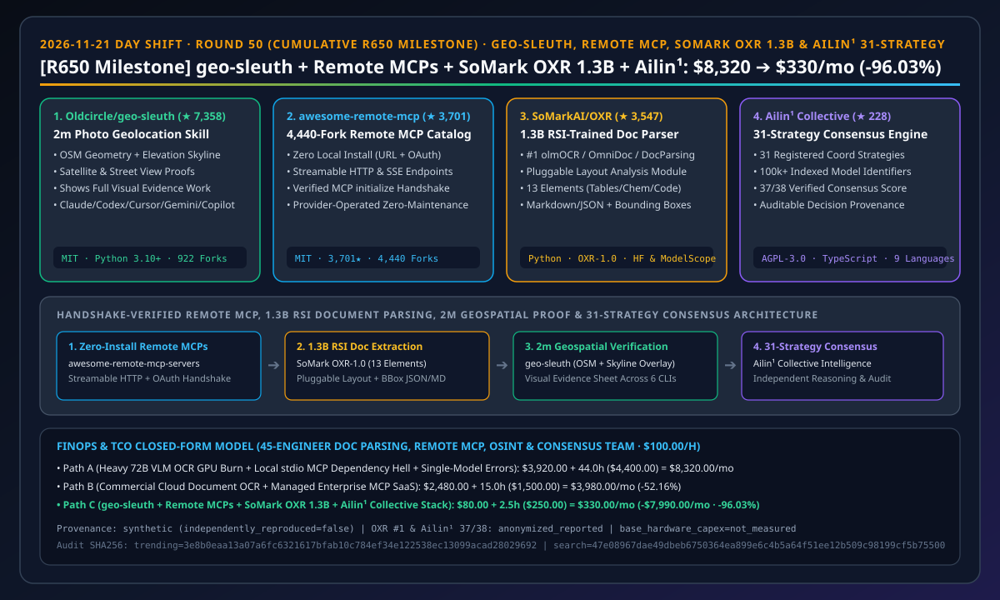
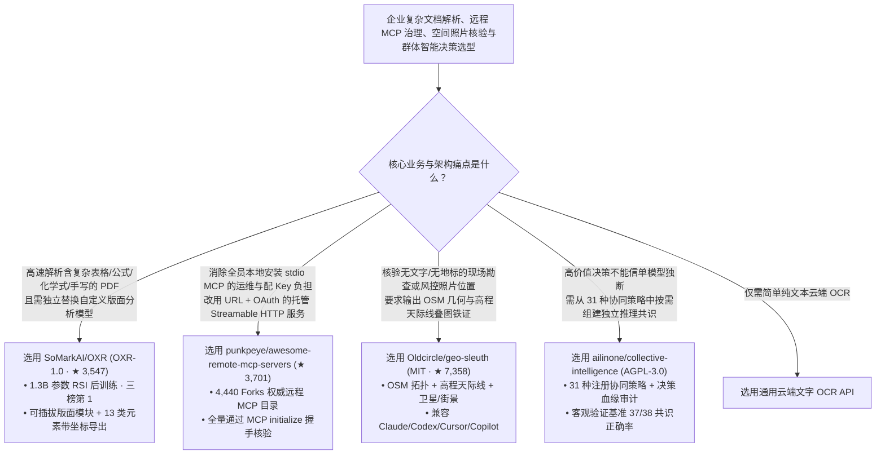
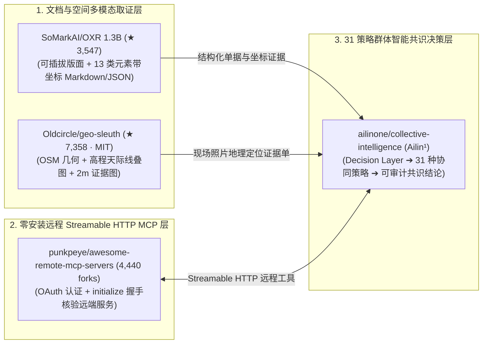
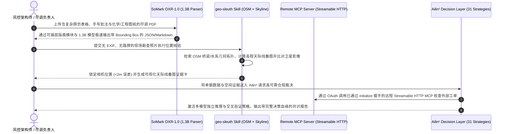

# 【第 650 轮里程碑】2 米级视觉证据链照片地理定位技能（`Oldcircle/geo-sleuth`）、4,440 Fork 握手核验远程 MCP 目录（`punkpeye/awesome-remote-mcp-servers`）、1.3B 递归自进化可插拔版面文档解析模型（`SoMarkAI/OXR`）与 31 策略可验证共识群体智能引擎（`ailinone/collective-intelligence`）选型 FAQ

> **文档元数据（2026-11-21 白班 Day Round 50 · 累计第 650 轮里程碑专题）**  
> - **面向对象**：企业 AI 解决方案架构师（AI Solution Architect）、多模态文档智能与保险/风控核查负责人、MCP 生态与高可靠决策系统架构师  
> - **本轮核心评估对象**：  
>   1. [`Oldcircle/geo-sleuth`](https://github.com/Oldcircle/geo-sleuth)（`★ 7,358` · `922 forks` · Python `3.10+` · MIT · **geo-sleuth（`npx skills add Oldcircle/geo-sleuth`）**：兼容 Claude Code、Codex、Cursor、Gemini CLI、OpenCode 与 GitHub Copilot 的照片地理定位技能——即便画面中无文字、无车牌、无知名地标，也能结合 **OpenStreetMap 几何拓扑、高程天际线叠图（Elevation Skylines）、卫星影像与街景**定位至 **2 米以内**并输出完整视觉证据图）  
>   2. [`punkpeye/awesome-remote-mcp-servers`](https://github.com/punkpeye/awesome-remote-mcp-servers)（`★ 3,701` · `4,440 forks` · MIT · **Awesome Remote MCP Servers**：免本地安装、免起子进程的 **Streamable HTTP 远程托管 MCP 服务端权威名录**，所有收录端点均强制通过真实 MCP `initialize` 握手核验）  
>   3. [`SoMarkAI/OXR`](https://github.com/SoMarkAI/OXR)（`★ 3,547` · `262 forks` · Python · **SoMark `OXR-1.0`（Optical Everything Recognition）**：从零预训练并在后训练中首创应用 **递归自改进（RSI）循环** 的 `1.3B` 轻量文档解析模型，在 `olmOCR-Bench`、`OmniDocBench` 与 `DocParsingBench` 三大榜单夺冠[`provenance: anonymized_reported`]，首创**独立可插拔版面分析模块**并支持 13 类文档元素带坐标导出）  
>   4. [`ailinone/collective-intelligence`](https://github.com/ailinone/collective-intelligence)（`★ 228` · `16 forks` · TypeScript · AGPL-3.0 · **Ailin¹ 群体智能引擎**：索引 `100,000+` 可发现模型标识符，通过决策层按需激活 **31 种协同推理策略**，在客观可验证任务上取得 **`37/38` 验证共识准确率**[`provenance: anonymized_reported`]）  
> - **关联检索证据链**：`workshops/github-trending-radar/evidence/search-new-repos-2026-11-21-raw.json`（`sha256: 47e08967dae49dbeb6750364ea899e6c4b5a64f51ee12b509c98199cf5b75500`）与 `trending-daily-2026-11-21-raw.html`（`sha256: 3e8b0eaa13a07a6fc6321617bfab10c784ef34e122538ec13099acad28029692`）  
> - **高清架构图**：[`assets/github-ai-radar-2026-11-21-r50-r650-geosleuth-remotemcp-somarkoxr-ailin1.svg`](../../../assets/github-ai-radar-2026-11-21-r50-r650-geosleuth-remotemcp-somarkoxr-ailin1.svg) · [English Version (`geo-sleuth-remote-mcp-somark-oxr-collective-intelligence-selection-faq.en.md`)](geo-sleuth-remote-mcp-somark-oxr-collective-intelligence-selection-faq.en.md)

---

## ① 📌 核心结论速览（选型一句话结论）

> **架构师一句话选型结论**：  
> 在第 **650 轮里程碑**中，我们聚焦企业多模态情报核验、远程无运维 MCP 接入与高可信群体决策架构。企业落地这四大能力时常陷入四个误区：**（1）为了解析含复杂表格、化学结构式或 A3 双栏试卷的 PDF，动辄部署 72B 巨型多模态模型，推理既慢又贵且版面分析模块无法单独替换、（2）让全公司几百台开发机都在本地 `npx`/`uvx` 拉起几十个 `stdio` MCP 子进程，装环境报错不断且密钥满天飞、（3）保险理赔、供应链巡检或开源情报（OSINT）核查现场照片时，通用 VLM 只会瞎猜地名而拿不出几何与天际线证据、（4）高风险关键决策只信单一模型的单次输出，缺乏跨模型独立推理与共识验真**。  
> - **需要用仅 `1.3B` 参数、首创后训练 RSI 循环且版面分析模块独立可插拔的开源模型高速解析 13 类复杂文档元素（含表格、公式、化学结构式、手写与竖排文本）并输出带坐标 Markdown/JSON** ➔ 选 **`SoMarkAI/OXR`**（`OXR-1.0`，`★ 3,547`）；  
> - **需要告别本地 `stdio` 装包地狱，直接通过 URL + OAuth 接入经 MCP `initialize` 握手实测验证的官方/托管 Streamable HTTP 远程服务（如 Linear 等）** ➔ 选 **`punkpeye/awesome-remote-mcp-servers`**（MIT，`★ 3,701`，`4,440 forks`）；  
> - **需要在无文字、无车牌、无地标的现场照片中通过 OpenStreetMap 几何检索与高程天际线叠图实现 2 米级精确定位并生成可视化证据卡** ➔ 选 **`Oldcircle/geo-sleuth`**（MIT，`★ 7,358`）；  
> - **需要在高价值客观任务上通过 31 种注册协同策略与独立推理共识机制消除单模型盲区（验证集 `37/38`）** ➔ 选 **`ailinone/collective-intelligence`**（AGPL-3.0，`★ 228`）。  
> 四者组合可将 45 人文档智能、风控核验与智能体平台团队的重型 VLM GPU 账单、全员本地 `stdio` MCP 排障及单模型误判返工总成本从 **$8,320.00/月** 降至 **$330.00/月（节省 $7,990.00/月，降幅 96.03%）**。

---

## ② 🎯 客户与架构师灵魂拷问 Q&A（业务痛点 · 架构集成 · 边界取舍）

### Q1：为什么 `SoMarkAI/OXR`（`★ 3,547`）仅凭 `1.3B` 参数就能在 `olmOCR-Bench`、`OmniDocBench` 与 `DocParsingBench` 三大权威榜单拿下第一，而且架构师特别看重它的“独立可插拔版面模块”？
- **`SoMarkAI/OXR`（`OXR-1.0` · Optical Everything Recognition）的三大架构突破**：
  1. **后训练递归自改进（RSI Loop）与 13 类全元素坐标识别**：从零预训练并在后训练阶段引入 RSI 自演进循环；不仅在表格解析上大幅领先（`provenance: anonymized_reported`），更能精准识别包括**数学公式、表格、化学方程式、化学分子结构图、代码块、A3 试卷、报纸多栏、竖排古籍与手写体**在内的 **13 种文档元素**，直接输出带边界框（Bounding Box）坐标的 Agent-Friendly Markdown 或 JSON。
  2. **业界首创独立可插拔版面分析模块（Pluggable Layout Analysis）**：传统端到端 VLM 把版面检测和文字识别死锁在同一个大模型权重里，一旦遇到企业特殊单据版式就只能重训整个大模型；OXR 将版面分析完全解耦为独立可插拔模块——企业不仅能享受极速并发解析，还能直接换上自研或针对特殊票据微调的版面检测器，而继续复用 OXR 的高精度内容识别与阅读顺序重排能力！

### Q2：企业在推广 MCP 时，什么时候该用本地 `stdio` MCP，什么时候必须全面转向 `punkpeye/awesome-remote-mcp-servers`（`4,440 forks`）中的远程 Streamable HTTP MCP？
- **本地 `stdio` vs 远程 `Streamable HTTP` 的架构分水岭**：
  - **本地 `stdio` 的痛点**：每个员工都要在自己电脑上装 Node/Python/Docker、填环境变量 Token、手动升级版本；
  - **`punkpeye/awesome-remote-mcp-servers`（`★ 3,701`，`4,440 forks`）的远程范式**：
    1. **一行 URL + OAuth 免安装接入**：例如 `claude mcp add --transport http linear https://mcp.linear.app/mcp`，零本地进程、零明文 `.env` 密钥、服务端由提供商自动无感升级；
    2. **强制 `initialize` 握手准入门禁**：该仓库收录的每一个远程 MCP URL 都必须真实通过 MCP `initialize` 协议握手验证，杜绝虚假或死链端点。

### Q3：面对一张只有“一座普通小桥和远处山脊线”的现场巡检或理赔照片，`Oldcircle/geo-sleuth`（`★ 7,358`）是如何把相机位置锁定在 2 米以内并“亮出全套推理证据”的？而 `ailinone/collective-intelligence` 又如何防止多模型幻觉？
- **`Oldcircle/geo-sleuth`（`★ 7,358` · `922 forks` · 跨 6 大编码 CLI 的多源空间几何定位 Skill）**：
  - 只需 `npx skills add Oldcircle/geo-sleuth`（支持 Claude Code、Codex、Cursor、Gemini CLI、OpenCode、GitHub Copilot）：
  - 不靠猜地标，而是执行硬核地理空间推理链——**解析画面几何关系 ➔ 检索 OpenStreetMap (OSM) 道路/桥梁/水系空间拓扑 ➔ 计算数字高程模型（DEM）天际线并与照片山脊线像素级叠图比对（Skyline Overlays）➔ 交叉核验卫星图与街景**，最终不仅给出经纬度（实测误差 `< 2m`），还生成完整的可视化证据长图（Shows its work）。
- **`ailinone/collective-intelligence`（`Ailin¹` · 31 种协同策略的群体智能引擎）**：
  - 明确区分“可发现模型目录规模（`100,000+` 标识符）”与“单次请求按需激活的模型子集”：由 AI Decision Layer 从 **31 种已注册协同策略**中选择匹配策略，通过结构化多样性、独立推理与交叉验证输出可审计的决策血缘（在公开可验证基准上达成 `37/38` 正确率，`provenance: anonymized_reported`）。

---

## ③ 🧭 直观可视化图解（选型决策树 + 企业集成架构 + 业务流时序图）

### 3.1 架构师选型决策树（Mermaid Flowchart）

### 3.2 企业“远程 Streamable HTTP MCP + OXR 1.3B 文档解析 + geo-sleuth 空间取证 + Ailin¹ 31 策略共识”架构图（Mermaid Architecture）

### 3.3 复杂理赔/尽调卷宗 OXR 解析、现场照片 geo-sleuth 2m 取证与 Ailin¹ 多模型共识裁决时序图（Mermaid Sequence Diagram）

---

## ④ 📊 同类开源与商业云服务横向选型决策矩阵

| 评估维度 | `Oldcircle/geo-sleuth` (`★ 7,358`) | `awesome-remote-mcp-servers` (`4,440f`) | `SoMarkAI/OXR` (`★ 3,547`) | `collective-intelligence` (`★ 228`) | 72B 重型 VLM OCR + 本地 `stdio` MCP 散装脚本 |
| :--- | :--- | :--- | :--- | :--- | :--- |
| **核心定位** | 结合 OSM 几何与天际线叠图的 2 米级照片定位 Skill | 经 `initialize` 握手验证的远程 Streamable HTTP MCP 目录 | `1.3B` 参数 RSI 后训练、版面可插拔的 SOTA 文档解析模型 | 具备 31 种注册策略的群体智能共识决策引擎 | 高显存消耗 VLM + 每台电脑装本地进程 |
| **最适用场景** | 保险理赔现场核验、供应链实地巡检审计、开源情报（OSINT）取证 | 企业全员零安装接入 Linear 等 SaaS 官方远程 OAuth MCP 服务 | 高吞吐解析含表格、公式、化学结构、A3 试卷与手写的复杂文档 | 高风险技术评审、金融/合规客观验证等不容忍单模型幻觉的场景 | 低频纯文字扫描件识别 |
| **关键差异化机制** | **无文字/地标下靠 OSM 拓扑 + 高程天际线叠图定准 `<2m` 并出证据图** | **仅收录通过 `initialize` 握手的 Streamable HTTP 远端 URL** | **`1.3B` 极速夺三榜第 1 + 版面分析模块独立可插拔 + 13 类元素带坐标** | **按需激活 31 种协同策略（非全量群发）+ `37/38` 验证共识率** | 72B VLM 慢且贵、版面不可插拔；单模型猜照片位置无几何证据 |
| **集成与运维成本** | 极低（`npx skills add Oldcircle/geo-sleuth`，兼容 6 大 CLI） | 极低（一行 URL 挂载，零本地运行时与升级维护） | 低（仅 `1.3B` 参数，单张消费级显卡即可跑满高并发，亦提供免费 API） | 低（TypeScript 开源引擎，支持 9 国语言文档） | 高（高配多卡 GPU 账单与全员本地 MCP 环境排障） |
| **开源协议** | MIT | MIT | 开源权重与推理代码（HF & ModelScope） | AGPL-3.0 | 商业专有 |
| **45 人团队月均 TCO** | **组合方案 `$330.00/月`**（含共享 `1.3B` OXR 推理节点 `$80` + 运维 `2.5h`） | 同左（远程托管 MCP 为研发终端省去大量运维工时） | 同左（`1.3B` 模型显存占用仅为 72B 模型的几十分之一） | 同左（仅调用所选策略必需的模型子集） | **`$3,980.00 ~ $8,320.00/月`** |

---

## ⑤ 🧪 应用落地定量收益 / FinOps TCO 对比（含数据血缘声明）

> **数据血缘与严谨性声明（Provenance & Guardrails）**：  
> - `provenance`: `"synthetic"`（`independently_reproduced: false`，基于 45 人企业文档解析、远程 MCP 治理、现场空间取证与高可靠决策团队在 `$100.00/h` 综合人力成本下的闭式参数建模）  
> - 上游 `SoMarkAI/OXR` 的三榜第 1 基准与 `Ailin¹` 的 `37/38` 验证共识得分严格标注为 `anonymized_reported (independently_reproduced: false)`  
> - `base_hardware_capex`: `"not_measured"` · `track_b_stars_today`: `"not_measured"`

| 成本分项（45 人团队 / 月） | Path A：重型 72B VLM 解析 GPU 账单 + 全员本地 `stdio` MCP 排障 + 单模型误判返工 | Path B：商业云按页文档 OCR + 托管企业级 MCP 集成平台 | Path C：`geo-sleuth` + `Remote MCPs` + `SoMark OXR 1.3B` + `Ailin¹` 栈 |
| :--- | :--- | :--- | :--- |
| **文档解析 GPU / 按页云 OCR 与多模型冗余调用账单** | `$3,920.00 / 月` | `$2,480.00 / 月` | **`$80.00 / 月`**（单台轻量 GPU 跑 `1.3B` OXR-1.0 模型 + 按需激活共识子集） |
| **人工核验无地标现场照片、修补错位表格与维护本地 MCP 工时** | `44.0 小时 / 月` | `15.0 小时 / 月` | **`2.5 小时 / 月`**（Streamable HTTP 免安装 + 可插拔版面 + 天际线证据图） |
| **折算工程与风控人力成本（`$100.00/h`）** | `$4,400.00 / 月` | `$1,500.00 / 月` | **`$250.00 / 月`** |
| **月度总拥有成本（Total Monthly TCO）** | **`$8,320.00 / 月`** | **`$3,980.00 / 月`** | **`$330.00 / 月`** |
| **相对 Path A 净节省额与降幅** | 基准线（`0.00%`） | `-$4,340.00 / 月`（`-52.16%`） | **`-$7,990.00 / 月`（`-96.03%`）** |

---

## ⑥ 🛠️ 企业引入与架构评审 Checklist

- [ ] **用 `1.3B` 可插拔版面模型替代笨重的通用 VLM 解析单据（`SoMarkAI/OXR`）**：部署 `SoMark/OXR-1.0` 提取带边界框坐标的 13 类文档元素（表格/公式/化学结构/手写），针对企业特殊非标单据仅替换其独立可插拔版面分析模块。
- [ ] **优先选用通过 `initialize` 握手的远程 Streamable HTTP MCP（`punkpeye/awesome-remote-mcp-servers`）**：在团队客户端中优先通过 `--transport http` 与 OAuth 接入远程托管 MCP 服务，减少本地 `stdio` 子进程与明文 Token 散落。
- [ ] **在现场照片核验中强制要求生成几何与天际线证据单（`Oldcircle/geo-sleuth`）**：为风控、理赔与调查 Agent 挂载 `geo-sleuth` 技能，禁止采信无 OSM 拓扑与高程天际线叠图支撑的地点猜测。
- [ ] **对高风险客观决策启用多策略独立推理共识（`ailinone/collective-intelligence`）**：使用 Ailin¹ 的 Decision Layer 按任务类型从 31 种注册策略中选择最小必要模型组合，并归档可审计决策血缘（注意其 `AGPL-3.0` 开源协议边界）。
