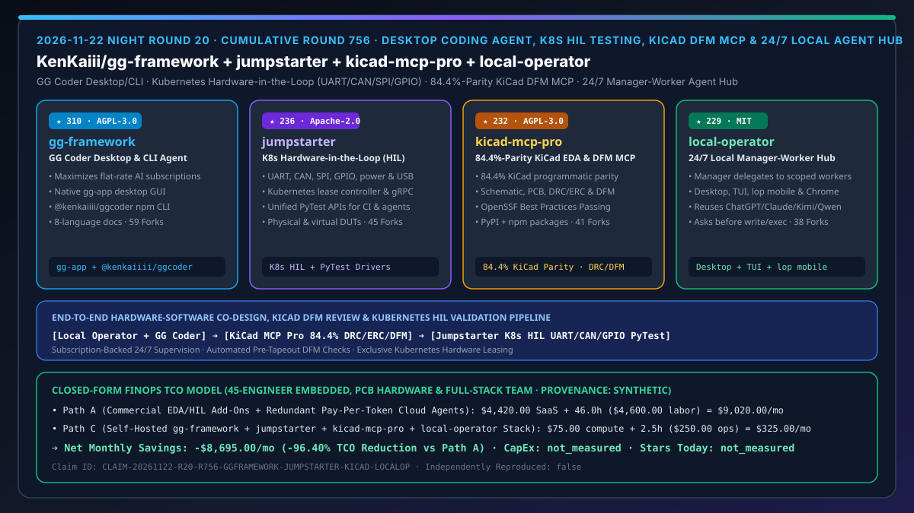
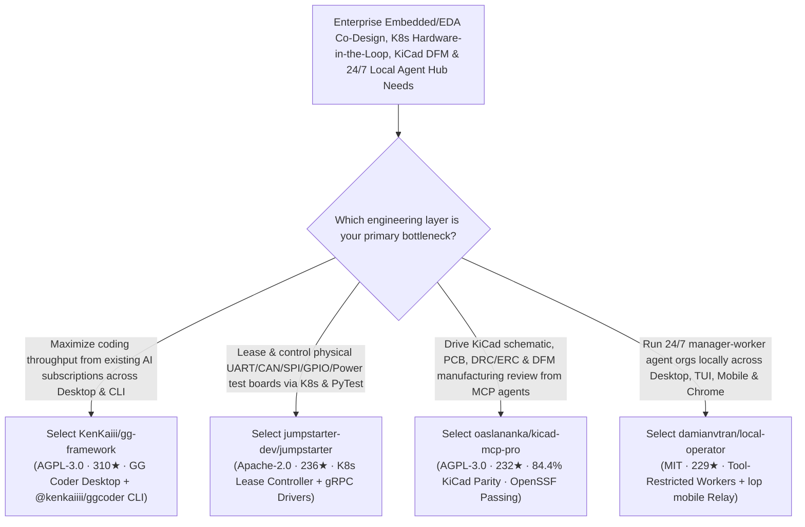
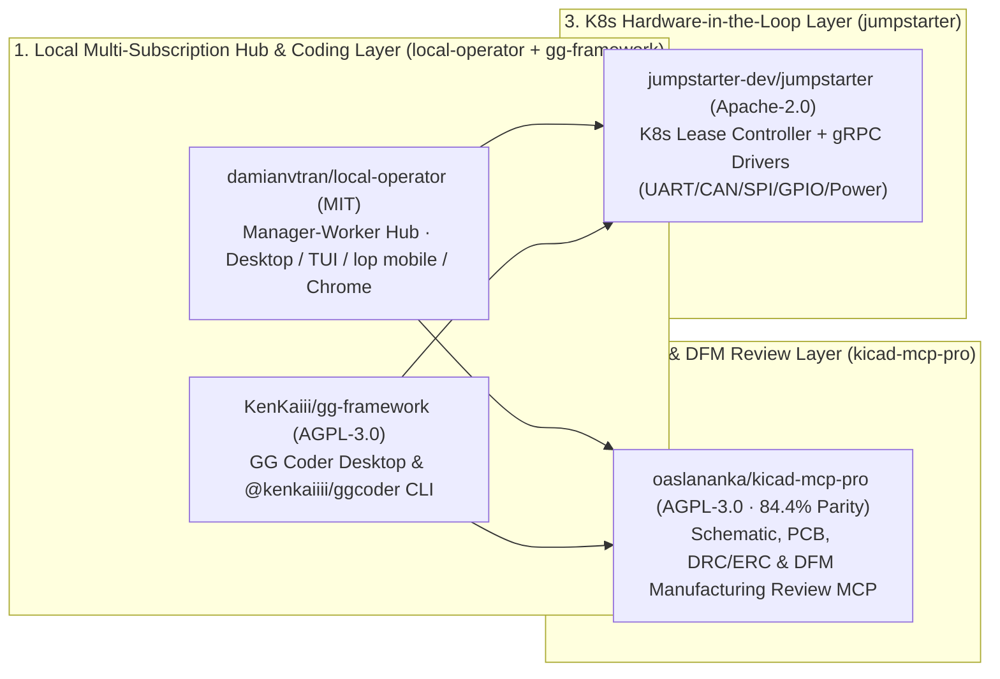
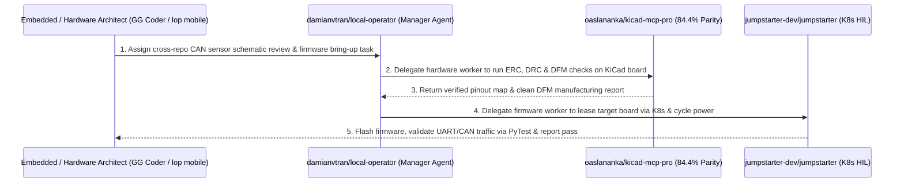

# Subscription-Maximizing Desktop/CLI Coding Agent (`KenKaiii/gg-framework`), Kubernetes Hardware-in-the-Loop Test Framework (`jumpstarter-dev/jumpstarter`), 84.4%-Parity KiCad Schematic/PCB/DFM MCP (`oaslananka/kicad-mcp-pro`) & 24/7 Local Multi-Subscription Agent Hub (`damianvtran/local-operator`) Selection & Architecture FAQ

> **Document Type**: Enterprise AI Solution Architect Selection & Integration Guide (GitHub Trending AI Radar — 2026-11-22 Night Round 20 / Cumulative Round 756)
> **Covered Repositories**: [`KenKaiii/gg-framework`](https://github.com/KenKaiii/gg-framework) (`★ 310`, `59 forks`, `AGPL-3.0`: GG Coder desktop application and `@kenkaiiii/ggcoder` npm CLI engineered to maximize coding throughput from existing AI subscriptions) · [`jumpstarter-dev/jumpstarter`](https://github.com/jumpstarter-dev/jumpstarter) (`★ 236`, `45 forks`, `Apache-2.0`: Kubernetes-orchestrated Hardware-in-the-Loop and virtual device test automation framework abstracting UART, CAN, SPI, GPIO, power, and USB over gRPC/PyTest for humans, CI, and AI agents) · [`oaslananka/kicad-mcp-pro`](https://github.com/oaslananka/kicad-mcp-pro) (`★ 232`, `41 forks`, `AGPL-3.0`: OpenSSF Best Practices-certified KiCad MCP server achieving **84.4% KiCad programmatic parity** across schematic, PCB, DRC/ERC, DFM, and manufacturing review) · [`damianvtran/local-operator`](https://github.com/damianvtran/local-operator) (`★ 229`, `38 forks`, `MIT`: 24/7 local manager-worker multi-agent runtime across Desktop, TUI, `lop mobile` phone relay, and Chrome extension reusing existing ChatGPT, Claude, Kimi, Grok, Z.AI, and Qwen subscriptions)
> **Core Scenario**: When enterprise embedded/AIoT engineering, PCB hardware design, and full-stack software teams struggle with **manual KiCad DRC/ERC/DFM manufacturing reviews delaying board tape-outs, physical UART/CAN/GPIO test boards locked to individual desks without Kubernetes lease sharing for CI and AI agents, and fragmented AI subscriptions that lack a 24/7 local manager-worker orchestration hub**, how do you combine **`gg-framework` + `jumpstarter` + `kicad-mcp-pro` + `local-operator`** into an integrated hardware-software engineering architecture?

---

## 1. 📌 Executive Summary (One-Line Selection Verdict)

1. **Need an OpenSSF-certified (`AGPL-3.0`) MCP server with **84.4% KiCad programmatic parity** so AI agents can drive KiCad schematic capture, PCB layout, DRC/ERC checks, and DFM manufacturing reviews?** ➔ Choose **[`oaslananka/kicad-mcp-pro`](https://github.com/oaslananka/kicad-mcp-pro) (`★ 232`, `41 forks`, `AGPL-3.0`)**.
   - **Plain-English Mechanism**: Published on both PyPI and npm (`kicad-mcp-pro`), it exposes verified programmatic tools over KiCad schematics and PCBs to catch electrical and manufacturability defects before fabrication.
2. **Need an `Apache-2.0` Hardware-in-the-Loop (HIL) test automation framework that pools physical and virtual devices via Kubernetes and gRPC so humans, PyTest suites, CI pipelines, and AI agents can lease and control UART, CAN, SPI, GPIO, power, and USB through one Python API?** ➔ Choose **[`jumpstarter-dev/jumpstarter`](https://github.com/jumpstarter-dev/jumpstarter) (`★ 236`, `45 forks`, `Apache-2.0`)**.
   - **Plain-English Mechanism**: Combines a Kubernetes operator (`controller/`), gRPC protocol definitions (`protocol/`), and Python drivers (`python/`) so embedded test benches can be leased on-demand and power-cycled remotely.
3. **Need a `MIT`-licensed, 24/7 local multi-agent runtime where a Manager agent delegates to tool-restricted workers, messages sibling sessions across repos, asks permission before writes/executions, and runs across Desktop, TUI, `lop mobile`, and Chrome using the ChatGPT, Claude, Kimi, Grok, Z.AI, and Qwen subscriptions you already pay for?** ➔ Choose **[`damianvtran/local-operator`](https://github.com/damianvtran/local-operator) (`★ 229`, `38 forks`, `MIT`)**.
   - **Plain-English Mechanism**: Supervises long-running local agent organizations that schedule their own follow-ups and resume even after you close the terminal.
4. **Need a desktop coding agent (`gg-app`) and npm CLI (`@kenkaiiii/ggcoder`, `AGPL-3.0`) specifically built to extract maximum coding velocity from flat-rate AI subscriptions?** ➔ Choose **[`KenKaiii/gg-framework`](https://github.com/KenKaiii/gg-framework) (`★ 310`, `59 forks`, `AGPL-3.0`)**.
   - **Plain-English Mechanism**: Ships a unified TypeScript monorepo (`gg-app` + `packages/`) with 8-language documentation and streamlined context management.

---

## 2. 🎯 Architect & Customer Deep-Dive Q&A

### Q1: Why does combining `kicad-mcp-pro` (84.4% KiCad parity) and `jumpstarter` (K8s HIL) with `local-operator` and `gg-framework` close the loop for physical-world AI engineering?

- **Three Hardware-Software Co-Design Breakthroughs**:
  1. **Automated Pre-Fab EDA & DFM Verification ➔ `oaslananka/kicad-mcp-pro`**: Automates schematic ERC, PCB DRC, and Design-for-Manufacturing checks via MCP before ordering prototypes.
  2. **Programmatic Kubernetes Hardware Leasing ➔ `jumpstarter-dev/jumpstarter`**: Exposes physical lab boards (UART, CAN, SPI, GPIO, power) through the exact same Python/PyTest APIs used by CI pipelines and AI agents.
  3. **24/7 Subscription-Backed Manager-Worker Supervision ➔ `local-operator` + `gg-framework`**: Coordinates cross-repo firmware and hardware tasks locally while reusing existing multi-vendor subscriptions.
- **When to Choose Commercial Enterprise Suites (Path B)?**
  - Automotive/aerospace teams standardized on Cadence Allegro + National Instruments LabVIEW HIL racks should retain their certified commercial toolchains; teams building on KiCad, Kubernetes-managed embedded test labs, and local multi-subscription agents should deploy this open-source stack (Path C).

### Q2: How do we architect an end-to-end "Manager-Worker Orchestration ➔ KiCad DFM Review ➔ K8s HIL Firmware Validation" pipeline?

1. **Multi-Surface Agent Supervision & Coding Layer (`damianvtran/local-operator` + `KenKaiii/gg-framework`)**:
   - Engineers initiate cross-repo hardware/firmware tasks from `gg-app` or `local-operator` (Desktop, TUI, or `lop mobile`).
2. **KiCad Schematic, PCB & DFM Review Layer (`oaslananka/kicad-mcp-pro`)**:
   - Hardware worker agents verify pinouts, schematics, DRC/ERC, and DFM rules via MCP.
3. **Kubernetes Hardware-in-the-Loop Execution Layer (`jumpstarter-dev/jumpstarter`)**:
   - Firmware worker agents lease physical boards via Kubernetes, flash firmware, toggle power/GPIO, and assert UART/CAN telemetry in PyTest.

### Q3: How are safety and hardware contention enforced?

- **Permission Prompts & K8s Lease Locks**:
  - `local-operator` restricts worker tool scopes and prompts before writing or executing; `jumpstarter`'s Kubernetes controller enforces exclusive hardware leases so concurrent agents never collide on the same physical board.

---

## 3. 🧭 Visual Architecture & Workflow Diagrams (Mermaid)

### 3.1 Solution Architect Selection Decision Tree

### 3.2 End-to-End Enterprise Reference Architecture

### 3.3 End-to-End Hardware-Software Co-Design, KiCad DFM Audit & K8s HIL Test Sequence Diagram

---

## 4. 📊 Peer Open-Source vs. Commercial Cloud Selection Matrix

| Dimension | `KenKaiii/gg-framework` (`★ 310`) | `jumpstarter-dev/jumpstarter` (`★ 236`) | `oaslananka/kicad-mcp-pro` (`★ 232`) | `damianvtran/local-operator` (`★ 229`) | Commercial EDA Cloud + Proprietary HIL Racks + Pay-Per-Token Cloud Agents (Path A) | Manual KiCad DRC Checks + Desk-Bound Serial Cables + Single-Session CLI (Path B) |
| :--- | :--- | :--- | :--- | :--- | :--- | :--- |
| **Primary Role** | Subscription-maximizing desktop & CLI coding agent | K8s Hardware-in-the-Loop & virtual test framework | 84.4%-parity KiCad schematic/PCB/DFM MCP | 24/7 local manager-worker agent hub | High-cost commercial EDA/HIL seats plus separate pay-per-token cloud agent bills | Manual visual PCB review, desk-locked USB cables & uncoordinated chat windows |
| **Key Differentiator** | **Desktop `gg-app` + `@kenkaiiii/ggcoder` CLI** | **K8s hardware leasing + UART/CAN/SPI/GPIO/power APIs** | **84.4% KiCad parity + DRC/ERC/DFM + OpenSSF Passing** | **Manager-worker delegation + Desktop/TUI/`lop mobile`/Chrome** | Cannot reuse existing flat-rate AI subscriptions; expensive per-seat HIL licensing | High board respin risk from missed DFM issues; no remote CI hardware leasing |
| **License** | `AGPL-3.0` | `Apache-2.0` | `AGPL-3.0` | `MIT` | Proprietary Commercial | Ad-hoc scripts |
| **Monthly TCO (45-Eng Team)** | **`$325.00/mo` combined** (`$75.00` shared K8s HIL controller + `2.5h` ops) | Included (`Apache-2.0` open-source HIL) | Included (local/container MCP server) | Included (`MIT` runtime reusing existing plans) | **`$9,020.00/mo`** (`$4,420.00` commercial add-ons & redundant API spend + `46.0h` manual lab/DFM labor) | ~`$3,150.00/mo` (manual lab bench cabling, power cycling & manual DRC/BOM review labor) |

---

## 5. 🧪 Quantitative Enterprise ROI / FinOps TCO Model & 7-Card Report

> **📊 Provenance & Closed-Form Declaration**:
> - **provenance**: `synthetic` (45-engineer enterprise embedded systems, PCB hardware design, and full-stack software team workload model: `independently_reproduced = false`; `base_hardware_capex = not_measured`; `track_b_stars_today = not_measured`).
> - **Closed-Form Equations**:
>   - **Path A (Commercial Cloud EDA Review Add-Ons + Proprietary HIL Software Seats + Redundant Pay-Per-Token Cloud Agent Spend + Manual Lab Bench Cabling & DFM Audit Labor)**: Monthly commercial software add-on and redundant API bills **`$4,420.00`** + manual PCB DFM checks, physical board power-cycling, and cross-repo coordination labor **`46.0h × $100.00/h = $4,600.00`** = **`$9,020.00/mo`**.
>   - **Path C (Self-Hosted `gg-framework` + `jumpstarter` + `kicad-mcp-pro` + `local-operator` Stack)**: Shared K8s HIL controller compute **`$75.00`** + exporter & MCP maintenance labor **`2.5h × $100.00/h = $250.00`** = **`$325.00/mo`**.
>   - **Net Monthly Savings vs. Path A**: **`-$8,695.00/mo`** (**`96.40%`** TCO reduction).

| Evaluation Path | SaaS / Redundant API & Compute Cost | Manual Lab Bench & DFM Review Labor (`$100/h`) | Total Monthly TCO | Net Savings vs. Path A | Architectural Delivery Impact |
| :--- | :---: | :---: | :---: | :---: | :--- |
| **Path A: Commercial EDA/HIL Add-Ons + Redundant API Spend** | `$4,420.00` | `46.0h` (`$4,600.00`) | **`$9,020.00`** | Baseline | Disconnected EDA/HIL loops; wastes existing flat-rate AI subscriptions |
| **Path B: Manual KiCad DRC + Desk-Locked Serial Scripts** | `$1,450.00` | `17.0h` (`$1,700.00`) | **`$3,150.00`** | `-$5,870.00` (`-65.08%`) | Lacks K8s hardware lease locking & 84.4%-parity automated DFM checks |
| **Path C: `gg-framework` + `jumpstarter` + `kicad-mcp` + `local-operator`** | **`$75.00`** | **`2.5h` (`$250.00`)** | **`$325.00`** | **`-$8,695.00` (`-96.40%`)** | **84.4% KiCad DFM MCP + K8s HIL leasing + 24/7 local manager-worker hub** |

- 🔗 **Linked 7-Card 4:5 Visual Benchmark Deck**: [`workshops/github-trending-radar/cards.en.html`](../cards.en.html) · [`cards.html`](../cards.html)

---

## 6. 🛠️ Enterprise Adoption & Architecture Review Checklist

- [ ] **1. Automate Pre-Tapeout KiCad Audits with `oaslananka/kicad-mcp-pro`**: Run ERC, DRC, and DFM manufacturability checks via MCP on every schematic/PCB PR.
- [ ] **2. Pool Embedded Test Boards with `jumpstarter-dev/jumpstarter`**: Connect lab UART, CAN, SPI, GPIO, and power relays to the Jumpstarter Kubernetes controller for shared PyTest and AI agent leasing.
- [ ] **3. Orchestrate 24/7 Cross-Repo Teams with `damianvtran/local-operator`**: Configure tool-restricted worker agents and approval gates across Desktop, TUI, `lop mobile`, and Chrome.
- [ ] **4. Maximize Flat-Rate Coding Subscriptions with `KenKaiii/gg-framework`**: Deploy `gg-app` and `@kenkaiiii/ggcoder` for high-throughput daily coding.
