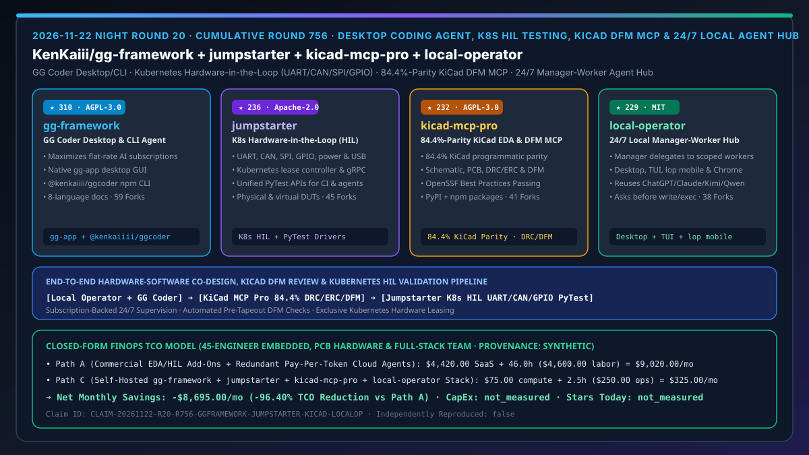
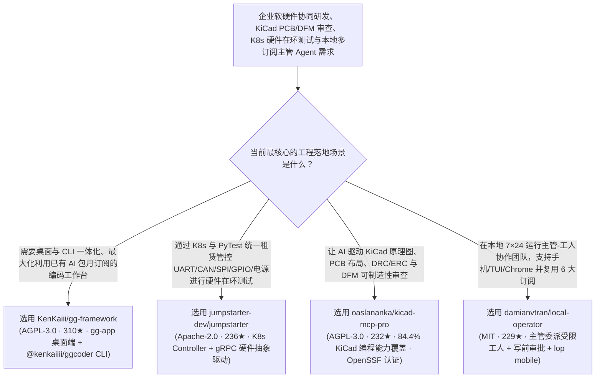
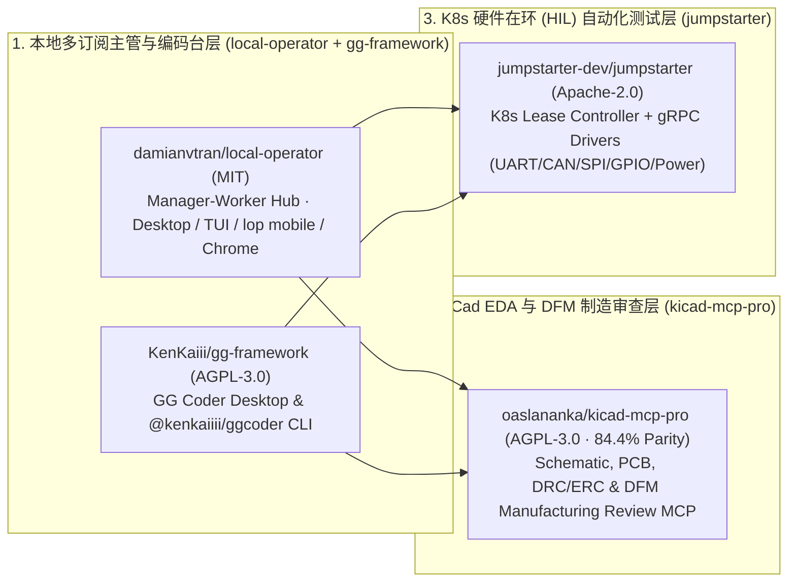
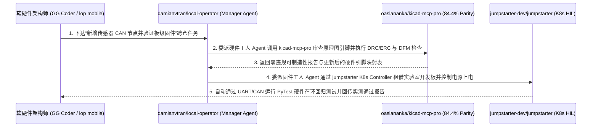

# 订阅额度榨取型桌面/CLI 编码工作台（`KenKaiii/gg-framework`）、K8s 硬件在环（HIL）嵌入式测试框架（`jumpstarter-dev/jumpstarter`）、84.4% 覆盖率 KiCad 原理图/PCB/DFM 制造审查 MCP（`oaslananka/kicad-mcp-pro`）与 7×24 本地多订阅协同主管中枢（`damianvtran/local-operator`）选型与集成架构 FAQ

> **文档类型**：企业 AI 解决方案架构师（AI Solution Architect）选型决策指南（GitHub Trending AI 雷达 2026-11-22 Night Round 20 / 累计第 756 轮）
> **覆盖项目**：[`KenKaiii/gg-framework`](https://github.com/KenKaiii/gg-framework)（`★ 310`、`59 forks`、`AGPL-3.0`，含桌面端 `gg-app` 与 `@kenkaiiii/ggcoder` CLI、旨在最大化榨取开发者现有 AI 包月订阅价值的编码智能体框架）· [`jumpstarter-dev/jumpstarter`](https://github.com/jumpstarter-dev/jumpstarter)（`★ 236`、`45 forks`、`Apache-2.0`，通过 Kubernetes Controller 与 gRPC 协议统一抽象 UART/CAN/SPI/GPIO/电源/USB 硬件接口，让人、CI 与 AI Agent 安全共享租赁真实开发板与虚拟设备的硬件在环测试框架）· [`oaslananka/kicad-mcp-pro`](https://github.com/oaslananka/kicad-mcp-pro)（`★ 232`、`41 forks`、`AGPL-3.0`，达到 **84.4% KiCad 编程能力对齐度**并通过 OpenSSF 最佳实践认证的原理图、PCB、DRC/ERC、DFM 可制造性审查 MCP）· [`damianvtran/local-operator`](https://github.com/damianvtran/local-operator)（`★ 229`、`38 forks`、`MIT`，跨桌面端、TUI、`lop mobile` 手机中继与 Chrome 插件的本地 7×24 主管-工人多智能体协同中枢，直接复用现有 ChatGPT/Claude/Kimi/Grok/Z.AI/Qwen 订阅）
> **核心场景**：当企业软硬件协同研发（AIoT/机器人/车载）、EDA 硬件设计团队与全栈工程团队面临**“AI Agent 编写完原理图与嵌入式固件后无法自动完成 KiCad DRC/ERC/DFM 可制造性审查、远程团队与 CI 流水线无法通过统一 API 安全租赁操作实验室里的 UART/CAN/GPIO 真实硬件开发板、以及开发者买了多个大模型包月订阅却缺乏本地 7×24 跨仓主管调度与桌面编码客户端”**四大痛点时，如何组合**`gg-framework` + `jumpstarter` + `kicad-mcp-pro` + `local-operator`** 构建端到端“EDA 硬件审查 + K8s 硬件在环测试 + 本地多订阅协同”架构？

---

## 一、📌 核心结论速览（选型一句话结论）

1. **想让 AI 智能体真正介入电子硬件工程全生命周期——从驱动 KiCad 绘制原理图与 PCB，到自动执行电气规则检查（ERC）、设计规则检查（DRC）、可制造性分析（DFM）与投产前制造评审** ➔ 选 **[`oaslananka/kicad-mcp-pro`](https://github.com/oaslananka/kicad-mcp-pro)（`★ 232`，`41 forks`，`AGPL-3.0`）**。
   - **通俗原理**：同时发布于 PyPI 与 npm，实测达成 **84.4% 的 KiCad 编程能力覆盖率（Programmatic Parity）** 并获 OpenSSF Best Practices Passing 与 Zenodo 学术引用认证，是硬件工程师的 AI 审图搭档。
2. **想把实验室里散落的嵌入式开发板（UART、CAN 总线、SPI、GPIO、可编程电源、USB）通过 Kubernetes Operator 与 gRPC 协议池化管理，让人类开发者、PyTest 脚本、CI 流水线和 AI Agent 用完全一致的 Python API 按需租借测试** ➔ 选 **[`jumpstarter-dev/jumpstarter`](https://github.com/jumpstarter-dev/jumpstarter)（`★ 236`，`45 forks`，`Apache-2.0`）**。
   - **通俗原理**：在 K8s 集群部署 `controller/` 服务，在连接物理开发板的宿主机运行 Exporter，AI Agent 编写完固件后即可通过 `jmp` CLI 与 PyTest 插件远程刷机、上电重启并读取串口/CAN 报文验证。
3. **想在本地机器上 7×24 小时跑一个“主管 Agent（Manager）带领受限工人 Agent（Tool-Restricted Workers）”的自治团队，不仅能跨仓库发消息、写操作前先弹框请示，还能通过 `lop mobile` 手机端、桌面端、TUI 与 Chrome 浏览器插件复用你已付费的 ChatGPT/Claude/Kimi/Grok/Z.AI/Qwen 订阅** ➔ 选 **[`damianvtran/local-operator`](https://github.com/damianvtran/local-operator)（`★ 229`，`38 forks`，`MIT`）**。
   - **通俗原理**：主管会话负责拆解计划、委派给权限受限的子工友执行并在终端关闭后按定时计划自动续跑，彻底榨干现有包月订阅。
4. **想要一款专为“极致利用已有 AI 订阅额度”而设计的桌面端（`gg-app`）与命令行（`@kenkaiiii/ggcoder`）编码智能体套件** ➔ 选 **[`KenKaiii/gg-framework`](https://github.com/KenKaiii/gg-framework)（`★ 310`，`59 forks`，`AGPL-3.0`）**。
   - **通俗原理**：提供开箱即用的桌面 GUI 与 npm CLI 双形态，内置八国语言文档（含简体中文），专注提升日常编码吞吐率。

---

## 二、🎯 客户与架构师灵魂拷问 Q&A（深度架构拆解）

### Q1：为什么“软件编码 + KiCad EDA 审查 (`kicad-mcp-pro`) + K8s 硬件在环 (`jumpstarter`)”打通了物理世界 AI 研发的最后一公里？

- **三大软硬一体闭环优势**：
  1. **原理图与 PCB 投板前自动排雷 ➔ `oaslananka/kicad-mcp-pro`**：以往硬件工程师改完板子靠人工肉眼核对 DRC/ERC 报错与工厂 DFM 工艺极限；`kicad-mcp-pro` 以 84.4% 的 KiCad 原生接口覆盖率让 Agent 自动完成规则校验与制造审查。
  2. **真机硬件在环（HIL）云化共享 ➔ `jumpstarter-dev/jumpstarter`**：把独占工位的物理电路板变成 K8s 纳管的可租赁资源，Agent 改完驱动代码即可自动调电源上下电、抓 UART/CAN 总线波形跑通 PyTest E2E 测试。
  3. **多订阅 7×24 主管-工人本地协同 ➔ `local-operator` + `gg-framework`**：通过 `local-operator` 让主管 Agent 跨固件仓与硬件仓协同调度，并复用团队现有的多厂商订阅额度。
- **何时直接用商业云/商业 EDA 方案（Path B）？**
  - 若大型芯片与车规级主板团队强制绑定 Cadence Allegro / Altium Designer 商业云协同套件，应优先使用原厂企业版工具链；若采用 KiCad 开源 EDA 生态、自建 K8s 嵌入式 HIL 测试实验室及本地多订阅智能体协同，则采用本轮开源栈（Path C）。

### Q2：典型企业级“本地主管调度 (`local-operator` / `gg-framework`) ➔ KiCad PCB/DFM 审查 (`kicad-mcp-pro`) ➔ K8s 硬件在环自动化测试 (`jumpstarter`)”生产架构怎么搭？

1. **多端主管调度与编码工作台层（`damianvtran/local-operator` + `KenKaiii/gg-framework`）**：
   - 工程师在 `gg-app` 桌面端或 `local-operator`（支持 `lop mobile` 手机巡检）下达软硬件联调任务，复用现有 Claude/ChatGPT/Kimi/Qwen 订阅。
2. **EDA 原理图、PCB 与 DFM 可制造性审查层（`oaslananka/kicad-mcp-pro`）**：
   - 硬件子 Agent 通过 `kicad-mcp-pro` 检查原理图连接、执行 DRC/ERC 与 DFM 制造评审。
3. **Kubernetes 硬件在环（HIL）测试执行层（`jumpstarter-dev/jumpstarter`）**：
   - 固件子 Agent 通过 `jumpstarter` 的 gRPC/PyTest 接口租用实验室目标开发板，控制电源、GPIO、UART 与 CAN 总线完成自动化回归验证。

### Q3：`local-operator` 和 `jumpstarter` 如何保障物理设备与本地文件安全？

- **工具受限工人 + 写前审批 + K8s 硬件租约隔离**：
  - `local-operator` 的主管仅向工人下发受限工具集并在写盘/执行前向用户请求确认；`jumpstarter` 通过 K8s Controller 对物理硬件实施租约（Lease）互斥与权限管控，防止两个测试任务同时操作同一块电路板电源。

---

## 三、🧭 直观可视化图解（Mermaid 决策树 + 集成架构 + 时序图）

### 3.1 架构师选型决策树

### 3.2 企业端到端生产集成参考架构图

### 3.3 软硬件协同开发、KiCad DFM 审查与 Jumpstarter 硬件在环验证时序图

---

## 四、📊 同类开源与商业云服务横向选型决策矩阵

| 对比维度 | `KenKaiii/gg-framework` (`★ 310`) | `jumpstarter-dev/jumpstarter` (`★ 236`) | `oaslananka/kicad-mcp-pro` (`★ 232`) | `damianvtran/local-operator` (`★ 229`) | 商业 EDA 云套件 + 商业 HIL 测试台 + 按量 API 重复付费 (Path A) | 手工查 KiCad DRC + 工程师跑到实验室插拔串口线 + 单窗口聊天 (Path B) |
| :--- | :--- | :--- | :--- | :--- | :--- | :--- |
| **核心能力定位** | 订阅额度优化型桌面与 CLI 编码智能体 | K8s 硬件在环（HIL）与虚拟设备测试框架 | 84.4% 覆盖率 KiCad 原理图/PCB/DFM MCP | 7×24 本地多订阅主管-工人智能体中枢 | 高昂的商业 EDA/HIL 许可证及与包月订阅割裂的按量云端 Agent 账单 | 人工肉眼对原理图、物理独占开发板与无跨仓协同的单体脚本 |
| **核心技术突破** | **桌面 `gg-app` + `@kenkaiiii/ggcoder` CLI 榨干包月额度** | **K8s 硬件租赁 + 统一 PyTest/gRPC 控制 UART/CAN/SPI/电源** | **84.4% KiCad 编程对齐 + DRC/ERC/DFM 制造全闭环 + OpenSSF** | **主管委派工具受限工人 + 写前审批 + 桌面/TUI/手机/Chrome 全覆盖** | 商业 HIL 机柜与 EDA 插件年费极贵；无法复用已有个人/团队包月订阅 | 远程居家无法插拔硬件断电重启；投板前漏检 DFM 导致返工报废 |
| **开源协议** | `AGPL-3.0` | `Apache-2.0` | `AGPL-3.0` | `MIT` | 闭源商业软件 | 内部零散脚本 |
| **月度 TCO（45 人团队）** | **组合仅 `$325.00/月`**（`$75.00` 共享 K8s HIL 控制器容器 + `2.5h` 维护） | 同左（`Apache-2.0` 免费开源） | 同左（本地/容器 MCP 零月租） | 同左（`MIT` 免费复用现有订阅） | **`$9,020.00/月`**（`$4,420.00` 商业插件与重复按量 API + `46.0h` 人工跑实验室与查板） | 约 `$3,150.00/月`（大量人工插拔开发板跑测试与人工核对 BOM/DRC 工时） |

---

## 五、🧪 应用落地定量收益/TCO 对比与 7-Card 报告

> **📊 数据来源与闭式核算声明（Provenance & Closed-Form Schema）**：
> - **provenance**: `synthetic`（基于 45 人企业软硬件协同研发、EDA 硬件设计与嵌入式测试团队月度工作负载模型：`independently_reproduced = false`；硬件采购基线 `base_hardware_capex = not_measured`；Track B 单日增量 `track_b_stars_today = not_measured`）。
> - **核算公式**：
>   - **Path A（采购商业 EDA 云端审查插件与商业 HIL 测试席位 + 脱离现有包月订阅额外支付的云端 Agent 按量 Token 账单 + 工程师手工核查 DRC/DFM 与往返实验室插拔开发板人工）**：月度商业软件附加包与额外 API 账单 **`$4,420.00`** + 人工核对 PCB DFM 规则、手动刷机上下电与跨仓协调人工 **`46.0h × $100.00/h = $4,600.00`** = **`$9,020.00/月`**。
>   - **Path C（自建 `gg-framework` + `jumpstarter` + `kicad-mcp-pro` + `local-operator` 开源软硬一体栈）**：共享 K8s HIL 控制面容器开销 **`$75.00`** + 硬件 Exporter 与 MCP 规则维护人工 **`2.5h × $100.00/h = $250.00`** = **`$325.00/月`**。
>   - **净节省（Net Savings vs Path A）**：**`-$8,695.00/月`**（成本降低 **`96.40%`**）。

| 评估方案 | 商业插件/API 与算力成本 | 硬件审查与实验室测试维护人工（`$100/h`） | 月度总 TCO | 相对 Path A 净节省 | 关键架构交付指标 |
| :--- | :---: | :---: | :---: | :---: | :--- |
| **Path A：商业 EDA/HIL 席位 + 额外按量 API + 人工跑实验室** | `$4,420.00` | `46.0h` (`$4,600.00`) | **`$9,020.00`** | Baseline | 软硬件验证割裂；既有 AI 订阅额度闲置浪费 |
| **Path B：手工查 KiCad DRC + 自写串口脚本 + 单窗口 Agent** | `$1,450.00` | `17.0h` (`$1,700.00`) | **`$3,150.00`** | `-$5,870.00` (`-65.08%`) | 缺少 K8s 多人共享硬件租约（Lease）与 84.4% 覆盖率 DFM 审查 |
| **Path C：`gg-framework` + `jumpstarter` + `kicad-mcp` + `local-operator`** | **`$75.00`** | **`2.5h` (`$250.00`)** | **`$325.00`** | **`-$8,695.00` (`-96.40%`)** | **84.4% KiCad DFM 审查 + K8s HIL 远程刷机 + 多订阅主管协同** |

- 🔗 **关联 7-Card 4:5 视觉评测报告**：[`workshops/github-trending-radar/cards.html`](../cards.html) · [`cards.en.html`](../cards.en.html)

---

## 六、🛠️ 企业引入与架构评审 Checklist

- [ ] **1. 硬件团队接入 `oaslananka/kicad-mcp-pro`**：在投板前通过 MCP 自动执行原理图 ERC、PCB DRC 与 DFM 可制造性检查。
- [ ] **2. 嵌入式实验室部署 `jumpstarter-dev/jumpstarter`**：将物理开发板的 UART、CAN、SPI、GPIO 与电源接入 K8s Controller，向 PyTest 与 AI Agent 开放按需租借 API。
- [ ] **3. 使用 `damianvtran/local-operator` 编排跨仓主管-工人工作流**：开启写前人工确认（Ask before write/execute），并通过 `lop mobile` 随时远程查看长任务进度。
- [ ] **4. 结合 `KenKaiii/gg-framework` 提升日常编码订阅利用率**：统一桌面端 `gg-app` 与 `@kenkaiiii/ggcoder` CLI 编码体验。
