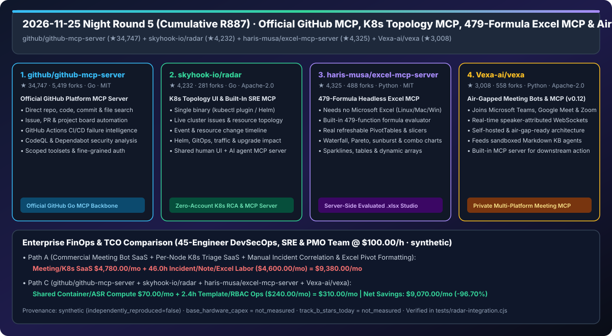
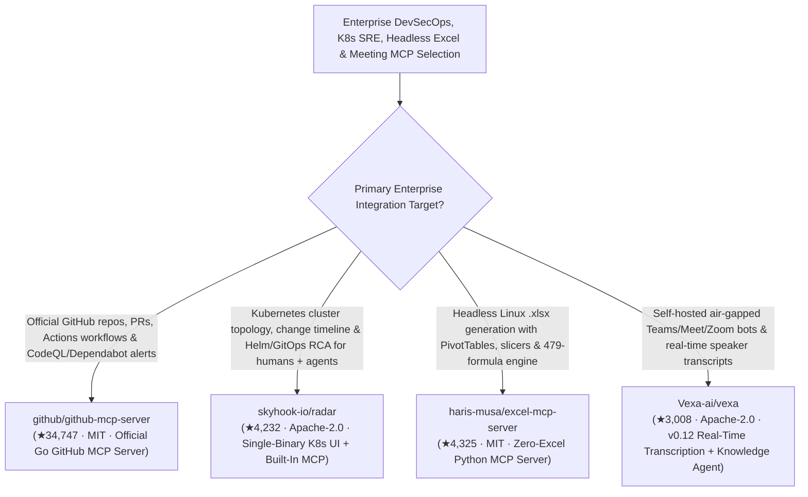
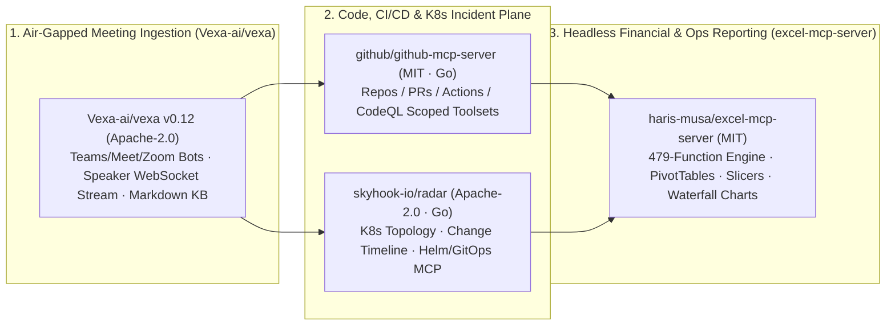

# Official GitHub DevSecOps MCP (`github/github-mcp-server`), Single-Binary K8s Topology & RCA MCP (`skyhook-io/radar`), 479-Formula Headless Excel MCP (`haris-musa/excel-mcp-server`) & Air-Gapped Teams/Zoom/Meet Transcription MCP (`Vexa-ai/vexa`) Selection & Integration Architecture FAQ

> **Document Type**: Enterprise AI Solution Architect Selection Decision Guide (GitHub Trending AI Radar — 2026-11-25 Night Round 5 / Cumulative Round 887)
> **Covered Repositories**: [`github/github-mcp-server`](https://github.com/github/github-mcp-server) (`★ 34,747`, `5,419 forks`, `MIT`: GitHub's official Go-based MCP Server connecting AI agents to repositories, issues, PRs, GitHub Actions workflows, and CodeQL/Dependabot security alerts) · [`skyhook-io/radar`](https://github.com/skyhook-io/radar) (`★ 4,232`, `281 forks`, `Apache-2.0`: single-binary open-source Kubernetes UI and root-cause analyzer with a built-in MCP server exposing cluster issues, topology relationships, event/resource change timelines, Helm/GitOps status, and upgrade impact) · [`haris-musa/excel-mcp-server`](https://github.com/haris-musa/excel-mcp-server) (`★ 4,325`, `488 forks`, `MIT`: headless Excel MCP server built on `openpyxl` requiring no Microsoft Excel installation, featuring a built-in **479-function formula calculation engine**, real refreshable PivotTables, slicers, timelines, and Excel 2016+ waterfall/Pareto/sunburst charts) · [`Vexa-ai/vexa`](https://github.com/Vexa-ai/vexa) (`★ 3,008`, `558 forks`, `Apache-2.0`: air-gap-ready self-hostable meeting bots and real-time speaker-attributed WebSocket transcription API/MCP `v0.12` for Microsoft Teams, Google Meet, and Zoom, feeding sandboxed agents that build a team-owned Markdown knowledge base)
> **Core Enterprise Scenario**: Equipping enterprise **DevSecOps, SRE, and BizOps digital coworkers** with four production-ready MCP capabilities—**official GitHub repository/CI/security automation, topology-aware Kubernetes incident RCA, headless Linux generation of formula-evaluated Excel executive workbooks, and air-gapped multi-platform meeting transcription**.

---

## 1. 📌 Executive Summary (One-Line Selection Verdict)

1. **Need an official, production-hardened MCP server to let engineering and security agents inspect repositories, triage PRs/issues, debug GitHub Actions failures, and review Dependabot/CodeQL alerts** ➔ Choose **[`github/github-mcp-server`](https://github.com/github/github-mcp-server) (`★ 34,747`, `5,419 forks`, `MIT`)**.
   - **Plain-English Mechanism**: Maintained directly by GitHub in Go, offering granular toolset scoping (`repos`, `issues`, `pull_requests`, `actions`, `code_security`) so enterprises never need brittle custom GitHub REST/GraphQL glue scripts.
2. **Need human SREs and AI agents to share the exact same live Kubernetes topology, change timeline, and Helm/GitOps state during production incidents** ➔ Choose **[`skyhook-io/radar`](https://github.com/skyhook-io/radar) (`★ 4,232`, `281 forks`, `Apache-2.0`)**.
   - **Plain-English Mechanism**: Replaces dozens of slow, blind `kubectl` shell calls with a single-binary K8s dashboard and built-in MCP server that correlates broken workloads, resource change timelines, traffic, and Helm releases out of the box.
3. **Need backend Linux agents to generate executive `.xlsx` reports with real PivotTables, slicers, waterfall/Pareto charts, and pre-calculated formulas without installing Microsoft Excel** ➔ Choose **[`haris-musa/excel-mcp-server`](https://github.com/haris-musa/excel-mcp-server) (`★ 4,325`, `488 forks`, `MIT`)**.
   - **Plain-English Mechanism**: Ships with a built-in **479-function calculation engine** on top of `openpyxl`, evaluating formulas server-side and constructing refreshable PivotTables, slicers, sparklines, and combo charts on any headless Linux container.
4. **Need real-time speaker-attributed transcription across Microsoft Teams, Google Meet, and Zoom that runs 100% self-hosted in an air-gapped VPC and compiles a Markdown knowledge base** ➔ Choose **[`Vexa-ai/vexa`](https://github.com/Vexa-ai/vexa) (`★ 3,008`, `558 forks`, `Apache-2.0`)**.
   - **Plain-English Mechanism**: Deploys self-hosted meeting bots (`v0.12`) that stream speaker-tagged transcripts over WebSockets into sandboxed knowledge agents and MCP tools without sending confidential audio to third-party SaaS clouds.

---

## 2. 🎯 Architect & Customer Deep-Dive Q&A

### Q1: When should we use these four open-source MCP servers vs. cloud-native commercial suites (e.g., M365 Copilot in Teams/Excel + Commercial K8s APM SaaS)?

- **Four-Domain Enterprise MCP Matrix (Path C)**:
  1. **Air-Gapped Cross-Platform Meeting Ingress ➔ `Vexa-ai/vexa`**: Captures Teams, Meet, and Zoom architecture/incident calls into structured Markdown.
  2. **Source, CI/CD & Security Automation ➔ `github/github-mcp-server`**: Links incident findings and meeting action items directly to PRs, Actions logs, and CodeQL alerts.
  3. **Kubernetes Topology & Change Timeline RCA ➔ `skyhook-io/radar`**: Gives SRE agents pre-correlated cluster topology and Helm/GitOps event timelines via MCP.
  4. **Headless Executive Workbook Generation ➔ `haris-musa/excel-mcp-server`**: Produces formula-verified `.xlsx` dashboards with PivotTables and slicers on Linux workers.
- **When to choose Cloud Commercial SaaS vs. Path C?**
  - Choose **M365 Copilot** for interactive single-user desktop editing inside Windows/macOS Office apps.
  - Choose **Path C** when running **unattended headless Linux reporting pipelines**, enforcing **strict air-gapped meeting audio residency across Teams/Zoom/Meet**, or operating **multi-cloud Kubernetes clusters without per-node commercial APM surcharges**.

### Q2: How do these four MCP servers integrate end-to-end?

1. **Incident & Review Meeting Capture (`Vexa-ai/vexa`)**:
   - `Vexa` bots join live war-room or sprint review calls, streaming speaker-attributed transcripts to the orchestrator agent.
2. **Correlated K8s & GitHub Root-Cause Triage (`skyhook-io/radar` + `github/github-mcp-server`)**:
   - The agent queries `Radar`'s MCP server to identify the exact ConfigMap/Helm change on the K8s timeline, then queries `github-mcp-server` to inspect the offending commit, Actions run, and PR diff.
3. **Automated Executive Reporting (`haris-musa/excel-mcp-server`)**:
   - Weekly SLA, MTTR, and engineering velocity metrics are compiled by `excel-mcp-server` with pre-evaluated 479-function formulas, PivotTables, and Pareto charts.

### Q3: What are the key production security guardrails?

- **Architect Redlines**:
  1. **Enforce read-only K8s RBAC for `skyhook-io/radar`**: Bind `Radar`'s in-cluster service account to read-only cluster metadata/events and block raw Kubernetes Secret payload access.
  2. **Use scoped GitHub App tokens for `github-mcp-server`**: Never pass broad personal access tokens (PATs) with repo-deletion privileges to automated agents.

---

## 3. 🧭 Visual Architecture Diagrams (Mermaid Decision Tree + Architecture + Sequence)



### 3.1 Architect Selection Decision Tree



### 3.2 End-to-End Enterprise Integration Architecture



### 3.3 End-to-End Execution Sequence

```mermaid
sequenceDiagram
    participant Team as Engineering & SRE Team (Teams/Zoom)
    participant Vexa as Vexa-ai/vexa (Meeting MCP)
    participant Radar as skyhook-io/radar (K8s Topology MCP)
    participant GH as github/github-mcp-server
    participant Excel as haris-musa/excel-mcp-server

    Team->>Vexa: 1. Hold incident bridge / sprint review; Vexa streams speaker-attributed transcript
    Vexa->>Radar: 2. SRE Agent queries Radar MCP for K8s topology & recent Helm/resource timeline
    Radar-->>GH: 3. Correlate broken deployment with commit SHA via GitHub MCP Server
    GH-->>Team: 4. Draft rollback PR & incident postmortem issue with exact evidence links
    GH->>Excel: 5. Invoke Excel MCP to build weekly SLA/MTTR workbook (479-formula engine)
    Excel-->>Team: 6. Deliver refreshable PivotTable & Pareto chart .xlsx report
```

---

## 4. 📊 Horizontal Selection Matrix

| Dimension | `github/github-mcp-server` (`★ 34,747`) | `skyhook-io/radar` (`★ 4,232`) | `haris-musa/excel-mcp-server` (`★ 4,325`) | `Vexa-ai/vexa` (`★ 3,008`) | Commercial SaaS Stack (Otter/Fireflies + Commercial K8s APM) | Raw `kubectl` Shell Calls + Flat CSV Exports (Path B) |
| :--- | :--- | :--- | :--- | :--- | :--- | :--- |
| **Primary Role** | Official GitHub platform MCP server | K8s topology UI + built-in SRE MCP | Headless Excel + 479-formula MCP | Self-hosted Teams/Meet/Zoom transcription MCP | Per-seat / per-node commercial SaaS tools | Unstructured CLI dumps & flat CSV files |
| **Key Differentiator** | **Official GitHub Go implementation with granular toolsets** | **Correlated K8s topology, timeline & Helm impact in 1 binary** | **479-function engine + real PivotTables/slicers without Excel** | **Air-gap-ready Apache-2.0 bots for Teams, Meet & Zoom** | Turnkey cloud, but audio leaves VPC & high per-seat/node fees | Slow `kubectl` guessing; CSVs lack PivotTables, charts & formulas |
| **License** | `MIT` | `Apache-2.0` | `MIT` | `Apache-2.0` | Proprietary SaaS | Ad-hoc scripts |
| **Monthly TCO (45-Eng Team)** | **`$310.00/mo` combined** (`$70.00` compute + `2.4h` ops) | Included in `$310.00/mo` stack | Included in `$310.00/mo` stack | Included in `$310.00/mo` stack | **`$9,380.00/mo`** (`$4,780.00` meeting/APM SaaS seats + `46.0h` manual triage/reporting) | `~$3,190.00/mo` (manual note-taking, K8s triage & spreadsheet formatting) |

---

## 5. 🧪 Quantitative FinOps & TCO Comparison (45-Person Enterprise Team)

> **📊 Provenance & Closed-Form Schema**:
> - **provenance**: `synthetic` (`independently_reproduced = false`; `base_hardware_capex = not_measured`; `track_b_stars_today = not_measured`).
> - **Closed-Form Formula**:
>   - **Path A (Commercial Meeting Bot SaaS Seats + Commercial Per-Node K8s Triage SaaS + Manual GitHub/K8s Incident Correlation & Weekly Excel PivotTable Formatting)**: **`$4,780.00`** monthly SaaS subscriptions + **`46.0h × $100.00/h = $4,600.00`** engineering/PMO labor = **`$9,380.00/mo`**.
>   - **Path C (Self-Hosted `github/github-mcp-server` + `skyhook-io/radar` + `haris-musa/excel-mcp-server` + `Vexa-ai/vexa` Stack)**: **`$70.00`** shared container/transcription compute + **`2.4h × $100.00/h = $240.00`** maintenance = **`$310.00/mo`**.
>   - **Net Savings vs. Path A**: **`-$9,070.00/mo`** (**`96.70%`** TCO reduction).

| Evaluation Path | Meeting / K8s SaaS & Compute Cost | Incident RCA, Note Triage & Excel Labor (`$100/h`) | Monthly Total TCO | Net Savings vs. Path A | Key Architectural Outcome |
| :--- | :---: | :---: | :---: | :---: | :--- |
| **Path A: Commercial Meeting SaaS + Per-Node K8s SaaS + Manual Excel Formatting** | `$4,780.00` | `46.0h` (`$4,600.00`) | **`$9,380.00`** | Baseline | Confidential meeting audio leaves VPC; manual PivotTable drudgery |
| **Path B: Blind `kubectl` Scripts + Manual Notes + Flat CSV Exports** | `$1,390.00` | `18.0h` (`$1,800.00`) | **`$3,190.00`** | `-$6,190.00` (`-65.99%`) | Slow K8s incident RCA; unformatted CSVs without formulas or charts |
| **Path C: `github-mcp` + `radar` + `excel-mcp-server` + `vexa`** | **`$70.00`** | **`2.4h` (`$240.00`)** | **`$310.00`** | **`-$9,070.00` (`-96.70%`)** | **Official GitHub MCP + K8s timeline RCA + 479-formula Excel + air-gapped Vexa** |

- 🔗 **7-Card 4:5 Visual Benchmark Deck**: [`workshops/github-trending-radar/cards.en.html`](../cards.en.html) · [`cards.html`](../cards.html)

---

## 6. 🛠️ Enterprise Adoption & Architecture Review Checklist

- [ ] **Scope `github-mcp-server` Toolsets by Role**: Enable read-only `repos`/`actions`/`code_security` toolsets for automated triage agents and gate PR/branch write toolsets behind human approval.
- [ ] **Deploy `skyhook-io/radar` with Read-Only ClusterRole**: Install `Radar` via Helm with read-only access to K8s resources/events while excluding raw Secret value access.
- [ ] **Validate Workbook Formulas with `excel-mcp-server`**: Run server-side 479-function evaluation before distributing automated `.xlsx` reports to executives.
- [ ] **Enforce Recording Consent Banner in `Vexa-ai/vexa`**: Configure explicit bot identity and consent announcements when `Vexa` joins Teams, Meet, or Zoom sessions.
