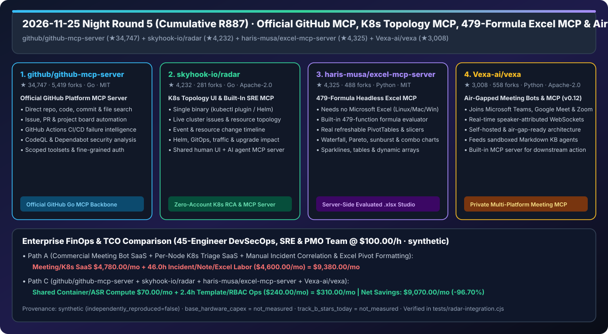
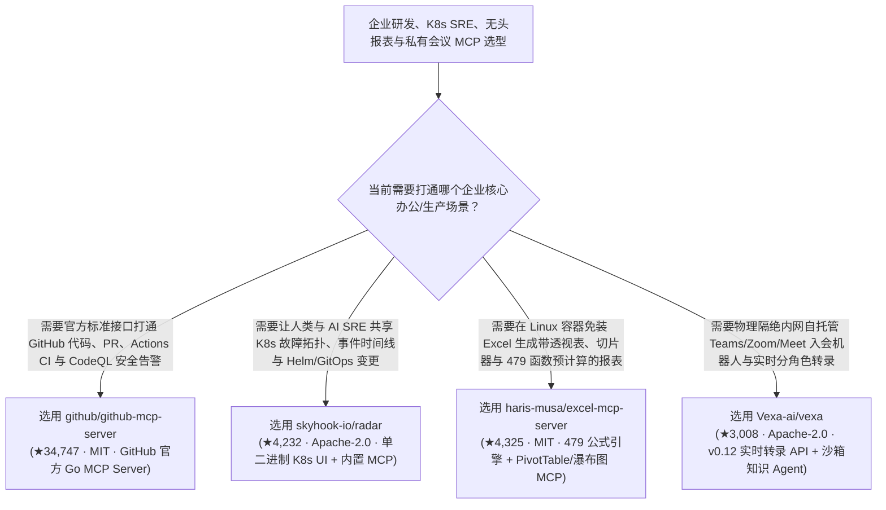
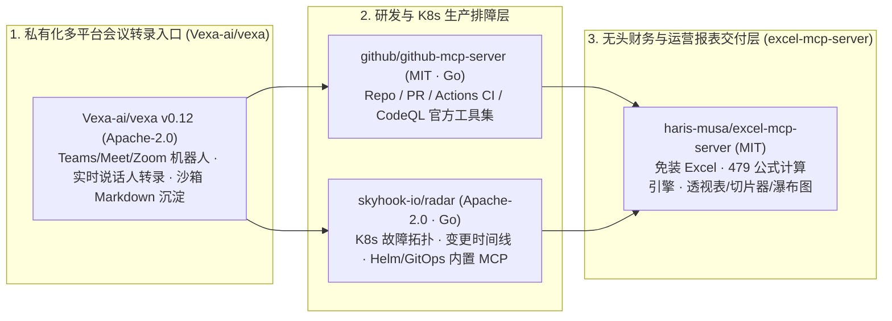
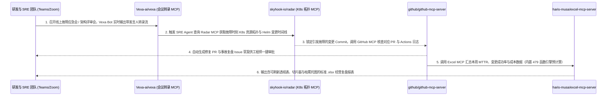

# GitHub 官方研发协同 MCP（`github/github-mcp-server`）、内置 MCP 的单二进制 K8s 故障拓扑分析台（`skyhook-io/radar`）、免装 Excel 的 479 函数与透视表 MCP（`haris-musa/excel-mcp-server`）与私有化 Teams/Zoom/Meet 实时会议转录 MCP（`Vexa-ai/vexa`）选型与集成架构 FAQ

> **文档类型**：企业 AI 解决方案架构师（AI Solution Architect）选型决策指南（GitHub Trending AI 雷达 2026-11-25 Night Round 5 / 累计第 887 轮）
> **覆盖项目**：[`github/github-mcp-server`](https://github.com/github/github-mcp-server)（`★ 34,747`、`5,419 forks`、`MIT`：GitHub 官方用 Go 编写的标准 MCP Server，打通代码仓库检索、Issue/PR 自动化、GitHub Actions 流水线排障与 CodeQL/Dependabot 安全告警分析）· [`skyhook-io/radar`](https://github.com/skyhook-io/radar)（`★ 4,232`、`281 forks`、`Apache-2.0`：单二进制免账号开源 Kubernetes 可视化故障诊断面板，内置原生 MCP Server，同步向人类 SRE 与 AI Agent 暴露集群问题、资源拓扑关系、事件变更时间线、Helm/GitOps 状态与升级影响面）· [`haris-musa/excel-mcp-server`](https://github.com/haris-musa/excel-mcp-server)（`★ 4,325`、`488 forks`、`MIT`：无需安装 Microsoft Excel 即可在 Linux/macOS/Windows 容器中创建和编辑 `.xlsx` 报表的 MCP Server，内置 **479 个 Excel 公式计算引擎**，支持真实数据透视表（PivotTables）、切片器（Slicers）、瀑布图/帕累托图/旭日图与迷你图）· [`Vexa-ai/vexa`](https://github.com/Vexa-ai/vexa)（`★ 3,008`、`558 forks`、`Apache-2.0`：支持物理隔绝内网（Air-Gapped）自托管的开源会议机器人与实时转录平台 `v0.12`，自动加入 Microsoft Teams、Google Meet 与 Zoom 会议输出带说话人区分的实时 WebSocket 转录流，并通过内置 MCP 与沙箱 Agent 自动沉淀团队自有 Markdown 知识库）
> **核心场景**：当企业构建“研发运维与经营分析全能数字同事（DevSecOps & BizOps Digital Coworker）”时，最核心的四个外部触手是：**① 读写 GitHub 代码仓、PR 与 CI 流水线；② 实时看懂生产 Kubernetes 集群为什么挂了、刚刚改了哪个 Helm/ConfigMap；③ 在 Linux 无头容器里直接生成带透视表、切片器与 479 个公式校验的财务/运营 Excel 报表；④ 自动参加跨国 Teams/Zoom 架构评审会并把带发言人署名的纪要转成任务单。** 本文给出这四个官方/标杆 MCP 项目的集成架构与云服务选型对比。

---

## 一、📌 核心结论速览（选型一句话结论）

1. **需要让企业研发与安全 Agent 标准、安全地操作 GitHub.com 或 GitHub Enterprise（查源码、提 PR、分析 Actions 构建失败日志、分拣 Dependabot/CodeQL 漏洞）** ➔ 选 **[`github/github-mcp-server`](https://github.com/github/github-mcp-server)（`★ 34,747`，`5,419 forks`，`MIT`）**。
   - **通俗原理**：由 GitHub 官方维护的纯 Go 高性能 MCP 服务端，无需团队自己手写残缺的 GitHub REST/GraphQL 包装脚本，原生支持按工具集（Toolsets）细粒度按需开启（如仅开只读 `repos`/`issues` 或开启 `actions`/`code_security`），是所有研发效能 Agent 的标准底座。
2. **需要让 SRE 运维值班 Agent 与工程师共享同一套 Kubernetes 实时拓扑视图，秒级回答“哪个 Pod 崩了、为什么崩、过去 15 分钟谁改了什么资源或 Helm Release”** ➔ 选 **[`skyhook-io/radar`](https://github.com/skyhook-io/radar)（`★ 4,232`，`281 forks`，`Apache-2.0`）**。
   - **通俗原理**：传统让 Agent 排障 K8s 是让它盲敲几十条 `kubectl get/describe/logs` 命令，既慢又容易漏掉关联的 Ingress/Service/ConfigMap 变更。`Radar` 是一个免注册单二进制（可作为 `kubectl` 插件或 Helm 部署在集群内），把资源依赖拓扑、事件时间线、GitOps 状态与升级影响预先关联好，并通过内置 MCP Server 直接喂给 Agent 执行根因分析（RCA）。
3. **需要让财务、经营分析与 PMO Agent 在 Linux 服务器端（无 Windows、无 Office 客户端授权）全自动生成带真实 Excel 透视表、切片器、组合图表与预先算好公式值的专业 `.xlsx` 经营周报** ➔ 选 **[`haris-musa/excel-mcp-server`](https://github.com/haris-musa/excel-mcp-server)（`★ 4,325`，`488 forks`，`MIT`）**。
   - **通俗原理**：普通 Python 脚本写出的 `.xlsx` 往往只有死数据，或者公式写入后不打开 Excel 软件重算就显示空值。`excel-mcp-server` 内置了覆盖 **479 个函数**的独立公式计算引擎，无需安装 Excel 即可在服务端算出公式结果，并原生支持 Excel 2016+ 瀑布图、箱线图、帕累托图、真实可刷新 PivotTable 与 Slicer。
4. **需要把 Microsoft Teams、Google Meet 与 Zoom 线上会议实时转化为带说话人标识的结构化纪要，且因涉密合规严禁使用外部闭源 SaaS 录屏 Bot（如 Otter / Fireflies SaaS）** ➔ 选 **[`Vexa-ai/vexa`](https://github.com/Vexa-ai/vexa)（`★ 3,008`，`558 forks`，`Apache-2.0`）**。
   - **通俗原理**：提供 `Apache-2.0` 完全开源、支持离线内网（Air-Gapped）自托管的入会 Bot 与 WebSocket 实时流式转录 API（`v0.12`），不仅能按发言人实时切分对话，还能通过 MCP Server 触发沙箱知识 Agent 自动将会议决议、待办事项沉淀进团队自有的 Markdown 知识库。

---

## 二、🎯 客户与架构师灵魂拷问 Q&A（深度架构拆解）

### Q1：在企业构建“研发运维与办公自动化 MCP 矩阵”时，这四个开源项目 vs 云厂商原生托管方案（如 Microsoft 365 Copilot in Teams/Excel + Azure AKS SRE Agent）怎么选？

- **四域协同架构（Path C）**：
  1. **会议语音需求与事故沟通入口 ➔ `Vexa-ai/vexa`**：自动接入 Teams/Zoom/Meet 应急排障会或需求评审会，实时生成带发言人署名的结构化纪要。
  2. **代码、PR 与流水线治理中枢 ➔ `github/github-mcp-server`**：根据会议纪要自动创建 Issue、拉取分支、分析 Actions 构建报错与 CodeQL 安全告警。
  3. **生产 K8s 拓扑与变更根因诊断 ➔ `skyhook-io/radar`**：当生产告警触发时，通过 Radar 内置 MCP 读取变更时间线与 Helm/GitOps 拓扑，定位故障变更。
  4. **无头容器自动化经营/复盘报表交付 ➔ `haris-musa/excel-mcp-server`**：每周自动汇总研发交付速率、集群可用性与成本指标，生成带透视表、瀑布图与 479 函数预计算的 `.xlsx` 高管周报。
- **何时选云厂商托管方案（M365 Copilot + Azure SRE Agent） vs 自建本轮开源四件套（Path C）？**
  - 若企业已全员采购 **Microsoft 365 E5 + M365 Copilot 席位（$30/人/月）**，个人在桌面端交互式编辑 Excel 与查看 Teams 会议总结直接用 M365 Copilot 最方便。
  - **何时必须用本轮开源四件套（Path C）？** 当企业需要**在 Linux 后端服务/定时无人值守流水线中批量生成复杂 Excel 报表**、会议横跨 Teams / Zoom / Google Meet 三大平台且要求语音与纪要 **100% 不出企业私有云（Air-Gapped）**、或者需要跨云 K8s 集群（EKS/GKE/AKS/自建 K8s）统一免费暴露拓扑级 MCP 给自研 SRE Agent 时，Path C 是唯一兼顾数据主权与零席位税的方案。

### Q2：如何将这四个 MCP 服务安全嵌入企业现有生产底座？

1. **最小权限 Toolset 挂载（`github/github-mcp-server` + `skyhook-io/radar`）**：
   - 为日常值班诊断 Agent 仅开启 `github-mcp-server` 的只读仓库/Actions/告警 Toolset 与 `skyhook-io/radar` 的只读拓扑/时间线 MCP 接口；只有经过人类工程师审批后，才通过受控写通道触发回滚 PR。
2. **内网隔离会议转录与知识沉淀流（`Vexa-ai/vexa`）**：
   - 在企业私有 K8s 集群部署 `Vexa v0.12`，会议音频流在本地 GPU/CPU 节点完成实时转录与说话人分离，经由沙箱 Agent 写入企业 Git 管理的 Markdown 知识库。
3. **无头容器报表渲染流水线（`haris-musa/excel-mcp-server`）**：
   - 在无 GUI 的 Linux Worker 容器内运行 `excel-mcp-server`，由内置 479 函数引擎预计算所有跨表引用公式并生成透视表与组合图，输出零报错的标准 `.xlsx` 附件。

### Q3：生产落地的安全与合规红线是什么？

- **架构师避坑红线**：
  1. **入会录音知情同意与合规标识**：部署 `Vexa-ai/vexa` 自动加入外部客户会议时，必须配置醒目的 Bot 显示名称（如 `[AI Meeting Recorder - Recorded]`）与入会聊天框合规告知，严守 GDPR 与企业法务红线。
  2. **GitHub Token 作用域最小化**：切勿给 `github/github-mcp-server` 注入拥有全组织 `admin:org` 或无限制 `repo` 删除权限的个人 PAT；应使用细粒度 GitHub App Installation Token。

---

## 三、🧭 直观可视化图解（Mermaid 决策树 + 集成架构 + 时序图）

### 3.1 架构师选型决策树

### 3.2 企业端到端生产集成参考架构图

### 3.3 线上事故应急会议、K8s 拓扑根因定位、PR 修复与复盘周报生成时序图

---

## 四、📊 同类开源与商业云服务横向选型决策矩阵

| 对比维度 | `github/github-mcp-server` (`★ 34,747`) | `skyhook-io/radar` (`★ 4,232`) | `haris-musa/excel-mcp-server` (`★ 4,325`) | `Vexa-ai/vexa` (`★ 3,008`) | 商业 SaaS 套件（Otter/Fireflies + 商业 K8s APM + 桌面插件） | 临时手写 `kubectl`/REST 脚本与无公式 CSV 导出 (Path B) |
| :--- | :--- | :--- | :--- | :--- | :--- | :--- |
| **核心业务定位** | GitHub 官方全功能研发协同 MCP | 内置 MCP 的单二进制 K8s 故障拓扑 UI | 免装 Excel 的 479 公式与透视表 MCP | 私有化 Teams/Meet/Zoom 实时转录与知识沉淀 | 按席位/按节点高价计费的外部 SaaS 组合 | 散装 CLI 脚本与简陋 CSV 报表 |
| **差异化杀手锏** | **GitHub 官方维护、原生支持 Actions 与安全告警** | **人机共用同一套 K8s 拓扑、事件时间线与升级评估** | **内置 479 函数计算引擎 + 真实 PivotTable/切片器/瀑布图** | **Apache-2.0 支持物理隔绝内网自托管跨平台入会 Bot** | 免自建，但会议录音出域且 Linux 端无法无头生成复杂 Excel | Agent 盲敲 `kubectl` 极慢；CSV 无透视表、图表与公式计算 |
| **开源协议** | `MIT` | `Apache-2.0` | `MIT` | `Apache-2.0` | 闭源商业 SaaS | 内部脚本 |
| **月度 TCO（45 人团队）** | **四件套合建仅 `$310.00/月`**（`$70.00` 容器/转录算力 + `2.4h` 维护） | 同左（单二进制零许可费） | 同左（无需购买服务端 Windows/Office 授权） | 同左（内网无限时长会议转录零按分钟抽成） | **`$9,380.00/月`**（`$4,780.00` 商业会议 Bot/K8s SaaS 席位 + `46.0h` 排障与手工做表） | 约 `$3,190.00/月`（大量人工整理会议纪要、排查 K8s 与手工做透视表） |

---

## 五、🧪 应用落地定量收益/TCO 对比与 7-Card 报告

> **📊 数据来源与闭式核算声明（Provenance & Closed-Form Schema）**：
> - **provenance**: `synthetic`（基于 45 人企业研发、SRE 运维、PMO 与经营分析团队月度工作负载模型：`independently_reproduced = false`；硬件采购基线 `base_hardware_capex = not_measured`；Track B 单日增量 `track_b_stars_today = not_measured`）。
> - **核算公式**：
>   - **Path A（按席位采购商业会议录屏 SaaS + 按节点计费商业 K8s 诊断 SaaS + 人工耗时拼装 GitHub/K8s 事故复盘与手工制作 Excel 透视表周报）**：月度商业 SaaS 订阅费 **`$4,780.00`** + 事故日志拉取、会议纪要整理与手工制作 Excel 图表/透视表人工 **`46.0h × $100.00/h = $4,600.00`** = **`$9,380.00/月`**。
>   - **Path C（自建 `github/github-mcp-server` + `skyhook-io/radar` + `haris-musa/excel-mcp-server` + `Vexa-ai/vexa` 企业级研发运维与办公 MCP 矩阵）**：共享容器与本地语音转录算力分摊 **`$70.00`** + 模板与权限日常维护人工 **`2.4h × $100.00/h = $240.00`** = **`$310.00/月`**。
>   - **净节省（Net Savings vs Path A）**：**`-$9,070.00/月`**（成本降低 **`96.70%`**）。

| 评估方案 | 商业会议 / K8s SaaS 订阅与算力成本 | 故障排障、纪要整理与手工做表人工（`$100/h`） | 月度总 TCO | 相对 Path A 净节省 | 核心业务交付效果 |
| :--- | :---: | :---: | :---: | :---: | :--- |
| **Path A：商业会议 Bot SaaS + 商业 K8s 监控席位 + 人工做 Excel 周报** | `$4,780.00` | `46.0h` (`$4,600.00`) | **`$9,380.00`** | Baseline | 涉密会议语音流经外部 SaaS；每周耗费大量人力手工调 Excel 透视表 |
| **Path B：盲敲 `kubectl` 脚本 + 手工记笔记 + 导出无格式 CSV** | `$1,390.00` | `18.0h` (`$1,800.00`) | **`$3,190.00`** | `-$6,190.00` (`-65.99%`) | K8s 故障缺乏变更时间线关联；CSV 报表无图表与公式校验 |
| **Path C：`github-mcp` + `radar` + `excel-mcp-server` + `vexa`** | **`$70.00`** | **`2.4h` (`$240.00`)** | **`$310.00`** | **`-$9,070.00` (`-96.70%`)** | **官方 GitHub MCP + K8s 拓扑时间线 + 479 公式无头 Excel + 内网会议转录** |

- 🔗 **关联 7-Card 4:5 视觉评测报告**：[`workshops/github-trending-radar/cards.html`](../cards.html) · [`cards.en.html`](../cards.en.html)

---

## 六、🛠️ 企业引入与架构评审 Checklist

- [ ] **GitHub MCP 按角色拆分只读/读写 Toolset**：在生产环境中通过 `--toolsets` 参数将 `github/github-mcp-server` 拆分为日常只读巡检实例与受审批保护的 PR/Issue 写入实例。
- [ ] **K8s 集群内 Helm 只读 RBAC 部署 `skyhook-io/radar`**：在生产 K8s 集群中为 `Radar` 绑定只读 ClusterRole（严禁直接授予 `secrets` 明文读取或集群删除权限），供 SRE 与 AI Agent 联合诊断。
- [ ] **无头 Excel 报表公式预计算校验**：在 Linux 报表流水线中使用 `haris-musa/excel-mcp-server` 生成高管报表时，启用内置 479 函数计算引擎验证所有汇总单元格，避免移动端预览出现空值。
- [ ] **私有化部署 `Vexa` 并配置合规入会告知**：在企业内网部署 `Vexa-ai/vexa v0.12`，开启入会免责声明与团队私有 Markdown 知识库自动归档。
