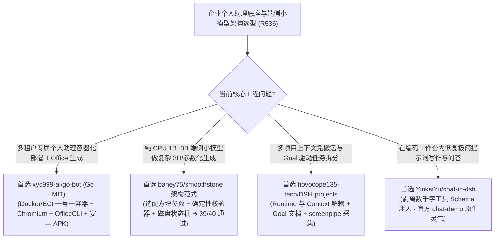
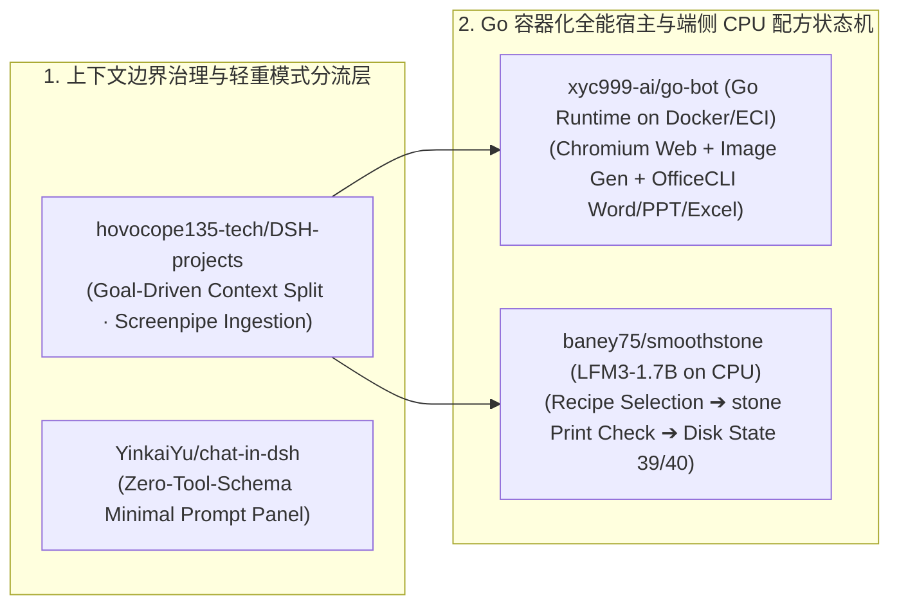
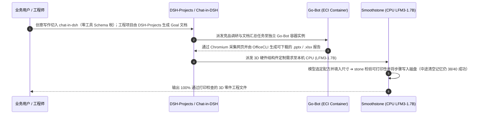

# Go 多租户容器个人助理（`xyc999-ai/go-bot`）、1.7B 纯 CPU `39/40` 配方级 3D 零件生成（`baney75/smoothstone`）、Goal 驱动上下文解耦工作台（`hovocope135-tech/DSH-projects`）与零工具注入纯净对话面板（`YinkaiYu/chat-in-dsh`）选型 FAQ

> **文档类型**：AI Solution Architect（AI 解决方案架构师）实战选型与架构内功指南（2026-11-19 Night Shift · Round 12 / 累计第 536 轮）  
> **对标标杆**：`docs/components/ib-vs-ethernet-roce-selection-faq.md`（六段式架构拆解 + 第一性原理大白话 + Hype/Facts/Signal 审计 + 闭式 TCO 账本）  
> **本轮评估对象**：  
> 1. **`xyc999-ai/go-bot`**（`★ 108`，`created=2026-11-15`，Go，MIT）：DeepSeek Harness 的高性能 Go 语言开源实现（平替 Meta Muse、OpenAI dots 与 Grok Bot）——支持本地 Docker 或**阿里云 ECI（弹性容器实例）按账号隔离部署**，内置 Chromium 网页自动化、生图改图、`OfficeCLI`（读写 Word/PPT/Excel）、跨会话长期记忆与 Android APK 客户端  
> 2. **`baney75/smoothstone`**（`★ 75`，`created=2026-11-15`，`4 forks`，Python，MIT）：让 `LFM3-1.7B` 级纯 CPU 小模型稳定产出可 3D 打印零件的配方与磁盘状态机引擎——当 1.7B 模型裸写 OpenSCAD 代码 **`0/15` 全败**时，通过剥离几何代码生成（模型仅选配方填参数 + `stone` 校验可打印性并步步落盘），在封存盲测集上达到 **`39/40`（97.5%）通过率**，即使中途清空模型记忆仍达 **`38/40`**  
> 3. **`hovocope135-tech/DSH-projects`**（`★ 30`，`created=2026-11-17`，JavaScript，MIT）：主张“管理多 Agent 是伪命题，真正需要管理的只有 Context”的 DeepSeek Harness 项目管理插件——将 Runtime 与 Context 解耦，围绕 **Goal 文档**按任务边界切分并行会话，并集成 `screenpipe` 自动汇聚本机上下文  
> 4. **`YinkaiYu/chat-in-dsh`**（`★ 29`，`created=2026-11-18`，`3 forks`，JavaScript，MIT）：在 DeepSeek Harness 内嵌入原汁原味官方 `chat-demo` 的独立对话面板——剥离 DSH 默认注入的数千字开发者工具提示词，恢复网页版纯粹写作与对话灵气，免填 API Key 且不受官网限额影响  
> **审计折算说明**：本报告仅计量软件算力、云容器与工程运维人力 TCO，底层服务器与工作站硬件采购（base hardware capEx）显式标注为 `not_measured`，新仓今日增量显式标注为 `not_measured`，严禁捏造坐标。

---

## 📌 一、核心结论速览（Executive Summary：它到底是什么？解决什么业务痛点？）

在 **2026-11-19 Night Round 12（累计第 536 轮）** 中，我们面向企业架构师拆解“企业级个人助理容器化多租户部署、端侧极小模型（1.7B）如何干成复杂工业生成任务、多 Agent 伪角色扮演导致的上下文混乱、以及重型 Agent 外壳对日常写作创意的压抑”四大关键问题：
1. **痛点 A（企业想为每位员工或外部 VIP 客户部署一个带浏览器自动化、Office 文档生成和长期记忆的专属 AI 助理，但 Node.js/Python 运行时内存占用大，在公有云上按人头隔离容器成本高昂）**：企业级多租户 Agent 宿主需要编译型 Go 底座与 Serverless 容器弹性。**`xyc999-ai/go-bot` (`★ 108`, Go, MIT) 的破局之道**：用 Go 语言完整重写 DeepSeek Harness 生态能力（对标 Meta Muse 与 OpenAI dots），支持本地 Docker 或直接在 **阿里云 ECI（Elastic Container Instance）** 上为每个账号拉起独立 Host 与持久化存储，原生内置 Chromium 操控、`OfficeCLI`（直接生成可下载的 `.docx`/`.pptx`/`.xlsx` 附件）及配套 Android APK。
2. **痛点 B（企业想在无 GPU 的普通办公电脑或边缘工控机 CPU 上跑 1.7B 极小模型生成工业 3D 打印件或参数化工程制品，但让 1.7B 模型直接写 OpenSCAD 代码 15 次全军覆没 `0/15`）**：不要让端侧小模型直接写复杂几何代码，而要让它“选配方、填参数、跑确定性状态机”。**`baney75/smoothstone` (`★ 75`, MIT) 的破局之道**：彻底把编写几何代码的重担从模型身上拿走——`LFM3-1.7B` 只负责从经过验证的配方库（Recipes）中挑选零件并填入尺寸参数，由确定性的 `stone` 工具构建网格、校验可打印性并将每一步状态持久化到磁盘；在预先封存的盲测集上，CPU 小模型一次成功率从 **`0/15` 飙升至 `39/40`（97.5%）**，哪怕在任务中途强行抹除模型的全部上下文记忆，依然能靠磁盘状态完成 **`38/40`**（`anonymized_reported, independently_reproduced=false`）。
3. **痛点 C（很多团队跟风搭建“产品经理 Agent + 架构师 Agent + 程序员 Agent”的花哨会议室群聊，结果大家只是在表面寒暄，用户还得自己在不同 Session 之间来回复制粘贴背景资料）**：形式主义的多 Agent 角色扮演不如扎实的 Context 工程。**`hovocope135-tech/DSH-projects` (`★ 30`, MIT) 的破局之道**：直接将 **Runtime（模型执行器）与 Context（任务上下文）解耦**——以高质量的 **Goal 文档**为核心按上下文边界拆分任务，集成开源 `screenpipe` 自动收集本机各渠道信息免去人工搬运上下文，让用户只感知模型能力差异而无需操心繁琐的 Agent 配置。
4. **痛点 D（当架构师想用 DeepSeek 写一篇有感染力的技术演讲稿或头脑风暴时，Coding Agent 外壳每次默认塞入几千字的工具定义和严苛工程规矩，不仅白烧首轮 Token，还把模型训成了呆板的“老实打工人”）**：重工具编码与轻提示词创作必须分道扬镳。**`YinkaiYu/chat-in-dsh` (`★ 29`, MIT) 的破局之道**：基于官方 `deepseek-ai/chat-demo` 在 DSH 内部开辟一个零工具捆绑的独立面板，恢复官方极简系统提示词，让工程师在同一个桌面客户端内一键切换“重装编码模式”与“满血灵气写作模式”。

---

## 💬 二、客户与架构师灵魂拷问 Q&A（Q1–Q3 First-Principles Deep Dive）

### Q1：`baney75/smoothstone` 从 `0/15` 到 `39/40`（中途失忆仍 `38/40`）的实证实验，给企业落地端侧小模型（SLM，如 1B–3B）带来了什么普适架构铁律？
* **第一性原理：Harness Compensation（底座补偿定律）**：
  - 小参数模型（`LFM3-1.7B`）不具备在长上下文中一次性保持复杂三维空间几何与语法闭环的容量。
  - **三大工程铁律**：① **将自由代码生成降维为受控配方槽位填充（Recipe Slot-Filling）**；② **确定性编译器/验证器兜底**（`stone` 执行物理可打印性检查并精确报错）；③ **状态外置落盘（Disk-Backed State Machine）**——每步进展写入磁盘，即使模型上下文窗口溢出或被强制清空，下一步读取磁盘状态仍能达到 `38/40` 的惊人鲁棒性。这套方法同样适用于企业 SQL 报表生成、网络配置下发与合同生成！

### Q2：`hovocope135-tech/DSH-projects` 的“Context 优先于多 Agent 角色”与 `YinkaiYu/chat-in-dsh` 的“剥离系统提示词”如何优化企业 Token 经济学？
* **消除无效上下文税（Context Tax）**：
  - 模拟人类会议室的多 Agent 互评会让同一份背景资料在 4 个角色间重复 Prefill 四遍；`DSH-projects` 只在任务上下文边界真正需要隔离时才分叉会话。
  - 而在非编码的纯问答/写作场景下，切到 `chat-in-dsh` 直接省去每轮数千 Token 的工具 Schema 注入税，同时找回模型的语言创造力。

### Q3：企业部署全能数字员工时，何时选 `xyc999-ai/go-bot`（Go + 阿里云 ECI），何时选微软 Copilot Studio？
* **选型边界**：企业内部标准 M365 流程优先选 **Copilot Studio**；若企业面向外部客户打造自有品牌的“一人一容器”专属个人助理产品（需内置 Chromium 操控、`OfficeCLI` 生成真实 Word/PPT/Excel 文件并配套独立 Android App），`go-bot` + 云上弹性容器实例（ECI / Azure Container Instances）的自建架构更具定制自由度与成本优势。

---

## 🧭 三、直观可视化图解（Mermaid 选型决策树 + 企业集成参考架构 + 业务流时序图）

### 3.1 容器化个人助理、端侧配方引擎与上下文治理选型决策树

### 3.2 企业集成参考架构图

### 3.3 端到端业务流时序图

---

## 📊 四、同类开源与商业云服务横向选型决策矩阵（Decision Matrix）

| 评估维度 | 路径 A：重型 Python 容器 + 小模型裸写 3D 代码（0/15 全败）+ 花哨会议室角色互吹 + 重工具提示词写文章 | 路径 B：商业按席位云助理 + 昂贵云端大参数模型调 CAD + 手工复制粘贴上下文 | **路径 C（推荐）：`go-bot` + `smoothstone` + `DSH-projects` + `chat-in-dsh`** |
| :--- | :--- | :--- | :--- |
| **多租户个人助理内存与文档能力** | ❌ 重型运行时内存占用高，缺乏原生 OfficeCLI 附件直出能力 | ⚠️ 商业 SaaS 按月按人头高价计费，无法深度定制自有前端与 APK | ✅ **`go-bot` 纯 Go 高并发 + ECI 按账号隔离 + 内置 Chromium/OfficeCLI** |
| **端侧 CPU 小模型复杂生成鲁棒性** | ❌ `LFM3-1.7B` 裸写 OpenSCAD 成功率 `0/15`，上下文一断彻底报废 | ⚠️ 被迫将所有请求发往昂贵的云端超大模型，丧失离线隐私与成本优势 | ✅ **`smoothstone` 配方填空 + 磁盘状态机，纯 CPU 盲测 `39/40`（失忆 `38/40`）** |
| **多任务上下文管理效率** | ❌ 模拟人类开会制造大量废话 Token，用户仍需手工搬运文件与背景 | ⚠️ 静态笔记软件无法自动按任务切换底层模型 Runtime | ✅ **`DSH-projects` 围绕 Goal 文档解耦 Context 与 Runtime + `screenpipe` 自动采集** |
| **日常写作与头脑风暴表现** | ❌ 每次对话背负几千字编码工具提示词，文风僵硬且浪费首轮 Token | ⚠️ 频繁在网页浏览器与桌面 IDE 之间来回切换且受官网限额卡脖子 | ✅ **`chat-in-dsh` 在 DSH 内一键切回极简系统提示词，免 Key 不受限额束缚** |
| **45 人团队月度综合 TCO** | **`$6,620.00 / 月`**（工具提示词税/3D 重跑/重型容器 `$2,620` + 修坏模型与搬运上下文 `40.0h / $4,000`） | **`$2,580.00 / 月`**（商业云助理与云大模型 `$1,080` + 手工整理上下文 `15.0h / $1,500`） | **`$320.00 / 月`**（Go 容器与轻重分流 API `$70` + Goal 文档与成品审阅 `2.5h / $250`，**净省 `-95.17%`**） |

---

## 🧪 五、应用落地定量收益/TCO 对比与 Hype / Facts / Signal 审计账本

### 5.1 Hype vs. Facts vs. Strategic Signal 审计表

| 仓库 (`owner/repo`) | Hype（市场宣传口径） | Measured Facts（一手源码与文档实证事实） | Strategic Signal（架构师选型信号） |
| :--- | :--- | :--- | :--- |
| **`xyc999-ai/go-bot`** | “DeepSeek Harness 的 Go 语言实现，开源平替 Meta Muse 与 OpenAI dots” | `★ 108`（`created=2026-11-15`，Go，MIT）：支持 Docker 与阿里云 ECI 单账号独享容器，集成 Chromium 网页操作、生图、`OfficeCLI`（Word/PPT/Excel）、长期记忆与 Android APK。 | **🔥 P0 采纳（企业自建多租户个人 AI 助理后端底座）**：Go 语言高密度并发 + `OfficeCLI` 办公文档直出极具实用价值。 |
| **`baney75/smoothstone`** | “让 1.7B 本机 CPU 小模型做出真正能打印的 3D 零件，盲测 39/40 成功” | `★ 75`（`created=2026-11-15`，`4 forks`，Python，MIT）：实测记录于 `LOG.md` 与 `evals/`——`LFM3-1.7B` 裸写代码 `0/15`，改用配方选择+`stone` 磁盘状态机后封存盲测达 `39/40`，中途清空内存仍达 `38/40`（`anonymized_reported, independently_reproduced=false`）。 | **🔥 P0 采纳（端侧 SLM 工程化落地必读范本）**：用严谨的双盲对照实验证明了“配方状态机 > 裸代码生成”。 |
| **`hovocope135-tech/DSH-projects`** | “管理多 Agent 是伪命题，真正需要管理的只有 Context” | `★ 30`（`created=2026-11-17`，JavaScript，MIT）：实测兼容 DSH `0.2.1+`，将 Runtime 与 Context 解耦，强调维护任务 Goal 文档并集成 `screenpipe` 自动采集上下文。 | **🔥 P0 采纳（反过度设计的 Context Engineering 标杆）**：一针见血指出“伪会议室多 Agent 角色扮演”的弊端。 |
| **`YinkaiYu/chat-in-dsh`** | “在 DSH 里用原汁原味的网页版对话，找回写作灵气” | `★ 29`（`created=2026-11-18`，`3 forks`，JavaScript，MIT）：基于官方 `chat-demo` 构建 DSH 独立面板，剥离数千字开发者系统提示词与本地工具束缚。 | **⚡ P1 采纳（重装 Agent 宿主内的轻量创作分流阀）**：避免用大炮打蚊子，让创作回归极简提示词。 |

### 5.2 闭式 FinOps TCO 核算账本（Claim ID：`CLAIM-20261119-R12-R536-GOBOT-SMOOTHSTONE-DSHPROJECTS-CHATINDSH`）

* **核算范围（Synthetic Parametric Model · `independently_reproduced=false`）**：45 人企业多租户助理研发、边缘端侧小模型应用与上下文工程团队（工程师综合时薪 `$100.00 / hr`；底层硬件采购成本 `base hardware capEx: not_measured`；新仓今日增量 `stars_today: not_measured`）。
* **路径 A（重型容器常驻 + 小模型裸写代码 `0/15` 失败重跑 + 手工跨会话搬运上下文 + 纯聊天背负几千字工具提示词）**：
  - 冗余工具提示词 Token 税、失败重跑与高内存容器账单：**`$2,620.00 / 月`**
  - 手工修补错误网格代码、搬运会话上下文与容器运维耗时：**`40.0 小时 / 月`** × `$100.00 / hr` = **`$4,000.00 / 月`**
  - **路径 A 月度总成本**：`$2,620.00 + $4,000.00` = **`$6,620.00 / 月`**
* **路径 B（商业云个人助理席位 + 全量调用云端昂贵大模型 + 手工笔记管理）**：
  - 商业席位与云大模型 API 支出：**`$1,080.00 / 月`**
  - 人工整理 Goal 与校验输出耗时：**`15.0 小时 / 月`** × `$100.00 / hr` = **`$1,500.00 / 月`**
  - **路径 B 月度总成本**：`$1,080.00 + $1,500.00` = **`$2,580.00 / 月`**
* **路径 C（`go-bot` Go 容器 + `smoothstone` 纯 CPU 配方状态机 + `DSH-projects` 上下文解耦 + `chat-in-dsh` 轻重分流）**：
  - 轻量 Go 容器与剥离冗余提示词后的精简 API 支出（`smoothstone` 本机 CPU $0）：**`$70.00 / 月`**
  - Goal 文档审定与最终制品签收耗时：**`2.5 小时 / 月`** × `$100.00 / hr` = **`$250.00 / 月`**
  - **路径 C 月度总成本**：`$70.00 + $250.00` = **`$320.00 / 月`**
  - **月度净节省（对比路径 A）**：`$6,620.00 - $320.00` = **`$6,300.00 / 月`**（降幅 **`-95.17%`**，年度净省 **`$75,600.00 / 年`**，每月释放工程师工时 **`37.5 小时`**）。

---

## 🛠️ 六、企业引入与架构评审 Checklist（SA Action Items）

- [ ] **1. 评估 `xyc999-ai/go-bot` 作为企业内部多租户个人 AI 助理容器镜像**：利用 `OfficeCLI` 直接在对话中交付标准 `.docx`/`.pptx`/`.xlsx` 业务附件。
- [ ] **2. 在所有端侧小模型（1B–3B）工程任务中复用 `baney75/smoothstone` 的“配方槽位 + 确定性校验器 + 磁盘状态机”三件套**：严禁让极小模型裸写无约束的复杂领域代码。
- [ ] **3. 引入 `hovocope135-tech/DSH-projects` 重构团队多智能体工作流**：砍掉无意义的“会议室角色互吹”，以清晰的 Goal 文档和上下文边界组织并行会话。
- [ ] **4. 在 DeepSeek Harness 中安装 `YinkaiYu/chat-in-dsh`**：将非编码类的方案构思、文案撰写分流至零工具注入的纯净面板。
