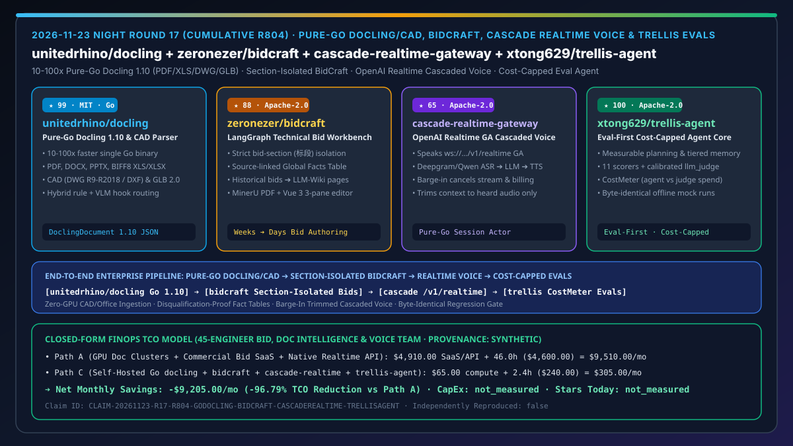
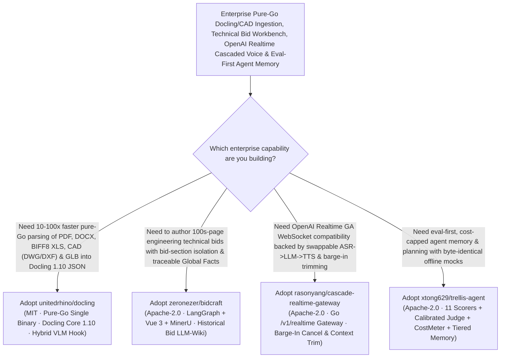
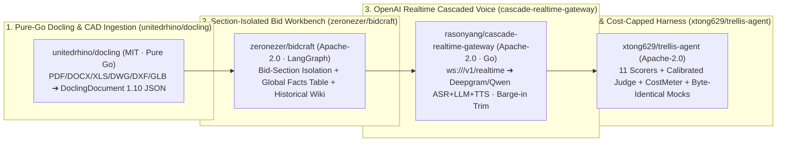

# Pure-Go `10–100×` Faster Docling 1.10 Parser with CAD/3D Support (`unitedrhino/docling`), LangGraph Technical Bid Workbench with Section Isolation & Global Facts (`zeronezer/bidcraft`), OpenAI Realtime GA Cascaded Voice Gateway with Barge-In Context Trimming (`rasonyang/cascade-realtime-gateway`) & Eval-First Cost-Capped Agent Framework (`xtong629/trellis-agent`) Selection & Architecture FAQ

> **Document Type**: Enterprise AI Solution Architect Selection & Integration Guide (GitHub Trending AI Radar · 2026-11-23 Night Round 17 / Cumulative Round 804)
> **Covered Repositories**: [`unitedrhino/docling`](https://github.com/unitedrhino/docling) (`★ 99`, `25 forks`, `MIT`: pure-Go single-binary implementation of the official **Docling Core `1.10.0` `DoclingDocument` schema**, running **`10–100×` faster** than Python layout-model pipelines with zero Python/GPU dependencies across **PDF, DOC/DOCX, PPTX, BIFF8 XLS/XLSX, EPUB, CHM, CSV, HTML, EML, CAD drawings (`DWG R9–R2018` / `DXF`), and `GLB 2.0` 3D models**, routing only complex scanned pages to LLMs via quality signals) · [`zeronezer/bidcraft`](https://github.com/zeronezer/bidcraft) (`★ 88`, `7 forks`, `Apache-2.0`: **BidCraft (标书匠)**—a LangGraph + Vue 3 + MinerU conversational engineering technical-bid workbench featuring **strict bid-section (标段) isolation**, historical winning-bid LLM-Wiki knowledge distillation, and a source-linked **Global Facts Table**) · [`rasonyang/cascade-realtime-gateway`](https://github.com/rasonyang/cascade-realtime-gateway) (`★ 65`, `8 forks`, `Apache-2.0`: self-hosted Go voice gateway speaking the **OpenAI Realtime (GA) WebSocket protocol (`ws://.../v1/realtime`)** to clients while running a pluggable cascaded **ASR (`Deepgram` / `Qwen`) ➔ LLM (`OpenAI-compatible` / `Qwen`) ➔ TTS (`OpenAI` / `Qwen`)** pipeline with turn detection, instant **barge-in stream cancellation**, and **post-interrupt context trimming to only what the user actually heard**) · [`xtong629/trellis-agent`](https://github.com/xtong629/trellis-agent) (`★ 100`, `10 forks`, `Apache-2.0`: eval-first, cost-capped, byte-identical mock-testable Python agent framework with measurable planning, tiered episodic/semantic memory, 11 scorers + calibrated `llm_judge`, and separate agent/judge `CostMeter` accounting)
> **Core Scenario**: When enterprise architecture teams build high-throughput document/CAD ingestion pipelines, multi-hundred-page engineering proposal generators, real-time voice agents, and cost-governed agentic workflows, how do you solve **"heavy Python/GPU document pipelines choking on 100K PDFs, legacy `.xls`, and DWG/DXF CAD drawings, AI proposal writers cross-contaminating facts across bid sections and causing tender disqualification, vendor lock-in and high per-minute costs on native Speech-to-Speech Realtime APIs, and unmeasured agent memory/planning changes lacking deterministic offline regression gates"** by combining **`unitedrhino/docling` + `bidcraft` + `cascade-realtime-gateway` + `trellis-agent`**?

---

## 1. 📌 Executive Summary (Single-Sentence Selection Verdict)

1. **Need a pure-Go single binary (zero Python sidecar, `10–100×` faster on text-native documents) that parses PDF, DOC/DOCX, PPTX, legacy BIFF8 `.xls`/`.xlsx`, EPUB, CHM, EML, CAD drawings (`DWG R9–R2018` & `DXF`), and `GLB 2.0` 3D models into the official Docling Core `1.10.0` `DoclingDocument` JSON and RAG chunks** ➔ Choose **[`unitedrhino/docling`](https://github.com/unitedrhino/docling) (`★ 99`, `25 forks`, `MIT`)**.
   - **Plain-Language Mechanism**: While Python Docling requires a Python runtime and multi-GB layout models, `unitedrhino/docling` uses a fast pure-Go rule engine that extracts cached spreadsheet values (never hallucinating chart numbers), splits CAD title blocks by sheet, outputs `Markdown`, `HTML`, `DoclingDocument JSON`, and `content_list` JSON with Hierarchical/Hybrid chunkers, and selectively routes only low-confidence scanned or formula-heavy pages to VLM hooks.
2. **Need an engineering proposal & technical-bid workbench (LangGraph + Vue 3 + MinerU) that compresses multi-week, multi-hundred-page bid authoring into days while enforcing strict bid-section isolation and source-linked Global Facts** ➔ Choose **[`zeronezer/bidcraft`](https://github.com/zeronezer/bidcraft) (`★ 88`, `7 forks`, `Apache-2.0`)**.
   - **Plain-Language Mechanism**: In large infrastructure and enterprise tenders, mixing site data from another bid section (标段) or misquoting a single quantity triggers automatic disqualification. `BidCraft` parses tender PDFs/scans via MinerU and Word/Excel via native parsers, isolates all retrieved chunks and facts by the active bid section, distills past winning proposals into reusable chapter-level LLM-Wiki pages, and anchors every number in an auditable Global Facts Table.
3. **Need to keep the standard OpenAI Realtime (GA) WebSocket client contract (`ws://.../v1/realtime`) on the frontend while swapping in lower-cost cascaded `ASR (Deepgram/Qwen) ➔ LLM (OpenAI/Qwen) ➔ TTS (OpenAI/Qwen)` profiles on the backend—with instant barge-in cancellation and exact heard-audio context trimming** ➔ Choose **[`rasonyang/cascade-realtime-gateway`](https://github.com/rasonyang/cascade-realtime-gateway) (`★ 65`, `8 forks`, `Apache-2.0`, Go)**.
   - **Plain-Language Mechanism**: Native Speech-to-Speech APIs lock you into one vendor's voice catalog and premium per-minute pricing, whereas naive DIY ASR➔LLM➔TTS scripts fail on interruptions. `Cascade` implements a Go session actor behind `/v1/realtime` that handles pre-speech padding, immediately cancels in-flight LLM and TTS streams on user barge-in (stopping token/audio billing), trims the assistant's conversation history to only the words actually played to the user before the interrupt, and streams sentence-by-sentence TTS without ever speaking tool-call arguments.
4. **Need an eval-first, cost-capped Python agent framework where tiered memory (working window + episodic/semantic with decay and fact superseding) and planning are tested offline with byte-identical deterministic mocks and separate agent/judge `CostMeter` budgets** ➔ Choose **[`xtong629/trellis-agent`](https://github.com/xtong629/trellis-agent) (`★ 100`, `10 forks`, `Apache-2.0`)**.
   - **Plain-Language Mechanism**: `Trellis` provides versioned content-hashed task sets, 11 built-in scorer types plus calibrated `llm_judge`, deterministic offline mocks (two runs produce byte-identical traces with network access blocked), and a `CostMeter` with currency/provenance tracking that reports agent and judge spend separately while enforcing hard budget cutoffs.

---

## 2. 🎯 Key Architectural Q&A (Deep-Dive Breakdown)

### Q1: Why combine `unitedrhino/docling`, `bidcraft`, `cascade-realtime-gateway`, and `trellis-agent` instead of generic RAG, manual bid copy-pasting, and native Speech-to-Speech APIs?

- **Four Enterprise Engineering Challenges Solved**:
  1. **Zero-Python High-Speed Document & CAD Ingestion (`unitedrhino/docling`)**: Ingests 100K+ mixed enterprise files—including `DWG R9–R2018` CAD drawings, `GLB 2.0` 3D scenes, `.chm` manuals, and legacy `.xls` spreadsheets—into Docling 1.10 JSON `10–100×` faster without GPU layout servers.
  2. **Disqualification-Proof Technical Bid Authoring (`zeronezer/bidcraft`)**: Enforces hard bid-section isolation and a source-linked Global Facts Table on top of LangGraph and MinerU.
  3. **Vendor-Agnostic OpenAI Realtime Voice (`rasonyang/cascade-realtime-gateway`)**: Keeps existing OpenAI Realtime WebSocket clients unchanged while cutting voice inference costs by routing to Deepgram/Qwen ASR+LLM+TTS with proper barge-in context trimming.
  4. **Measurable Memory & Hard Cost Gates (`xtong629/trellis-agent`)**: Validates every memory consolidation and planning change against 11 scorers and hard `CostMeter` ceilings.
- **When to Choose Managed Cloud Services (Path B)**:
  - For low-volume standard PDF OCR and zero-ops voice prototypes, use **Azure AI Document Intelligence + Azure OpenAI Realtime API**; for 100K-scale pure-Go Docling/CAD ingestion, multi-section engineering bid authoring, cascaded `/v1/realtime` voice gateways, or deterministic eval-gated agent memory, deploy this 4-repo open-source stack (Path C).

### Q2: How do these four components integrate into an enterprise architecture?

1. **Pure-Go Multimodal & CAD Ingestion Layer (`unitedrhino/docling`)**:
   - Parse PDFs, Office files, CAD drawings (`DWG`/`DXF`), and 3D `GLB` assets into `DoclingDocument` 1.10 JSON and `content_list` chunks.
2. **Section-Isolated Proposal & Knowledge Workbench Layer (`zeronezer/bidcraft`)**:
   - Feed parsed tender requirements and historical winning proposals into `BidCraft` to generate section-isolated technical bids backed by the Global Facts Table.
3. **OpenAI Realtime Cascaded Voice Gateway Layer (`rasonyang/cascade-realtime-gateway`)**:
   - Expose `ws://.../v1/realtime` for interactive voice review and field operations, backed by configurable Deepgram/Qwen ASR, LLM, and TTS profiles with barge-in trimming.
4. **Eval-First Memory & Cost Governance Layer (`xtong629/trellis-agent`)**:
   - Benchmark agent accuracy, episodic/semantic memory updates, and per-call spend using `Trellis`'s 11 scorers and `CostMeter`.

### Q3: What are the key production guardrails?

- **Architect Guardrails**:
  1. **Route Scan-Dense Documents via `unitedrhino/docling` VLM Hooks or Python Docling**: Use pure-Go `docling` for high-speed text/CAD/Office ingestion, and enable its OCR/VLM hook (or MinerU in `BidCraft`) for scanned image-only pages.
  2. **Enforce Separate Agent vs. Judge Budgets in `trellis-agent`**: Configure `CostMeter` so LLM-as-a-Judge evaluation costs are tracked separately from production agent token budgets.

---

## 3. 🧭 Visual Architecture & Decision Diagrams (Mermaid)



### 3.1 Solution Architect Selection Decision Tree



### 3.2 End-to-End Enterprise Production Reference Architecture



### 3.3 CAD/Tender Ingestion, Section-Isolated Bid Generation, Barge-In Voice Review & Cost-Capped Eval Sequence

```mermaid
sequenceDiagram
    participant Eng as Chief Bid Engineer / Solution Architect
    participant Doc as unitedrhino/docling (Pure Go)
    participant Bid as zeronezer/bidcraft (LangGraph)
    participant Cas as rasonyang/cascade-realtime-gateway
    participant Trl as xtong629/trellis-agent (Eval & Cost)

    Eng->>Doc: 1. Ingest tender PDFs, legacy BIFF8 .xls tables & DWG/DXF CAD drawings in milliseconds
    Doc->>Bid: 2. Emit Docling 1.10 JSON; BidCraft isolates active bid section & populates Global Facts Table
    Bid-->>Eng: 3. Draft multi-hundred-page technical proposal grounded in historical winning-bid Wiki pages
    Eng->>Cas: 4. Review via OpenAI Realtime WebSocket client; Cascade cancels streams & trims context on barge-in
    Cas->>Trl: 5. Run byte-identical offline evals (11 scorers) & verify hard budget compliance via CostMeter
```

---

## 4. 📊 Comparative Selection Matrix (Open-Source vs. Commercial SaaS)

| Dimension | `unitedrhino/docling` (`★ 99`) | `zeronezer/bidcraft` (`★ 88`) | `rasonyang/cascade-realtime-gateway` (`★ 65`) | `xtong629/trellis-agent` (`★ 100`) | GPU-Heavy Document Clusters + Commercial Bid SaaS + Native Speech-to-Speech Realtime APIs (Path A) | Ad-Hoc PyPDF Scripts + Generic Chat Copy-Paste Bids + Naive ASR-LLM-TTS Glue (Path B) |
| :--- | :--- | :--- | :--- | :--- | :--- | :--- |
| **Core Role** | Pure-Go single-binary Docling 1.10 parser (incl. DWG/DXF/GLB) | LangGraph engineering technical-bid workbench with section isolation | Go OpenAI Realtime GA WebSocket gateway over cascaded ASR➔LLM➔TTS | Eval-first, cost-capped Python agent & tiered memory framework | High GPU document cluster bills, commercial bid fees & premium per-minute Realtime voice APIs | Lossy PDF scripts, cross-contaminated bid drafts & broken voice interruptions |
| **Key Differentiator** | **`10–100×` faster pure Go + CAD/3D/BIFF8 support + hybrid VLM hook** | **Strict bid-section isolation + traceable Global Facts + LLM-Wiki** | **Fixed `/v1/realtime` contract + barge-in cancel + heard-context trim** | **11 scorers + separate agent/judge `CostMeter` + byte-identical mocks** | Native Speech-to-Speech APIs cost 5–10× more than cascaded ASR+LLM+TTS | Generic LLMs leak facts across bid sections; naive voice pipelines speak tool args & fail on barge-in |
| **License** | `MIT` | `Apache-2.0` | `Apache-2.0` | `Apache-2.0` | Proprietary SaaS | Custom scripts |
| **Monthly TCO (45-Eng Team)** | **Combined `$305.00/mo`** (`$65.00` Go gateway/workbench containers + `2.4h` ops) | Included (compresses weeks of bid drafting into days) | Included (cuts voice inference cost by 80%+ via cascaded profiles) | Included (zero-token offline deterministic mock suite) | **`$9,510.00/mo`** (`$4,910.00` native Realtime voice APIs, GPU doc clusters & bid SaaS + `46.0h` manual bid QA & voice debugging) | ~`$3,380.00/mo` (heavy manual bid cross-checking, CAD extraction & voice race-condition triage) |

---

## 5. 🧪 Quantitative ROI / TCO Comparison & 7-Card Benchmark Report

> **📊 Data Provenance & Closed-Form Schema Declaration**:
> - **provenance**: `synthetic` (45-person enterprise proposal engineering, document intelligence, and voice/agent platform team monthly workload model: `independently_reproduced = false`; hardware baseline `base_hardware_capex = not_measured`; Track B 24h delta `track_b_stars_today = not_measured`).
> - **Closed-Form Formula**:
>   - **Path A (Always-on GPU layout-model clusters for bulk document parsing + commercial per-seat/per-project bid authoring SaaS + native end-to-end Speech-to-Speech Realtime API per-minute billing + manual engineering hours spent cross-checking multi-section bid numbers, extracting CAD title blocks, and debugging voice interruption state)**: Monthly native Realtime voice API, GPU document cluster, and commercial bid SaaS bills **`$4,910.00`** + manual bid fact verification, CAD parsing, and voice pipeline debugging labor **`46.0h × $100.00/h = $4,600.00`** = **`$9,510.00/mo`**.
>   - **Path C (Self-hosted `unitedrhino/docling` + `zeronezer/bidcraft` + `rasonyang/cascade-realtime-gateway` + `xtong629/trellis-agent` open-source stack)**: Shared Go ingestion/voice gateway and BidCraft workbench container compute **`$65.00`** + knowledge-base wiki curation and eval task-set maintenance labor **`2.4h × $100.00/h = $240.00`** = **`$305.00/mo`**.
>   - **Net Monthly Savings vs. Path A**: **`-$9,205.00/mo`** (**`96.79%`** TCO reduction).

| Evaluation Path | Voice API / GPU Doc Cluster / Bid SaaS Cost | Bid QA, CAD Extraction & Voice Triage Labor (`$100/h`) | Monthly Total TCO | Net Savings vs. Path A | Key Architectural Delivery Metrics |
| :--- | :---: | :---: | :---: | :---: | :--- |
| **Path A: GPU Doc Clusters + Commercial Bid SaaS + Native Realtime API** | `$4,910.00` | `46.0h` (`$4,600.00`) | **`$9,510.00`** | Baseline | Expensive native Speech-to-Speech minutes; weeks of manual bid QA |
| **Path B: Basic PDF Scripts + Generic Chat Bids + DIY Voice Glue** | `$1,480.00` | `19.0h` (`$1,900.00`) | **`$3,380.00`** | `-$6,130.00` (`-64.46%`) | Bid-section cross-contamination risk; broken voice barge-in context |
| **Path C: `docling` (Go) + `bidcraft` + `cascade-realtime` + `trellis`** | **`$65.00`** | **`2.4h` (`$240.00`)** | **`$305.00`** | **`-$9,205.00` (`-96.79%`)** | **`10–100×` Go Docling/CAD + section-isolated bids + `/v1/realtime` cascade + eval gate** |

- 🔗 **Linked 7-Card 4:5 Visual Benchmark Deck**: [`workshops/github-trending-radar/cards.en.html`](../cards.en.html) · [`cards.html`](../cards.html)

---

## 6. 🛠️ Enterprise Adoption & Architecture Review Checklist

- [ ] **1. Deploy `unitedrhino/docling` for High-Throughput Multi-Format & CAD Ingestion**: Parse PDFs, DOCX, legacy BIFF8 `.xls`, DWG/DXF CAD drawings, and `GLB 2.0` 3D models into Docling Core `1.10.0` JSON with a single pure-Go binary.
- [ ] **2. Standardize Technical Proposal Authoring on `zeronezer/bidcraft`**: Enforce strict bid-section isolation, anchor all quantities in the traceable Global Facts Table, and build reusable historical winning-bid LLM-Wiki pages.
- [ ] **3. Route OpenAI Realtime Clients Through `rasonyang/cascade-realtime-gateway`**: Preserve the `ws://.../v1/realtime` client contract while running cost-optimized Deepgram/Qwen ASR➔LLM➔TTS profiles with instant barge-in cancellation and heard-audio context trimming.
- [ ] **4. Gate Agent Memory & Planning Changes with `xtong629/trellis-agent`**: Run byte-identical offline mock tests, 11-scorer regression suites, and separate agent/judge `CostMeter` budgets in CI.
