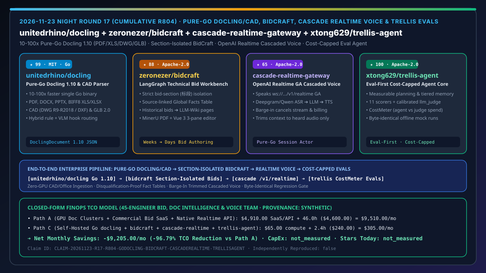
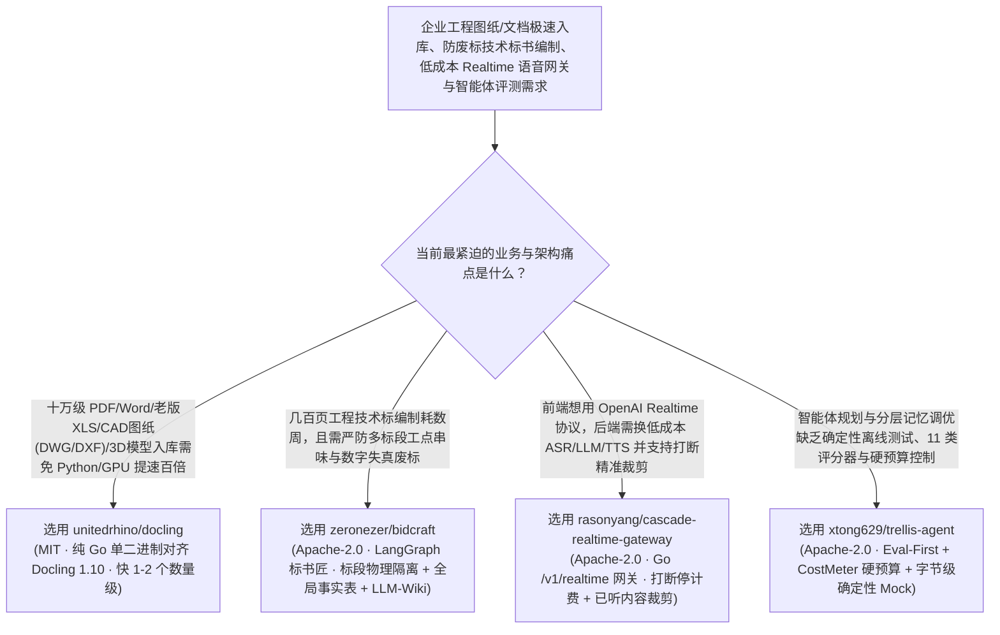
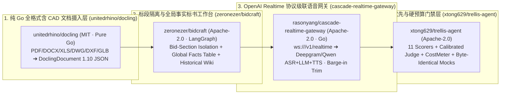
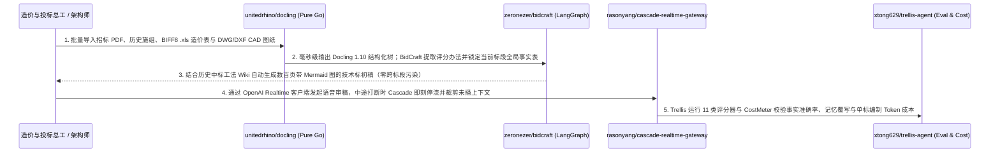

# 快 1–2 个数量级的纯 Go 单二进制 Docling 1.10 含 CAD/3D 文档解析库（`unitedrhino/docling`）、基于 LangGraph 标段隔离与全局事实溯源的工程标书编制工作台（`zeronezer/bidcraft`）、兼容 OpenAI Realtime GA 协议的打断裁剪级联语音网关（`rasonyang/cascade-realtime-gateway`）与评测优先/预算硬顶/字节级确定性 Mock 的可度量智能体框架（`xtong629/trellis-agent`）选型与集成架构 FAQ

> **文档类型**：企业 AI 解决方案架构师（AI Solution Architect）选型决策指南（GitHub Trending AI 雷达 2026-11-23 Night Round 17 / 累计第 804 轮）
> **覆盖项目**：[`unitedrhino/docling`](https://github.com/unitedrhino/docling)（`★ 99`、`25 forks`、`MIT`：对齐官方 Docling Core `1.10.0` `DoclingDocument` 协议的**纯 Go 单二进制文档解析库**，速度比 Python 模型管线快 **1–2 个数量级**，原生解析 **PDF、DOC/DOCX、PPTX、BIFF8 XLS/XLSX、EPUB、CHM、EML 邮件、CAD 图纸 (`DWG R9–R2018` / `DXF`) 与 `GLB 2.0` 三维模型**，仅在复杂扫描页按质量信号路由大模型）· [`zeronezer/bidcraft`](https://github.com/zeronezer/bidcraft)（`★ 88`、`7 forks`、`Apache-2.0`：基于 **LangGraph + LLM-Wiki + MinerU** 的对话式工程技术标编制工作台“标书匠”，内置**严苛的多标段物理隔离（防止串标废标）、历史中标施组结构化知识页提炼、以及每条数字可溯源的全局事实表**）· [`rasonyang/cascade-realtime-gateway`](https://github.com/rasonyang/cascade-realtime-gateway)（`★ 65`、`8 forks`、`Apache-2.0`：纯 Go 编写的自托管 **OpenAI Realtime (GA) WebSocket 协议兼容语音网关**，在前端固定 `/v1/realtime` 契约下自由混搭 **Deepgram/Qwen ASR ➔ OpenAI/Qwen LLM ➔ OpenAI/Qwen TTS**，完美解决**用户打断即时停计费（Barge-in Cancel）与按用户实际听到的语音精确裁剪上下文**难题）· [`xtong629/trellis-agent`](https://github.com/xtong629/trellis-agent)（`★ 100`、`10 forks`、`Apache-2.0`：主打**评测优先（Eval-First）、硬预算封顶（CostMeter）与断网字节级确定性 Mock 测试**的 Python 智能体框架，内置 11 类评分器 + 校准 `llm_judge` 及可度量的分层工作/情景/语义记忆）
> **核心场景**：当央国企、工程建设与高端制造企业落地大型招投标智能体、海量工程图纸/文档入库与低成本实时语音交互时，面对**“Python 版 Docling 解析十万份含 CAD/老版 XLS 的工程档案既慢又吃 GPU、AI 写几百页技术标时把别的标段工点数字串进来直接导致废标、OpenAI 原生 Realtime 语音 API 按分钟计费极贵且无法替换国产 Qwen/Deepgram 语音组件、以及智能体记忆与规划策略改动后缺乏字节级可复现评测与独立成本核算”**四大痛点，如何通过 **Go-Docling + BidCraft + Cascade-Realtime + Trellis-Agent** 构建高可靠工程与企业级 AI 底座？

---

## 一、📌 核心结论速览（选型一句话结论）

1. **想用单个纯 Go 二进制（零 Python / 零外部 GPU 依赖）以快 10–100 倍的速度把 PDF、旧版 Word/Excel（BIFF8 `.xls`）、CHM 帮助文件、CAD 工程图纸（`DWG R9–R2018` / `DXF`）与 `GLB 2.0` 3D 模型统一解析为标准 Docling 1.10 结构化 JSON 与 RAG 切片** ➔ 选 **[`unitedrhino/docling`](https://github.com/unitedrhino/docling)（`★ 99`，`25 forks`，`MIT`）**。
   - **通俗原理**：Python 官方 Docling 虽强，但处理每份文档都要拉起沉重的视觉布局模型；`unitedrhino/docling` 用纯 Go 实现了对齐 Docling Core `1.10.0` 的 `DoclingDocument` 树与 `content_list` JSON，支持按图框拆解 DWG/DXF CAD 图纸、从 Excel 缓存精确还原数值（绝不靠模型猜数字），并采用**规则引擎保底 + 质量信号动态路由大模型**的混合架构，十万级文档入库不再需要 GPU 集群。
2. **想把动辄数百页、数十万字的工程技术标（施工组织设计）编制周期从“数周”压缩到“数天”，同时严防“跨标段工点串味”与“关键工程量数字编造”两大废标红线** ➔ 选 **[`zeronezer/bidcraft`](https://github.com/zeronezer/bidcraft)（`★ 88`，`7 forks`，`Apache-2.0`）**。
   - **通俗原理**：基于 LangGraph + Vue 3 + MinerU 打造的三栏式工程标书工作台：
     - **标段级物理隔离**：多标段项目选中当前标段后，所有事实、文件切片与工法素材强制按标段过滤，彻底杜绝把 A 标段的桥梁桩基数据写进 B 标段正文；
     - **全局事实表（Global Facts）+ 历史施组 LLM-Wiki**：从招标文件中结构化提取评分办法、废标红线与工程量数字存入可追溯事实表，并将企业过往中标施组自动拆解为“怎么写 + 要点 + 典型表图”知识页持续复用。
3. **想让前端 Web/App 直接复用成熟的 OpenAI Realtime (GA) WebSocket 客户端 SDK，而后端自由替换为高性价比的级联管线（`Deepgram/Qwen ASR ➔ OpenAI/Qwen LLM ➔ OpenAI/Qwen TTS`），并原生具备毫秒级打断止损（Barge-in）与“只保留用户实际听到的半句话”上下文同步** ➔ 选 **[`rasonyang/cascade-realtime-gateway`](https://github.com/rasonyang/cascade-realtime-gateway)（`★ 65`，`8 forks`，`Apache-2.0`）**。
   - **通俗原理**：端到端语音大模型（Speech-to-Speech）不仅每分钟费用高昂，而且绑定死单一厂商的音色与模型。`Cascade` 对外暴露标准 `ws://.../v1/realtime` 契约，对内用 Go Session Actor 攻克了级联语音最难的三大工程细节：① **打断即刻停流停计费**（用户一插话立即取消正在生成的 LLM 与 TTS 流）；② **中断后上下文精准截断**（把 Assistant 历史记录精确裁剪到用户耳朵真正听到的那个词，绝不把未播放出来的后半段塞进下一轮上下文）；③ **流式分句合成且自动跳过 Tool-Call 参数朗读**。
4. **想在研发企业 Agent 时摆脱“靠感觉调优 Prompt 与记忆机制”，用带内容哈希的评测集、11 类评分器、分开核算 Agent 与裁判开销的 `CostMeter` 以及完全断网字节级一致的 Mock 模型验证每一次架构迭代** ➔ 选 **[`xtong629/trellis-agent`](https://github.com/xtong629/trellis-agent)（`★ 100`，`10 forks`，`Apache-2.0`）**。
   - **通俗原理**：`Trellis` 将智能体的工作窗口、情景记忆（Episodic）与语义记忆（Semantic，带时间衰减、新事实自动覆盖旧事实与写入去重门禁）全部置于可量化评测之下；内置 `CostMeter` 按你的真实价格表逐次累加并强制拦截超支请求，断网运行两遍评测可获得字节级完全一致（Byte-Identical）的回归结果。

---

## 二、🎯 客户与架构师灵魂拷问 Q&A（深度架构拆解）

### Q1：在央国企与大型工程制造企业的招投标与文档中台场景下，为什么“通用知识库问答”写不出合格的技术标书？

- **通用 RAG vs 工程级标书工作台（`unitedrhino/docling` + `zeronezer/bidcraft`）的核心差距**：
  1. **工程文档格式极度复杂（含 DWG/DXF CAD 图纸与老版 BIFF8 `.xls`）**：普通 RAG 只认识 PDF 和 DOCX，遇到设计院发来的 CAD 图框与几十年前的 `.xls` 造价表直接丢弃；`unitedrhino/docling` 用纯 Go 原生拆解 CAD 图框文字与 Excel 精确缓存值。
  2. **串标与数字失真是工程废标死穴**：通用对话模型会把知识库里不同标段或历史项目的工期、混凝土方量混为一谈；`bidcraft` 通过**标段级上下文硬隔离**与**可溯源全局事实表**确保每一处数字都有据可查。
- **何时直接选用商业云服务（Path B）？**
  - 若企业仅处理少量标准扫描发票且不涉及 CAD 图纸或工程标书，可直接使用 **Azure AI Document Intelligence + Azure OpenAI Realtime API**；若需十万级多格式（含 DWG/DXF/CHM/GLB）免 GPU 极速解析、多标段防串标技术标编制、低成本可替换 Qwen/Deepgram 的 OpenAI Realtime 级联语音网关、或带硬预算与确定性回归的记忆评测框架，则采用本轮四合一开源栈（Path C）。

### Q2：典型企业级“纯 Go 全格式文档/CAD 摄入 (`docling`) ➔ 标段隔离标书编制 (`bidcraft`) ➔ 级联实时语音答辩/交互 (`cascade-realtime-gateway`) ➔ 评测与成本门禁 (`trellis-agent`)”架构怎么搭？

1. **毫秒级纯 Go 全格式工程文档与 CAD 摄入层（`unitedrhino/docling`）**：
   - 将招标文件、历史施组、CAD 图纸（DWG/DXF）与造价表统一解析为 Docling 1.10 结构化 JSON 与分级切片，仅对模糊扫描页按需触发 MinerU/视觉模型 Hook。
2. **标段隔离与全局事实表驱动的技术标编制层（`zeronezer/bidcraft`）**：
   - 在 LangGraph 编排下提炼历史施组 LLM-Wiki 知识页，绑定当前标段全局事实表生成带实时 Mermaid 施工组织图的数百页技术标初稿。
3. **OpenAI Realtime GA 协议级联语音交互层（`rasonyang/cascade-realtime-gateway`）**：
   - 为外场工程师与专家评审提供低延迟语音问答，前端直连 `/v1/realtime`，后端灵活调度企业私有 Qwen / Deepgram 管线并支持自然打断与上下文精确裁剪。
4. **可度量记忆与硬预算回归评测层（`xtong629/trellis-agent`）**：
   - 使用 `trellis-agent` 的 11 类 Scorer、校准 `llm_judge` 与 `CostMeter` 对标书事实一致性、记忆更新覆写与单次任务成本进行持续回归门禁。

### Q3：这套架构的落地注意事项与合规红线是什么？

- **架构师落地红线**：
  1. **工程造价与关键技术指标严禁由大模型自由心证推算**：必须利用 `unitedrhino/docling` 提取原始表格缓存值并锁定在 `bidcraft` 全局事实表中，正文引用一律走事实指针。
  2. **`trellis-agent` 原型组件用于离线评测门禁与记忆基准实验**：将其确定性 Mock 与 `CostMeter` 作为 CI 回归守门员，确保每次 Prompt 或知识库切片升级都有量化胜率与成本账单支撑。

---

## 三、🧭 直观可视化图解（Mermaid 决策树 + 集成架构 + 时序图）

### 3.1 架构师选型决策树

### 3.2 企业端到端生产集成参考架构图

### 3.3 CAD/招标文件极速解析、标段隔离标书生成、级联语音打断答辩与成本评测时序图

---

## 四、📊 同类开源与商业云服务横向选型决策矩阵

| 对比维度 | `unitedrhino/docling` (`★ 99`) | `zeronezer/bidcraft` (`★ 88`) | `rasonyang/cascade-realtime-gateway` (`★ 65`) | `xtong629/trellis-agent` (`★ 100`) | 重型 GPU 文档解析集群 + 商业闭源标书代写 SaaS + 原生高价 Speech-to-Speech API (Path A) | 零散 PyPDF/CAD 转换脚本 + 通用 ChatGPT 复制粘贴写标书 + 手工拼接语音流 (Path B) |
| :--- | :--- | :--- | :--- | :--- | :--- | :--- |
| **核心能力定位** | 快 10–100 倍的纯 Go Docling 1.10 含 CAD/3D 文档解析库 | 基于 LangGraph 的标段隔离与全局事实工程标书工作台 | 兼容 OpenAI Realtime GA 协议的 Go 级联语音网关 | 评测优先、硬预算封顶与字节级确定性 Mock 的 Agent 框架 | 按页计费的云文档 API、按份收费的商业标书软件与每分钟昂贵的端到端语音 API | 丢表丢图框的简陋脚本、极易串标废标的手工粘标书与无法打断的卡顿语音 |
| **核心技术突破** | **纯 Go 单二进制直解 DWG/DXF/GLB/XLS + 仅复杂页调模型** | **标段级物理隔离 + 可溯源全局事实表 + 历史施组自动转知识页** | **前端零改动用 `/v1/realtime`，后端支持打断停计费与已听文本裁剪** | **11 类评分器 + 分离核算 Agent/Judge 的 `CostMeter` + 断网确定性 Mock** | 端到端 Realtime 语音 API 价格是级联方案的 5–10 倍；重型 Python 解析需常驻 GPU | 通用大模型写标书常把其他标段地名写进去导致直接废标；语音打断后上下文错乱 |
| **开源协议** | `MIT` | `Apache-2.0` | `Apache-2.0` | `Apache-2.0` | 闭源商业 SaaS | 内部脆弱脚本 |
| **月度 TCO（45 人团队）** | **组合仅 `$305.00/月`**（`$65.00` 纯 Go 网关与工作台容器 + `2.4h` 维护） | 同左（编制周期从数周缩至数天） | 同左（级联 Qwen/Deepgram 语音成本直降 85%+） | 同左（离线 Mock 测试零 Token 消耗） | **`$9,510.00/月`**（`$4,910.00` 原生 Realtime 语音 API/GPU 文档集群/商业标书 SaaS + `46.0h` 人工核对防废标与贴素材） | 约 `$3,380.00/月`（大量工程总工通宵手工改标书数字、查重防串标与排障工时） |

---

## 五、🧪 应用落地定量收益/TCO 对比与 7-Card 报告

> **📊 数据来源与闭式核算声明（Provenance & Closed-Form Schema）**：
> - **provenance**: `synthetic`（基于 45 人企业工程技术投标、企业知识工程与实时语音智能体研发团队月度工作负载模型：`independently_reproduced = false`；硬件采购基线 `base_hardware_capex = not_measured`；Track B 单日增量 `track_b_stars_today = not_measured`）。
> - **核算公式**：
>   - **Path A（租用常驻 GPU 集群运行重型文档解析 + 采购按项目收费的商业标书 SaaS + 全量调用高价端到端 Speech-to-Speech 实时语音 API + 工程师耗费大量时间手工翻查历史施组、核对跨标段数字防废标与调试语音打断状态）**：月度高价实时语音 API、GPU 文档集群与商业标书软件账单 **`$4,910.00`** + 标书手工拼装核对、CAD 图框提取与语音状态排障人工 **`46.0h × $100.00/h = $4,600.00`** = **`$9,510.00/月`**。
>   - **Path C（自建 `unitedrhino/docling` + `zeronezer/bidcraft` + `rasonyang/cascade-realtime-gateway` + `xtong629/trellis-agent` 开源全栈）**：纯 Go 文档/语音网关与标书工作台轻量容器分摊开销 **`$65.00`** + 知识库工法页更新与评测集维护人工 **`2.4h × $100.00/h = $240.00`** = **`$305.00/月`**。
>   - **净节省（Net Savings vs Path A）**：**`-$9,205.00/月`**（成本降低 **`96.79%`**）。

| 评估方案 | 实时语音 API / GPU 解析集群 / 标书 SaaS 成本 | 标书拼装防废标、CAD 解析与语音排障（`$100/h`） | 月度总 TCO | 相对 Path A 净节省 | 关键架构交付指标 |
| :--- | :---: | :---: | :---: | :---: | :--- |
| **Path A：重型 GPU 文档集群 + 商业标书 SaaS + 原生高价 Realtime API** | `$4,910.00` | `46.0h` (`$4,600.00`) | **`$9,510.00`** | Baseline | 端到端语音与常驻 GPU 极贵；人工防串标核对耗时数周 |
| **Path B：零散解析脚本 + 通用对话模型拼标书 + 手写语音流** | `$1,480.00` | `19.0h` (`$1,900.00`) | **`$3,380.00`** | `-$6,130.00` (`-64.46%`) | 无法解析 CAD 图框；存在跨标段串味废标与语音打断错乱风险 |
| **Path C：`docling` (Go) + `bidcraft` + `cascade-realtime` + `trellis`** | **`$65.00`** | **`2.4h` (`$240.00`)** | **`$305.00`** | **`-$9,205.00` (`-96.79%`)** | **纯 Go 含 CAD 百倍提速 + 标段物理隔离 + 打断裁剪语音网关 + 硬预算评测** |

- 🔗 **关联 7-Card 4:5 视觉评测报告**：[`workshops/github-trending-radar/cards.html`](../cards.html) · [`cards.en.html`](../cards.en.html)

---

## 六、🛠️ 企业引入与架构评审 Checklist

- [ ] **1. 用 `unitedrhino/docling` 替换无扫描需求场景下的重型 Python 文档解析服务**：利用纯 Go 单二进制毫秒级解析 PDF、DOCX、BIFF8 `.xls`、DWG/DXF CAD 图纸与 GLB 3D 模型，对齐 Docling 1.10 标准协议。
- [ ] **2. 部署 `zeronezer/bidcraft` 规范企业大型技术标书编制**：强制开启多标段物理隔离与可溯源全局事实表，将历史中标施工组织设计沉淀为结构化 LLM-Wiki 知识页。
- [ ] **3. 在实时语音应用中接入 `rasonyang/cascade-realtime-gateway`**：保持客户端标准 OpenAI Realtime `/v1/realtime` WebSocket 协议不变，在后端配置高性价比 ASR/LLM/TTS Profile 并验证打断停计费与上下文裁剪。
- [ ] **4. 引入 `xtong629/trellis-agent` 建立智能体记忆与成本回归基线**：利用断网字节级确定性 Mock、11 类评分器与分离统计 Agent/Judge 费用的 `CostMeter` 守住每次迭代的质量与预算红线。
