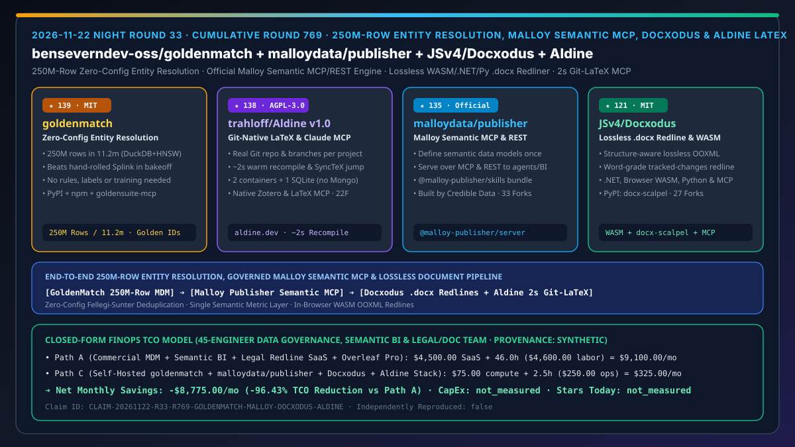
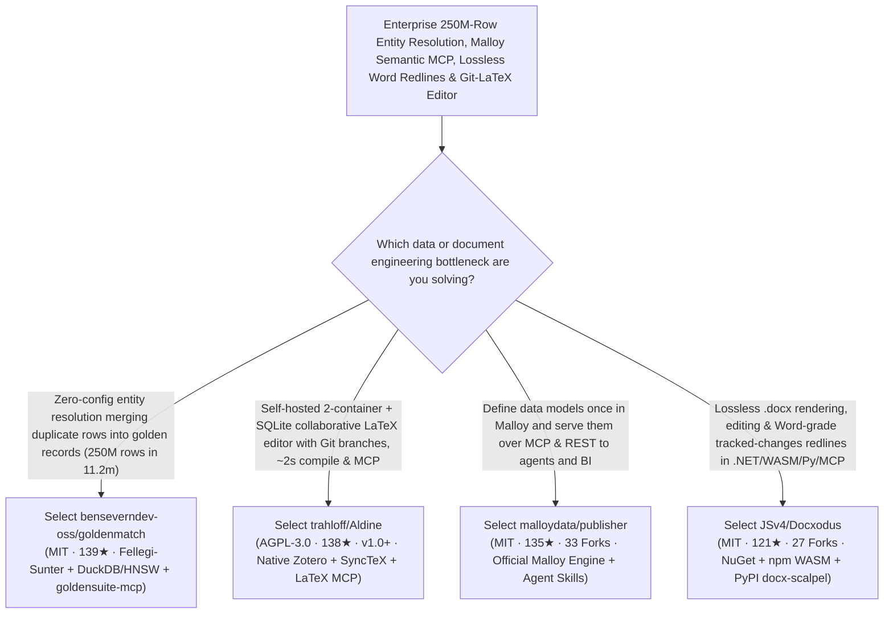
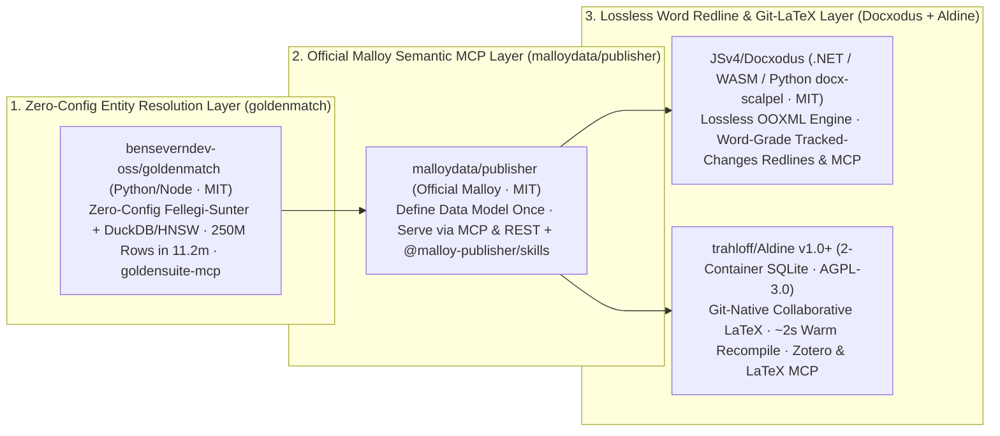
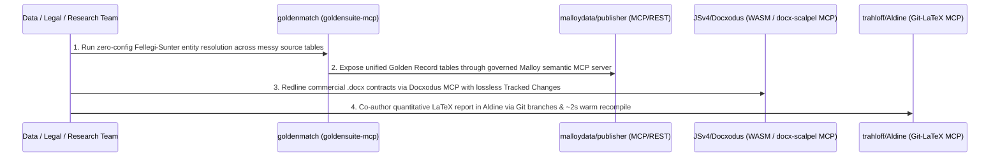

# 250M-Row Zero-Config Entity Resolution (`benseverndev-oss/goldenmatch`), Git-Native 2s-Recompile LaTeX Editor & MCP (`trahloff/Aldine`), Official Malloy Semantic Analytics MCP Engine (`malloydata/publisher`) & Lossless `.docx` Redline & WASM/MCP Toolkit (`JSv4/Docxodus`) Selection & Architecture FAQ

> **Document Type**: Enterprise AI Solution Architect Selection & Integration Guide (GitHub Trending AI Radar — 2026-11-22 Night Round 33 / Cumulative Round 769)
> **Covered Repositories**: [`benseverndev-oss/goldenmatch`](https://github.com/benseverndev-oss/goldenmatch) (`★ 139`, `18 forks`, `MIT`: zero-config Fellegi-Sunter + DuckDB/HNSW entity resolution engine merging messy records into golden entities—processing **250M rows in 11.2 min** and outperforming hand-rolled Splink—with `goldensuite-mcp`) · [`trahloff/Aldine`](https://github.com/trahloff/Aldine) (`★ 138`, `22 forks`, `AGPL-3.0`, `v1.0+`: self-hosted collaborative LaTeX editor and Overleaf alternative running in 2 containers + 1 SQLite file with real Git branches, native Zotero, `~2s` warm recompiles, SyncTeX, and a built-in LaTeX MCP server) · [`malloydata/publisher`](https://github.com/malloydata/publisher) (`★ 135`, `33 forks`, `MIT`: official analytics engine for Malloy by Credible Data serving one semantic data model over **MCP and REST** to AI agents, BI tools, and apps) · [`JSv4/Docxodus`](https://github.com/JSv4/Docxodus) (`★ 121`, `27 forks`, `MIT`: lossless structure-aware OOXML `.docx` engine with Word-grade tracked-changes redlines, in-browser WASM editor, NuGet `Docxodus`, npm `docxodus`, PyPI `docx-scalpel`, CLI, and MCP server)
> **Core Scenario**: When enterprise Master Data Management (MDM), BI semantic platform, legal/contract operations, and technical publishing teams struggle with **duplicate customer/supplier records across messy tables requiring weeks of manual Splink/regex tuning, AI agents writing conflicting ad-hoc SQL queries without a shared semantic model, naive Python `.docx` scripts mangling Word formatting and failing to generate native Tracked-Changes redlines, and heavy Overleaf CE deployments requiring MongoDB + Redis**, how do you combine **`goldenmatch` + `malloydata/publisher` + `Docxodus` + `Aldine`** into a unified data-to-document enterprise stack?

---

## 1. 📌 Executive Summary (One-Line Selection Verdict)

1. **Need zero-config entity resolution (`MIT`, PyPI `goldenmatch`, npm `goldenmatch`, `goldensuite-mcp`) that finds and merges duplicate people, companies, or products into golden records without writing rules, labelling pairs, or training models—scaling to **250M rows in 11.2 minutes** and beating hand-rolled Splink?** ➔ Choose **[`benseverndev-oss/goldenmatch`](https://github.com/benseverndev-oss/goldenmatch) (`★ 139`, `18 forks`, `MIT`)**.
   - **Plain-English Mechanism**: Automatically selects blocking and Fellegi-Sunter probabilistic matching strategies accelerated by DuckDB and HNSW, explaining what it chose and exposing the entire suite to AI agents via `goldensuite-mcp`.
2. **Want to define your enterprise data model once in **Malloy** and serve it over both **MCP and REST** to AI agents, applications, and BI tools (`MIT`, `@malloy-publisher/server` & `@malloy-publisher/skills`)?** ➔ Choose **[`malloydata/publisher`](https://github.com/malloydata/publisher) (`★ 135`, `33 forks`, `MIT`, Official Malloy Engine)**.
   - **Plain-English Mechanism**: Eliminates metric drift from ad-hoc Text-to-SQL by giving agents governed Malloy semantic models and one-command skills (`npx -y @malloy-publisher/skills@latest install`).
3. **Need a structure-aware, lossless OOXML (`.docx`) engine (`MIT`, tested on `neurotic_docx_bench`) that renders HTML/Markdown projections, runs stateful edit sessions, generates **Word-grade native Tracked-Changes redlines**, and ships simultaneously as a .NET library, browser/Node WebAssembly module (`npm: docxodus`), Python package (`PyPI: docx-scalpel`), CLI, and **MCP server**?** ➔ Choose **[`JSv4/Docxodus`](https://github.com/JSv4/Docxodus) (`★ 121`, `27 forks`, `MIT`)**.
   - **Plain-English Mechanism**: Compiles its C# OOXML core to WebAssembly so browser apps, Node services, Python scripts, and MCP agents can redline and edit `.docx` files losslessly with zero server dependencies.
4. **Need a self-hosted (`AGPL-3.0`, `v1.0+`) collaborative LaTeX editor and Overleaf alternative that runs in just **2 containers and 1 SQLite file**—with real Git branches per project, native Zotero integration, `~2s` warm PDF recompiles, SyncTeX jump-to-line, and a built-in LaTeX MCP server for Claude?** ➔ Choose **[`trahloff/Aldine`](https://github.com/trahloff/Aldine) (`★ 138`, `22 forks`, `AGPL-3.0`)**.
   - **Plain-English Mechanism**: Replaces Overleaf's heavy MongoDB/Redis stack with a fast, Git-native SQLite architecture backed by Playwright E2E tests and a stable `1.x` MCP/plugin contract (`docs/STABILITY.md`).

---

## 2. 🎯 Architect & Customer Deep-Dive Q&A

### Q1: Why does pairing `goldenmatch` (Golden Entity Resolution) + `malloydata/publisher` (Semantic MCP) + `Docxodus` / `Aldine` (Lossless Redlines & LaTeX) solve the end-to-end Enterprise Data-to-Deliverable pipeline?

- **Four Connected Enterprise Layers**:
  1. **Clean Identity Foundation ➔ `benseverndev-oss/goldenmatch`**: Resolves messy multi-source records into canonical golden entities at `250M rows / 11.2 min` (`anonymized_reported, independently_reproduced=false`).
  2. **Governed Semantic Metric Layer ➔ `malloydata/publisher`**: Serves one authoritative Malloy data model over MCP and REST so every AI agent and BI tool computes identical metrics.
  3. **Lossless Legal/Commercial `.docx` Redlining ➔ `JSv4/Docxodus`**: Lets contract and compliance agents edit `.docx` agreements and generate native Word Tracked-Changes redlines via WASM, Python (`docx-scalpel`), or MCP without breaking formatting.
  4. **Git-Native Technical & Quantitative Publishing ➔ `trahloff/Aldine`**: Compiles multi-author LaTeX reports in `~2s` with real Git branches and Claude MCP integration.
- **When to Choose Commercial Cloud Suites (Path B)?**
  - Global enterprises already licensed for Informatica MDM + Looker Enterprise + Overleaf Server Pro can retain their existing contracts; teams seeking zero-config 250M-row entity resolution, open-source Malloy semantic MCP serving, browser-native WASM `.docx` redlining, and 2-container Git-LaTeX collaboration should deploy this open-source stack (Path C).

### Q2: How do we wire these four tools into an automated enterprise workflow?

1. **Entity Resolution & MDM Layer (`benseverndev-oss/goldenmatch`)**:
   - Deduplicate and merge customer, vendor, and product tables via `goldenmatch` and `goldensuite-mcp`.
2. **Semantic Analytics & MCP Layer (`malloydata/publisher`)**:
   - Expose governed Malloy semantic models over MCP and REST (`@malloy-publisher/server`).
3. **Contract Redlining & Technical Report Layer (`JSv4/Docxodus` + `trahloff/Aldine`)**:
   - Generate redlined `.docx` contracts via `Docxodus` MCP/WASM and compile quantitative LaTeX reports via `Aldine` MCP.

### Q3: Why is `JSv4/Docxodus`'s WebAssembly architecture a game-changer for enterprise web applications and privacy-sensitive legal workflows?

- **Zero-Server In-Browser & Node.js OOXML Execution**:
  - Sensitive legal contracts never have to be uploaded to a third-party document conversion server; the full OOXML engine runs inside the browser or Node process as a plain ES module backed by WebAssembly.

---

## 3. 🧭 Visual Architecture & Workflow Diagrams (Mermaid)

### 3.1 Solution Architect Selection Decision Tree

### 3.2 End-to-End Enterprise Reference Architecture

### 3.3 End-to-End Golden Record Deduplication, Governed Malloy Query, `.docx` Redline & LaTeX Compilation Sequence Diagram

---

## 4. 📊 Peer Open-Source vs. Commercial Cloud Selection Matrix

| Dimension | `benseverndev-oss/goldenmatch` (`★ 139`) | `trahloff/Aldine` (`★ 138`) | `malloydata/publisher` (`★ 135`) | `JSv4/Docxodus` (`★ 121`) | Commercial MDM Suites + Cloud Semantic BI + Paid Contract Redline SaaS + Overleaf Pro (Path A) | Hand-Rolled Splink Rules + Raw Text-to-SQL + Lossy `python-docx` Scripts (Path B) |
| :--- | :--- | :--- | :--- | :--- | :--- | :--- |
| **Primary Role** | Zero-config 250M-row entity resolution & MCP | 2-container SQLite Git-LaTeX editor & MCP | Official Malloy semantic MCP & REST server | Lossless `.docx` redline & WASM/Py/.NET/MCP engine | High-cost commercial MDM, semantic BI, legal redlining & Overleaf enterprise seats | Weeks of manual rule tuning, inconsistent ad-hoc SQL & formatting-breaking `.docx` scripts |
| **Key Differentiator** | **Zero-config Fellegi-Sunter + 250M rows in 11.2m + MCP** | **Real Git branches + ~2s recompile + 2 containers/SQLite** | **One Malloy model served over MCP & REST + skills** | **Lossless OOXML + Word-grade redlines + browser WASM** | Expensive per-seat/per-record SaaS lock-in; heavy Overleaf MongoDB/Redis ops | Hand-rolled Splink takes weeks to tune; standard Python libraries break Word styling |
| **License** | `MIT` | `AGPL-3.0` | `MIT` | `MIT` | Proprietary SaaS | Ad-hoc scripts |
| **Monthly TCO (45-Eng Team)** | **`$325.00/mo` combined** (`$75.00` shared DuckDB/Aldine container + `2.5h` ops) | Included (2-container SQLite deployment) | Included (`MIT` open-source server) | Included (`$0` in-browser/local WASM) | **`$9,100.00/mo`** (`$4,500.00` commercial MDM, BI, legal redline & Overleaf seats + `46.0h` manual ETL/doc fixes) | ~`$3,200.00/mo` (manual deduplication rule tuning, SQL reconciliation & Word formatting repair) |

---

## 5. 🧪 Quantitative Enterprise ROI / FinOps TCO Model & 7-Card Report

> **📊 Provenance & Closed-Form Declaration**:
> - **provenance**: `synthetic` (45-engineer enterprise data governance, semantic BI, legal operations, and technical publishing team workload model: `independently_reproduced = false`; `base_hardware_capex = not_measured`; `track_b_stars_today = not_measured`; `goldenmatch` `250M rows in 11.2 min` and Splink bakeoff results are `anonymized_reported, independently_reproduced = false`).
> - **Closed-Form Equations**:
>   - **Path A (Commercial MDM Software + Commercial Semantic BI & Legal Redlining SaaS Seats + Overleaf Team Subscriptions + Manual Deduplication Rule Authoring, SQL Reconciliation & Word Formatting Repair Labor)**: Monthly commercial software and SaaS bills **`$4,500.00`** + manual entity matching rule tuning, SQL metric reconciliation, and broken `.docx` formatting repair labor **`46.0h × $100.00/h = $4,600.00`** = **`$9,100.00/mo`**.
>   - **Path C (Self-Hosted `goldenmatch` + `malloydata/publisher` + `Docxodus` + `Aldine` Stack)**: Shared DuckDB & 2-container SQLite host compute **`$75.00`** + semantic model & template maintenance labor **`2.5h × $100.00/h = $250.00`** = **`$325.00/mo`**.
>   - **Net Monthly Savings vs. Path A**: **`-$8,775.00/mo`** (**`96.43%`** TCO reduction).

| Evaluation Path | MDM / BI / Legal / LaTeX SaaS & Compute | Rule Tuning & Document Repair Labor (`$100/h`) | Total Monthly TCO | Net Savings vs. Path A | Architectural Delivery Impact |
| :--- | :---: | :---: | :---: | :---: | :--- |
| **Path A: Commercial MDM + Legal Redline SaaS + Overleaf Pro** | `$4,500.00` | `46.0h` (`$4,600.00`) | **`$9,100.00`** | Baseline | Four stacked SaaS subscriptions; siloed data and document workflows |
| **Path B: Hand-Rolled Splink + Raw SQL + Lossy `python-docx`** | `$1,500.00` | `17.0h` (`$1,700.00`) | **`$3,200.00`** | `-$5,900.00` (`-64.84%`) | Lacks zero-config 250M-row matching, Malloy MCP & lossless Word redlines |
| **Path C: `goldenmatch` + `publisher` + `Docxodus` + `Aldine`** | **`$75.00`** | **`2.5h` (`$250.00`)** | **`$325.00`** | **`-$8,775.00` (`-96.43%`)** | **250M-row golden records + Malloy MCP + WASM `.docx` redlines + 2s LaTeX** |

- 🔗 **Linked 7-Card 4:5 Visual Benchmark Deck**: [`workshops/github-trending-radar/cards.en.html`](../cards.en.html) · [`cards.html`](../cards.html)

---

## 6. 🛠️ Enterprise Adoption & Architecture Review Checklist

- [ ] **1. Deduplicate Enterprise Master Data with `benseverndev-oss/goldenmatch`**: Run zero-config Fellegi-Sunter matching accelerated by DuckDB/HNSW and expose `goldensuite-mcp` to data agents.
- [ ] **2. Serve Governed Semantic Models via `malloydata/publisher`**: Install `@malloy-publisher/skills` and expose a single Malloy semantic layer over MCP and REST.
- [ ] **3. Automate Lossless `.docx` Redlines with `JSv4/Docxodus`**: Use `docxodus` (WASM/.NET) or `docx-scalpel` (Python/MCP) to generate Word-grade Tracked-Changes redlines without formatting loss.
- [ ] **4. Self-Host Collaborative Git-LaTeX with `trahloff/Aldine`**: Deploy the 2-container + 1-SQLite stack for `~2s` warm recompiles, native Zotero, and Claude LaTeX MCP integration.
