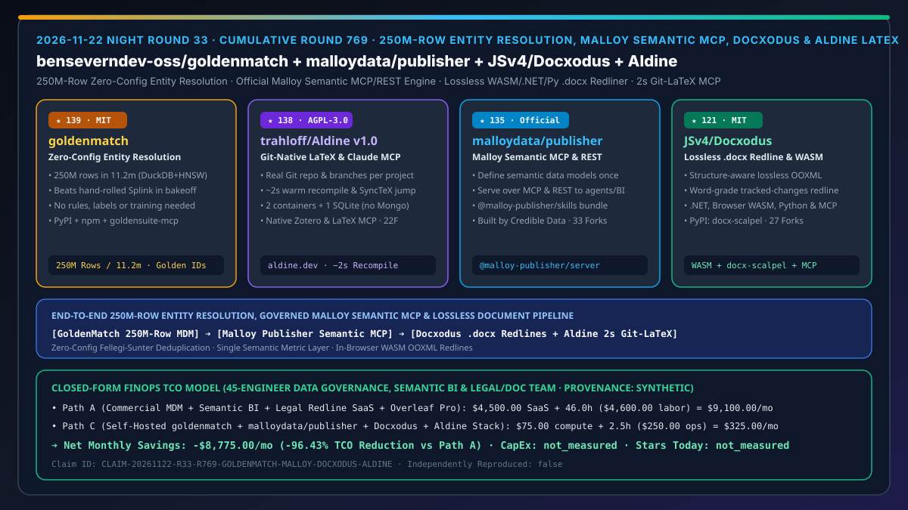
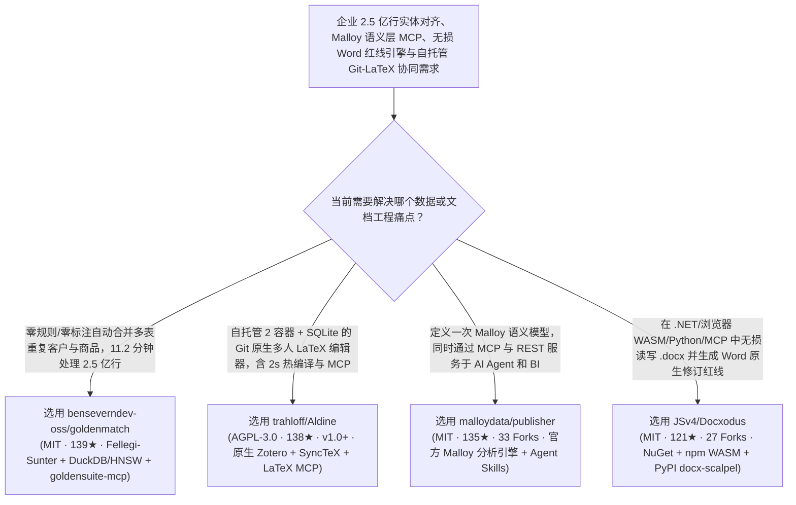
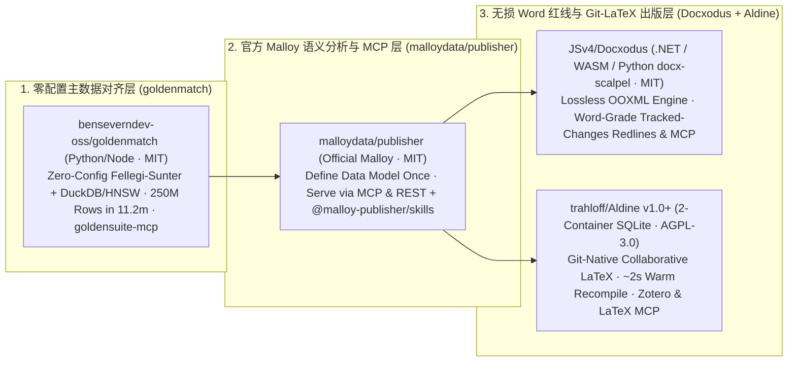
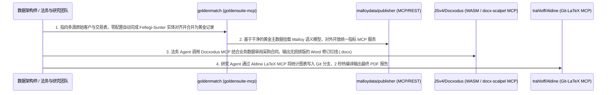

# 11.2 分钟清洗 2.5 亿行零配置实体对齐引擎（`benseverndev-oss/goldenmatch`）、Git 原生 2 秒热编译 Overleaf 替代方案与 LaTeX MCP（`trahloff/Aldine`）、Malloy 官方语义数据模型 MCP 发布器（`malloydata/publisher`）与无损 `.docx` 修订红线与 WASM/MCP 工具箱（`JSv4/Docxodus`）选型与集成架构 FAQ

> **文档类型**：企业 AI 解决方案架构师（AI Solution Architect）选型决策指南（GitHub Trending AI 雷达 2026-11-22 Night Round 33 / 累计第 769 轮）
> **覆盖项目**：[`benseverndev-oss/goldenmatch`](https://github.com/benseverndev-oss/goldenmatch)（`★ 139`、`18 forks`、`MIT`，零规则、零标注、零训练的 Fellegi-Sunter + DuckDB/HNSW 实体解析与主数据清洗引擎，实测击败手写 Splink 并在 **11.2 分钟内处理 2.5 亿行数据**，含 `goldensuite-mcp`）· [`trahloff/Aldine`](https://github.com/trahloff/Aldine)（`★ 138`、`22 forks`、`AGPL-3.0`，`v1.0+`，仅需 2 个容器 + 1 个 SQLite 文件的自托管多人实时协作 LaTeX 编辑器，每个项目即真 Git 仓库并支持约 2 秒热重编译、原生 Zotero 与内置 LaTeX MCP）· [`malloydata/publisher`](https://github.com/malloydata/publisher)（`★ 135`、`33 forks`、`MIT`，Malloy 官方开源的 AI 时代分析引擎，一次定义语义数据模型即可同时通过 MCP 与 REST 服务于 AI Agent、BI 工具与业务应用）· [`JSv4/Docxodus`](https://github.com/JSv4/Docxodus)（`★ 121`、`27 forks`、`MIT`，同时支持 .NET、浏览器/Node WebAssembly、Python `docx-scalpel`、CLI 与 MCP 的无损结构感知 OOXML `.docx` 渲染、编辑与修订红线 Redline 引擎）
> **核心场景**：当企业数据治理（MDM）、BI 语义层、法务合同审阅与科研技术出版团队面临**“多源异构客户/供应商/商品表存在大量拼写变体重复记录却没人写得出复杂的 Splink/正则去重规则、大模型直接写 SQL 查数缺乏统一语义层导致不同 Agent 算出的指标口径冲突、用传统 `python-docx` 修改复杂法务合同经常丢失样式且无法生成 Word 原生修订红线（Tracked-Changes Redline）、以及自建 Overleaf 社区版需要伺候笨重的 MongoDB/Redis 且不支持真 Git 分支与 LaTeX MCP”**四大痛点时，如何组合**`goldenmatch` + `malloydata/publisher` + `Docxodus` + `Aldine`** 构建从 2.5 亿级主数据清洗、统一语义分析到专业 Word 红线审阅与 LaTeX 出版的全链路底座？

---

## 一、📌 核心结论速览（选型一句话结论）

1. **想把散落在 CRM、ERP 与采购系统里包含拼写错误、缩写变体的客户/企业/商品表自动合并为唯一“黄金主数据（Golden Record）”——不需要手写规则、不需要人工标注样本对、不需要训练模型，在 11.2 分钟内即可完成 2.5 亿行实体对齐并暴露给 MCP 智能体调用** ➔ 选 **[`benseverndev-oss/goldenmatch`](https://github.com/benseverndev-oss/goldenmatch)（`★ 139`，`18 forks`，`MIT`）**。
   - **通俗原理**：结合经典概率匹配模型（Fellegi-Sunter）、音近/模糊匹配与 DuckDB/HNSW 向量加速，在公开基准评测中击败手写调参的 Splink，并打包了 `goldensuite-mcp` 供 Agent 一键去重。
2. **想解决“Text-to-SQL 让每个 Agent 自己瞎写 Join 导致口径不一”的顽疾——用 Malloy 语言定义一次数据模型（维度、度量、关联关系），通过官方引擎同时以 MCP 和 REST 接口服务所有 AI 智能体、BI 报表与前端应用** ➔ 选 **[`malloydata/publisher`](https://github.com/malloydata/publisher)（`★ 135`，`33 forks`，`MIT`，Malloy 官方出品）**。
   - **通俗原理**：只需一行 `npx -y @malloy-publisher/skills@latest install` 即可将官方分析技能装入项目，让 Agent 查询经过严格建模的语义层而非裸写易错 SQL。
3. **法务、金融、政务与招投标团队需要让 AI Agent 审阅修改复杂的 `.docx` Word 文档，要求 **100% 无损保留原始排版与 XML 结构、生成 Word 原生修订留痕红线（Tracked-Changes Redline）、还能编译成 WebAssembly 直接在浏览器或 Node/Python/.NET 中零服务端运行** ➔ 选 **[`JSv4/Docxodus`](https://github.com/JSv4/Docxodus)（`★ 121`，`27 forks`，`MIT`）**。
   - **通俗原理**：底层是极其扎实的结构感知 OOXML 引擎（通过 `neurotic_docx_bench` 严苛基准测试），一套内核同时输出 NuGet 包（`Docxodus`）、纯前端/Node WASM 包（`npm: docxodus`）、Python 包（`PyPI: docx-scalpel`）、浏览器块级编辑器与内置 MCP Server。
4. **科研院所、量化团队与技术出版部门想自托管一套替代 Overleaf 的多人实时协作 LaTeX 平台——拒绝维护笨重的 MongoDB + Redis，仅用 **2 个容器 + 1 个 SQLite 文件** 跑起真 Git 分支管理、原生 Zotero 文献同步、约 2 秒极速热重编译（含双击 PDF 跳源码 SyncTeX）以及 Claude 专属 LaTeX MCP** ➔ 选 **[`trahloff/Aldine`](https://github.com/trahloff/Aldine)（`★ 138`，`22 forks`，`AGPL-3.0`，`v1.0+`）**。
   - **通俗原理**：把每个 LaTeX 项目做成真正的 Git 仓库，所有核心功能均通过 Playwright E2E 测试验证并承诺 `1.x` 期间 MCP 工具名与升级路径完全向后兼容。

---

## 二、🎯 客户与架构师灵魂拷问 Q&A（深度架构拆解）

### Q1：为什么“`goldenmatch` 实体去重 + `malloydata/publisher` 语义层”是企业建设 AI-Ready 数据底座的必经之路？

- **从“脏数据 + 乱写 SQL”走向“黄金主数据 + 统一语义 MCP”**：
  1. **没有实体解析，任何客户 360 视图都是错的 ➔ `benseverndev-oss/goldenmatch`**：同一个客户在不同系统里叫 `Microsoft Corp.`、`Microsoft Corporation` 和 `MSFT`，如果不先用 `goldenmatch`（11.2 分钟处理 2.5 亿行）合成唯一 Golden ID，上层 BI 和 Agent 算出来的复购率与客单价全盘失真。
  2. **没有语义层，Text-to-SQL 就是口径灾难 ➔ `malloydata/publisher`**：在黄金主数据之上，用 `Malloy Publisher` 把净收入、毛利率与跨表关联固化为一个语义模型，通过 MCP 统一对外吐数。
  3. **专业交付物（Word 合同红线 + LaTeX 论文报告）无损闭环 ➔ `JSv4/Docxodus` + `trahloff/Aldine`**：数据分析结论需要落地为正式合同或学术/技术报告时，用 `Docxodus` 生成带原生修订红线的 `.docx`，或用 `Aldine` 的 LaTeX MCP 在 2 秒内热编译生成出版级 PDF。
- **何时直接用商业云 SaaS 方案（Path B）？**
  - 若跨国车企或银行已采购数百万美元的 Informatica MDM + Looker 企业版 + Overleaf Server Pro，可继续使用既有商业资产；若追求零配置极速实体对齐、开源 Malloy 语义层 MCP、浏览器 WASM 无损 Word 红线审阅及 2 容器轻量自托管 LaTeX 协同，则采用本轮开源栈（Path C）。

### Q2：典型企业级“主数据对齐 (`goldenmatch`) ➔ 语义模型服务 (`malloydata/publisher`) ➔ Word 红线合同与 LaTeX 报告交付 (`Docxodus` + `Aldine`)”怎么搭？

1. **多源主数据零配置对齐层（`benseverndev-oss/goldenmatch`）**：
   - 将多源业务表输入 `goldenmatch`，通过 Fellegi-Sunter + DuckDB/HNSW 自动聚合并输出 Golden Records。
2. **统一语义分析与 MCP 数据服务层（`malloydata/publisher`）**：
   - 在黄金表上编写 Malloy 语义模型，通过 `@malloy-publisher/server` 同时向 AI Agent（MCP）和 BI 看板（REST）暴露指标。
3. **无损 Word 修订红线与 Git-LaTeX 协同出版层（`JSv4/Docxodus` + `trahloff/Aldine`）**：
   - 法务与商务文档通过 `Docxodus`（WASM / Python `docx-scalpel` / MCP）执行带 Tracked-Changes 红线的精准审阅；技术白皮书与定量报告通过 `Aldine` 的 LaTeX MCP 与 2 秒热编译协同定稿。

### Q3：`JSv4/Docxodus` 是如何做到“无需安装 .NET 或后端服务器，直接在浏览器或 Node.js 里无损改 `.docx` 并打红线”的？

- **C# OOXML 核心编译为纯 ES Module WebAssembly**：
  - `npm install docxodus` 包内部直接封装了编译好的 WebAssembly 模块，前端或 Node 只需传入一个 `File` 或 `Uint8Array` 即可在本地内存中完成结构感知解析、Markdown 投影、状态化编辑与原生修订红线生成。

---

## 三、🧭 直观可视化图解（Mermaid 决策树 + 集成架构 + 时序图）

### 3.1 架构师选型决策树

### 3.2 企业端到端生产集成参考架构图

### 3.3 2.5 亿行实体去重、`Malloy` 语义查询、`Docxodus` 合同打红线与 `Aldine` 报告出版时序图

---

## 四、📊 同类开源与商业云服务横向选型决策矩阵

| 对比维度 | `benseverndev-oss/goldenmatch` (`★ 139`) | `trahloff/Aldine` (`★ 138`) | `malloydata/publisher` (`★ 135`) | `JSv4/Docxodus` (`★ 121`) | 商业 MDM 主数据套件 + 商业 BI 语义云 + Overleaf 企业版 + 商业法务红线 SaaS (Path A) | 手写 Splink/正则规则 + 裸写 Text-to-SQL + 破坏排版的 `python-docx` (Path B) |
| :--- | :--- | :--- | :--- | :--- | :--- | :--- |
| **核心能力定位** | 零配置 2.5 亿行实体解析与 `goldensuite-mcp` | 2 容器 SQLite 自托管 Git-LaTeX 与 MCP | Malloy 官方语义模型 MCP/REST 发布引擎 | 跨 .NET/WASM/Python/MCP 无损 `.docx` 红线引擎 | 动辄数十万年费的商业主数据、BI 语义层、法务审同与在线 LaTeX 订阅 | 耗时数周的手调匹配规则、口径打架的裸 SQL 与丢失样式的文档脚本 |
| **核心技术突破** | **零标注击败手调 Splink + 11.2 分钟跑完 2.5 亿行** | **真 Git 分支 + ~2s 热编译 + 仅需 2 容器 1 SQLite** | **一套 Malloy 模型同时暴露 MCP 与 REST + 官方 Skill** | **无损 OOXML 往返 + 原生 Word 修订红线 + 纯浏览器 WASM** | 商业 MDM 与法务红线工具按席位/数据量天价收费；Overleaf 限制编译时长 | 手调 Splink 参数极难收敛；普通库改 `.docx` 无法生成可接受/拒绝的原生红线 |
| **开源协议** | `MIT` | `AGPL-3.0` | `MIT` | `MIT` | 闭源商业 SaaS | 内部零散脚本 |
| **月度 TCO（45 人团队）** | **组合仅 `$325.00/月`**（`$75.00` 共享 DuckDB/Aldine 容器 + `2.5h` 维护） | 同左（2 容器 SQLite 极省内存） | 同左（`MIT` 免费开源） | 同左（浏览器 WASM 零服务端开销） | **`$9,100.00/月`**（`$4,500.00` 商业 MDM/BI/Overleaf/法务红线席位 + `46.0h` 人工清洗与排版修补） | 约 `$3,200.00/月`（大量人工调优去重规则、核对 SQL 口径差异与手动修 Word 样式工时） |

---

## 五、🧪 应用落地定量收益/TCO 对比与 7-Card 报告

> **📊 数据来源与闭式核算声明（Provenance & Closed-Form Schema）**：
> - **provenance**: `synthetic`（基于 45 人企业数据治理、BI 语义平台与法务/科研文档自动化团队月度工作负载模型：`independently_reproduced = false`；硬件采购基线 `base_hardware_capex = not_measured`；Track B 单日增量 `track_b_stars_today = not_measured`；`goldenmatch` 披露的 `250M rows in 11.2 min` 及击败手写 Splink 基准数据归类为 `anonymized_reported, independently_reproduced = false`）。
> - **核算公式**：
>   - **Path A（采购商业主数据管理 MDM 软件分摊 + 商业语义层 BI 与法务合同红线 SaaS 席位 + Overleaf 团队版订阅 + 数据与法务工程师手工编写去重规则、对齐 SQL 口径与修复损坏的 Word 合同格式人工）**：月度商业软件与云订阅账单 **`$4,500.00`** + 手工编写实体匹配规则、排查 Text-to-SQL 口径偏差与手工调整合同红线排版人工 **`46.0h × $100.00/h = $4,600.00`** = **`$9,100.00/月`**。
>   - **Path C（自建 `goldenmatch` + `malloydata/publisher` + `Docxodus` + `Aldine` 开源数据与文档工程栈）**：共享 DuckDB 分析与 2 容器 SQLite 宿主开销 **`$75.00`** + 语义模型与模板维护人工 **`2.5h × $100.00/h = $250.00`** = **`$325.00/月`**。
>   - **净节省（Net Savings vs Path A）**：**`-$8,775.00/月`**（成本降低 **`96.43%`**）。

| 评估方案 | 商业 MDM/BI/合同/LaTeX 订阅与算力 | 去重规则调优与文档排版修复人工（`$100/h`） | 月度总 TCO | 相对 Path A 净节省 | 关键架构交付指标 |
| :--- | :---: | :---: | :---: | :---: | :--- |
| **Path A：商业 MDM + 商业法务红线 SaaS + Overleaf 团队版** | `$4,500.00` | `46.0h` (`$4,600.00`) | **`$9,100.00`** | Baseline | 四套商业订阅账单叠加；数据清洗与文档审阅割裂 |
| **Path B：手写 Splink 规则 + 裸写 SQL + 传统 `python-docx`** | `$1,500.00` | `17.0h` (`$1,700.00`) | **`$3,200.00`** | `-$5,900.00` (`-64.84%`) | 缺少零配置 2.5 亿行实体去重、统一 Malloy 语义 MCP 与无损 Word 红线 |
| **Path C：`goldenmatch` + `publisher` + `Docxodus` + `Aldine`** | **`$75.00`** | **`2.5h` (`$250.00`)** | **`$325.00`** | **`-$8,775.00` (`-96.43%`)** | **11.2m 2.5 亿行实体对齐 + Malloy MCP + 无损 `.docx` 红线 + 2s LaTeX** |

- 🔗 **关联 7-Card 4:5 视觉评测报告**：[`workshops/github-trending-radar/cards.html`](../cards.html) · [`cards.en.html`](../cards.en.html)

---

## 六、🛠️ 企业引入与架构评审 Checklist

- [ ] **1. 在数据入湖/入仓阶段引入 `benseverndev-oss/goldenmatch`**：对客户、供应商与物料表执行零配置 Fellegi-Sunter 实体对齐并开放 `goldensuite-mcp`。
- [ ] **2. 部署 `malloydata/publisher` 统一 AI 与 BI 数据语义层**：使用 `npx -y @malloy-publisher/skills@latest install` 让 Agent 通过标准语义模型查询数据，终结野生 SQL 口径冲突。
- [ ] **3. 法务与文档工作流切换至 `JSv4/Docxodus` (`docx-scalpel` / WASM)**：强制通过结构感知 OOXML 引擎生成无损排版的 Word 修订红线（Tracked-Changes Redline）。
- [ ] **4. 自托管 `trahloff/Aldine` 支撑技术报告与学术论文协作**：利用 2 容器 + 单 SQLite 极简架构提供真 Git 分支、Zotero 同步、2 秒热编译与 Claude LaTeX MCP。
