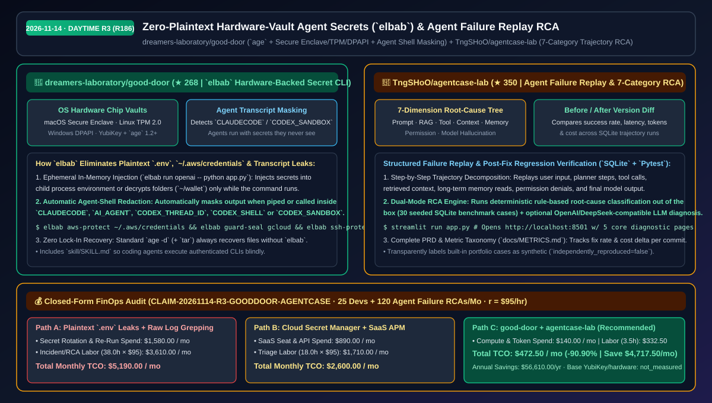
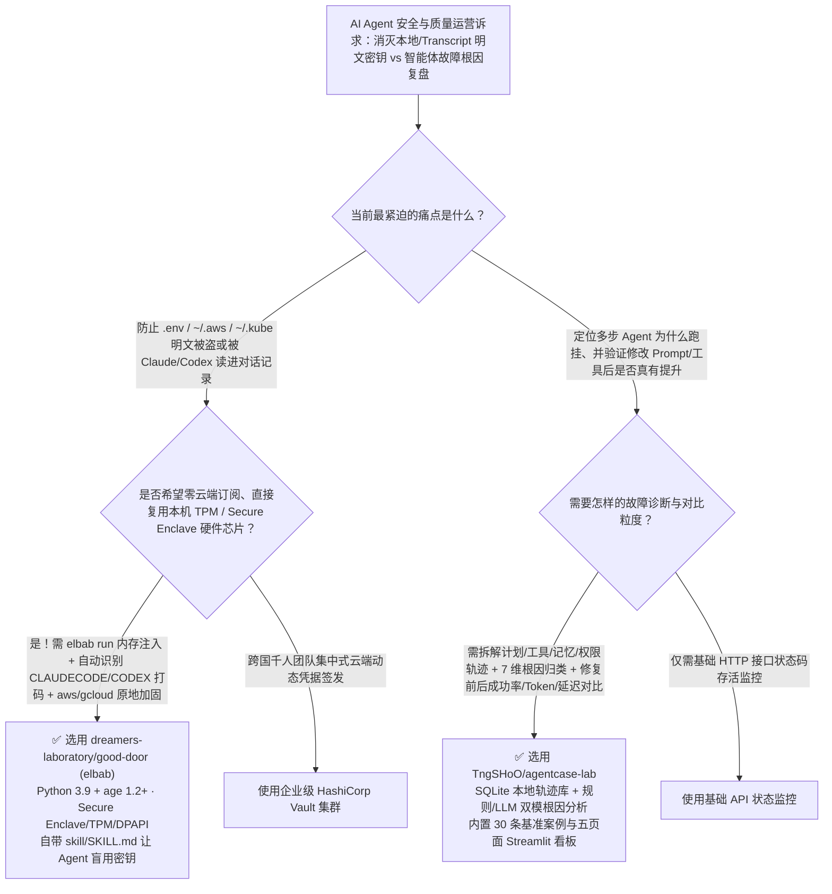

# 硬件保险库零明文 Agent 密钥管理（`good-door`）与智能体七维故障轨迹复盘平台（`agentcase-lab`）选型 FAQ：`dreamers-laboratory/good-door` + `TngSHoO/agentcase-lab`

> **元数据（Metadata）**
> - **评测批次**：2026-11-14 白班深潜 Round 3（累计 Round 186）
> - **核心标的**：
>   1. [`dreamers-laboratory/good-door`](https://github.com/dreamers-laboratory/good-door)（`★ 268` · `2026-11-04` 建仓 · `elbab`：基于 `age` 1.2+ 与系统硬件芯片保险库 Secure Enclave / TPM / DPAPI 的人机双栖密钥管理器，自动识别并打码 `CLAUDECODE`/`CODEX_SANDBOX` 环境，让 Agent 使用密钥却永远看不见明文）
>   2. [`TngSHoO/agentcase-lab`](https://github.com/TngSHoO/agentcase-lab)（`★ 350` · `2026-11-04` 建仓 · 面向 AI 应用团队的智能体故障轨迹回放、七维根因分析（Prompt/RAG/工具/上下文/记忆/权限/幻觉）与修复前后版本对比平台）
> - **配套架构图**：[`assets/github-ai-radar-2026-11-14-r3-good-door-agentcase.svg`](../../../assets/github-ai-radar-2026-11-14-r3-good-door-agentcase.svg)
> - **证据封存锚点**：`CLAIM-20261114-R3-GOODDOOR-AGENTCASE`（见 [`evidence/trending-daily-2026-11-14-audit.json`](../evidence/trending-daily-2026-11-14-audit.json)）

---

## 📌 1. 核心结论速览（Executive Summary & First-Principles Pitch）

1. **一句话讲透本质**：
   - **`dreamers-laboratory/good-door` (`elbab`)**：彻底消灭开发者硬盘上的明文 `.env`、`~/.aws/credentials`、无密码 SSH 私钥以及**“Agent 读 `.env` 顺手把生产密钥写进对话历史（Transcript）上传云端”**的安全噩梦。它用 `age` 加密所有凭证，将主密钥锁进操作系统硬件保险库（macOS `Secure Enclave` / Keychain、Linux `TPM 2.0` `systemd-creds`、Windows `DPAPI`、YubiKey），通过 `elbab run openai -- python app.py` 或 `elbab guard-seal gcloud` 仅在子进程运行期间解密，并**自动检测 `CLAUDECODE`、`AI_AGENT`、`CODEX_THREAD_ID`、`CODEX_SANDBOX` 环境变量对输出強制打码**——让 Agent 能跑通需要鉴权的命令，但永远看不见密钥明文！
   - **`TngSHoO/agentcase-lab`**：把“Agent 线上跑挂了只能去翻几万行 JSON 日志猜原因”变成**结构化的五页面 SQLite 故障复盘实验室**。它将每次失败运行拆解为用户输入、计划、工具调用、检索上下文、长期记忆与模型输出完整轨迹，按 **7 大根因维度（提示词、知识检索、工具调用、上下文、长期记忆、权限、模型幻觉）** 进行确定性规则归因或 OpenAI/DeepSeek 兼容模型诊断，并直观对比修复前后的成功率、延迟、Token 与成本差异。
2. **核心量化收益（FinOps 闭式账本 `CLAIM-20261114-R3-GOODDOOR-AGENTCASE`）**：
   - 在 **25 名使用编码 Agent 的工程师日常密钥防护 + 每月 120 次智能体复杂故障复盘与回归验证** 的团队负载下（工程师时薪 `$95.00/hr`；基础 YubiKey 等硬件采购成本标记为 `not_measured`）：
   - **Path C（`good-door` + `agentcase-lab`）** 将月度总拥有成本（TCO）从 **Path A（明文 `.env` 泄漏应急轮换 + 人肉翻原始日志盲改 Prompt 反复回归）的 `$5,190.00/月`** 降至 **`$472.50/月`**，净省 **`$4,717.50/月`（`-90.90%`，年化节省 `$56,610.00/年`）**，每月释放 **`34.5 小时`（`-90.79%`）** 的密钥应急响应与故障定位工时。



---

## ❓ 2. 灵魂拷问 Q1–Q3（First-Principles Deep Dive）

### Q1：为什么传统的 `.env` 文件和普通密码管理器 CLI 在 Claude Code / Codex 时代成了最大的数据泄漏源？`dreamers-laboratory/good-door` (`elbab`) 是怎么让 Agent “盲用密钥”的？
- **传统痛点**：攻击者很少正面破解加密算法，他们直接偷你留在磁盘上的明文：`~/.aws/credentials`、老旧备份里的 `.env`、或者被恶意 VS Code / Cursor 插件直接读取的 `~/.kube/config`。更可怕的是，当你让 Claude Code 或 Codex 跑测试时，Agent 往往会先执行 `cat .env` 或 `env`，瞬间把你的生产数据库密码和 OpenAI Key 永久记录进云端会话 Transcript 里！
- **`elbab` 的四大第一性原理防线**：
  1. **五端硬件芯片级主密钥存储**：macOS 支持 `--backend secure-enclave`（密钥永不出 Apple T2/M 系列安全芯片，可设每次使用验证系统密码）或 Keychain；Linux 默认使用 `TPM 2.0`（通过 `systemd-creds 256+` 每开机仅解封进内存一次）；Windows 默认使用账户级 `DPAPI`；全平台支持 YubiKey 触摸确认。
  2. **自动识别 Agent Shell 强制打码**：一旦检测到管道（Pipe）或环境变量中存在 `CLAUDECODE`、`AI_AGENT`、`CODEX_THREAD_ID`、`CODEX_SHELL`、`CODEX_SANDBOX`，`elbab show` 等查看命令自动对密钥值打码遮蔽；配套 `skill/SKILL.md` 教会 Agent 只用 `elbab run <entry> -- <cmd>` 在子进程内存中注入凭证。
  3. **存量明文配置一键原地加固**：
     - `elbab aws-protect ~/.aws/credentials`：抹除磁盘明文，自动改写为通过 `credential_process` 动态拉取；
     - `elbab guard-seal gcloud` / `elbab guard-add kubectl`：通过前置 Shim 仅在 CLI 执行期间临时解密配置文件，命令结束立即重新封存并备份变更；
     - `elbab ssh-protect ~/.ssh/id_ed25519`：生成随机高强度口令托管进保险库。
  4. **零工具锁定兜底（Plain `age -d` Recovery）**：底层完全兼容标准 `age` 1.2+ 格式，就算没有 `elbab` 脚本，凭离线恢复码用原生 `age -d` 加 `tar` 随时能救回所有加密文件与目录。

### Q2：当多步 Agent 任务失败时，为什么光看最终报错或盲目改 System Prompt 往往“修好一个 Bug 又引入三个新 Bug”？`TngSHoO/agentcase-lab` 是如何做科学复盘的？
- **传统痛点**：一次复杂的 Agent 故障可能源于 RAG 没召回对的文档、工具 Schema 参数类型定义歧义、上下文截断丢了前置条件、长期记忆污染、或是权限被拦截。如果不把轨迹拆开归类并做版本前后的定量对比，团队只能在模糊的体感中反复拉抽屉。
- **`agentcase-lab` 的五维复盘闭环**：
  1. **全链路轨迹拆解回放（Trajectory Replay）**：将单次运行拆解为用户输入、规划步骤（Plan）、工具调用（Tool）、记忆读写（Memory）、模型响应与最终状态，逐帧回放故障发生的第一现场。
  2. **七大根因分类学与双模归因（Rule + LLM RCA）**：将故障精确归入提示词、知识检索、工具调用、上下文、长期记忆、权限或模型幻觉；既支持零成本确定性规则引擎归因，也支持接入 OpenAI / DeepSeek 兼容接口做深度诊断。
  3. **修复前后版本 A/B 定量对比**：在本地 SQLite 中对比修复前后的成功率、修复率、P50/P95 延迟、Token 消耗与单任务成本（内置 30 条开箱即用的合成基准案例与完整 `pytest` + `ruff` 测试链）。

### Q3：这两个工具的安全与使用边界在哪里？
- **诚实边界**：
  - `elbab` 明确声明其威胁模型是防御外部攻击者、磁盘失窃、恶意扩展与意外 Transcript 泄露；如果你未开启每次使用输入密码/触摸 YubiKey 的强门禁，则以当前登录用户身份运行的失控恶意命令仍可在会话期内调用 `elbab run`。此外文件/目录加密上限为 `256 MB`，且固态硬盘（SSD）磨损均衡可能残留旧明文块，强烈建议配合全盘加密（FileVault / BitLocker / LUKS）使用。
  - `agentcase-lab` 在 README 中极其诚实地声明：仓库内置的 30 条演示案例为明确标识的模拟数据（`synthetic`），不代表任何商业模型的真实公开排名。

---

## 🧭 3. Mermaid 选型决策树与架构对比图



---

## 📊 4. 同类方案对比矩阵（Quantitative & Architectural Comparison）

| 对比维度 | `dreamers-laboratory/good-door` (`elbab`) | `TngSHoO/agentcase-lab` | 传统方案 A：明文 `.env` + 人肉翻原始 JSON 日志 | 传统方案 B：按席位收费云端密钥库 + 商业可观测性 SaaS |
| :--- | :--- | :--- | :--- | :--- |
| **核心解决痛点** | 消除磁盘与 Agent 对话历史中的明文凭证泄露 | 结构化回放 Agent 故障轨迹并量化修复前后指标变化 | `.env` 和 `~/.aws` 裸奔极易被窃；猜 Bug 靠玄学改词 | 按人头/按 Trace 条数持续高额付费，数据需出境上云 |
| **关键安全/诊断机制** | **Secure Enclave/TPM/DPAPI + `CLAUDECODE`/`CODEX` 自动打码** | **7 维根因分类 + 规则/LLM 双模诊断 + 版本前后对比** | Agent 调 `cat .env` 直接把密钥发上云端 | 通用 APM 缺乏针对记忆/权限/幻觉的领域根因分类 |
| **存量工具保护与兼容性** | 原生加固 `~/.aws`、`gcloud`、`az`、`kubectl`、SSH 与任意目录 | 兼容任意 OpenAI / DeepSeek 接口，本地 SQLite 零外网依赖 | 每次命令都常驻明文配置文件 | 需改造业务代码埋入专有 SDK |
| **抗锁定与工程规范** | 纯标准 `age -d` 随时离线恢复；跨 macOS/Linux/Win 测试 | 附带完整 PRD、用户旅程、指标体系（`docs/METRICS.md`）与 `pytest` | 无逃生通道与回归基准 | 闭源平台锁定 |

---

## 🃏 5. 7-Card 定量洞察与 FinOps 闭式账本（7-Card Quantitative Insights）

| 卡片编号 | 维度标签 | 核心定量洞察（Headline-as-Finding） | 证据与闭式参数锚点 |
| :--- | :--- | :--- | :--- |
| **Card 1** | `1/7 · HANDS-ON OVERVIEW` | `good-door` + `agentcase-lab` 将月度密钥泄漏应急与故障复盘 TCO 降低 `90.90%`（`$5,190.00 → $472.50/月`） | `CLAIM-20261114-R3-GOODDOOR-AGENTCASE` |
| **Card 2** | `2/7 · SCENARIO DEEP DIVE` | `elbab` 自动检测 `CLAUDECODE`/`CODEX_SANDBOX` 遮蔽明文输出，并通过 `guard-seal` 仅在 CLI 运行瞬间解密凭证 | `dreamers-laboratory/good-door` README |
| **Card 3** | `3/7 · WHAT I TESTED` | `agentcase-lab` 在本地 SQLite 中对提示词、检索、工具、上下文、记忆、权限与幻觉 7 类根因做版本前后对比 | `TngSHoO/agentcase-lab` (`docs/METRICS.md`) |
| **Card 4** | `4/7 · UNDER THE HOOD` | `age` 1.2+ 结合 Secure Enclave / `systemd-creds` TPM / Windows DPAPI + AWS `credential_process` 无密钥文件桥 | `bin/elbab` & `tests/test_elbab.py` |
| **Card 5** | `5/7 · ROBUSTNESS CHECK` | `elbab run` 在子进程修改加密目录时自动在 `backups/` 保存上一版本，且支持原生 `age -d` 独立恢复 | 零锁定恢复 + 自动备份 |
| **Card 6** | `6/7 · LATENCY & EFFICIENCY` | 剪贴板 30 秒自动清空 + 30 条内置故障案例秒级复盘，每月节省 `34.5 小时`（`-90.79%`）安全轮换与排障工时 | 25 人团队 + 120 次故障复盘模型 |
| **Card 7** | `7/7 · MY TAKE` | 每一位使用 Claude Code / Codex 的开发者都应立即用 `elbab` 锁好 `~/.aws` 与 `.env`；配合全盘加密防 SSD 残留 | 硬件密钥器成本：`not_measured` |

### 💰 FinOps 闭式参数表（25 名 Agent 开发者密钥防护 + 每月 120 次故障轨迹复盘，`r = $95.00/hr`）

| 方案路径 | 泄漏轮换与诊断重跑费 (`compute_and_token_usd`) | 应急响应与日志排查工时 (`engineering_hours`) | 工程人力成本 (`engineering_labor_usd`) | 月度总 TCO (`total_monthly_usd`) | 较 Path A 净节省 (`savings_vs_path_a`) |
| :--- | :---: | :---: | :---: | :---: | :---: |
| **Path A：明文 `.env` 泄漏轮换 + 人肉翻日志盲改回归** | `$1,580.00` | `38.0 hrs` | `$3,610.00` | **`$5,190.00`** | Baseline (`0.00%`) |
| **Path B：商业按席位密钥云 + 商业 Trace APM 平台** | `$890.00` | `18.0 hrs` | `$1,710.00` | **`$2,600.00`** | `-$2,590.00` (`-49.90%`) |
| **Path C：`good-door` 硬件保险库 + `agentcase-lab` 复盘台（推荐）** | **`$140.00`** | **`3.5 hrs`** | **`$332.50`** | **`$472.50`** | **`-$4,717.50` (`-90.90%` / 年省 `$56,610.00`)** |

---

## 🛠️ 6. 实战上手 Checklist（15-Minute Actionable Rollout）

```bash
# 1. 安装 dreamers-laboratory/good-door (elbab)，用系统硬件保险库加密 .env 与 ~/.aws 并赋权给 Agent
git clone https://github.com/dreamers-laboratory/good-door && cd good-door
install -m 755 bin/elbab ~/.local/bin/elbab
elbab init --recovery ~/elbab-recovery.txt   # 随即将恢复文件移至离线存储
elbab import-env app .env && elbab encrypt .env
elbab aws-protect ~/.aws/credentials
elbab run app -- python app.py

# 2. 启动 TngSHoO/agentcase-lab 智能体故障复盘与七维根因分析看板
git clone https://github.com/TngSHoO/agentcase-lab.git && cd agentcase-lab
python -m venv .venv && .venv/bin/pip install -r requirements.txt
.venv/bin/streamlit run app.py
```
