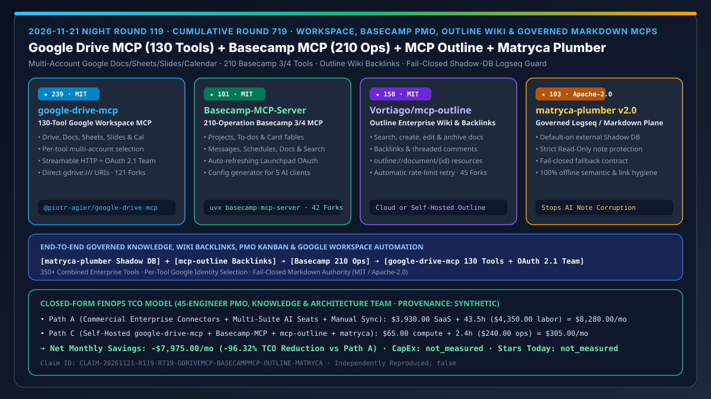
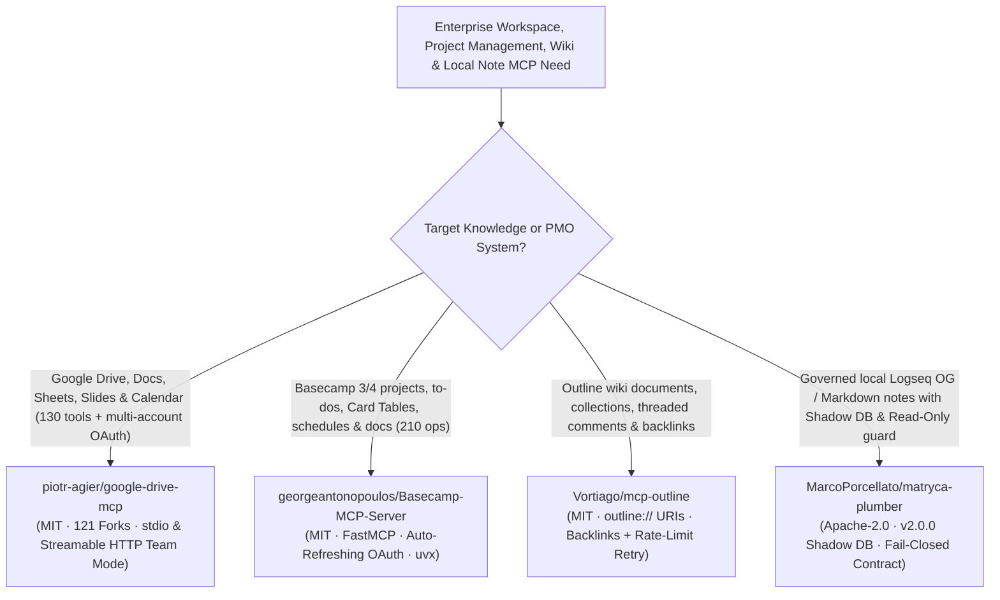
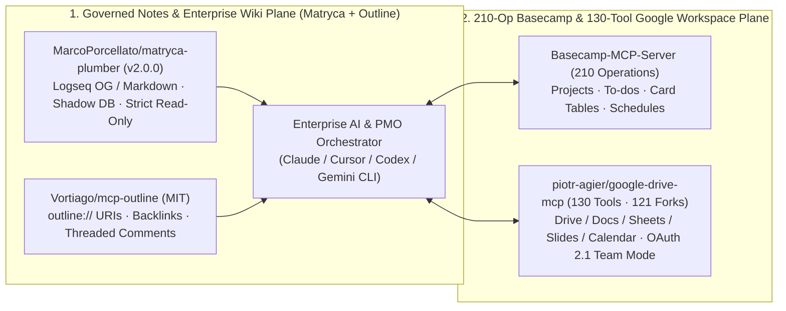
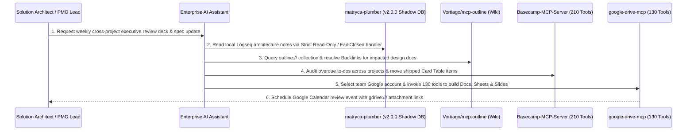

# 130-Tool Multi-Account Google Workspace MCP (`piotr-agier/google-drive-mcp`), 210-Operation Basecamp 3/4 MCP (`georgeantonopoulos/Basecamp-MCP-Server`), Outline Wiki Backlinks MCP (`Vortiago/mcp-outline`) & Governed Shadow-DB Markdown Daemon (`MarcoPorcellato/matryca-plumber`) Selection & Architecture FAQ

> **Document Type**: Enterprise AI Solution Architect Selection & Integration Guide (GitHub Trending AI Radar — 2026-11-21 Night Round 119 / Cumulative Round 719)
> **Covered Repositories**: [`piotr-agier/google-drive-mcp`](https://github.com/piotr-agier/google-drive-mcp) (`★ 239`, `121 forks`, `MIT` — self-hosted 130-tool MCP server for Google Drive, Docs, Sheets, Slides & Calendar with per-tool multi-account selection, `gdrive:///` resources & OAuth 2.1 Team Mode) · [`georgeantonopoulos/Basecamp-MCP-Server`](https://github.com/georgeantonopoulos/Basecamp-MCP-Server) (`★ 101`, `42 forks`, `MIT` — FastMCP server exposing 210 Basecamp 3 & 4 operations across projects, to-dos, card tables, schedules & docs with auto-refreshing OAuth) · [`Vortiago/mcp-outline`](https://github.com/Vortiago/mcp-outline) (`★ 158`, `45 forks`, `MIT` — Outline wiki MCP server with `outline://` resource URIs, backlink discovery, threaded comments & rate-limit retry logic) · [`MarcoPorcellato/matryca-plumber`](https://github.com/MarcoPorcellato/matryca-plumber) (`★ 103`, `17 forks`, `Apache-2.0` — local-first governed memory plane for Logseq OG / Markdown with external Shadow DB, Strict Read-Only protection & fail-closed fallback contract)
> **Core Scenario**: How enterprise PMO, knowledge engineering, and architecture teams connect AI assistants across **Google Workspace (`130 tools`), Basecamp 3/4 (`210 operations`), Outline enterprise wikis (`backlinks & collections`), and local Logseq/Markdown engineering notes**—while enforcing **per-tool Google identity control** and **preventing AI agents from corrupting human-owned Markdown knowledge graphs (`matryca-plumber`)**.

---

## 1. 📌 Executive Summary (One-Line Selection Verdict)

1. **Need a self-hosted Google Workspace MCP server (`121 forks`) with 130 deep tools across Drive, Shared Drives, Docs, Sheets, Slides, and Calendar plus per-tool multi-account selection and OAuth 2.1 Team Mode** ➔ Choose **[`piotr-agier/google-drive-mcp`](https://github.com/piotr-agier/google-drive-mcp) (`★ 239`, `121 forks`, `MIT`)**.
   - **Plain-English Mechanism**: Exposes **130 granular tools** (file management, Shared Drives, permissions, revisions, rich Docs editing, Sheets cell formatting, Slides authoring, Calendar events) and `gdrive:///` resource URIs. Supports local `stdio` OAuth (with multiple Google accounts and per-tool account selection), service accounts, and remote **Streamable HTTP with OAuth 2.1 Team Mode**.
2. **Need natural-language project governance across Basecamp 3 or 4 with 210 operations covering projects, to-dos, messages, Kanban card tables, schedules, documents, and uploads** ➔ Choose **[`georgeantonopoulos/Basecamp-MCP-Server`](https://github.com/georgeantonopoulos/Basecamp-MCP-Server) (`★ 101`, `42 forks`, `MIT`)**.
   - **Plain-English Mechanism**: Built on FastMCP (`uvx basecamp-mcp-server login` walks through 37signals Launchpad OAuth setup on `localhost:8000/auth/callback` and auto-refreshes tokens). Exposes **210 Basecamp operations** and generates exact config snippets (`uvx basecamp-mcp-server config <app>`) for Claude Desktop, Cursor, Claude Code, and Codex.
3. **Need an MCP server for cloud or self-hosted Outline wikis that supports `outline://` resource URIs, backlink impact analysis, hierarchical collections, threaded comments, and automatic rate-limit retries** ➔ Choose **[`Vortiago/mcp-outline`](https://github.com/Vortiago/mcp-outline) (`★ 158`, `45 forks`, `MIT`)**.
   - **Plain-English Mechanism**: Connects AI assistants to Outline documentation (`uvx mcp-outline` or GHCR Docker container) to search/create/archive docs, inspect **backlinks** (finding every document referencing a given spec), manage threaded comments, and read `outline://document/{id}` URIs directly (while also linking to Outline's newly released official MCP server for native cloud users).
4. **Need a local-first governed memory plane (`matryca-plumber v2.0.0`) for Logseq OG and Markdown notes that prevents AI agents from corrupting files on disk via a default-on external Shadow DB, Strict Read-Only protection, and a fail-closed contract** ➔ Choose **[`MarcoPorcellato/matryca-plumber`](https://github.com/MarcoPorcellato/matryca-plumber) (`★ 103`, `17 forks`, `Apache-2.0`)**.
   - **Plain-English Mechanism**: Born from a real incident (*"I gave an AI agent access to my notes. It corrupted them. I built Matryca Plumber so that never happens again"*), `matryca-plumber v2.0.0` runs 100% offline over FastMCP `stdio`, keeping disk Markdown as the sole authority while isolating semantic indexing and link hygiene inside an external **Shadow DB** with **Strict Read-Only protection** and a **fail-closed fallback contract**.

---

## 2. 🎯 Architect & Customer Deep-Dive Q&A

### Q1: Why do enterprise PMO and engineering teams deploy these four open-source MCP servers instead of relying solely on single-vendor office AI add-ons?

- **Three Cross-Platform & Safety Advantages**:
  1. **Cross-System PMO & Engineering Synthesis (`Basecamp 210 tools` + `Outline Backlinks` + `Google Workspace 130 tools`)**: Single-vendor AI add-ons (like Gemini for Workspace) cannot natively query overdue Basecamp 4 card-table items or trace backlinks inside a self-hosted Outline wiki. Combining these MCP servers lets one agent pull overdue Basecamp deliverables, cross-reference Outline design backlinks, and generate formatted Google Slides/Sheets status decks in one turn.
  2. **Multi-Account Identity Control (`piotr-agier/google-drive-mcp`)**: Architects and agencies managing multiple Google tenants can select the exact Google account per tool call or run OAuth 2.1 Team Mode over Streamable HTTP while keeping credentials on-premises.
  3. **Zero-Corruption Local Knowledge Governance (`MarcoPorcellato/matryca-plumber`)**: Raw filesystem MCP servers routinely mangle Logseq block properties and bidirectional links. `matryca-plumber v2.0.0` enforces Strict Read-Only protection, external Shadow DB indexing, and fail-closed handlers (`journal_day`).
- **When to Choose Commercial SaaS Add-Ons (Path B)**:
  - Organizations storing 100% of documents and project trackers inside Google Workspace with no Basecamp, Outline, or local Logseq footprint can use native **Gemini for Google Workspace**.

### Q2: How do we wire an end-to-end PMO, Wiki & Workspace automation architecture combining all four MCP servers?

1. **Governed Local Architecture Notes Layer (`MarcoPorcellato/matryca-plumber`)**:
   - Attach `matryca-plumber` (`v2.0.0`) over FastMCP `stdio` to local Logseq OG / Markdown vaults with external Shadow DB and Strict Read-Only protection enabled.
2. **Enterprise Wiki & Backlink Graph Layer (`Vortiago/mcp-outline`)**:
   - Connect `mcp-outline` to self-hosted or cloud Outline instances so agents can traverse `outline://collection/{id}` hierarchies, resolve document **backlinks**, and post review comments.
3. **210-Operation Project & Kanban Tracking Layer (`georgeantonopoulos/Basecamp-MCP-Server`)**:
   - Wire `basecamp-mcp-server` to Basecamp 3/4 to audit overdue to-dos, summarize project message boards, and move Kanban cards across Card Tables.
4. **130-Tool Google Workspace Authoring & Calendar Layer (`piotr-agier/google-drive-mcp`)**:
   - Deploy `@piotr-agier/google-drive-mcp` (in Local OAuth or Streamable HTTP OAuth 2.1 Team Mode) to author Google Docs specs, format Sheets trackers, build Slides executive decks, and schedule Calendar reviews.

### Q3: What are the boundaries and trade-offs of this stack?

- **Key Strengths**:
  - **Over 350 Specialized Productivity & Knowledge Tools** under **`MIT` & `Apache-2.0` licenses**.
  - **Full Credential & File Sovereignty**: OAuth tokens and Markdown files stay under your infrastructure control.
- **Operational Scope**:
  - For teams running cloud-hosted Outline that prefer a vendor-hosted endpoint, `Vortiago/mcp-outline` documents how to use Outline's official MCP server alongside or in place of the self-hosted container.

---

## 3. 🧭 Visual Architecture & Decision Diagrams

### 3.1 Solution Architect Selection Decision Tree

### 3.2 End-to-End Enterprise Reference Architecture

### 3.3 Fail-Closed Note Recall, Wiki Backlink Check, Basecamp Triage & Google Slides Synthesis Sequence

---

## 4. 📊 Peer Open-Source vs Commercial Cloud Selection Matrix

| Dimension | `piotr-agier/google-drive-mcp` (`★ 239`) | `Basecamp-MCP-Server` (`★ 101`) | `Vortiago/mcp-outline` (`★ 158`) | `matryca-plumber` (`★ 103`) | Commercial Enterprise Search + Per-Seat AI Add-Ons (Path A) | Single-Vendor Suite AI (Path B) |
| :--- | :--- | :--- | :--- | :--- | :--- | :--- |
| **Core Role** | 130-tool Google Drive/Docs/Sheets/Slides/Calendar MCP | 210-op Basecamp 3/4 project & Kanban MCP | Outline wiki document, comment & backlinks MCP | Governed Shadow-DB Logseq/Markdown daemon (`v2.0.0`) | Commercial Glean/iPaaS + $30/user/mo suite AI seats | Gemini for Workspace / Notion AI |
| **Architectural Edge** | **130 tools + per-tool multi-account + OAuth 2.1 Team Mode** | **210 operations + auto token refresh + 5-client config CLI** | **Backlink discovery + `outline://` URIs + rate-limit retry** | **External Shadow DB + Strict Read-Only + fail-closed safety** | High per-seat costs; raw scripts corrupt local Markdown vaults | Cannot bridge Basecamp 3/4, self-hosted Outline & local Logseq |
| **License** | `MIT` | `MIT` | `MIT` | `Apache-2.0` | Proprietary SaaS | Proprietary Cloud PaaS |
| **Monthly TCO (45-Eng Team)** | **`$305.00/mo` combined** (`$65.00` compute + `2.4h` ops) | Included in `$305.00/mo` stack | Included in `$305.00/mo` stack | Included in `$305.00/mo` stack | **`$8,280.00/mo`** (`$3,930.00` seats/SaaS + `43.5h` manual sync) | `~$2,610.00/mo` (stacked multi-suite seat fees) |

---

## 5. 🧪 Quantitative ROI / FinOps TCO Model & 7-Card Report

> **📊 Provenance & Closed-Form Audit Declaration**:
> - **Provenance**: `synthetic` (45-engineer enterprise PMO, knowledge engineering & solution architecture workload model; `independently_reproduced = false`; `base_hardware_capex = not_measured`; `track_b_stars_today = not_measured`).
> - **Closed-Form Equations**:
>   - **Path A (Commercial Enterprise Connector SaaS + Multi-Suite Per-User AI Add-On Seats + Manual Cross-System Status Reporting & Markdown Vault Corruption Recovery)**: Monthly SaaS & seat spend **`$3,930.00`** + manual cross-platform reporting & note recovery labor **`43.5h × $100.00/h = $4,350.00`** = **`$8,280.00/mo`**.
>   - **Path C (Self-Hosted `piotr-agier/google-drive-mcp` + `georgeantonopoulos/Basecamp-MCP-Server` + `Vortiago/mcp-outline` + `MarcoPorcellato/matryca-plumber`)**: Shared Streamable HTTP container compute **`$65.00`** + OAuth & connector maintenance **`2.4h × $100.00/h = $240.00`** = **`$305.00/mo`**.
>   - **Net Savings vs Path A**: **`-$7,975.00/mo`** (**`96.32%`** cost reduction).

| Architecture Option | API / SaaS / Compute | PMO & Engineering Ops Labor (`$100/h`) | Total Monthly TCO | Net Savings vs Path A | Key Architectural Outcome |
| :--- | :---: | :---: | :---: | :---: | :--- |
| **Path A: Commercial Connectors + Multi-Suite AI Seats** | `$3,930.00` | `43.5h` (`$4,350.00`) | **`$8,280.00`** | Baseline | Siloed SaaS suites; unguarded scripts corrupt local notes |
| **Path B: Single-Suite Cloud AI + Manual Basecamp Sync** | `$1,410.00` | `12.0h` (`$1,200.00`) | **`$2,610.00`** | `-$5,670.00` (`-68.48%`) | Lacks 210 Basecamp ops, Outline backlinks & Shadow-DB note guard |
| **Path C: `google-drive-mcp` + `Basecamp` + `outline` + `matryca`** | **`$65.00`** | **`2.4h` (`$240.00`)** | **`$305.00`** | **`-$7,975.00` (`-96.32%`)** | **130 GDrive tools + 210 Basecamp ops + Outline backlinks + Shadow DB** |

- 🔗 **7-Card 4:5 Visual Report**: [`workshops/github-trending-radar/cards.en.html`](../cards.en.html) · [`cards.html`](../cards.html)

---

## 6. 🛠️ Enterprise Adoption & Architecture Review Checklist

- [ ] **1. Deploy `piotr-agier/google-drive-mcp` with Identity Controls**: Configure OAuth credentials (`gcp-oauth.keys.json`) in local `stdio` mode (with per-tool account selection) or remote Streamable HTTP OAuth 2.1 Team Mode across all 130 Drive/Docs/Sheets/Slides/Calendar tools.
- [ ] **2. Connect PMO Workflows via `georgeantonopoulos/Basecamp-MCP-Server`**: Run `uvx basecamp-mcp-server login` and `uvx basecamp-mcp-server config <app>` to enable 210 Basecamp 3/4 operations with auto-refreshing OAuth tokens.
- [ ] **3. Integrate `Vortiago/mcp-outline` for Wiki Backlink Governance**: Expose `outline://` resources and backlink lookups so agents verify dependent documents before proposing spec changes.
- [ ] **4. Protect Local Markdown & Logseq Vaults with `MarcoPorcellato/matryca-plumber` (`v2.0.0`)**: Keep default-on external Shadow DB, Strict Read-Only protection, and fail-closed contracts enabled so AI agents never corrupt human-authored Markdown files.
