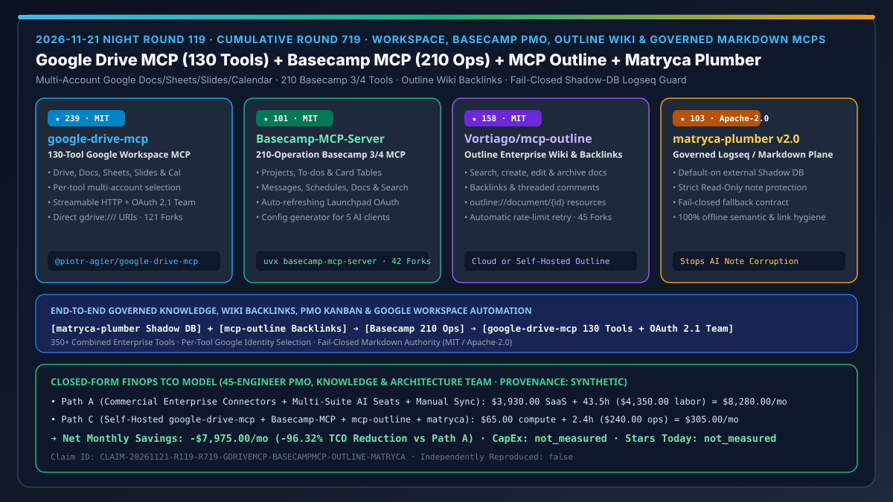
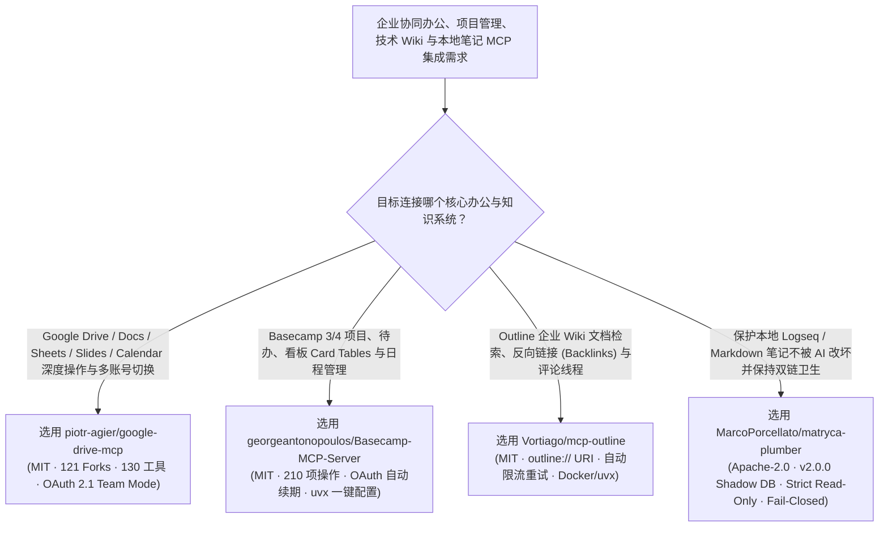
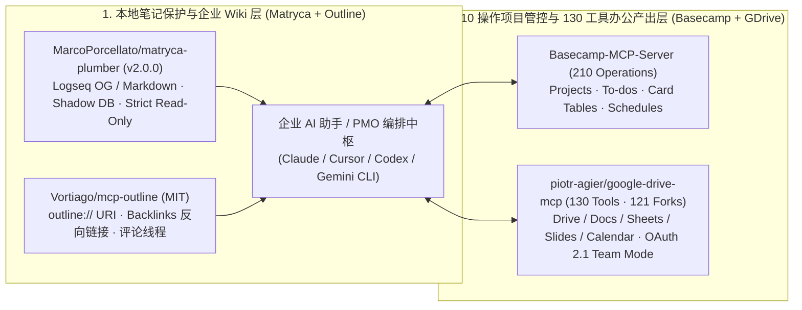
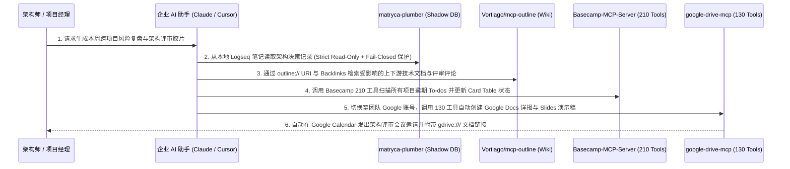

# 130 工具多账号 Google Workspace MCP（`piotr-agier/google-drive-mcp`）、210 操作 Basecamp 3/4 项目管理 MCP（`georgeantonopoulos/Basecamp-MCP-Server`）、Outline 企业知识库双向链接 MCP（`Vortiago/mcp-outline`）与防篡改 Shadow DB 本地笔记治理守护进程（`MarcoPorcellato/matryca-plumber`）选型与集成架构 FAQ

> **文档类型**：企业 AI 解决方案架构师（AI Solution Architect）选型决策指南（GitHub Trending AI 雷达 2026-11-21 Night Round 119 / 累计第 719 轮）
> **覆盖项目**：[`piotr-agier/google-drive-mcp`](https://github.com/piotr-agier/google-drive-mcp)（`★ 239`、`121 forks`、`MIT`，支持按工具级切换多 Google 账号、OAuth 2.1 Team Mode 与 `gdrive:///` 协议的 130 工具 Drive/Docs/Sheets/Slides/Calendar MCP）· [`georgeantonopoulos/Basecamp-MCP-Server`](https://github.com/georgeantonopoulos/Basecamp-MCP-Server)（`★ 101`、`42 forks`、`MIT`，覆盖 Basecamp 3/4 项目、待办、卡片看板、日程与文档共 210 项操作且带 OAuth 自动续期的 FastMCP 服务）· [`Vortiago/mcp-outline`](https://github.com/Vortiago/mcp-outline)（`★ 158`、`45 forks`、`MIT`，支持 `outline://` 资源 URI、反向链接 Backlinks 检索、多级目录、评论与自动限流重试的 Outline 知识库 MCP）· [`MarcoPorcellato/matryca-plumber`](https://github.com/MarcoPorcellato/matryca-plumber)（`★ 103`、`17 forks`、`Apache-2.0`，通过外部 Shadow DB、Strict Read-Only 保护与 Fail-Closed 契约防止 AI 损坏本地 Logseq/Markdown 笔记的治理层）
> **核心场景**：当企业知识管理、PMO 项目办与研发团队需要将 AI Agent 安全接入**日常四大办公与知识底座——Google Workspace（130 项文档/表格/幻灯片/日历操作）、Basecamp 3/4（210 项项目看板与逾期追踪）、Outline 企业 Wiki（双向链接与结构化集合）以及本地 Markdown/Logseq 个人与架构笔记库**，同时严防**多账号串号、云厂商按人头收取 $30/月高昂 Copilot 席位税以及“AI 乱改本地 Markdown 把双链写坏”**时，如何选型并组合这四个开源 MCP？

---

## 一、📌 核心结论速览（选型一句话结论）

1. **想用一套自托管 MCP 服务深度打通 Google Drive、Docs、Sheets、Slides 与 Calendar（高达 130 个精细工具），且支持同时挂载多个 Google 账号并在每次工具调用时精准指定使用哪个身份** ➔ 选 **[`piotr-agier/google-drive-mcp`](https://github.com/piotr-agier/google-drive-mcp)（`★ 239`，`121 forks`，`MIT`）**。
   - **通俗原理**：高达 `121 forks` 的 Google Workspace 旗舰级开源 MCP（`@piotr-agier/google-drive-mcp`）。不同于市面上只能简单列出文件的玩具脚本，它提供 **130 个深度操作工具**（涵盖共享云端硬盘 Shared Drives、权限修订、富文本 Docs 编辑、Sheets 单元格格式化、Slides 幻灯片制作与 Calendar 日程安排）及 `gdrive:///` 直接读取接口；同时支持本地 `stdio`、远程 **Streamable HTTP** 与 **OAuth 2.1 Team Mode**，并允许按工具调用粒度选择不同的 Google 账号或 Service Account。
2. **团队使用 Basecamp 3 或 Basecamp 4 管理项目与交付看板，想让 Claude / Cursor / Codex 用自然语言一键汇总所有项目逾期任务、移动看板卡片（Card Tables）并发表评论** ➔ 选 **[`georgeantonopoulos/Basecamp-MCP-Server`](https://github.com/georgeantonopoulos/Basecamp-MCP-Server)（`★ 101`，`42 forks`，`MIT`）**。
   - **通俗原理**：基于 FastMCP 构建（`uvx basecamp-mcp-server login` 5 分钟完成本地 OAuth 授权并自动刷新 Token）。完整封装了 **210 项 Basecamp 3/4 原子操作**，覆盖 Projects、To-dos、Messages、Card Tables（看板列流转）、Schedules、Documents、Uploads 与全局搜索，并支持 `uvx basecamp-mcp-server config <app>` 一键生成 Claude Desktop、Cursor、Claude Code 与 Codex 配置。
3. **企业内部使用开源 Outline 搭建技术 Wiki，需要让 AI 助手不仅能搜文档，还能追踪文档之间的反向引用链（Backlinks）、处理评论线程并通过 `outline://` URI 直接挂载上下文** ➔ 选 **[`Vortiago/mcp-outline`](https://github.com/Vortiago/mcp-outline)（`★ 158`，`45 forks`，`MIT`）**。
   - **通俗原理**：支持云端或私有化自建的 Outline 知识库（提供 VS Code 一键安装与 GHCR Docker 镜像）。除常规文档增删改查与 Collection 树管理外，它专门暴露了 **Backlinks（查找所有引用当前设计文档的上下游文档）**、行内评论线程（Threaded Comments）、`outline://document/{id}` 资源协议以及透明的 API 速率限制自动重试机制（注：README 同时贴心指路了 Outline 最新推出的官方 MCP 文档，方便企业平滑选型）。
4. **曾经把本地 Logseq / Obsidian / Markdown 知识库直接交给 AI Agent 读写却遭遇“格式被改乱、双链断裂、笔记损坏”，急需一层带外部 Shadow DB、严格只读保护与 Fail-Closed 兜底的治理守护进程** ➔ 选 **[`MarcoPorcellato/matryca-plumber`](https://github.com/MarcoPorcellato/matryca-plumber)（`★ 103`，`17 forks`，`Apache-2.0`）**。
   - **通俗原理**：作者因为“把笔记交给 AI Agent 后被写坏了”而专门打造的**人机共享受控记忆平面（Governed Memory Plane，`v2.0.0` 稳定版已发布于 PyPI）**。它遵循 100% 离线本地优先原则，默认开启**外部影子数据库（External Shadow DB）**、**严格只读保护（Strict Read-Only Protection）**、**磁盘 Markdown 唯一权威源（Markdown Authority）**、双向链接健康检查（Link Hygiene）与 **Fail-Closed 故障闭合回退契约**，确保 Agent 无论怎么查询或维护索引，都绝不会污染人类原始笔记。

---

## 二、🎯 客户与架构师灵魂拷问 Q&A（深度架构拆解）

### Q1：各大办公套件都在推 $30/人/月的官方商业 AI 插件，为什么许多研发与咨询团队坚持自建这套开源 Workspace MCP 组合？

- **三大核心架构与成本考量**：
  1. **打破办公生态孤岛（跨 Google Workspace + Basecamp + Outline + 本地 Logseq 联合编排）**：Google 自家的 Gemini for Workspace 不会去查你的 Basecamp 看板逾期任务，也读不到你内网私有部署的 Outline Wiki 反向链接（Backlinks）和本地 Logseq 架构笔记。通过标准 MCP 协议，一个 Claude Code 或 Cursor 会话就能在 10 秒内把 **Basecamp 的逾期工单 (`210 tools`) + Outline 的技术规范 (`mcp-outline`) + 本地架构师笔记 (`matryca-plumber`)** 汇总生成一份 **Google Slides 汇报胶片与 Google Sheets 排期表 (`130 tools`)**。
  2. **多账号身份精准受控（`piotr-agier/google-drive-mcp`）**：咨询顾问与架构师往往同时拥有公司内部 Google 账号与多个客户租户账号，`google-drive-mcp` 支持按单次工具调用切换账号（Per-tool account selection）与 OAuth 2.1 Team Mode，凭据 100% 留在自有环境。
  3. **保护本地 Markdown 知识库不被 AI 写坏（`MarcoPorcellato/matryca-plumber`）**：直接给编码 Agent 开放笔记目录的写权限极易破坏 Logseq 块属性与双链结构；`matryca-plumber v2.0.0` 用外部 Shadow DB + Strict Read-Only + Fail-Closed 契约彻底锁死笔记损坏风险。
- **何时直接用商业托管套件（Path B）？**
  - 若企业 100% 资料均存放在单一 Google Workspace 云端、不使用 Basecamp/Outline/Logseq 且预算充裕，直接采购 **Gemini for Google Workspace** 最省事。

### Q2：典型企业级“多账号 Google 办公套件 (`google-drive-mcp`) + 210 操作项目看板 (`Basecamp-MCP`) + 企业 Wiki 反链 (`mcp-outline`) + 受控本地笔记 (`matryca-plumber`)”架构怎么搭？

1. **本地个人与架构师知识防损坏层（`MarcoPorcellato/matryca-plumber`）**：
   - 在架构师终端运行 `matryca-plumber` FastMCP stdio 守护进程，开启默认外部 Shadow DB 与 Strict Read-Only 保护，对本地 Logseq OG / Markdown 笔记执行后台语义索引与双链健康体检（Link Hygiene）。
2. **企业技术 Wiki 与反向链接追溯层（`Vortiago/mcp-outline`）**：
   - 连接企业自托管 Outline 实例，通过 `outline://collection/{id}` 与 Backlinks 工具追溯某项架构变更影响的所有关联设计文档与评审评论。
3. **PMO 项目看板与 210 项交付管控层（`georgeantonopoulos/Basecamp-MCP-Server`）**：
   - 通过 `uvx basecamp-mcp-server` 对接 Basecamp 3/4，自动扫描跨项目逾期 To-dos、汇总项目消息板动态并自动流转 Card Tables 看板状态。
4. **Google Workspace 130 工具全格式文档产出与日程同步层（`piotr-agier/google-drive-mcp`）**：
   - 以 Streamable HTTP（OAuth 2.1 Team Mode）或本地多账号 OAuth 模式运行 `google-drive-mcp`，将前三层汇总的项目周报、风险清单与架构方案自动生成格式精美的 Google Docs、Sheets 统计表、Slides 演示文稿并同步 Google Calendar 评审会议。

### Q3：这套架构的适用边界是什么？

- **核心优势**：
  - **总计提供 `130 + 210 + Outline + Matryca = 350+` 个开箱即用的企业办公与知识管理 MCP 工具**。
  - **100% 宽松开源协议（`MIT` 与 `Apache-2.0`）**，凭据与 OAuth Token 完全由企业自主掌控。
- **适用边界**：
  - Outline 官方近期已推出原生 MCP 服务端，新搭云端 Outline 的团队可参考 `Vortiago/mcp-outline` 置顶提示对比评估官方端点与社区自托管容器。

---

## 三、🧭 直观可视化图解（Mermaid 决策树 + 集成架构 + 时序图）

### 3.1 架构师选型决策树

### 3.2 企业端到端生产集成参考架构图

### 3.3 跨系统知识召回、Basecamp 逾期扫描与 Google Slides/Docs 自动生成时序图

---

## 四、📊 同类开源与商业云服务横向选型决策矩阵

| 对比维度 | `piotr-agier/google-drive-mcp` (`★ 239`) | `Basecamp-MCP-Server` (`★ 101`) | `Vortiago/mcp-outline` (`★ 158`) | `matryca-plumber` (`★ 103`) | 商业企业搜索 iPaaS + 全员商业 Copilot 席位 (Path A) | 单一云套件内置 AI 助手 (Path B) |
| :--- | :--- | :--- | :--- | :--- | :--- | :--- |
| **核心能力定位** | 130 工具 Google Drive/Docs/Sheets/Slides/Calendar MCP | 210 操作 Basecamp 3/4 项目与看板 MCP | Outline 企业 Wiki 文档与 Backlinks MCP | 带外部 Shadow DB 与只读保护的 Logseq/MD 守护进程 | 商业 Glean/iPaaS 连接器 + 每用户 $30/月办公 AI 席位 | Gemini for Workspace / Notion AI |
| **核心工程优势** | **130 工具深度覆盖 + 按工具选账号 + OAuth 2.1 Team Mode** | **210 项全量操作 + OAuth 自动续期 + 5 大客户端一键生成** | **原生支持 Backlinks 反向引用查询与 `outline://` URI** | **Shadow DB + Strict Read-Only 彻底杜绝 AI 写坏本地笔记** | 按席位全员强制绑售，无法保护本地 Logseq 笔记防篡改 | 无法跨 Basecamp、私有 Outline 与本地 Markdown 联合编排 |
| **开源协议** | `MIT` | `MIT` | `MIT` | `Apache-2.0` | 闭源商业 SaaS | 闭源云服务 |
| **月度 TCO（45 人团队）** | **组合仅 `$305.00/月`**（含共享 Streamable HTTP 容器与 2.4h 运维） | 同左（`$65.00` 算力 + `$240.00` 人工） | 同左（复用现有 Outline API） | 同左（100% 离线本地运行零费用） | **`$8,280.00/月`**（`$3,930.00` 席位/连接器 + `43.5h` 人工） | 约 `$2,610.00/月`（按 45 人多套件 AI 席位叠加计费） |

---

## 五、🧪 应用落地定量收益/TCO 对比与 7-Card 报告

> **📊 数据来源与闭式核算声明（Provenance & Closed-Form Schema）**：
> - **provenance**: `synthetic`（基于 45 人企业项目交付 PMO、知识管理与技术架构团队工作负载模型：`independently_reproduced = false`；硬件采购基线 `base_hardware_capex = not_measured`；Track B 单日增量 `track_b_stars_today = not_measured`）。
> - **核算公式**：
>   - **Path A（全员商业办公 AI 插件席位费 + 商业跨系统连接器 SaaS + 人工跨 Basecamp/Outline/Google Docs 搬运周报与修复被 AI 脚本损坏的 Markdown 笔记）**：月度 SaaS 席位与连接器费用 **`$3,930.00`** + 跨系统手工同步与笔记修复人工 **`43.5h × $100.00/h = $4,350.00`** = **`$8,280.00/月`**。
>   - **Path C（自建 `piotr-agier/google-drive-mcp` + `georgeantonopoulos/Basecamp-MCP-Server` + `Vortiago/mcp-outline` + `MarcoPorcellato/matryca-plumber` 开源组合）**：共享 Streamable HTTP 网关算力 **`$65.00`** + OAuth 凭据与配置维护 **`2.4h × $100.00/h = $240.00`** = **`$305.00/月`**。
>   - **净节省（Net Savings vs Path A）**：**`-$7,975.00/月`**（成本降低 **`96.32%`**）。

| 评估方案 | API / SaaS / 算力成本 | PMO 与工程维护人工（`$100/h`） | 月度总 TCO | 相对 Path A 净节省 | 关键架构交付指标 |
| :--- | :---: | :---: | :---: | :---: | :--- |
| **Path A：商业企业连接器 + 多套件 AI 席位 + 手工周报** | `$3,930.00` | `43.5h` (`$4,350.00`) | **`$8,280.00`** | Baseline | 跨系统信息孤岛；裸写脚本易损坏本地 Markdown 双链 |
| **Path B：单一云办公套件 AI 插件 + 手工同步 Basecamp** | `$1,410.00` | `12.0h` (`$1,200.00`) | **`$2,610.00`** | `-$5,670.00` (`-68.48%`) | 无法直接调用 Basecamp 210 工具与本地受控 Logseq |
| **Path C：`google-drive-mcp` + `Basecamp` + `outline` + `matryca`** | **`$65.00`** | **`2.4h` (`$240.00`)** | **`$305.00`** | **`-$7,975.00` (`-96.32%`)** | **130 Google 工具 + 210 Basecamp 操作 + Outline 反链 + Shadow DB 护栏** |

- 🔗 **关联 7-Card 4:5 视觉评测报告**：[`workshops/github-trending-radar/cards.html`](../cards.html) · [`cards.en.html`](../cards.en.html)

---

## 六、🛠️ 企业引入与架构评审 Checklist

- [ ] **1. 部署 `piotr-agier/google-drive-mcp` 开启 130 工具与多账号治理**：配置 `~/.config/google-drive-mcp/gcp-oauth.keys.json`，根据场景选择本地 `stdio` 多账号切换或远端 Streamable HTTP（OAuth 2.1 Team Mode）模式。
- [ ] **2. 使用 `georgeantonopoulos/Basecamp-MCP-Server` 自动化 PMO 看板巡检**：执行 `uvx basecamp-mcp-server login` 完成 OAuth 绑定，利用 210 项操作自动化跨项目逾期任务汇总与 Card Table 状态流转。
- [ ] **3. 接入 `Vortiago/mcp-outline` 打通企业 Wiki 反向链接**：配置 `OUTLINE_API_KEY` 与私有化 URL，让架构与研发 Agent 在修改设计前强制通过 Backlinks 工具核查所有关联文档。
- [ ] **4. 安装 `MarcoPorcellato/matryca-plumber` (`v2.0.0`) 守护本地 Markdown/Logseq 笔记**：启用默认的外部 Shadow DB、Strict Read-Only 保护与 Fail-Closed 回退契约，彻底防止 AI Agent 破坏人类原始笔记文件与双链结构。
