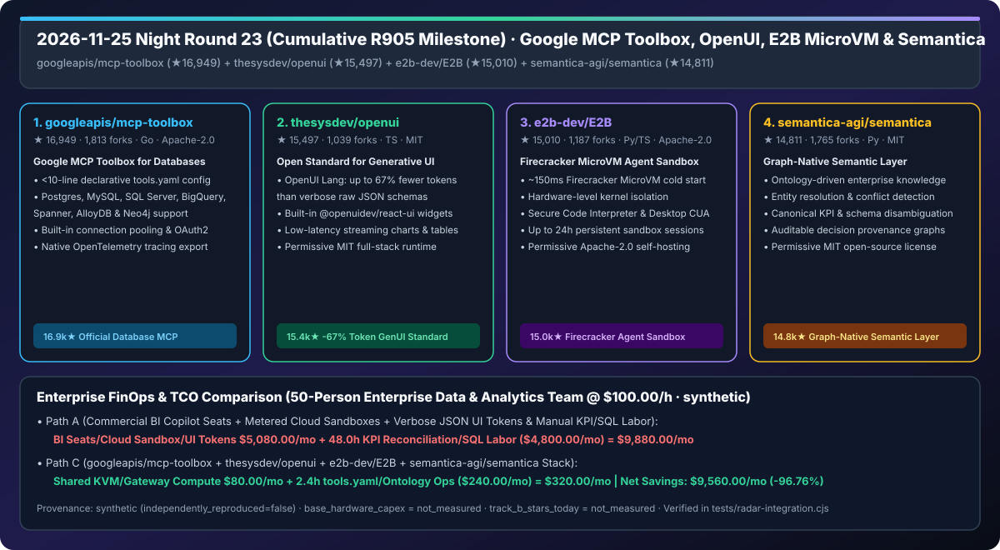
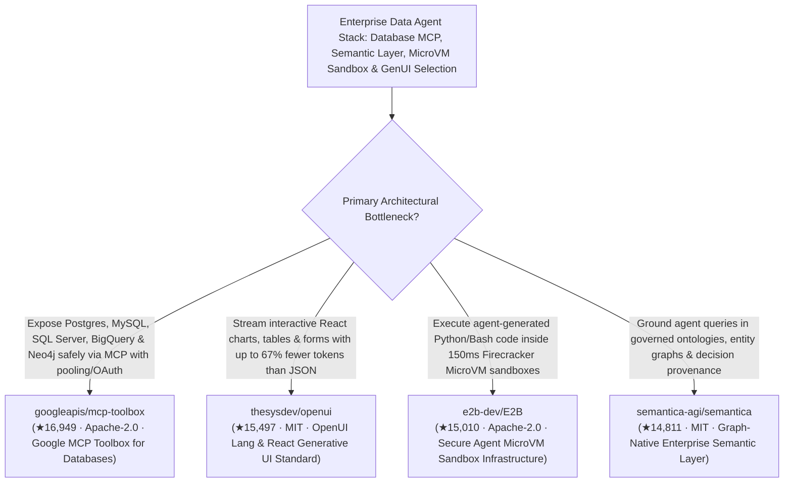
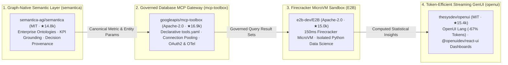
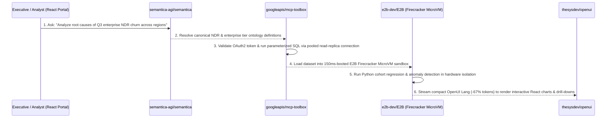

# Google Official Database MCP Server (`googleapis/mcp-toolbox`), 67%-Lower-Token Generative UI Standard (`thesysdev/openui`), Firecracker MicroVM Agent Sandbox (`e2b-dev/E2B`) & Graph-Native Semantic Layer (`semantica-agi/semantica`) Selection & Integration Architecture FAQ

> **Document Type**: Enterprise AI Solution Architect Selection Decision Guide (GitHub Trending AI Radar — 2026-11-25 Night Round 23 / Cumulative Round 905 Milestone)
> **Covered Repositories**: [`googleapis/mcp-toolbox`](https://github.com/googleapis/mcp-toolbox) (`★ 16,949`, `1,813 forks`, `Apache-2.0`, Go: Google's open-source MCP server for databases supporting PostgreSQL, MySQL, SQL Server, BigQuery, Spanner, AlloyDB, Neo4j, and more with declarative `tools.yaml`, connection pooling, OAuth2 auth, and OpenTelemetry) · [`thesysdev/openui`](https://github.com/thesysdev/openui) (`★ 15,497`, `1,039 forks`, `MIT`, TypeScript: The Open Standard for Generative UI featuring `OpenUI Lang`—up to 67% more token-efficient than raw JSON—and `@openuidev/react-ui` components) · [`e2b-dev/E2B`](https://github.com/e2b-dev/E2B) (`★ 15,010`, `1,187 forks`, `Apache-2.0`, Python/TypeScript: open-source Firecracker MicroVM sandbox infrastructure for enterprise-grade agent code execution and computer use) · [`semantica-agi/semantica`](https://github.com/semantica-agi/semantica) (`★ 14,811`, `1,765 forks`, `MIT`, Python: graph-native semantic layer for trustworthy enterprise AI unifying ontology modeling, entity resolution, and decision provenance)
> **Core Enterprise Scenario**: Building a **100% Permissive (`Apache-2.0` / `MIT`) Trustworthy Enterprise Data & Analytics Agent Stack**—combining graph-native ontology disambiguation (`semantica`), parameterized database MCP access with connection pooling and OAuth (`googleapis/mcp-toolbox`), ~150ms Firecracker MicroVM code execution (`E2B`), and token-efficient streaming Generative UI dashboards (`openui`).

---

## 1. 📌 Executive Summary (One-Line Selection Verdict)

1. **Need an official, `Apache-2.0` database MCP gateway that exposes PostgreSQL, MySQL, SQL Server, BigQuery, Spanner, and Neo4j to agents via declarative `<10-line` `tools.yaml` with built-in connection pooling, OAuth2, and OpenTelemetry** ➔ Choose **[`googleapis/mcp-toolbox`](https://github.com/googleapis/mcp-toolbox) (`★ 16,949`, `1,813 forks`, `Apache-2.0`)**.
   - **Plain-English Mechanism**: Prevents raw SQL injection and connection-pool exhaustion by letting DBAs define parameterized, RBAC-scoped database queries in `tools.yaml` that hot-reload as standard MCP tools.
2. **Need a graph-native semantic layer that maps ambiguous business terms onto governed enterprise ontologies, entity graphs, and decision lineage before an agent queries any database** ➔ Choose **[`semantica-agi/semantica`](https://github.com/semantica-agi/semantica) (`★ 14,811`, `1,765 forks`, `MIT`)**.
   - **Plain-English Mechanism**: Eliminates schema hallucination and conflicting KPI definitions by grounding agent reasoning in an explicit semantic knowledge graph with full provenance tracking.
3. **Need hardware-isolated Firecracker MicroVM sandboxes (~150ms cold start) so agents can safely run Python data science, bash scripts, and headless browsers without risking container escape on your host cluster** ➔ Choose **[`e2b-dev/E2B`](https://github.com/e2b-dev/E2B) (`★ 15,010`, `1,187 forks`, `Apache-2.0`)**.
   - **Plain-English Mechanism**: Spins up dedicated micro-virtual machines with isolated kernels for every agent session—offering far stronger security boundaries than shared-kernel Docker containers.
4. **Need a full-stack `MIT` Generative UI standard that streams interactive React charts, tables, and forms using up to 67% fewer LLM output tokens than verbose JSON schemas** ➔ Choose **[`thesysdev/openui`](https://github.com/thesysdev/openui) (`★ 15,497`, `1,039 forks`, `MIT`)**.
   - **Plain-English Mechanism**: Uses `OpenUI Lang`, a compact line-oriented DSL purpose-built for LLM streaming, paired with `@openuidev/react-ui` to render responsive enterprise dashboards with lower latency and cost.

---

## 2. 🎯 Architect & Customer Deep-Dive Q&A

### Q1: Why does naive "raw Text-to-SQL + Docker `exec()`" fail in enterprise production, and how does this four-project stack solve it?

- **Four-Layer Trustworthy Enterprise Data Agent Architecture (Path C)**:
  1. **L1 Graph-Native Ontology & KPI Grounding ➔ `semantica-agi/semantica`**: Resolves business entities, synonyms, and canonical metric definitions before query generation.
  2. **L2 Governed Database MCP Gateway ➔ `googleapis/mcp-toolbox`**: Executes parameterized queries across heterogeneous SQL/NoSQL/Graph databases with connection pooling, OAuth2, and OTel tracing.
  3. **L3 Firecracker MicroVM Code Interpreter ➔ `e2b-dev/E2B`**: Runs Python statistical analysis and data transformations inside hardware-isolated microVMs.
  4. **L4 Token-Efficient Streaming Generative UI ➔ `thesysdev/openui`**: Renders interactive React charts, tables, and drill-down forms using `OpenUI Lang` (up to 67% fewer tokens).
- **When to choose Commercial Cloud BI Copilots & Hosted Sandboxes vs. Path C?**
  - Choose **Commercial Cloud SaaS** when all data lives in a single cloud warehouse and usage volume is low.
  - Choose **Path C** when querying heterogeneous on-prem/cloud databases (`googleapis/mcp-toolbox`), running high-frequency sandboxed code execution on self-hosted `Apache-2.0` `E2B` infrastructure, and cutting generative UI token costs by up to 67% (`openui`).

### Q2: How do these four components integrate end-to-end?

1. **Ontology-Grounded MCP Database Query (`semantica` → `googleapis/mcp-toolbox`)**:
   - The agent resolves user intent against `semantica`'s ontology graph, selects the matching parameterized tool in `googleapis/mcp-toolbox`, and retrieves governed dataset rows under the caller's OAuth2 identity.
2. **MicroVM Analytics to Streaming React UI (`E2B` → `openui`)**:
   - The agent processes the dataset inside an `E2B` Firecracker sandbox and streams the resulting insights as compact `OpenUI Lang` into the React frontend.

### Q3: What are the key security and operational guardrails?

- **Architect Redlines**:
  1. **Route `googleapis/mcp-toolbox` to read replicas and enforce parameterized `tools.yaml` definitions**: Never expose raw arbitrary DDL/DML execution on primary transactional databases.
  2. **Block internal metadata/control-plane egress from `E2B` microVMs**: Deny access to cloud metadata endpoints (`169.254.169.254`) and internal VPC management subnets from sandboxed guest VMs.

---

## 3. 🧭 Visual Architecture Diagrams (Mermaid Decision Tree + Architecture + Sequence)

### 3.1 Architect Selection Decision Tree

### 3.2 End-to-End Enterprise Integration Architecture

### 3.3 End-to-End Execution Sequence

---

## 4. 📊 Horizontal Selection Matrix

| Dimension | `googleapis/mcp-toolbox` (`★ 16,949`) | `thesysdev/openui` (`★ 15,497`) | `e2b-dev/E2B` (`★ 15,010`) | `semantica-agi/semantica` (`★ 14,811`) | Commercial Warehouse Copilot Seats + Per-Second Cloud Sandboxes + Verbose JSON UI (Path A) | Unfiltered Raw Text-to-SQL + Host `exec()` Python (Path B) |
| :--- | :--- | :--- | :--- | :--- | :--- | :--- |
| **Primary Role** | `Apache-2.0` Google database MCP gateway | `MIT` token-efficient Generative UI standard | `Apache-2.0` Firecracker MicroVM agent sandbox | `MIT` graph-native enterprise semantic layer | Proprietary BI seats & metered cloud sandboxes | Direct LLM-generated SQL & unisolated code runs |
| **Key Differentiator** | **`<10-line` `tools.yaml` + pooling + OAuth2 + OTel across 20+ DBs** | **`OpenUI Lang` cuts UI streaming tokens by up to 67% vs. JSON** | **~150ms hardware-isolated Firecracker MicroVMs** | **Ontology validation, entity resolution & decision lineage** | Managed cloud, but single-vendor lock-in & high per-second sandbox bills | SQL injection risk, hallucinated KPIs & container escape vulnerability |
| **License** | **`Apache-2.0`** | **`MIT`** | **`Apache-2.0`** | **`MIT`** | Proprietary SaaS | High Risk |
| **Monthly TCO (50-Eng Team)** | **`$320.00/mo` combined** (`$80.00` KVM/gateway compute + `2.4h` ops) | Included in `$320.00/mo` stack | Included in `$320.00/mo` stack | Included in `$320.00/mo` stack | **`$9,880.00/mo`** (`$5,080.00` BI seats/cloud sandboxes/JSON tokens + `48.0h` KPI reconciliation/SQL fixes) | `~$3,680.00/mo` (debugging wrong KPI reports & database outages) |

---

## 5. 🧪 Quantitative FinOps & TCO Comparison (50-Person Enterprise Data & Analytics Team)

> **📊 Provenance & Closed-Form Schema**:
> - **provenance**: `synthetic` (`independently_reproduced = false`; `base_hardware_capex = not_measured`; `track_b_stars_today = not_measured`).
> - **Closed-Form Formula**:
>   - **Path A (Commercial BI Copilot Seats + Metered Per-Second Cloud Code-Interpreter Sandboxes + Verbose JSON UI Token Overhead & Manual KPI/SQL Reconciliation Labor)**: **`$5,080.00`** monthly BI seat, cloud sandbox, and token fees + **`48.0h × $100.00/h = $4,800.00`** metric reconciliation, query tuning, and custom chart glue labor = **`$9,880.00/mo`**.
>   - **Path C (`googleapis/mcp-toolbox` + `thesysdev/openui` + `e2b-dev/E2B` + `semantica-agi/semantica` Stack)**: **`$80.00`** shared KVM sandbox and MCP gateway compute + **`2.4h × $100.00/h = $240.00`** `tools.yaml` and ontology maintenance = **`$320.00/mo`**.
>   - **Net Savings vs. Path A**: **`-$9,560.00/mo`** (**`96.76%`** TCO reduction).

| Evaluation Path | BI Seats / Cloud Sandbox / UI Tokens & Compute | KPI Reconciliation, SQL Tuning & UI Dev (`$100/h`) | Monthly Total TCO | Net Savings vs. Path A | Key Architectural Outcome |
| :--- | :---: | :---: | :---: | :---: | :--- |
| **Path A: Commercial BI Copilot Seats + Metered Cloud Sandboxes + JSON UI** | `$5,080.00` | `48.0h` (`$4,800.00`) | **`$9,880.00`** | Baseline | Expensive per-seat/per-second billing; verbose JSON UI latency |
| **Path B: Raw Unfiltered Text-to-SQL + Unisolated Host Python** | `$1,580.00` | `21.0h` (`$2,100.00`) | **`$3,680.00`** | `-$6,200.00` (`-62.75%`) | Hallucinated KPI definitions; primary DB overload & security risk |
| **Path C: `mcp-toolbox` + `openui` + `E2B` + `semantica`** | **`$80.00`** | **`2.4h` (`$240.00`)** | **`$320.00`** | **`-$9,560.00` (`-96.76%`)** | **100% `Apache-2.0`/`MIT` DB MCP + ontology layer + MicroVMs + `-67%` UI tokens** |

- 🔗 **7-Card 4:5 Visual Benchmark Deck**: [`workshops/github-trending-radar/cards.en.html`](../cards.en.html) · [`cards.html`](../cards.html)

---

## 6. 🛠️ Enterprise Adoption & Architecture Review Checklist

- [ ] **Standardize Database Agent Access Through `googleapis/mcp-toolbox` `tools.yaml`**: Enforce parameterized SQL, connection limits, OAuth2 token validation, and OpenTelemetry tracing across all enterprise databases.
- [ ] **Anchor Business Metrics in `semantica-agi/semantica` Ontologies**: Require agents to resolve canonical metric definitions and entity relationships before invoking database tools.
- [ ] **Isolate All Agent Code Execution Inside `e2b-dev/E2B` Firecracker MicroVMs**: Restrict sandbox network egress and enforce strict execution timeouts.
- [ ] **Adopt `thesysdev/openui` (`OpenUI Lang`) for Streaming Analytical Dashboards**: Cut LLM output token usage by up to 67% while rendering safe, schema-validated React components.
