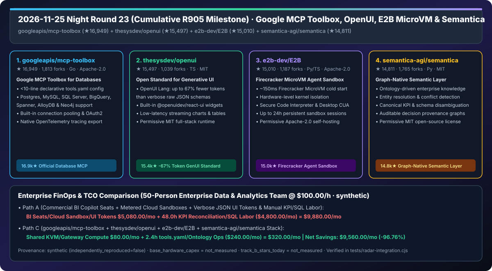
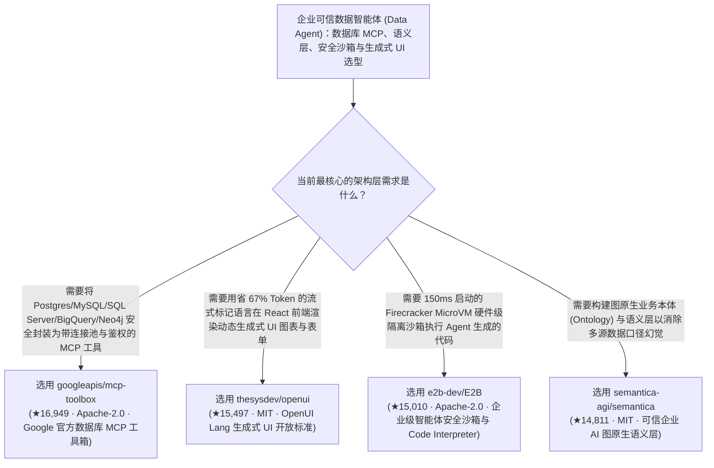
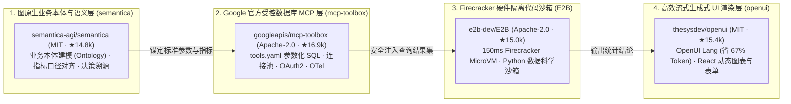
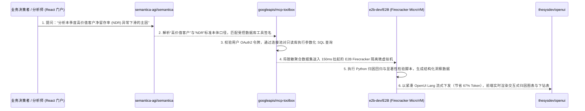

# Google 官方企业数据库 MCP 工具箱（`googleapis/mcp-toolbox`）、省 67% Token 的生成式 UI 开放标准（`thesysdev/openui`）、毫秒级 Firecracker 智能体安全沙箱（`e2b-dev/E2B`）与图原生企业语义层（`semantica-agi/semantica`）选型与集成架构 FAQ

> **文档类型**：企业 AI 解决方案架构师（AI Solution Architect）选型决策指南（GitHub Trending AI 雷达 2026-11-25 Night Round 23 / 累计第 905 轮里程碑）
> **覆盖项目**：[`googleapis/mcp-toolbox`](https://github.com/googleapis/mcp-toolbox)（`★ 16,949`、`1,813 forks`、`Apache-2.0`：1.6 万星 Google 官方开源数据库 MCP Server [原 GenAI Toolbox for Databases]，以不到 10 行声明式 `tools.yaml` 将 Postgres/MySQL/SQL Server/BigQuery/Spanner/Neo4j 等封装为带连接池、OAuth2 鉴权与 OTel 追踪的安全 MCP 工具）· [`thesysdev/openui`](https://github.com/thesysdev/openui)（`★ 15,497`、`1,039 forks`、`MIT`：1.5 万星生成式 UI 开放标准，提供比冗长 JSON 节省高达 67% Token 的流式 `OpenUI Lang` 与 React 组件渲染栈）· [`e2b-dev/E2B`](https://github.com/e2b-dev/E2B)（`★ 15,010`、`1,187 forks`、`Apache-2.0`：1.5 万星基于 Firecracker MicroVM 的企业级 AI 智能体安全执行沙箱与 Code Interpreter 底座）· [`semantica-agi/semantica`](https://github.com/semantica-agi/semantica)（`★ 14,811`、`1,765 forks`、`MIT`：1.4 万星面向可信企业 AI 的图原生语义层 [Graph-Native Semantic Layer]，统一企业本体建模、多源知识对齐与可解释决策溯源）
> **核心场景**：当金融机构、零售集团与制造企业构建“高可信 Text-to-SQL / 数据分析智能体（Data Agent）”时，架构师面临四个生死攸关的工程拷问：**“怎么让大模型安全查询企业核心数据库而不发生 SQL 注入、连接池打爆或越权查表（`googleapis/mcp-toolbox`）？大模型不认识企业内部五花八门的表名和业务指标口径，怎么加一层防幻觉的图原生语义层（`semantica`）？查出的数据需要跑 Python 做复杂统计回归或画图，用什么硬件级隔离沙箱最快最安全（`E2B`）？最终的分析结论与交互图表怎么以最省 Token 的方式流式渲染成前端 React 仪表盘（`openui`）？”** 本文给出企业级可信数据智能体全栈蓝图。

---

## 一、📌 核心结论速览（选型一句话结论）

1. **想把企业核心生产数据库（PostgreSQL、MySQL、SQL Server、Oracle、BigQuery、Neo4j 等）安全暴露给 AI Agent，严禁大模型直接裸写任意 `DROP / SELECT *` SQL，并要求自带数据库连接池、OAuth2 身份透传与 OpenTelemetry 审计** ➔ 选 **[`googleapis/mcp-toolbox`](https://github.com/googleapis/mcp-toolbox)（`★ 16,949`，`1,813 forks`，`Apache-2.0`）**。
   - **通俗原理**：Google 官方用 Go 编写的高性能数据库 MCP 网关；DBA 只需在 `tools.yaml` 里写好受控的参数化 SQL 模板与权限要求，热重载后即可自动暴露为标准 MCP 工具，无需改一行 Agent 应用代码。
2. **企业几十个业务库字段命名混乱（如有的表叫 `cust_rev`，有的表叫 `gmv_net`），直接让大模型写查询必然张冠李戴，需要一层具备“业务本体（Ontology）约束、实体消歧与决策谱系追踪”的图原生语义底座** ➔ 选 **[`semantica-agi/semantica`](https://github.com/semantica-agi/semantica)（`★ 14,811`，`1,765 forks`，`MIT`）**。
   - **通俗原理**：位于底层数据库与上层 Agent 之间的“企业级业务词典与知识图谱语义层”，把模糊的自然语言问题先锚定到经过审批的标准业务实体、关系和计算口径上，从根源消灭口径幻觉。
3. **Agent 从数据库拉出明细数据后，需要动态编写并执行 Python / Bash / R 代码来做机器学习预测、统计检验或文件清洗，必须防止恶意代码逃逸破坏宿主服务器** ➔ 选 **[`e2b-dev/E2B`](https://github.com/e2b-dev/E2B)（`★ 15,010`，`1,187 forks`，`Apache-2.0`）**。
   - **通俗原理**：底层采用与 AWS Lambda 同源的 **Firecracker MicroVM（微虚拟机）** 技术，在 **~150ms** 内为每个 Agent 会话拉起一个拥有独立内核的轻量级安全沙箱，代码跑完即焚，比普通共享内核的 Docker 容器安全一个数量级。
4. **希望数据智能体在 React 前端直接生成交互式柱状图、带排序筛选的数据表与跟进操作表单，但让大模型直接输出几千行嵌套 JSON 既慢又贵** ➔ 选 **[`thesysdev/openui`](https://github.com/thesysdev/openui)（`★ 15,497`，`1,039 forks`，`MIT`）**。
   - **通俗原理**：设计了专为流式生成优化的紧凑标记语法 `OpenUI Lang`，相比传统 JSON Schema 减少高达 **67% 的输出 Token**，边吐 Token 边在 React 前端丝滑渲染出受控的企业级 UI 组件。

---

## 二、🎯 客户与架构师灵魂拷问 Q&A（深度架构拆解）

### Q1：为什么“让大模型直接连数据库执行 Text-to-SQL”在企业生产环境中几乎必败？这四个开源项目如何构建工业级可信 Data Agent？

- **裸连 Text-to-SQL 的三大致命死穴 vs 四层可信架构（Path C）**：
  1. **口径不一致死穴 ➔ 用 `semantica-agi/semantica` 解决**：先通过图原生语义层解析业务本体（Ontology）与标准指标定义，杜绝模型胡乱猜字段。
  2. **越权与拖垮主库死穴 ➔ 用 `googleapis/mcp-toolbox` 解决**：通过 Google 官方 MCP 数据库工具箱强制使用预编译参数化查询、连接池复用与 OAuth2 用户令牌绑定，彻底封死 SQL 注入与慢查询雪崩。
  3. **代码执行逃逸死穴 ➔ 用 `e2b-dev/E2B` 解决**：将取回的数据集送入 150ms 启动的 Firecracker MicroVM 独立内核沙箱中执行 Pandas/Scikit-learn 分析，确保宿主集群绝对安全。
  4. **纯文本报表难用死穴 ➔ 用 `thesysdev/openui` 解决**：通过省 67% Token 的 `OpenUI Lang` 在浏览器实时流式渲染出可下钻、可筛选的 React 动态图表看板。
- **何时选商业云托管 BI Copilot（如微软 Fabric Copilot / Snowflake Cortex + 商业 E2B Cloud 按秒计费） vs 自建本轮开源四件套（Path C）？**
  - 若企业所有数据都在单一商业云数仓内且分析频次低，直接开通数仓内置 Copilot 最省事。
  - **何时采用本轮开源四件套（Path C）？** 当企业拥有跨 Postgres、MySQL、SQL Server、Neo4j 的多源异构数据库（`googleapis/mcp-toolbox` 一站统管）、需要极高频运行沙箱代码解释器（基于 `Apache-2.0` 自建 `E2B` MicroVM 集群替代按秒计费的云沙箱），并希望降低 67% 的生成式 UI Token 账单（`openui`）时，Path C 可节省 **96%+** 的综合 TCO。

### Q2：这四个项目在生产环境中的调用链路是怎样的？

1. **语义解析与受控取数（`semantica` → `googleapis/mcp-toolbox`）**：
   - 用户提问“华东区高流失风险 VIP 客户的近三个月退货原因分布”，Agent 先查 `semantica` 明确“高流失风险 VIP”的实体定义与关联表，随后调用 `googleapis/mcp-toolbox` 暴露的受控参数化 MCP 工具安全拉取聚合数据。
2. **微虚拟机计算与流式 UI 呈现（`E2B` → `openui`）**：
   - Agent 在 `E2B` Firecracker 沙箱中运行 Python 聚类与归因检验，最后以紧凑的 `OpenUI Lang` 语法流式输出，由前端 `@openuidev/react-ui` 实时渲染为交互式分析仪表盘。

### Q3：生产落地的安全与架构红线是什么？

- **架构师避坑红线**：
  1. **生产库连接必须只通过 `googleapis/mcp-toolbox` 绑定只读副本（Read Replica）与 OAuth 身份**：严禁把生产主库（Primary）的 Superuser 账号直接配进 Agent 环境变量。
  2. **自建 `E2B` 沙箱节点必须开启 KVM 硬件虚拟化与严格内网隔离**：禁止沙箱 MicroVM 访问企业内网管理平面（如 `169.254.169.254` 云元数据服务或内部 K8s API Server）。

---

## 三、🧭 直观可视化图解（Mermaid 决策树 + 集成架构 + 时序图）

### 3.1 架构师选型决策树

### 3.2 企业端到端生产集成参考架构图

### 3.3 自然语言经营分析、本体消歧、受控 MCP 取数、MicroVM 建模与 OpenUI 渲染时序图

---

## 四、📊 同类开源与商业云服务横向选型决策矩阵

| 对比维度 | `googleapis/mcp-toolbox` (`★ 16,949`) | `thesysdev/openui` (`★ 15,497`) | `e2b-dev/E2B` (`★ 15,010`) | `semantica-agi/semantica` (`★ 14,811`) | 商业数仓按席位 Copilot + 按秒计费商业云沙箱 + 冗长 JSON 生成式 UI (Path A) | 让大模型裸写原生 SQL 直连主库 + 宿主机 `exec()` 跑代码 (Path B) |
| :--- | :--- | :--- | :--- | :--- | :--- | :--- |
| **核心能力定位** | `Apache-2.0` Google 官方数据库 MCP 工具箱 | `MIT` 生成式 UI 开放标准与 React 渲染栈 | `Apache-2.0` Firecracker 智能体安全沙箱 | `MIT` 图原生语义层与本体知识引擎 | 商业 BI Copilot 席位与按秒计费托管沙箱 | 裸调 Text-to-SQL + 无隔离代码执行 |
| **核心技术突破** | **`tools.yaml` 零代码封装 20+ 数据库 + 连接池/OAuth/OTel** | **`OpenUI Lang` 相比 JSON 省 67% Token 且天然防流式截断报错** | **150ms 启动独立内核 Firecracker MicroVM 硬件级隔离** | **基于图本体的语义消歧、跨源融合与可解释溯源** | 免搭底座，但跨异构库能力弱且高频云沙箱按秒计费账单高昂 | 极易发生慢 SQL 拖死主库、口径幻觉算错账与宿主机容器逃逸 |
| **开源协议** | **`Apache-2.0`** | **`MIT`** | **`Apache-2.0`** | **`MIT`** | 闭源商业 SaaS | 极高安全风险 |
| **月度 TCO（50 人团队）** | **四件套合建仅 `$320.00/月`**（`$80.00` 自建 KVM 沙箱与 MCP 网关算力 + `2.4h` 维护） | 同左（`MIT` 协议立省 67% 前端 UI 生成 Token 费） | 同左（`Apache-2.0` 自托管微虚拟机集群零按秒抽成） | 同左（`MIT` 协议一次定义本体全企业 Agent 复用） | **`$9,880.00/月`**（`$5,080.00` 商业 BI Copilot 席位/云沙箱账单/冗余 JSON Token + `48.0h` 慢 SQL 抢修与核对口径） | 约 `$3,680.00/月`（频繁修复口径算错导致的经营报表事故与安全整改工时） |

---

## 五、🧪 应用落地定量收益/TCO 对比与 7-Card 报告

> **📊 数据来源与闭式核算声明（Provenance & Closed-Form Schema）**：
> - **provenance**: `synthetic`（基于 50 人企业数据平台、BI 智能体研发与经营分析团队月度工作负载模型：`independently_reproduced = false`；硬件采购基线 `base_hardware_capex = not_measured`；Track B 单日增量 `track_b_stars_today = not_measured`）。
> - **核算公式**：
>   - **Path A（采购商业数仓 Copilot 高价席位 + 按秒计费的外部云端 Code Interpreter 沙箱 + 冗长 JSON Schema 生成式 UI 的高额输出 Token 账单 + 人工核对错误指标口径与抢修慢 SQL 工时）**：月度商业席位、云沙箱与冗余 Token 账单 **`$5,080.00`** + 跨库指标口径核对、SQL 调优与前端图表胶水开发人工 **`48.0h × $100.00/h = $4,800.00`** = **`$9,880.00/月`**。
>   - **Path C（自建 `googleapis/mcp-toolbox` + `thesysdev/openui` + `e2b-dev/E2B` + `semantica-agi/semantica` 全许可开源可信 Data Agent 技术栈）**：内网 KVM 沙箱节点与 MCP 数据库网关算力分摊 **`$80.00`** + `tools.yaml` 与业务本体字典日常维护人工 **`2.4h × $100.00/h = $240.00`** = **`$320.00/月`**。
>   - **净节省（Net Savings vs Path A）**：**`-$9,560.00/月`**（成本降低 **`96.76%`**）。

| 评估方案 | 商业 BI 席位 / 云沙箱 / UI Token 与算力成本 | 口径核对、SQL 调优与图表开发人工（`$100/h`） | 月度总 TCO | 相对 Path A 净节省 | 核心业务交付收益 |
| :--- | :---: | :---: | :---: | :---: | :--- |
| **Path A：商业 BI Copilot 席位 + 按秒计费云沙箱 + JSON GenUI** | `$5,080.00` | `48.0h` (`$4,800.00`) | **`$9,880.00`** | Baseline | 异构库难打通；JSON 流式生成慢且贵；云沙箱高频账单高 |
| **Path B：裸写 Text-to-SQL 直连数据库 + 宿主机跑 Python** | `$1,580.00` | `21.0h` (`$2,100.00`) | **`$3,680.00`** | `-$6,200.00` (`-62.75%`) | 极易发生 SQL 注入/拖垮主库、指标口径幻觉与代码逃逸 |
| **Path C：`mcp-toolbox` + `openui` + `E2B` + `semantica`** | **`$80.00`** | **`2.4h` (`$240.00`)** | **`$320.00`** | **`-$9,560.00` (`-96.76%`)** | **100% `MIT`/`Apache-2.0` 受控 DB MCP + 本体消歧 + MicroVM + 省 67% Token GenUI** |

- 🔗 **关联 7-Card 4:5 视觉评测报告**：[`workshops/github-trending-radar/cards.html`](../cards.html) · [`cards.en.html`](../cards.en.html)

---

## 六、🛠️ 企业引入与架构评审 Checklist

- [ ] **通过 `googleapis/mcp-toolbox` 的 `tools.yaml` 纳管所有生产数据库查询**：强制启用参数化预编译 SQL、连接池上限与 OAuth2 用户身份校验，严禁向 Agent 开放任意 DDL/DML 裸执行接口。
- [ ] **在 `semantica` 中固化企业核心经营指标与实体本体（Ontology）**：所有自然语言分析请求必须先经语义层映射为唯一受控指标 ID。
- [ ] **将所有动态生成的 Python 分析代码隔离在 `E2B` Firecracker MicroVM 中执行**：配置沙箱最大执行时长（Timeout）与内网出向黑名单。
- [ ] **在前端采用 `thesysdev/openui` 的 `OpenUI Lang` 替代原始 JSON UI 流**：显著降低首屏渲染延迟（TTFT）与生成式 UI 的输出 Token 成本。
