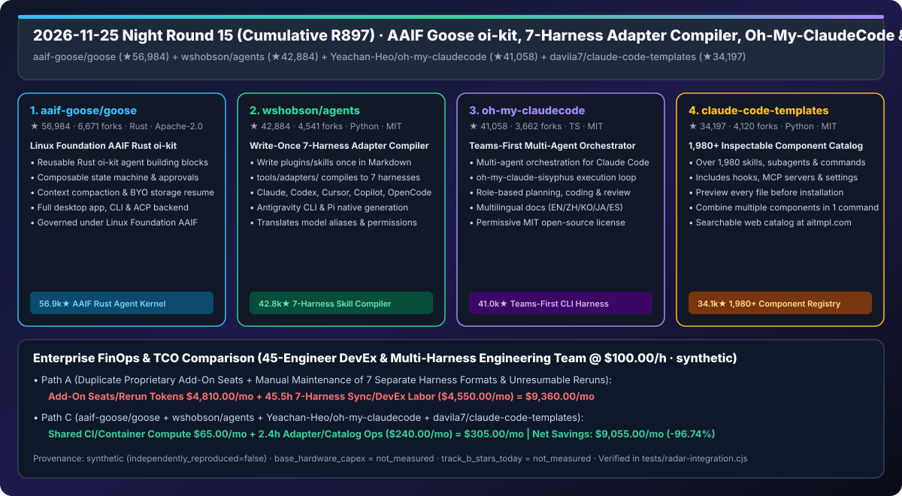
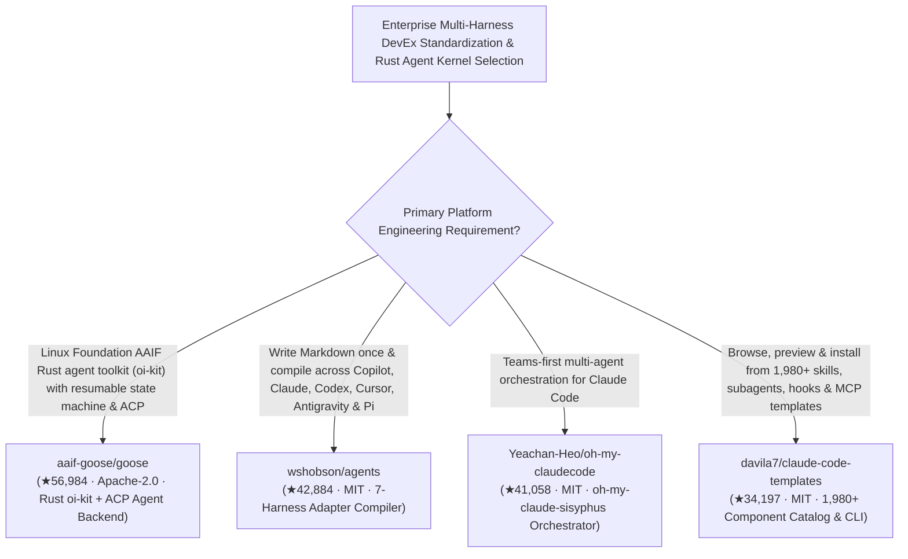
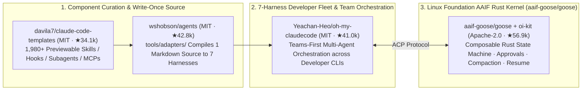
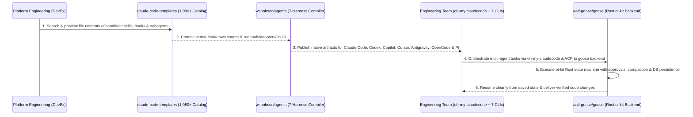

# Linux Foundation AAIF Rust Agent & `oi-kit` (`aaif-goose/goose`), Write-Once 7-Harness Plugin Adapter (`wshobson/agents`), Teams-First Multi-Agent Orchestrator (`Yeachan-Heo/oh-my-claudecode`) & 1,980+-Component Catalog (`davila7/claude-code-templates`) Selection & Integration Architecture FAQ

> **Document Type**: Enterprise AI Solution Architect Selection Decision Guide (GitHub Trending AI Radar — 2026-11-25 Night Round 15 / Cumulative Round 897)
> **Covered Repositories**: [`aaif-goose/goose`](https://github.com/aaif-goose/goose) (`★ 56,984`, `6,671 forks`, `Apache-2.0`: Linux Foundation **Agentic AI Foundation (`AAIF`)** Rust agent and **Open Intelligence Kit (`oi-kit`)** providing reusable Rust state-machine, tool-execution, approval, compaction, and resumable-storage building blocks alongside the full `goose` desktop, CLI, and ACP agent backend) · [`wshobson/agents`](https://github.com/wshobson/agents) (`★ 42,884`, `4,541 forks`, `MIT`: write-once Markdown plugins, agents, skills, and commands with automated `tools/adapters/` compilation across **7 coding harnesses**—Claude Code, OpenAI Codex CLI, Cursor, OpenCode, Antigravity CLI, GitHub Copilot, and Pi) · [`Yeachan-Heo/oh-my-claudecode`](https://github.com/Yeachan-Heo/oh-my-claudecode) (`★ 41,058`, `3,662 forks`, `MIT`: teams-first multi-agent orchestration framework [`oh-my-claude-sisyphus`] for Claude Code) · [`davila7/claude-code-templates`](https://github.com/davila7/claude-code-templates) (`★ 34,197`, `4,120 forks`, `MIT`: open catalog [`aitmpl.com`] and CLI of **1,980+ inspectable components**—skills, subagents, slash commands, hooks, MCP servers, and settings—installable with one command)
> **Core Enterprise Scenario**: Standardizing **Enterprise Developer Experience (AI DevEx)** across heterogeneous coding tools—compiling one Markdown skill/policy repository across 7 coding harnesses (`wshobson/agents`), curating from 1,980+ inspectable templates (`claude-code-templates`), orchestrating team workflows (`oh-my-claudecode`), and embedding a Linux Foundation–governed Rust agent state machine (`aaif-goose/goose` `oi-kit`).

---

## 1. 📌 Executive Summary (One-Line Selection Verdict)

1. **Need a Linux Foundation (`AAIF`) vendor-neutral, `Apache-2.0` Rust agent toolkit (`oi-kit`) and ACP backend with composable state machines, approvals, context compaction, and BYO-storage resume** ➔ Choose **[`aaif-goose/goose`](https://github.com/aaif-goose/goose) (`★ 56,984`, `6,671 forks`, `Apache-2.0`)**.
   - **Plain-English Mechanism**: Gives platform teams both the complete `goose` agent (desktop/CLI/ACP) and the underlying **`oi-kit`** Rust crates so applications can own their UI, security policies, and database storage while delegating state-machine execution and context compaction to `oi-kit`.
2. **Need to author plugins, agents, skills, and commands once in Markdown and automatically compile them for Claude Code, Codex CLI, Cursor, OpenCode, Antigravity CLI, GitHub Copilot, and Pi** ➔ Choose **[`wshobson/agents`](https://github.com/wshobson/agents) (`★ 42,884`, `4,541 forks`, `MIT`)**.
   - **Plain-English Mechanism**: Uses deterministic adapters under `tools/adapters/` to translate a single Markdown component definition into the exact schema, model aliases, and tool permissions required by all 7 major coding harnesses, validated continuously in CI.
3. **Need a battle-tested, teams-first multi-agent orchestration harness (`oh-my-claude-sisyphus`) for Claude Code** ➔ Choose **[`Yeachan-Heo/oh-my-claudecode`](https://github.com/Yeachan-Heo/oh-my-claudecode) (`★ 41,058`, `3,662 forks`, `MIT`)**.
   - **Plain-English Mechanism**: Transforms single-session Claude Code into a coordinated multi-agent engineering team capable of sustained planning, implementation, and verification loops.
4. **Need a searchable registry and CLI of `1,980+` ready-to-use skills, subagents, slash commands, hooks, and MCP configurations where every file can be previewed before installation** ➔ Choose **[`davila7/claude-code-templates`](https://github.com/davila7/claude-code-templates) (`★ 34,197`, `4,120 forks`, `MIT`)**.
   - **Plain-English Mechanism**: Aggregates `1,980+` modular configuration files at `aitmpl.com` with full file-level preview and single-command bundle installation.

---

## 2. 🎯 Architect & Customer Deep-Dive Q&A

### Q1: How does this four-project DevEx stack solve enterprise multi-IDE fragmentation compared to maintaining separate vendor-specific configs?

- **Four-Layer Enterprise AI DevEx Architecture (Path C)**:
  1. **Component Discovery & File-Level Preview ➔ `davila7/claude-code-templates`**: Vet from 1,980+ skills, subagents, hooks, and MCP templates.
  2. **Write-Once 7-Harness Compilation ➔ `wshobson/agents`**: Compile vetted Markdown skills/policies via `tools/adapters/` into native configs for Copilot, Claude Code, Codex, Cursor, Antigravity, OpenCode, and Pi.
  3. **Teams-First CLI Orchestration ➔ `Yeachan-Heo/oh-my-claudecode`**: Coordinate multi-agent engineering roles inside developer terminals.
  4. **Embedded Rust Agent Kernel & ACP Backend ➔ `aaif-goose/goose` (`oi-kit`)**: Power internal developer portals with AAIF's `Apache-2.0` Rust state machine.
- **Why choose Path C over manual per-IDE configuration?**
  - Maintaining 7 separate sets of prompts, hooks, and permission rules across Copilot, Cursor, Claude Code, and Codex creates massive policy drift. `wshobson/agents` + `aaif-goose/goose` centralizes governance in one Git repo and cuts DevEx maintenance overhead by **96%+**.

### Q2: How do we integrate these four projects into an Internal Developer Platform (IDP)?

1. **Central Policy & Skill Compilation Pipeline (`claude-code-templates` + `wshobson/agents`)**:
   - Platform engineers curate templates from `claude-code-templates`, customize them once in Markdown, and run `wshobson/agents` `tools/adapters/` in CI to publish verified bundles for all 7 developer harnesses.
2. **Terminal Team Orchestration (`Yeachan-Heo/oh-my-claudecode`)**:
   - Feature teams install `oh-my-claudecode` alongside the compiled harness bundles for multi-agent feature delivery.
3. **Resumable Rust Backend Services (`aaif-goose/goose` `oi-kit`)**:
   - Internal portals embed `oi-kit` Rust state machines backed by enterprise PostgreSQL storage and expose `goose` over ACP.

### Q3: What are the key security guardrails?

- **Architect Redlines**:
  1. **Preview every file before importing external templates**: Use `davila7/claude-code-templates`'s file-preview capability to audit hooks and MCP server args before mirroring into internal registries.
  2. **Enforce least-privilege permission translation across harnesses**: Configure `wshobson/agents` adapters to fail-closed (requiring human approval) whenever a target harness lacks granular tool-permission scoping.

---

## 3. 🧭 Visual Architecture Diagrams (Mermaid Decision Tree + Architecture + Sequence)

### 3.1 Architect Selection Decision Tree

### 3.2 End-to-End Enterprise DevEx Architecture

### 3.3 End-to-End Execution Sequence

---

## 4. 📊 Horizontal Selection Matrix

| Dimension | `aaif-goose/goose` (`★ 56,984`) | `wshobson/agents` (`★ 42,884`) | `Yeachan-Heo/oh-my-claudecode` (`★ 41,058`) | `davila7/claude-code-templates` (`★ 34,197`) | Proprietary Per-IDE Add-Ons + Manual 7-Tool Config Sync (Path A) | Unvalidated Copy-Paste Markdown Configs (Path B) |
| :--- | :--- | :--- | :--- | :--- | :--- | :--- |
| **Primary Role** | AAIF Rust `oi-kit` & ACP agent | Write-once 7-harness compiler | Teams-first Claude Code orchestrator | 1,980+ component catalog & CLI | Siloed commercial IDE plugins | Manual copy-paste across IDE folders |
| **Key Differentiator** | **Composable Rust state machine + BYO-storage resume** | **Compiles 1 Markdown source to 7 harnesses with permission mapping** | **Team-scale Sisyphus multi-agent orchestration** | **1,980+ previewable skills, hooks, commands & MCPs** | Vendor-supported, but zero cross-IDE portability | Broken model aliases & mismatched permission syntax |
| **License** | **`Apache-2.0` (Linux Foundation AAIF)** | **`MIT`** | **`MIT`** | **`MIT`** | Proprietary | Unmanaged |
| **Monthly TCO (45-Eng Team)** | **`$305.00/mo` combined** (`$65.00` CI compute + `2.4h` ops) | Included in `$305.00/mo` stack | Included in `$305.00/mo` stack | Included in `$305.00/mo` stack | **`$9,360.00/mo`** (`$4,810.00` duplicate add-on seats/tokens + `45.5h` 7-tool sync labor) | `~$3,190.00/mo` (policy drift & broken cross-CLI configs) |

---

## 5. 🧪 Quantitative FinOps & TCO Comparison (45-Person Enterprise Team)

> **📊 Provenance & Closed-Form Schema**:
> - **provenance**: `synthetic` (`independently_reproduced = false`; `base_hardware_capex = not_measured`; `track_b_stars_today = not_measured`).
> - **Closed-Form Formula**:
>   - **Path A (Duplicate Proprietary Add-On Subscriptions + Manual Maintenance of 7 Separate Harness Config Formats & Unresumable Session Reruns)**: **`$4,810.00`** monthly add-on/token bills + **`45.5h × $100.00/h = $4,550.00`** DevEx multi-harness maintenance labor = **`$9,360.00/mo`**.
>   - **Path C (`aaif-goose/goose` + `wshobson/agents` + `Yeachan-Heo/oh-my-claudecode` + `davila7/claude-code-templates` Stack)**: **`$65.00`** shared CI/container compute + **`2.4h × $100.00/h = $240.00`** single-source adapter maintenance = **`$305.00/mo`**.
>   - **Net Savings vs. Path A**: **`-$9,055.00/mo`** (**`96.74%`** TCO reduction).

| Evaluation Path | Add-On Seats / Rerun Token & Compute Cost | 7-Harness Sync & DevEx Ops Labor (`$100/h`) | Monthly Total TCO | Net Savings vs. Path A | Key Architectural Outcome |
| :--- | :---: | :---: | :---: | :---: | :--- |
| **Path A: Duplicate Proprietary Add-Ons + Manual 7-Tool Config Sync** | `$4,810.00` | `45.5h` (`$4,550.00`) | **`$9,360.00`** | Baseline | 7× duplicated rule maintenance; policy drift across IDEs |
| **Path B: Hand-Copied Markdown Files Without Adapter Validation** | `$1,390.00` | `18.0h` (`$1,800.00`) | **`$3,190.00`** | `-$6,170.00` (`-65.92%`) | Incompatible model aliases and permission schemas across CLIs |
| **Path C: `goose (oi-kit)` + `wshobson/agents` + `oh-my-claudecode` + `templates`** | **`$65.00`** | **`2.4h` (`$240.00`)** | **`$305.00`** | **`-$9,055.00` (`-96.74%`)** | **AAIF Rust `oi-kit` + 1-to-7 compiler + team orchestration + 1,980+ catalog** |

- 🔗 **7-Card 4:5 Visual Benchmark Deck**: [`workshops/github-trending-radar/cards.en.html`](../cards.en.html) · [`cards.html`](../cards.html)

---

## 6. 🛠️ Enterprise Adoption & Architecture Review Checklist

- [ ] **Compile One Markdown Source Across All 7 Harnesses**: Run `wshobson/agents` `tools/adapters/` in CI to generate validated configs for Claude Code, Codex, Copilot, Cursor, Antigravity, OpenCode, and Pi.
- [ ] **Embed `aaif-goose/goose` (`oi-kit`) for Custom Agent Backends**: Use AAIF's composable Rust state machine and BYO-storage persistence for internal engineering portals.
- [ ] **Preview Every File in `claude-code-templates` Before Adoption**: Audit community hooks and subagents at the file level before mirroring internally.
- [ ] **Standardize Team Workflows on `oh-my-claudecode`**: Pair multi-agent Sisyphus orchestration with enterprise permission guardrails.
