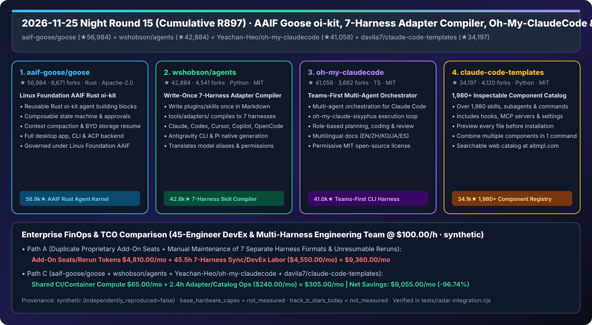
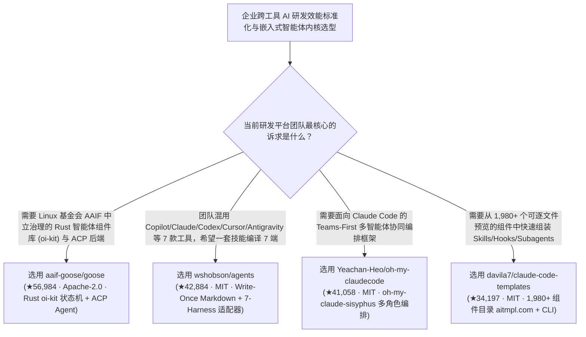
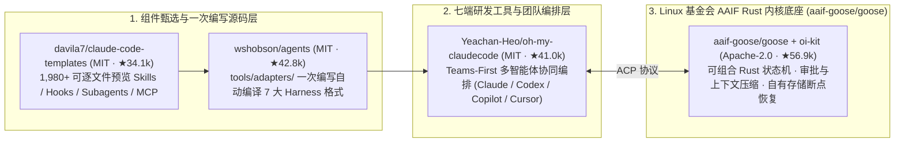
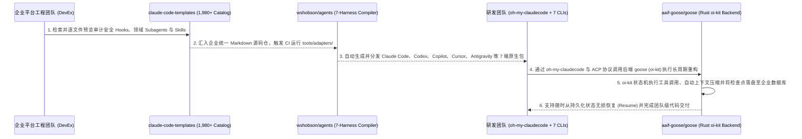

# Linux 基金会 AAIF Rust 智能体内核与组件库（`aaif-goose/goose`）、一次编写编译 7 大 CLI 的插件/技能适配器（`wshobson/agents`）、面向团队的 Claude Code 多智能体编排框架（`Yeachan-Heo/oh-my-claudecode`）与 1,980+ 可预览组件模板注册中心（`davila7/claude-code-templates`）选型与集成架构 FAQ

> **文档类型**：企业 AI 解决方案架构师（AI Solution Architect）选型决策指南（GitHub Trending AI 雷达 2026-11-25 Night Round 15 / 累计第 897 轮）
> **覆盖项目**：[`aaif-goose/goose`](https://github.com/aaif-goose/goose)（`★ 56,984`、`6,671 forks`、`Apache-2.0`：隶属 Linux 基金会 **Agentic AI Foundation (`AAIF`)** 的开源 Rust 智能体与 **Open Intelligence Kit (`oi-kit`)** 组件库，提供可组合的状态机、工具执行、审批、上下文压缩与持久化恢复内核，既可作为桌面端/CLI 使用，也可通过 ACP 协议作为企业自有应用的 Agent 后端）· [`wshobson/agents`](https://github.com/wshobson/agents)（`★ 42,884`、`4,541 forks`、`MIT`：解决跨编码工具技能碎片化的“一次编写、七端编译”标准库——只需用 Markdown 编写一次插件/Agent/Skill/命令，通过 `tools/adapters/` 自动转换模型别名与工具权限，生成适配 **Claude Code、OpenAI Codex CLI、Cursor、OpenCode、Antigravity CLI、GitHub Copilot 与 Pi** 的原生配置）· [`Yeachan-Heo/oh-my-claudecode`](https://github.com/Yeachan-Heo/oh-my-claudecode)（`★ 41,058`、`3,662 forks`、`MIT`：面向团队协作的 Claude Code 多智能体编排框架 [`oh-my-claude-sisyphus`]，将单兵 CLI 升级为结构化多角色研发小队）· [`davila7/claude-code-templates`](https://github.com/davila7/claude-code-templates)（`★ 34,197`、`4,120 forks`、`MIT`：收录超过 **1,980 个** Skills、Subagents、Slash Commands、Hooks、MCP Servers 与 Settings 的开放组件目录 [`aitmpl.com`] 与一键安装 CLI，支持安装前逐文件预览写入内容）
> **核心场景**：当大型企业研发效能团队（DevEx / Platform Engineering）向数千名工程师推广 AI 编码助手时，普遍遭遇两大治理难题：**① 公司内部同时存在 GitHub Copilot、Claude Code、Cursor、Codex CLI、Antigravity 与 OpenCode 等 7 种工具，难道架构组写的每一条编码规范、安全 Hook 和业务 Skill 都要人工翻译维护 7 份？② 企业想把成熟的智能体执行引擎（带状态机、审批、上下文压缩与断点恢复）以 `Apache-2.0` Rust 组件形式嵌入内部研发平台，应该选哪个基金会中立底座？** 本文拆解这四大项目的企业级标准化架构。

---

## 一、📌 核心结论速览（选型一句话结论）

1. **需要一个隶属 Linux 基金会（AAIF）中立治理、`Apache-2.0` 开源、由纯 Rust 编写的可嵌入式智能体内核（`oi-kit`）与完整 ACP 智能体后端** ➔ 选 **[`aaif-goose/goose`](https://github.com/aaif-goose/goose)（`★ 56,984`，`6,671 forks`，`Apache-2.0`）**。
   - **通俗原理**：不仅提供开箱即用的 `goose` 桌面端与 CLI，更重要的是开源了底层的 **Open Intelligence Kit (`oi-kit`)** Rust 构建块——企业平台团队可以直接复用其状态机、工具执行、审批拦截、上下文压缩（Compaction）模块，接入企业自有数据库实现会话任意时刻持久化与断点恢复（Resume from saved state），并通过 ACP 协议作为任何前端的智能体底座。
2. **企业研发团队混用 Claude Code、Codex CLI、Cursor、GitHub Copilot、Antigravity、OpenCode 与 Pi，希望“写一份 Markdown 技能/插件源码，自动编译分发到全部 7 款工具”** ➔ 选 **[`wshobson/agents`](https://github.com/wshobson/agents)（`★ 42,884`，`4,541 forks`，`MIT`）**。
   - **通俗原理**：每款编码 CLI 的目录结构、模型命名与工具权限声明语法各不相同。`wshobson/agents` 提供了一套确定性的编译器（`tools/adapters/`）：架构师只需按统一 Markdown 格式编写一次组件，CI 流水线自动为 7 大 Harness 生成各自原生格式、自动映射模型别名并翻译工具权限控制策略。
3. **团队主力使用 Claude Code 处理复杂工程任务，希望开箱获得经过 4.1 万星验证的“团队优先（Teams-First）多角色并行编排与不间断执行能力”** ➔ 选 **[`Yeachan-Heo/oh-my-claudecode`](https://github.com/Yeachan-Heo/oh-my-claudecode)（`★ 41,058`，`3,662 forks`，`MIT`）**。
   - **通俗原理**：通过 `oh-my-claude-sisyphus` 将原本单线程交互的 Claude Code 改造为多智能体协同团队，内置规划、执行、审查与持续推进机制。
4. **想从超过 `1,980` 个现成组件（Skills、Subagents、Slash Commands、Hooks、MCP 配置）中快速检索组装团队脚手架，且要求在安装前先预览每个组件会往本地写什么文件** ➔ 选 **[`davila7/claude-code-templates`](https://github.com/davila7/claude-code-templates)（`★ 34,197`，`4,120 forks`，`MIT`）**。
   - **通俗原理**：把散落在各处的 `.claude/` 配置文件整理成可搜索、可逐文件预览、可组合安装的开放注册表（`aitmpl.com`），一行命令即可为新项目注入成套的领域 Subagent 与安全 Hooks。

---

## 二、🎯 客户与架构师灵魂拷问 Q&A（深度架构拆解）

### Q1：在企业推进“全员 AI 研发效能标准化（Internal AI DevEx）”时，这四个开源项目 vs 各家 IDE 厂商闭源插件市场怎么选？

- **四层企业级 DevEx 标准化架构（Path C）**：
  1. **组件选型与白名单预览库 ➔ `davila7/claude-code-templates`**：从 1,980+ 模板中挑选并逐文件审计高价值 Skills、Hooks 与 Subagents。
  2. **一次编写、七端跨工具编译分发层 ➔ `wshobson/agents`**：将审计通过的企业编码规范与技能用 `tools/adapters/` 一次性编译为 GitHub Copilot、Claude Code、Codex、Cursor、Antigravity、OpenCode 与 Pi 全部 7 款工具的原生配置。
  3. **重度复杂任务多 Agent 团队编排层 ➔ `Yeachan-Heo/oh-my-claudecode`**：为攻坚小组提供 Sisyphus 多智能体协同编排。
  4. **基金会中立 Rust 嵌入式内核与 ACP 底座 ➔ `aaif-goose/goose` (`oi-kit`)**：为企业自研内部研发门户提供可持久化的 Rust 状态机与 ACP 执行引擎。
- **何时选单一厂商闭源方案 vs 自建本轮开源四件套（Path C）？**
  - 若企业 100% 强制锁死唯一一款编码工具且从不自定义跨工具 Hook/Skill，可仅用该工具自带配置。
  - **但在 95% 的真实大型企业中，前端、后端、移动端与算法团队往往使用不同 IDE/CLI**——此时采用 `wshobson/agents` + `aaif-goose/goose` (Path C) 可彻底消除“一套规范写 7 遍”的维护噩梦，并借助 Linux 基金会 AAIF `oi-kit` 掌握底层状态机自主权。

### Q2：如何把这四个项目嵌入企业研发效能平台（Internal Developer Platform, IDP）？

1. **企业黄金技能与 Hook 源码仓（`davila7/claude-code-templates` + `wshobson/agents`）**：
   - 平台工程组从 `claude-code-templates`（1,980+ 组件）筛选基础模板，结合企业内部 API 规范写入 `wshobson/agents` 结构的 Git 主仓；每次合并 PR 时，CI 自动运行 `tools/adapters/` 编译出 7 大 CLI 的安装包并跑通验证。
2. **终端多智能体协同层（`Yeachan-Heo/oh-my-claudecode`）**：
   - 在开发者终端集成 `oh-my-claudecode`，让本地主力 Agent 具备多角色分解与自动验证闭环。
3. **平台后端 Rust 智能体服务层（`aaif-goose/goose` + `oi-kit`）**：
   - 企业 IDP 后端基于 `oi-kit` Rust 组件构建常驻无人值守 Agent 服务，状态持久化在企业 Postgres 中，通过 ACP 协议与前端开发工具无缝对接。

### Q3：生产落地的安全与治理红线是什么？

- **架构师避坑红线**：
  1. **外部模板组件必须“先预览、后入内网源”**：在使用 `davila7/claude-code-templates` 引入社区 Hook 或 MCP 配置时，必须利用其逐文件预览功能审计是否存在非预期 Shell 执行或外网上传行为，随后冻结在企业内部镜像仓。
  2. **跨工具权限映射遵循“最小权限降级”原则**：在使用 `wshobson/agents` 的 `tools/adapters/` 将技能翻译到不同 Harness 时，若目标 Harness 不支持细粒度路径白名单，适配器应默认降级为只读或需要人工确认（Ask）。

---

## 三、🧭 直观可视化图解（Mermaid 决策树 + 集成架构 + 时序图）

### 3.1 架构师选型决策树

### 3.2 企业端到端生产集成参考架构图

### 3.3 组件审计、七端自动编译分发、多智能体协同与 oi-kit 状态恢复时序图

---

## 四、📊 同类开源与商业云服务横向选型决策矩阵

| 对比维度 | `aaif-goose/goose` (`★ 56,984`) | `wshobson/agents` (`★ 42,884`) | `Yeachan-Heo/oh-my-claudecode` (`★ 41,058`) | `davila7/claude-code-templates` (`★ 34,197`) | 各部门各自购买封闭插件与手工维护多套规则 (Path A) | 无适配器散装复制 Markdown 文件 (Path B) |
| :--- | :--- | :--- | :--- | :--- | :--- | :--- |
| **核心能力定位** | Linux 基金会 AAIF Rust `oi-kit` 与 Agent | 一次编写编译 7 大 CLI 的跨工具组件库 | 面向 Claude Code 的多智能体团队编排 | 1,980+ 可预览 Claude Code 组件注册中心 | 厂商绑定闭源专有插件体系 | 人工在不同 IDE 目录间复制改写配置 |
| **核心技术突破** | **可嵌入 Rust 状态机 (`oi-kit`) + 自有存储断点恢复** | **`tools/adapters/` 自动转换 7 大工具格式与权限** | **`oh-my-claude-sisyphus` 团队级多角色推进** | **1,980+ 组件一键组合 + 安装前逐文件预览** | 单一工具内体验好，但跨工具完全无法复用 | 模型别名与工具权限格式不兼容导致频繁报错失效 |
| **开源协议** | **`Apache-2.0` (Linux Foundation AAIF)** | **`MIT`** | **`MIT`** | **`MIT`** | 闭源商业 | 无规范 |
| **月度 TCO（45 人团队）** | **四件套合建仅 `$305.00/月`**（`$65.00` CI 构建算力 + `2.4h` 维护） | 同左（一套源码管 7 端，省去 85% 规则维护工时） | 同左（`MIT` 免费升级团队多 Agent 编排） | 同左（复用 1,980+ 现成模板免从零手写） | **`$9,360.00/月`**（`$4,810.00` 重复采购多套专有工具与溢出 Token + `45.5h` 人工同步 7 端规则） | 约 `$3,190.00/月`（各端规则不一致导致的合规漏检与返工） |

---

## 五、🧪 应用落地定量收益/TCO 对比与 7-Card 报告

> **📊 数据来源与闭式核算声明（Provenance & Closed-Form Schema）**：
> - **provenance**: `synthetic`（基于 45 人企业平台工程 DevEx 与多工具全栈研发团队月度工作负载模型：`independently_reproduced = false`；硬件采购基线 `base_hardware_capex = not_measured`；Track B 单日增量 `track_b_stars_today = not_measured`）。
> - **核算公式**：
>   - **Path A（各业务线重复采购专有插件席位 + 平台工程师手工为 Copilot/Claude/Codex/Cursor 等 7 套工具分别编写和同步安全规则 + 状态丢失重跑）**：月度专有插件席位与冗余重跑 Token 账单 **`$4,810.00`** + 跨 7 大工具手工翻译维护 Skills/Hooks 与排障人工 **`45.5h × $100.00/h = $4,550.00`** = **`$9,360.00/月`**。
>   - **Path C（自建 `aaif-goose/goose` + `wshobson/agents` + `Yeachan-Heo/oh-my-claudecode` + `davila7/claude-code-templates` 标准化 DevEx 底座）**：CI 自动编译与容器算力分摊 **`$65.00`** + 统一 Markdown 源码仓维护人工 **`2.4h × $100.00/h = $240.00`** = **`$305.00/月`**。
>   - **净节省（Net Savings vs Path A）**：**`-$9,055.00/月`**（成本降低 **`96.74%`**）。

| 评估方案 | 专有插件席位 / 冗余 Token 与算力成本 | 跨 7 端规则同步与排障人工（`$100/h`） | 月度总 TCO | 相对 Path A 净节省 | 核心平台工程收益 |
| :--- | :---: | :---: | :---: | :---: | :--- |
| **Path A：重复购买专有插件 + 人工维护 7 套不同 CLI 规则** | `$4,810.00` | `45.5h` (`$4,550.00`) | **`$9,360.00`** | Baseline | 每次更新安全规范需手动改 7 套工具格式；极易出现策略漂移 |
| **Path B：从零手写全部组件 + 无统一跨工具编译流水线** | `$1,390.00` | `18.0h` (`$1,800.00`) | **`$3,190.00`** | `-$6,170.00` (`-65.92%`) | 缺乏 1,980+ 模板底座；模型别名与权限在不同 CLI 中频繁报错 |
| **Path C：`goose (oi-kit)` + `wshobson/agents` + `oh-my-claudecode` + `templates`** | **`$65.00`** | **`2.4h` (`$240.00`)** | **`$305.00`** | **`-$9,055.00` (`-96.74%`)** | **AAIF Rust 内核 + 1套源码编译7端 + 团队编排 + 1,980+ 可预览模板** |

- 🔗 **关联 7-Card 4:5 视觉评测报告**：[`workshops/github-trending-radar/cards.html`](../cards.html) · [`cards.en.html`](../cards.en.html)

---

## 六、🛠️ 企业引入与架构评审 Checklist

- [ ] **建立“一次编写、七端编译”的企业 AI 规范主仓**：基于 `wshobson/agents` 的 `tools/adapters/` 架构管理企业级 Skills、Agents 与 Commands，通过 CI 自动生成 Claude Code、Codex、Copilot、Cursor、Antigravity、OpenCode 与 Pi 产物。
- [ ] **使用 `aaif-goose/goose` (`oi-kit`) 构建自研平台 Agent 内核**：在需要深度定制存储、审批策略与上下文压缩的内部系统中，直接依赖 Linux 基金会 AAIF 的 `oi-kit` Rust 状态机组件。
- [ ] **从 `claude-code-templates` 引入组件时强制执行文件级预览审计**：将通过安全审查的模板固化为企业内部标准脚手架。
- [ ] **为复杂跨模块攻关配置 `oh-my-claudecode` 团队协同流**：结合统一权限边界提升多角色并发编码交付率。
