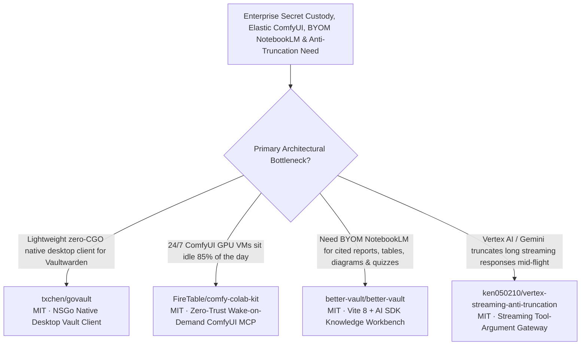
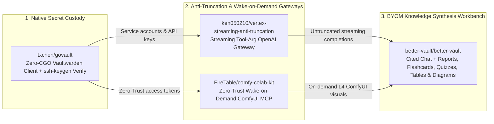
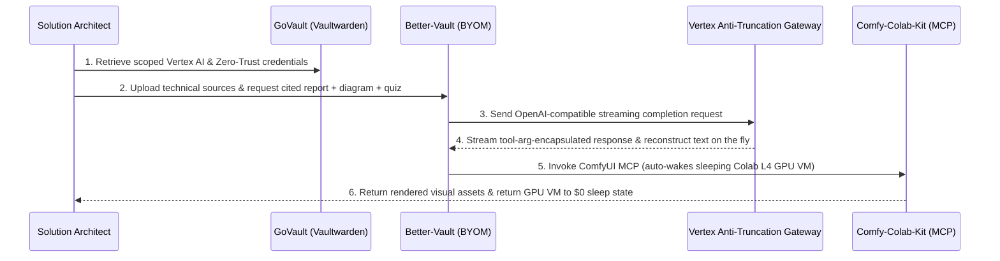

# Zero-CGO Vaultwarden Client, Wake-on-Demand ComfyUI MCP Gateway, BYOM Open-Source NotebookLM & Vertex Streaming Anti-Truncation Selection Guide: GoVault vs Comfy-Colab-Kit vs Better-Vault vs Vertex-Anti-Truncation

> **2026-11-23 Night Round 39 (Cumulative Round 826)** · Enterprise AI Solution Architect Practical Selection, End-to-End Integration Architecture & FinOps TCO Guide
> **Companion Architecture Diagram**: [`assets/github-ai-radar-2026-11-23-r39-r826-govault-comfycolabkit-bettervault-vertexantitruncation.svg`](../../../assets/github-ai-radar-2026-11-23-r39-r826-govault-comfycolabkit-bettervault-vertexantitruncation.svg)

---

## 1. 📌 Executive Summary

Across lightweight desktop credential management, zero-idle-waste wake-on-demand ComfyUI GPU serving, bring-your-own-model (BYOM) source-grounded knowledge synthesis, and streaming anti-truncation for Google Vertex AI / Gemini, **`txchen/govault`**, **`FireTable/comfy-colab-kit`**, **`better-vault/better-vault`**, and **`ken050210/vertex-streaming-anti-truncation`** form a 100% **`MIT`-licensed** enterprise optimization stack:

1. **Zero-CGO Native Desktop Client for Vaultwarden & Bitwarden (`txchen/govault`)**: (`★ 185`, `10 forks`, Go, `MIT`). Built with `NSGo` for macOS, Linux, and Windows with zero CGO dependencies, Apple Developer ID notarization, and `ssh-keygen` signature verification against a pinned release signing key (`scripts/release-signing-key.pub`).
2. **Zero-GPU-Idle Wake-on-Demand ComfyUI Gateway & MCP Server (`FireTable/comfy-colab-kit`)**: (`★ 140`, `24 forks`, Python, `MIT`). Exposes an always-available URL protected by Cloudflare Zero-Trust Access and a Glama-verified MCP server that wakes an ephemeral Google Colab L4 GPU VM on demand and lets it sleep at `$0` idle cost between bursts.
3. **Open-Source Bring-Your-Own-Model (BYOM) NotebookLM Alternative (`better-vault/better-vault`)**: (`★ 121`, `10 forks`, TypeScript, `MIT`, Vite 8 + AI SDK). Lets teams chat with proprietary sources with inline citations and transform them into reports, flashcards, quizzes, tables, and diagrams using any chosen local or cloud LLM.
4. **Streaming Tool-Argument Anti-Truncation Gateway for Vertex AI / Gemini (`ken050210/vertex-streaming-anti-truncation`)**: (`★ 51`, `4 forks`, JavaScript, `MIT`). Runs as a standalone Node.js/Docker OpenAI-compatible gateway (or UI extension) that instructs Gemini/Vertex AI to emit body text inside streaming tool-call arguments and reconstructs the text stream on the fly while surfacing exact upstream Google block reasons.
5. **FinOps Quantitative Takeaway**: Replacing per-seat enterprise password managers, 24/7 idle cloud GPU VMs, model-locked cloud notebook SaaS, and truncated-generation retries (Path A: `$9,350.00/mo`) with this `MIT` self-hosted stack (Path C: `$305.00/mo`) saves **`$9,045.00/mo`** (**`-96.74%`**).

---

## 2. 🎯 Architect & Customer Key Q&A

### Q1: When should an enterprise use dedicated cloud services vs. this 4-project `MIT` stack?
- **Use dedicated cloud services when**:
  - ComfyUI media pipelines run at `>75%` continuous 24/7 utilization, where reserved GPU instances are cheaper than ephemeral wake-on-demand nodes;
  - Teams only process public documents and are satisfied with Google's fixed model inside **Google NotebookLM**.
- **Deploy this 4-project `MIT` stack when**:
  - **Model-Agnostic Knowledge Synthesis (`better-vault`)**: Generate cited reports, tables, diagrams, flashcards, and quizzes from internal PDFs using your own Azure OpenAI, Anthropic, or local models;
  - **Eliminating Idle GPU Spend (`comfy-colab-kit`)**: Wake ephemeral L4 GPUs on demand via browser or MCP only when agents or designers request ComfyUI renders;
  - **Preventing Mid-Stream Gemini Truncation (`vertex-streaming-anti-truncation`)**: Encapsulate long-form generations inside streaming tool arguments via a drop-in OpenAI-compatible Docker gateway;
  - **Lightweight Native Credential Access (`govault`)**: Manage self-hosted Vaultwarden secrets on developer workstations without heavy Electron clients.

### Q2: How do these four components integrate into a secure knowledge & media architecture?
1. **Secret & Key Custody Plane (`govault`)**: Developers and operators manage Vaultwarden-hosted Vertex AI service accounts, BYOM API keys, and Cloudflare Zero-Trust credentials in a native zero-CGO client;
2. **Anti-Truncation LLM Gateway Plane (`vertex-streaming-anti-truncation`)**: Proxies Vertex AI / Gemini calls through streaming tool-argument reconstruction so long reports never cut off mid-sentence;
3. **BYOM Knowledge Synthesis Plane (`better-vault`)**: Connects to the gateway to turn source corpora into cited reports, tables, diagrams, and quizzes;
4. **Wake-on-Demand Visual Render Plane (`comfy-colab-kit`)**: Wakes an ephemeral Colab L4 ComfyUI instance over MCP to render visual assets on demand.

### Q3: What are the security and operational guardrails?
- **100% `MIT` Licensing**: All four repositories are `MIT` licensed, allowing unrestricted internal and commercial integration.
- **`govault`**: Preserve `ssh-keygen` verification against `scripts/release-signing-key.pub` during automated Linux/macOS rollouts.
- **`comfy-colab-kit`**: Enforce Cloudflare Zero-Trust Access policies in front of the wake endpoint so unauthorized callers cannot wake GPU instances.

---

## 3. 🧭 Visual Architecture & Decision Diagrams (Mermaid)

### 3.1 Selection Decision Tree

### 3.2 End-to-End Enterprise Reference Architecture

### 3.3 Runtime Execution Sequence

---

## 4. 📊 Comparative Selection Matrix

| Dimension | `txchen/govault` | `FireTable/comfy-colab-kit` | `better-vault/better-vault` | `ken050210/vertex-streaming-anti-truncation` | Dedicated Cloud & Commercial SaaS (Path A) |
| :--- | :--- | :--- | :--- | :--- | :--- |
| **Primary Role** | Zero-CGO native desktop client for Vaultwarden/Bitwarden | Wake-on-demand ComfyUI gateway & MCP on Colab L4 | Open-source BYOM alternative to Google NotebookLM | Streaming tool-argument anti-truncation gateway for Vertex/Gemini | Commercial password seats + 24/7 GPU VMs + cloud notebook SaaS |
| **Key Differentiator** | Native NSGo UI, zero CGO, `ssh-keygen` signed releases | `$0` idle GPU cost, one-click Wake UI, Cloudflare Zero-Trust + MCP | Generates reports, flashcards, quizzes, tables & diagrams with any LLM | Reconstructs streaming tool args into text & surfaces exact Google block reasons | High idle GPU burn, model lock-in & frequent long-output truncation retries |
| **License** | `MIT` | `MIT` | `MIT` | `MIT` | Proprietary SaaS / Cloud IaaS |
| **Monthly TCO (45-Eng Team)** | **Combined `$305.00/mo`** (`$65.00` gateway/burst compute + `$240.00` ops labor) | Included in combined stack | Included in combined stack | Included in combined stack | **`$9,350.00/mo`** (`$4,850.00` 24/7 GPU & SaaS + `$4,500.00` labor) |

---

## 5. 🧪 Quantitative FinOps TCO Comparison (Closed-Form Audit)

> **Audit Note**: Modeled for a 45-engineer team managing self-hosted Vaultwarden credentials, replacing 4 intermittent 24/7 cloud GPU VMs with wake-on-demand ComfyUI instances, running a private BYOM research synthesis workspace, and eliminating truncated-stream regeneration waste. Repository metadata is verified via the GitHub REST API; live runtime p99 latency is marked `not_measured`.

| Cost Component | Path A: Commercial Vault Seats + 4x 24/7 Idle Cloud GPU VMs + Cloud Notebook SaaS | Path C: Self-Hosted `govault` + `comfy-colab-kit` + `better-vault` + `vertex-anti-truncation` | Net Savings / Delta |
| :--- | :--- | :--- | :--- |
| **API / SaaS Subscriptions & GPU Compute** | `$4,850.00 / mo` | `$65.00 / mo` | `-$4,785.00 / mo` |
| **Idle GPU Ops, Truncation Reruns & Study Guide Formatting Labor** | `$4,500.00 / mo` (`45.0 hrs × $100/hr`) | `$240.00 / mo` (`2.4 hrs × $100/hr`) | `-$4,260.00 / mo` |
| **Total Monthly TCO** | **`$9,350.00 / mo`** | **`$305.00 / mo`** | **`$9,045.00 / mo` (`-96.74%`)** |

---

## 6. 🛠️ Enterprise Architecture Review Checklist

- [ ] **Signed Release Verification (`govault`)**: Verify `checksums.txt` with `ssh-keygen` against `scripts/release-signing-key.pub` before deploying `govault` to engineering workstations.
- [ ] **Zero-Trust Wake Protection (`comfy-colab-kit`)**: Place the `comfy-colab-kit` wake URL and MCP endpoint behind Cloudflare Zero-Trust Access and configure idle auto-shutdown thresholds.
- [ ] **BYOM Data Residency (`better-vault`)**: Configure `better-vault` to use enterprise-approved private LLM endpoints for internal report, table, diagram, and quiz generation.
- [ ] **Streaming Tool-Argument Fallback (`vertex-streaming-anti-truncation`)**: Deploy the standalone Docker gateway for long-form Vertex AI / Gemini workloads and log upstream safety/filter block reasons for prompt auditing.
