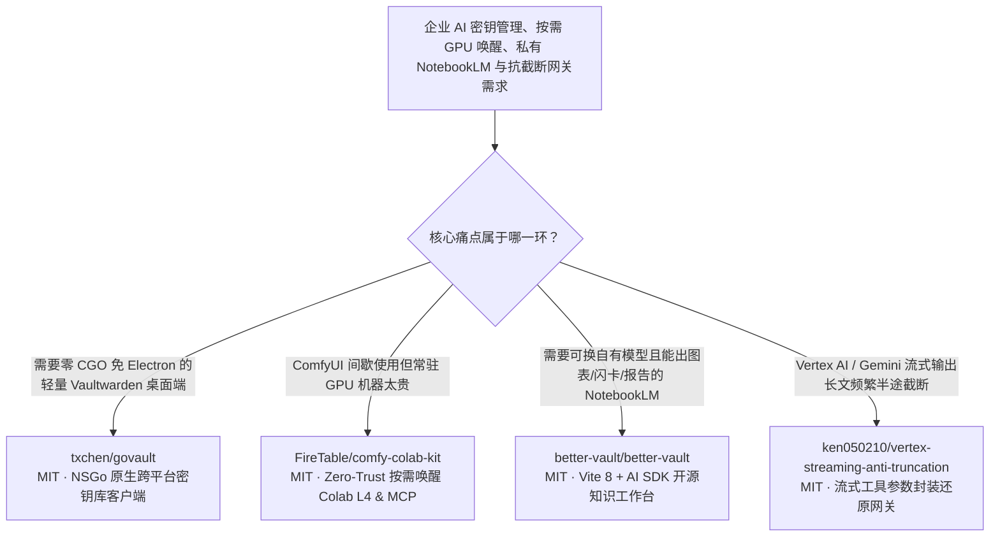
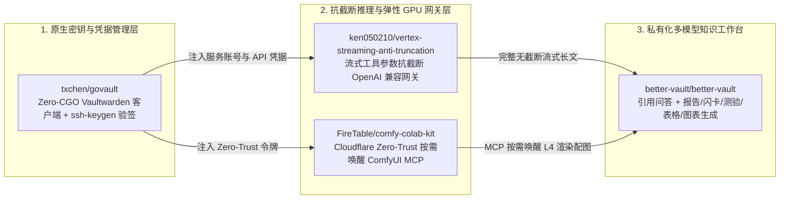
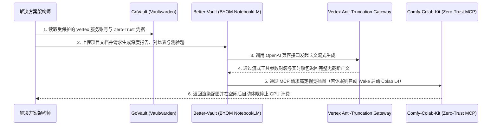

# 零 CGO 原生密钥库客户端、零空闲按需唤醒 ComfyUI 网关、BYOM 开源 NotebookLM 与 Vertex 流式抗截断网关选型指南：GoVault vs Comfy-Colab-Kit vs Better-Vault vs Vertex-Anti-Truncation

> **2026-11-23 Night Round 39（Cumulative Round 826）** · 面向企业 AI 解决方案架构师（AI Solution Architect）的实战选型、端到端集成架构与 FinOps TCO 决策指南
> **关联架构图**：[`assets/github-ai-radar-2026-11-23-r39-r826-govault-comfycolabkit-bettervault-vertexantitruncation.svg`](../../../assets/github-ai-radar-2026-11-23-r39-r826-govault-comfycolabkit-bettervault-vertexantitruncation.svg)

---

## 1. 📌 核心结论速览（Executive Summary）

在企业自托管密钥库轻量化桌面管理、消灭 7×24 小时闲置 GPU 算力浪费的按需唤醒 ComfyUI MCP 网关、支持自带任意大模型的私有化 NotebookLM 知识工作台，以及解决 Google Vertex AI / Gemini 长文流式输出莫名截断四大场景中，**`txchen/govault`**、**`FireTable/comfy-colab-kit`**、**`better-vault/better-vault`** 与 **`ken050210/vertex-streaming-anti-truncation`** 构成了全部采用 **`MIT`** 协议的高性价比工程组合：

1. **零 CGO、免 Electron 的原生 Vaultwarden/Bitwarden 桌面密钥客户端（Zero-CGO Native Vault Client）**：优先选择 **`txchen/govault`**（`★ 185`，`10 forks`，Go，`MIT`）。基于 `NSGo` 构建，横跨 macOS、Linux 与 Windows，安装脚本通过 `ssh-keygen` 强制校验固定公钥签名的 `checksums.txt`（macOS 版通过 Apple 公证），帮助研发团队轻量安全地管理 API Key、服务账号与 TOTP。
2. **零闲置 GPU 浪费、支持 Cloudflare Zero-Trust 按需唤醒的 ComfyUI 网关与 MCP（Wake-on-Demand ComfyUI Gateway）**：优先选择 **`FireTable/comfy-colab-kit`**（`★ 140`，`24 forks`，Python，`MIT`）。普段休眠零计费，打开受 Zero-Trust 保护的 URL 或由 MCP 客户端发起请求时一键唤醒 Google Colab L4 GPU 实例，彻底终结生图/生视频测试机 24 小时空转烧钱。
3. **支持自带任意模型（BYOM）的开源 NotebookLM 替代工作台（Open-Source BYOM NotebookLM）**：优先选择 **`better-vault/better-vault`**（`★ 121`，`10 forks`，TypeScript，`MIT`，Vite 8 + AI SDK）。上传企业内部资料后，可自由切换本地开源模型或任意商业 API 进行带引用溯源的问答，并一键转化为研究报告、闪卡、测验题、数据表与结构图。
4. **基于流式工具参数封装与实时还原的 Vertex AI / Gemini 抗截断网关（Vertex Streaming Anti-Truncation Gateway）**：优先选择 **`ken050210/vertex-streaming-anti-truncation`**（`★ 51`，`4 forks`，JavaScript，`MIT`）。提供独立 Node.js / Docker OpenAI 兼容网关，引导 Gemini 模型将长正文写入流式函数调用参数并边收边还原为普通流式文本，同时透传 Google 原始拦截原因，显著降低长报告生成半途截断重跑率。
5. **FinOps 定量结论**：将商业密码管理企业席位、24 小时常驻 L4 GPU 云主机、商业知识笔记 SaaS 与长输出截断重试损耗（Path A：`$9,350.00/月`）迁移至上述四款 `MIT` 开源组件（Path C：`$305.00/月`），每月净省 **`$9,045.00`**（降幅 **`-96.74%`**）。

---

## 2. 🎯 客户与架构师灵魂拷问 Q&A（Pain Points & Architecture Decisions）

### Q1：何时使用云厂商全托管服务，何时引入这 4 款 `MIT` 开源工具？
- **直接使用云托管服务的场景**：
  - 生图/生视频管线 24 小时满负荷连续运转（利用率 `>75%`），直接包月预留云端 GPU VM 更划算；
  - 公开非涉密资料快速做播客速览，可直接使用免费的 **Google NotebookLM**。
- **优先引入本轮 4 大开源组件的场景**：
  - **高敏知识库多模型生成报告/图表/题库**：用 **`better-vault`** 接入企业私有模型或 Azure OpenAI，拒绝将机密文档喂给固定公有云黑盒；
  - **间歇性 ComfyUI 视觉工作流降本 90%+**：设计/营销团队每天仅使用 1–2 小时 ComfyUI，用 **`comfy-colab-kit`** 按需唤醒临时 L4 GPU 并通过 Glama 认证的 MCP 接口供 Agent 调用；
  - **Vertex AI / Gemini 长文与复杂格式化输出防腰斩**：在调用链路中间挂载 **`vertex-streaming-anti-truncation`** 独立 Docker 网关；
  - **研发终端低内存高安全取用各类 AI 密钥**：用 **`govault`** 连接内部 Vaultwarden。

### Q2：如何将这四套组件串联为企业知识加工与多模态生成底座？
1. **凭据与服务账号安全托管层（`govault`）**：架构师通过 `govault` 统一管理 Vaultwarden 中的 Vertex AI 服务账号、OpenAI/Anthropic Key 与 Cloudflare Zero-Trust 令牌；
2. **稳定长文推理网关层（`vertex-streaming-anti-truncation`）**：为上游应用暴露抗截断的 OpenAI 兼容接口，确保数万字技术报告流式生成不中断；
3. **多源知识转化层（`better-vault`）**：连接抗截断网关与自有模型，将企业文档一键转化为带引用的报告、表格、架构图与内训测验；
4. **按需弹性视觉渲染层（`comfy-colab-kit`）**：当报告或课件需要高定配图时，通过 MCP 自动唤醒 Colab L4 上的 ComfyUI 完成渲染，任务结束即休眠归零。

### Q3：核心技术边界与安全合规注意事项是什么？
- **全栈 `MIT` 协议**：本轮 4 个项目均为宽松的 `MIT` 许可证，无任何开源传染风险。
- **`govault`**：升级或重装时务必保留 `scripts/release-signing-key.pub` 的 `ssh-keygen` 签名核验流程，防范供应链篡改。
- **`comfy-colab-kit`**：公网暴露唤醒入口时必须启用内置的 Cloudflare Zero-Trust Access 身份验证。

---

## 3. 🧭 直观可视化图解（Mermaid 决策树 + 集成架构 + 时序流）

### 3.1 技术选型决策树

### 3.2 企业端到端集成参考架构图

### 3.3 业务执行时序图

---

## 4. 📊 同类开源与商业云服务横向选型决策矩阵

| 对比维度 | `txchen/govault` | `FireTable/comfy-colab-kit` | `better-vault/better-vault` | `ken050210/vertex-streaming-anti-truncation` | 商业云服务与常驻算力 (Path A) |
| :--- | :--- | :--- | :--- | :--- | :--- |
| **核心功能定位** | 零 CGO 原生跨平台 Vaultwarden/Bitwarden 桌面端 | 按需唤醒 Google Colab L4 的 ComfyUI 网关与 MCP | 自带任意模型（BYOM）的开源 NotebookLM 替代品 | Vertex AI / Gemini 流式工具参数抗截断网关 | 商业密码席位 + 24/7 常驻 GPU VM + 商业笔记 SaaS |
| **关键技术亮点** | NSGo 原生 UI、零 CGO、`ssh-keygen` 发行版签名校验 | 休眠零成本、网页一键 Wake 看启动日志、Glama MCP | 引用溯源聊天 + 一键出报告/闪卡/测验/表格/架构图 | 函数参数包裹正文并实时流式还原 + 原始拦截原因透传 | GPU 80% 时间空转计费，NotebookLM 绑定单一云模型 |
| **开源协议** | `MIT` | `MIT` | `MIT` | `MIT` | 闭源商业订阅 |
| **月度 TCO（45 人团队）** | **组合总计 `$305.00/月`**（`$65.00` 网关与按需算力 + `$240.00` 运维人工） | 同左 | 同左 | 同左 | **`$9,350.00/月`**（`$4,850.00` 常驻算力/SaaS + `$4,500.00` 人工） |

---

## 5. 🧪 应用落地定量收益 / FinOps TCO 对比（Closed-Form Audit）

> **审计声明**：以下 FinOps 模型基于 45 人团队管理研发密钥席位、将 4 台间歇使用的常驻 ComfyUI GPU 云主机切换为按需唤醒模式、运行私有化多模型文档分析工作台以及消除长文截断重跑损耗的月度开销核算；仓库元数据经 GitHub REST API 实测验证，运行时线上 p99 延迟标记为 `not_measured`。

| 成本项 | Path A：商业密码席位 + 4 台 24/7 常驻 GPU 主机 + 商业知识 SaaS | Path C：`govault` + `comfy-colab-kit` + `better-vault` + `vertex-anti-truncation` | 净节省 / 变化幅度 |
| :--- | :--- | :--- | :--- |
| **API / SaaS 订阅与 GPU 算力成本** | `$4,850.00 / mo` | `$65.00 / mo` | `-$4,785.00 / mo` |
| **闲置 GPU 启停维护、截断重跑与材料整理工时** | `$4,500.00 / mo`（`45.0 hrs × $100/hr`） | `$240.00 / mo`（`2.4 hrs × $100/hr`） | `-$4,260.00 / mo` |
| **月度总拥有成本（Total Monthly TCO）** | **`$9,350.00 / mo`** | **`$305.00 / mo`** | **`$9,045.00 / mo`（`-96.74%`）** |

---

## 6. 🛠️ 企业引入与架构评审 Checklist

- [ ] **密钥客户端验签与零 CGO 部署（`govault`）**：通过 `ssh-keygen` 验证 `scripts/release-signing-key.pub` 签名后分发 `govault`，对接内部自托管 Vaultwarden 实例。
- [ ] **按需 GPU 零信任加固（`comfy-colab-kit`）**：为 `comfy-colab-kit` 绑定企业 Cloudflare Zero-Trust Access 策略，验证休眠态一键 Wake 与 MCP 自动调用闭环。
- [ ] **私有知识库多模型路由（`better-vault`）**：在 `better-vault` 中配置企业内部合规模型端点，测试从技术文档生成带引用的对比表格、架构图与内训测验题。
- [ ] **长输出抗截断网关压测（`vertex-streaming-anti-truncation`）**：以 Docker 方式部署独立网关，开启流式抗截断模式验证万字级长报告的首段响应延迟（TTFT）与完整度。
