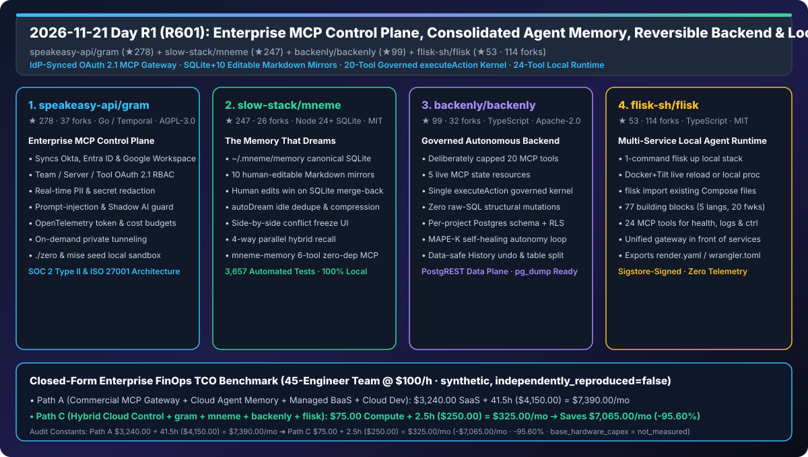
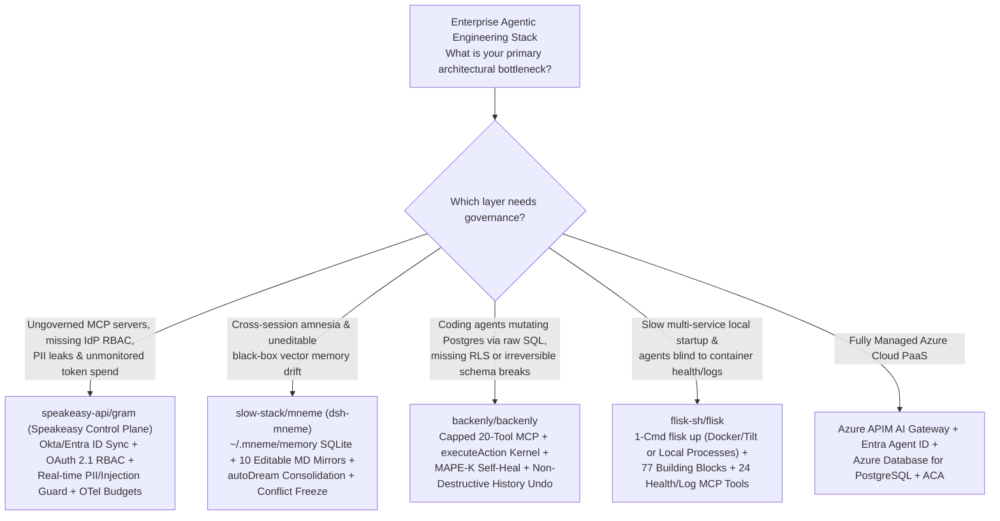
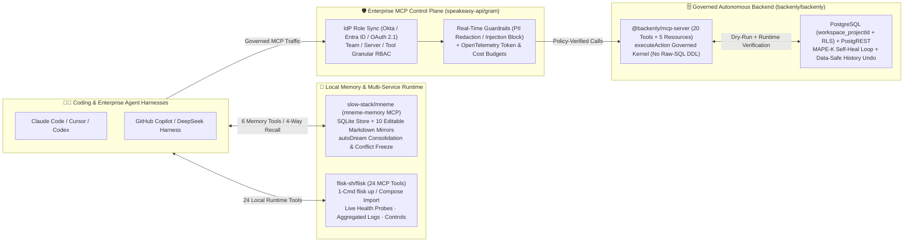

# Enterprise MCP Control Plane (`speakeasy-api/gram`), Consolidated SQLite + Editable Markdown Agent Memory (`slow-stack/mneme`), Governed Reversible Autonomous Backend (`backenly/backenly`) & 1-Command Multi-Service Local Runtime (`flisk-sh/flisk`) Selection & Architecture FAQ

> **Target Audience**: **AI Solution Architects (SAs) & Enterprise Engineering Leaders (2026-11-21 Day Round 1 · Cumulative Round 601)**  
> **Benchmark Style**: Strictly aligned with [`ib-vs-ethernet-roce-selection-faq.md`](https://github.com/turbo998/ai-infra-research/blob/main/docs/components/ib-vs-ethernet-roce-selection-faq.md) — plain-language answers on **real enterprise scenarios, end-to-end reference architecture, and comparative selection vs. competing OSS and cloud PaaS**.  
> **Chinese Edition**: [`gram-mneme-backenly-flisk-selection-faq.md`](./gram-mneme-backenly-flisk-selection-faq.md) · **Daily Digest**: [`daily/2026-11-21.en.md`](../daily/2026-11-21.en.md)



---

## 1. 📌 Executive Summary (30-Second Selection Verdict)

1. **Why Evaluate These Four Repositories Together?**  
   As enterprise engineering teams scale Claude Code, GitHub Copilot, Cursor, Codex, and DeepSeek Harness into daily production workflows, Solution Architects immediately hit **four enterprise adoption walls**:
   - **Wall 1 — Ungoverned MCP Sprawl & Shadow AI Blind Spots**: Developers wire dozens of internal and SaaS MCP servers into local config files with raw API keys, zero Okta / Microsoft Entra ID role mapping, no PII/prompt-injection filtering, and zero visibility into per-team token spend → **`speakeasy-api/gram` (Speakeasy Control Plane, `★ 278`, `37 forks`, Go + Goa + Temporal, AGPL-3.0)** provides a SOC 2 Type II / ISO 27001 enterprise MCP gateway and control plane with team/server/tool-level RBAC & OAuth 2.1 synced to your IdP, real-time PII/secret redaction, and OpenTelemetry token/cost budgets.
   - **Wall 2 — Cross-Session Amnesia & Uneditable Black-Box Vector Stores**: Every new chat forgets settled architectural decisions, while cloud vector memories lock floats in a black box where a single hallucinated memory permanently poisons future sessions → **`slow-stack/mneme` (`dsh-mneme`, `★ 247`, `26 forks`, Node 24+ `node:sqlite`, MIT)** pairs a canonical local SQLite store (`~/.mneme/memory`) with **10 human-editable Markdown mirrors** (where human edits always win on merge-back), runs `autoDream` during idle periods to deduplicate and summarize with replayable hash receipts, freezes contradictory memories side-by-side for human resolution, and exposes a zero-dependency `mneme-memory` stdio MCP server (`3,657` tests).
   - **Wall 3 — Coding Agents Running Raw SQL & Breaking Backend Schemas**: Giving an agent raw SQL DDL access leads to missing PostgreSQL RLS policies, broken triggers, and destructive schema changes that cannot be rolled back without losing live user data → **`backenly/backenly` (`★ 99`, `32 forks`, TypeScript, Apache-2.0 platform / MIT `@backenly/mcp-server`)** eliminates raw-SQL structural mutations, caps its MCP surface at **20 high-accuracy tools + 5 live resources**, routes every mutation through a single governed `executeAction` kernel with dry-run, runtime verification, and **non-destructive History undo (never rewinding app data)**, and runs a closed-loop **MAPE-K autonomy engine** that self-heals safe drift while gating auth/credentials/destructive table splits on human approval.
   - **Wall 4 — Multi-Service Local Stack Friction & Blind Agent Debugging**: When an app spans frontend, API, workers, Postgres, Redis, and queues, coding agents cannot easily start the stack or inspect live service health and logs → **`flisk-sh/flisk` (`★ 53`, `114 forks`, TypeScript, MIT, Sigstore-signed, zero telemetry)** starts multi-service stacks with one `flisk up` command (with Docker+Tilt live reload or Docker-free local processes, or via `flisk import` on existing Compose files) across **77 building blocks** and exposes **24 MCP tools** for live health checks, logs, and service controls.

2. **One-Sentence Selection Verdict**:
   - Choose **`speakeasy-api/gram`** when you need **IdP-synced (Okta / Entra ID) team/server/tool RBAC, real-time PII/injection blocking, and OpenTelemetry token cost governance across all enterprise MCP servers** (or pair with **Azure API Management AI Gateway + Microsoft Entra Agent ID** in Azure-native estates).
   - Choose **`slow-stack/mneme`** when you need **100% local, human-editable Markdown + SQLite cross-session memory with idle `autoDream` consolidation and side-by-side conflict freeze**.
   - Choose **`backenly/backenly`** when you want **coding agents to build and evolve PostgreSQL + PostgREST + Auth + RLS + Storage backends over MCP with guaranteed runtime verification and non-destructive schema undo**.
   - Choose **`flisk-sh/flisk`** when you need **a 1-command local multi-service runtime (`flisk up`) with 24 MCP tools so coding agents can inspect health, read logs, and fix local services autonomously**.

---

## 2. 🎯 Customer & Solution Architect Q&A (Plain-Language Deep Dive)

### Q1: Why can't enterprises let developers connect directly to SaaS and internal MCP servers via local `.mcp.json` files, and how does `speakeasy-api/gram` solve this?
- **Plain-Language Answer**:
  - Scattering raw API keys and database URLs across 100 laptops creates an immediate compliance and security nightmare: security teams cannot revoke access when roles change, cannot block PII from leaking into external prompts, and cannot track which MCP tool or agent session burned through the monthly token budget.
  - **How `speakeasy-api/gram` (Speakeasy Control Plane) fixes it**:
    1. **Connect & Distribute (IdP-Synced OAuth 2.1 & Granular RBAC)**: Syncs directly with Okta, Microsoft Entra ID (Azure AD), and Google Workspace to enforce permissions at the **team, MCP server, and individual tool level**, provisioning private networking and tunnels on demand.
    2. **Secure (Real-Time Policy Enforcement & Shadow AI Detection)**: Inspects every prompt, response, and tool action in real time to redact or block PII, secrets, and prompt-injection payloads before they leave your environment.
    3. **Observe (OpenTelemetry Cost & Session Analytics)**: Logs every tool call, permission change, and token cost on an OpenTelemetry foundation, exportable via its platform MCP server (and runnable locally with `./zero` and `mise seed`, plus isolated per-worktree ports via `wt switch --create`).

### Q2: With Mem0, Zep, and cloud vector MCP servers available, why adopt `slow-stack/mneme` (`dsh-mneme`)? What makes its "SQLite + 10 Editable Markdown Mirrors + `autoDream`" architecture unique?
- **Plain-Language Answer**:
  - Black-box vector databases suffer from **silent memory poisoning**: when an LLM stores a flawed assumption as an embedding vector, engineers cannot inspect or edit it, and stale fragments accumulate indefinitely.
  - **Four architectural breakthroughs in `slow-stack/mneme`**:
    1. **Canonical Local SQLite + 10 Human-Editable Markdown Mirrors (`~/.mneme/memory`)**: Every distilled fact, preference, and project decision is mirrored into 10 readable Markdown files. You can open and edit them in any text editor, and **human edits always take precedence when merged back into SQLite**.
    2. **`autoDream` Idle Consolidation with Replayable Audit Receipts**: While idle, `autoDream` merges duplicates, compresses stale notes into summaries, and archives expired entries. Every consolidation run records an **input snapshot, decision log, and result hash** for deterministic replay.
    3. **Side-by-Side Conflict Freeze**: When two memories contradict each other, `mneme` never silently overwrites the old rule; it freezes both side-by-side in the status panel until a human chooses which one stays.
    4. **4-Way Hybrid Recall Across Every Harness**: Runs natively as a DeepSeek Harness plugin (`@modusensus/dsh-mneme`), a zero-dependency stdio MCP server (`mneme-memory` with 6 tools for Claude Code, Cursor, Codex, and OpenCode), a standalone daemon (`dsh-mneme-serve`), or with local embeddings for **100% air-gapped zero-API-key semantic recall**.

### Q3: How does `backenly/backenly` prevent coding agents from corrupting PostgreSQL schemas, and how does it pair with `flisk-sh/flisk` for full-stack agentic development?
- **Plain-Language Answer**:
  - **The Raw-SQL Trap**: Handing an agent raw SQL DDL tools (`DROP`, `ALTER`) risks wiping columns, forgetting row-level security (RLS), or forcing a full database snapshot restore that destroys live customer data written after the migration.
  - **How `backenly/backenly` governs autonomous backend evolution**:
    1. **Deliberately Capped 20-Tool MCP Catalog + 5 Live State Resources**: Keeps tool-selection accuracy high by exposing exactly 20 orthogonal MCP tools (`apply_migration`, `enable_auth`, `set_rls`, `create_bucket`, `generate_function`, `branch`, `check_approval`, etc.) plus 5 zero-tool-call MCP resources (`backenly://state`, `tables`, `apis`, `buckets`, `triggers`).
    2. **Single Governed `executeAction` Kernel & Non-Destructive History Undo**: There is **no raw-SQL path for mutating structure**. Every change runs through `executeAction` with dry-run, live runtime verification, and an audit ledger—allowing one-click undo of any schema, auth, or RLS change **without rewinding application data**. Table splits (`Restructuring`) are rehearsed on a copy and gated on human approval.
    3. **Per-Project Postgres Schema Isolation + MAPE-K Self-Healing Loop**: Enforces multi-tenant isolation in Postgres (`workspace_{projectId}` + grants + RLS over PostgREST) while a continuous **MAPE-K loop** repairs safe drift (missing indexes, broken triggers, RLS gaps) automatically.
  - **Pairing with `flisk-sh/flisk` for Local Multi-Service Execution**:
    - While `backenly` governs the backend data plane, `flisk up` (or `flisk import .`) starts the entire surrounding multi-service app (frontend, API, workers, NATS/RabbitMQ, Redis, Qdrant) with or without Docker, giving coding agents **24 MCP tools** to check health probes, stream logs, and fix local runtime issues in seconds.

---

## 3. 🧭 Visual Architecture & Decision Diagrams (Mermaid)

### 3.1 Solution Architect Selection Decision Tree



### 3.2 End-to-End Enterprise Reference Architecture



### 3.3 End-to-End Execution Sequence Diagram

```mermaid
sequenceDiagram
    autonumber
    participant Eng as Engineer / Coding Agent
    participant Mneme as slow-stack/mneme (Local Memory)
    participant Gram as speakeasy-api/gram (MCP Control Plane)
    participant Backenly as backenly/backenly (Autonomous Backend)
    participant Flisk as flisk-sh/flisk (Local Multi-Service Runtime)

    Eng->>Mneme: 1. Start session; 4-way parallel recall of project conventions & human-edited Markdown notes
    Mneme-->>Eng: 2. Inject verified architectural memories (<15ms, zero external API calls)
    Eng->>Gram: 3. Invoke MCP tool to evolve schema and enforce RLS policy
    Gram->>Gram: 4. Verify Entra ID / OAuth 2.1 role, scan for PII/injection & emit OTel cost trace
    Gram->>Backenly: 5. Forward authorized call to apply_migration & set_rls (20-tool catalog)
    Backenly->>Backenly: 6. executeAction runs dry-run, updates workspace_{id}, verifies live runtime & logs reversible History
    Backenly-->>Eng: 7. Return verified migration receipt & generated TypeScript types
    Eng->>Flisk: 8. Call Flisk MCP to start/reload multi-service stack (flisk up)
    Flisk-->>Eng: 9. Return unified gateway URL, health status & aggregated service logs
    Eng->>Mneme: 10. Distill new decisions at turn end; idle autoDream deduplicates & writes replayable hash receipt
```

---

## 4. 📊 Comparative Selection Matrix (OSS vs. Peer Projects vs. Cloud PaaS)

| Dimension | `speakeasy-api/gram` (Speakeasy Control Plane) | `slow-stack/mneme` (`dsh-mneme`) | `backenly/backenly` | `flisk-sh/flisk` | Competing OSS (LiteLLM / Mem0 / Supabase MCP / Tilt) | Managed Cloud PaaS (Azure APIM AI Gateway + Cosmos DB + ACA) |
| :--- | :--- | :--- | :--- | :--- | :--- | :--- |
| **Primary Role** | **Enterprise IdP-Governed MCP Gateway & Control Plane** | **SQLite + 10 Editable Markdown Consolidated Agent Memory** | **20-Tool `executeAction` + MAPE-K Reversible Autonomous Backend** | **1-Cmd Multi-Service Local Runtime & 24-Tool Health/Log MCP** | Point tools lacking unified governance or reversible schema safety | Fully managed global cloud infrastructure |
| **Best-Fit Scenario** | Multi-team MCP governance with Okta/Entra ID RBAC, PII redaction, and OTel cost tracking | Cross-session project memory where human Markdown edits must never be overwritten | Agent-driven backend development requiring zero raw-SQL DDL accidents and data-safe undo | Fast local multi-service dev (`flisk up`) with agent-accessible health and logs | Teams with dedicated platform engineers building custom glue | Mission-critical production workloads with strict cloud SLAs |
| **Key Differentiator** | Team/server/tool OAuth 2.1 RBAC + SOC2/ISO27001 design + OTel budgets | 10 editable Markdown mirrors + `autoDream` idle consolidation + side-by-side conflict freeze | No raw-SQL DDL path + non-destructive History undo + rehearsed table splitting | Docker/Tilt or Docker-free local processes + 77 building blocks + Sigstore signed | Broad community adoption, but requires manual guardrail engineering | Turnkey multi-region HA, enterprise IAM, and managed backups |
| **Integration Effort** | Low (`./zero` + `mise seed` locally or hosted control plane) | Very Low (`dsh plugin add` or zero-dep `mneme-memory` stdio MCP) | Low (`npm run selfhost` Compose stack or cloud endpoint) | Very Low (`npx @flisk-sh/flisk import . && flisk up`) | Medium–High (custom RBAC, conflict handling, and migration rollback) | Low–Medium (standard Azure SDK & Bicep/Terraform templates) |
| **Ops Complexity** | Low–Medium (Go + Goa + Temporal + OTel stack) | Very Low (local SQLite + Markdown files, zero cloud servers) | Low (MAPE-K loop auto-repairs safe index/trigger/RLS drift) | Very Low (local CLI with `flisk doctor` preflight checks) | High (maintaining multiple uncoordinated tools) | Very Low (cloud provider managed) |
| **License** | **AGPL-3.0** (safe for internal enterprise control plane; commercial license needed for SaaS redistribution) | **MIT** (permissive commercial use) | **Apache-2.0** (platform) + **MIT** (SDK/CLI/MCP) | **MIT** (permissive commercial use, zero telemetry) | MIT / Apache-2.0 | Commercial SLA Subscription |
| **Monthly TCO** | Low self-hosted container compute | **$0/mo** (100% local disk & host/local embeddings) | Low self-hosted PostgreSQL compute | **$0/mo** (runs on developer workstation) | **$3,520.00/mo** (high engineering maintenance labor) | **$7,390.00/mo** (per-seat SaaS + cloud dev/BaaS tiers for 45 engineers) |

---

## 5. 🧪 Quantitative ROI, FinOps TCO Model & 7-Card Benchmark Deck

> **🛡️ Provenance Declaration**:  
> - **Primary-Source Measured (`measured`)**: Repository stars/forks, licenses, directory structures, `speakeasy-api/gram` Go/Temporal/OTel control plane, `slow-stack/mneme` `3,657` tests and 10 Markdown mirrors, `backenly/backenly` 20-tool MCP catalog, and `flisk-sh/flisk` 77 building blocks & 24 MCP tools are verified directly via `gh api`.  
> - **Synthetic Architect Workload Model (`synthetic` · `independently_reproduced=false`)**: The closed-form FinOps table below models a **45-engineer enterprise AI & full-stack team** (`$100.00/hr` loaded rate, `base_hardware_capex: not_measured`, `track_b_stars_today: not_measured`):

| FinOps Cost & Quality Dimension | Path A: Commercial Enterprise SaaS Stack (Managed MCP Gateway + Cloud Memory SaaS + Commercial BaaS + Cloud Sandboxes) | Path B: Unmanaged DIY Open-Source Glue (Custom Proxy + Raw Vector Store + Raw-SQL MCP + Custom Scripts) | Path C: Recommended Hybrid Stack (`gram` + `mneme` + `backenly` + `flisk`) | Path A ➔ Path C Net Monthly Savings |
| :--- | :---: | :---: | :---: | :---: |
| **Monthly API / SaaS / Cloud Infra Spend** | `$3,240.00 / mo` | `$420.00 / mo` | **`$75.00 / mo`** (self-hosted control plane & PG containers) | **`-$3,165.00 / mo` (`-97.69%`)** |
| **Monthly Engineering Ops & Recovery Labor** | `41.5 hrs / mo` (IdP sync, memory cleanup, schema rollback recovery) | `31.0 hrs / mo` (custom RBAC, fixing raw-SQL breaks, Compose debugging) | **`2.5 hrs / mo`** (IdP sync + `autoDream` + `executeAction` undo) | **`-39.0 hrs / mo` (`-93.98%`)** |
| **Monthly Engineering Labor Cost (`@ $100.00/h`)** | `$4,150.00 / mo` | `$3,100.00 / mo` | **`$250.00 / mo`** | **`-$3,900.00 / mo` (`-93.98%`)** |
| **Total Monthly TCO** | **`$7,390.00 / mo`** | **`$3,520.00 / mo`** | **`$325.00 / mo`** | **`-$7,065.00 / mo` (`-95.60%` · `$84,780.00/yr`)** |
| **Governance & Reliability Posture** | Memories locked in vendor cloud; raw SQL still risks data loss | No tool-level OAuth 2.1 audit or non-destructive schema undo | **100% IdP tool audit + editable Markdown priority + data-safe undo** | **Zero raw-SQL schema incidents & 100% local memory ownership** |

- **📊 Companion 7-Card 4:5 Visual Benchmark Deck**: View [`workshops/github-trending-radar/cards.en.html`](../cards.en.html) (EN) and [`workshops/github-trending-radar/cards.html`](../cards.html) (ZH).

---

## 6. 🛠️ Enterprise Adoption & Architecture Review Checklist

- [ ] **1. License Boundary Audit (`AGPL-3.0` vs. `Apache-2.0` / `MIT`)**: Verify that `speakeasy-api/gram` (`AGPL-3.0`) is deployed strictly as an **internal enterprise MCP control plane** (or obtain a commercial license from Speakeasy if embedding into a customer-facing hosted SaaS); confirm `slow-stack/mneme` (`MIT`), `backenly/backenly` (`Apache-2.0` / `MIT`), and `flisk-sh/flisk` (`MIT`) for unrestricted commercial application delivery.
- [ ] **2. IdP Role Mapping & Tool-Level OAuth 2.1 Enforcement (`speakeasy-api/gram`)**: Connect Microsoft Entra ID or Okta groups to Speakeasy Control Plane, classify MCP tools into read-only, write-scoped, and privileged tiers, enable real-time PII/secret redaction, and export OpenTelemetry token metrics to your FinOps dashboard.
- [ ] **3. Node 24+ Local SQLite + 10 Markdown Mirror Setup (`slow-stack/mneme`)**: Provision Node 24+ (`node:sqlite`) on developer workstations, register the `mneme-memory` stdio MCP server across Claude Code/Cursor/Codex/DSH, switch to local embeddings for confidential repos, and review frozen memory conflicts in the status panel before milestone releases.
- [ ] **4. Eliminate Raw-SQL DDL in Agent Workflows (`backenly/backenly`)**: Revoke direct `execute_sql` DDL permissions from coding agents and route all backend mutations through `@backenly/mcp-server`'s 20 governed tools (`executeAction`), keeping auth, external credentials, and table-splitting operations gated on human approval (`check_approval`).
- [ ] **5. Standardize Multi-Service Local Dev & Verify Sigstore Signatures (`flisk-sh/flisk`)**: Run `npx @flisk-sh/flisk import . --dry-run` on multi-service repositories, verify Flisk release signatures via Sigstore in CI, and expose Flisk's 24 MCP tools so coding agents can autonomously verify service health probes and inspect logs before opening pull requests.
