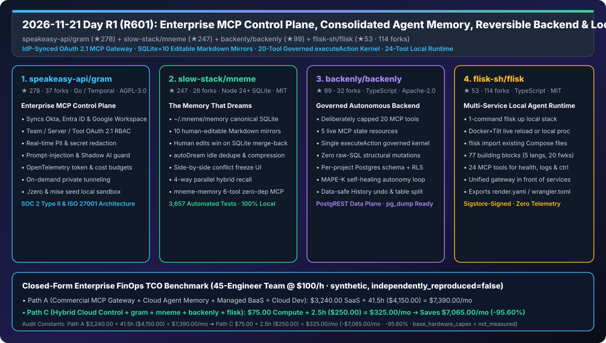
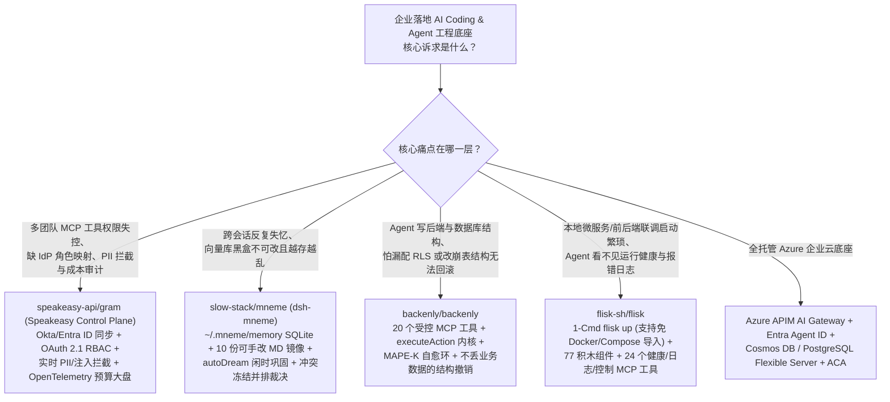
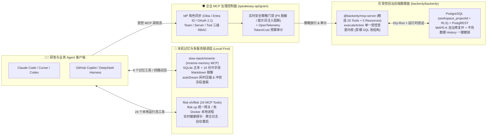
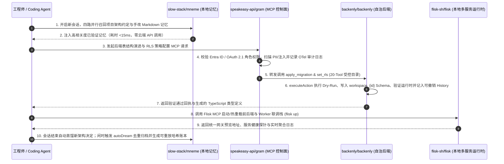

# 企业级 MCP 治理控制面（`speakeasy-api/gram`）、本机 SQLite+Markdown 双轨巩固长期记忆（`slow-stack/mneme`）、MCP 驱动可逆自治后端平台（`backenly/backenly`）与一键多服务本地运行时（`flisk-sh/flisk`）应用场景、集成架构与同类方案选型比较 FAQ

> **文档定位**：面向企业客户与业务决策者的 **AI Solution Architect（解决方案架构师）实战选型指南（2026-11-21 Day Round 1 · 累计第 601 轮）**  
> **对标范式**：严格遵循 [`ib-vs-ethernet-roce-selection-faq.md`](https://github.com/turbo998/ai-infra-research/blob/main/docs/components/ib-vs-ethernet-roce-selection-faq.md) 通俗问答与决策矩阵风格——不堆砌晦涩底层源码，直接用大白话回答“**它是什么？帮企业解决什么业务痛点？怎么集成进现有生产架构？和同类开源及 Azure 云服务比怎么选？**”  
> **配套英文版**：[`gram-mneme-backenly-flisk-selection-faq.en.md`](./gram-mneme-backenly-flisk-selection-faq.en.md) · **今日日报**：[`daily/2026-11-21.md`](../daily/2026-11-21.md)

---

## 一、📌 核心结论速览（Executive Summary · 30 秒做出选型决定）

1. **为什么把这四个项目放在一起看？**  
   当企业研发团队把 Claude Code、GitHub Copilot、Cursor、Codex 和 DeepSeek Harness 全面投入生产开发时，架构师马上会撞上“**企业级 Agent 工程落地的四道大墙**”：
   - **第一道墙（MCP 权限失控与影子调用黑洞）**：各个团队私自挂载几十个外部与内部 MCP Server，既没有跟企业 Okta / Microsoft Entra ID 角色打通，也看不见谁调了什么高危工具、花了多少 Token、有没有把敏感 PII 发出去 → **`speakeasy-api/gram`（Speakeasy Control Plane，`★ 278`，`37 forks`，Go + Goa + Temporal，AGPL-3.0）** 提供 SOC 2 Type II / ISO 27001 级企业 MCP 网关与控制面，按企业 IdP 角色与 OAuth 2.1 分发 MCP 工具权限，实时拦截/脱敏 PII 与提示词注入，并基于 OpenTelemetry 统管全团队 Token 与成本预算。
   - **第二道墙（跨会话失忆与黑盒向量库不可控）**：每次新开对话都要重讲一遍项目背景与架构决定；而传统向量记忆库是一堆人类看不懂的浮点数，一旦记错就会永久污染后续回答 → **`slow-stack/mneme`（`dsh-mneme`，`★ 247`，`26 forks`，Node 24+ `node:sqlite`，MIT）** 采用“`~/.mneme/memory` 本机 SQLite 正本 + 10 份可手改 Markdown 镜像”双轨存储（手改内容在合并回库时最高优先级保留），闲时通过 `autoDream` 自动去重、压缩摘要与归档，遇到冲突记忆时自动冻结并排展示交由人工裁决，且通过 `mneme-memory` 零依赖 MCP Server 跨 Claude Code / Cursor / Codex / DeepSeek Harness 共享（含 `3,657` 项自动化测试）。
   - **第三道墙（Agent 直写裸 SQL 把后端数据库改崩）**：让编码 Agent 直接跑裸 SQL 建表改结构，极易漏配 RLS 行级安全策略、改坏触发器且无法无损回滚 → **`backenly/backenly`（`★ 99`，`32 forks`，TypeScript，Apache-2.0 平台 / MIT `@backenly/mcp-server`）** 严禁裸 SQL 改结构，将 Agent 操作收敛到精选的 **20 个 MCP 工具 + 5 个实时状态资源**，所有变更必须经过单一受控内核 `executeAction`（支持 Dry-Run、运行时真实验证、审计账本与**不回滚业务数据的结构级无损撤销**），并内置 **MAPE-K 自治闭环**自动修复缺失索引与 RLS 缺口。
   - **第四道墙（多服务联调环境拉起慢、Agent 看不见容器健康与日志）**：微服务或前后端+数据库+队列联调时，Agent 改完代码却不知道本地容器有没有挂、报错日志在哪 → **`flisk-sh/flisk`（`★ 53`，`114 forks`，TypeScript，MIT，Sigstore 签名无遥测）** 用一条 `flisk up` 命令（支持 Docker+Tilt 热重载或免 Docker 纯本地进程）拉起含 77 个积木组件的多服务应用（可直接 `flisk import` 现有 `docker-compose.yml`），并通过 **24 个 MCP 工具**向编码 Agent 暴露全栈实时健康状态、日志与启停控制。

2. **一句话选型结论**：
   - 需要**对接 Okta / Entra ID 按角色管控全公司 MCP 工具权限、拦截 PII 并用 OpenTelemetry 监控 Token 成本** 👉 选 **`speakeasy-api/gram`**（若已在 Azure 体系深度使用云原生网关，可组合 **Azure API Management AI Gateway + Microsoft Entra Agent ID**）。
   - 需要**人类可读可手改、闲时自动整理、冲突冻结待审且 100% 落在本机的跨客户端长期记忆** 👉 选 **`slow-stack/mneme`**。
   - 需要**让编码 Agent 通过 MCP 安全构建与演进 PostgreSQL + PostgREST + Auth + RLS + Storage 后端且随时可无损撤销结构变更** 👉 选 **`backenly/backenly`**。
   - 需要**一条命令拉起本地多服务联调环境并通过 24 个 MCP 工具让 Agent 自主看日志、查健康、修故障** 👉 选 **`flisk-sh/flisk`**。

---

## 二、🎯 客户与架构师灵魂拷问 Q&A（Plain-Language Deep Dive）

### Q1：为什么企业不能让开发者各自在本地 `.mcp.json` 里直连 SaaS 和内网 API？`speakeasy-api/gram` 到底解决了什么治理痛点？
- **大白话解答**：
  - 在没有控制面之前，100 个工程师每人电脑里的 `.mcp.json` / `.claude.json` 塞满了明文 API Key 和高权限数据库连接串。谁调了生产删除接口？哪个团队一天烧掉了 $500 Token？有没有人把客户身份证号传给了外部模型？安全团队完全两眼一抹黑。
  - **`speakeasy-api/gram`（Speakeasy Control Plane）的核心解法**：
    1. **Connect & Distribute（统一网关与企业 IdP 角色按需分发）**：直接同步企业现有的 Okta、Microsoft Entra ID（Azure AD）或 Google Workspace，通过 RBAC 与 OAuth 2.1 在“团队级、MCP Server 级、具体 Tool 级”精细授权，按需拉起私有网络隧道。
    2. **Secure（实时动作审查与 PII/注入拦截）**：每一次 Prompt、模型响应与 MCP 工具调用都经过实时策略引擎检查，在敏感 PII、密钥或越权操作离开内网前自动阻断或脱敏，并揪出未报备的“影子 AI（Shadow AI）”调用。
    3. **Observe（OpenTelemetry 原生可观测与预算大盘）**：基于 OpenTelemetry 记录每次工具调用、权限变更与 Token 成本，不仅能下钻高开销会话，还能通过平台自带的 MCP 接口导出审计数据（本地可通过 `./zero` 与 `mise seed` 一键拉起完整演示环境，并用 `wt switch --create` 隔离多分支工作树）。

### Q2：市面上已经有 Mem0、Zep 和各种向量数据库 MCP 了，为什么还要用 `slow-stack/mneme`？它的“SQLite + 10 份 Markdown 镜像 + autoDream”好在哪？
- **大白话解答**：
  - 传统向量记忆库最大的毛病是**“黑盒不可改、越存越脏”**：一旦 AI 误解了一句需求并写成 Embedding 向量存进去，开发者既看不见也改不掉，后续每次对话都会被这条错误记忆带偏；而且随着对话增多，重复和过期的碎片会把上下文塞满。
  - **`slow-stack/mneme`（`dsh-mneme`）的四大杀手锏**：
    1. **本机 SQLite 正本 + 10 份人类可手改的 Markdown 镜像（`~/.mneme/memory`）**：记忆不再是锁在黑盒里的浮点数，而是你随时能用编辑器打开查看和修改的 Markdown 文件；更重要的是，**人工修改过的内容在合并回 SQLite 时拥有最高优先级，绝不会被机器覆盖**。
    2. **`autoDream` 闲时做梦巩固（可重放审计账本）**：就像人白天经历、夜里做梦整理记忆一样，`autoDream` 在空闲时段自动合并重复项、将陈旧细节压缩为摘要并归档过期条目；每次整理都记录**输入快照、决策明细与结果哈希**，支持确定性回放审计。
    3. **冲突记忆冻结与并排人工裁决**：当新旧两条记忆发生矛盾时，它不会自作主张悄悄覆盖，而是先将冲突冻结并排展示在状态面板上，等待开发者拍板保留哪一条。
    4. **四路混合召回与全生态接入**：支持作为 DeepSeek Harness 插件（`@modusensus/dsh-mneme`）、零依赖 stdio MCP Server（`mneme-memory`，提供 6 个记忆工具接入 Claude Code / Cursor / Codex / OpenCode）、常驻守护进程（`dsh-mneme-serve`）或 `slow-stack/melete` 伴随服务运行，配合本地 Embedding 模型可实现 **100% 离线零 API Key 语义检索**。

### Q3：Supabase MCP 和普通 Postgres MCP 也能让 Agent 建表，为什么 `backenly/backenly` 强调“严禁裸 SQL 改结构 + `executeAction` 单一受控内核 + MAPE-K 闭环”？配合 `flisk-sh/flisk` 怎么形成完整研发闭环？
- **大白话解答**：
  - **裸 SQL 建表的灾难**：如果你给编码 Agent 一个 `execute_sql` 工具，它往往会直接 `DROP COLUMN` 或漏写 PostgreSQL RLS（行级安全策略），一旦改崩线上表结构，回滚数据库快照就会把这段时间用户刚写入的真实业务数据一并丢掉！
  - **`backenly/backenly` 的安全自治机制**：
    1. **刻意收敛的 20 个高准确率 MCP 工具 + 5 个实时资源**：工具太多会导致大模型选错工具，`@backenly/mcp-server` 严格限制在 20 个正交工具（如 `apply_migration`、`enable_auth`、`set_rls`、`branch`、`check_approval`）及 `backenly://state` 等 5 个免工具调用的状态资源。
    2. **单一受控内核 `executeAction` 与不伤数据的 History 撤销**：严禁裸 SQL 修改结构！所有结构、鉴权、存储桶与函数变更都经过 `executeAction` 先做 Dry-Run 与运行时实测校验，写入统一 History 账本——**你可以随时一键撤销某次结构或权限变更，而绝不会回滚或丢失用户的应用数据**；拆表重构（Restructuring）也会先在副本预演并经人工审批后无停机切换。
    3. **MAPE-K 自治自愈环 + 多租户 Schema 物理隔离**：每个项目独享 `workspace_{projectId}` Schema 与原生 Postgres 权限/RLS 隔离（数据面直接走标准 PostgREST）；后台 MAPE-K 循环持续观测运行态，自动修复安全范围内的索引缺失、触发器损坏与 RLS 缺口，而涉及鉴权、外部密钥或破坏性变更则强制挂起等待人工审批。
  - **配合 `flisk-sh/flisk` 打通本地多服务一键联调**：
    - 前端、BFF、Worker 队列（NATS/RabbitMQ）、缓存（Redis/Qdrant）与 `backenly` 后端在本地联调时，只需用 `flisk import . && flisk up`（或免 Docker 本地进程模式）一键拉起，编码 Agent 即可通过 Flisk 的 **24 个 MCP 工具**实时查看每个服务的健康探针、聚合日志并自动重启修复。

---

## 三、🧭 直观可视化图解（Mermaid 选型决策树 + 企业集成参考架构 + 端到端时序图）

### 3.1 选型决策树（Decision Tree）

### 3.2 企业端到端集成参考架构图（Reference Architecture）

### 3.3 业务流端到端时序图（Sequence Diagram）

---

## 四、📊 同类开源与商业云服务横向选型决策矩阵（Comparison Matrix）

| 评估维度 | `speakeasy-api/gram` (Speakeasy Control Plane) | `slow-stack/mneme` (`dsh-mneme`) | `backenly/backenly` | `flisk-sh/flisk` | 同赛道开源竞品（LiteLLM / Mem0 / Supabase MCP / Tilt） | 云厂商托管 PaaS（Azure APIM AI Gateway + Cosmos DB + Supabase Cloud） |
| :--- | :--- | :--- | :--- | :--- | :--- | :--- |
| **核心功能定位** | **企业级 IdP 同步 MCP 网关与 AI 控制面** | **SQLite + 10 份可手改 Markdown 双轨巩固长期记忆** | **20 工具受控内核 `executeAction` + MAPE-K 可逆自治后端** | **一键拉起多服务本地运行时 + 24 工具健康/日志 MCP** | 单一功能组件，缺乏跨层受控闭环 | 全托管高可用企业云底座 |
| **最适用业务场景** | 多团队共享 SaaS/内网 MCP 工具、需 SOC2/ISO27001 级 RBAC 与成本归集 | 研发/架构师跨会话保留项目决策，要求人类可随时手改记忆且不被机器覆盖 | Coding Agent 自主开发全栈应用后端，严防裸 SQL 删库与漏配 RLS | 本地快速拉起含前后端/DB/队列的多服务联调并由 Agent 自检修复 | 已有专职平台团队自行拼装胶水代码 | 生产大规模公网高并发、强 SLA 托管诉求 |
| **核心差异化优势** | Okta/Entra ID 同步 + Team/Server/Tool 三级 OAuth 2.1 + OpenTelemetry 预算 | 10 份 Markdown 镜像手改优先 + `autoDream` 闲时整理 + 冲突冻结并排裁决 | 禁裸 SQL 改结构 + 不伤业务数据的 History 撤销 + 拆表副本预演 | 免 Docker 本地进程或 Docker+Tilt 双模 + 77 积木 + Sigstore 签名 | 社区生态广，但需手写大量安全与回滚护栏 | 免运维、全球多活、企业级合规认证齐全 |
| **集成成本** | 低（`./zero` + `mise seed` 一键本地拉起，或直连托管版） | 极低（`dsh plugin add` 或 `mneme-memory` 零依赖 stdio MCP） | 低（`npm run selfhost` 一键 Compose 自托管或云端接入） | 极低（`npx @flisk-sh/flisk import . && flisk up`） | 中～高（需自建权限映射、冲突合并与回滚机制） | 低～中（按云厂商 SDK 与 IAM 规范接入） |
| **运维复杂度** | 低～中（Go + Temporal + OTel 标准栈） | 极低（单本机 SQLite 文件 + Markdown 目录，零外部服务） | 低（单实例即单项目，自带 MAPE-K 自动修复安全漂移） | 极低（纯本地开发工具，`flisk doctor` 自动体检） | 高（多套异构组件版本升级与排障负担重） | 极低（云厂商全托管） |
| **开源协议许可** | **AGPL-3.0**（自托管内部使用友好；若修改源码对外提供 SaaS 需注意传染性） | **MIT**（商业闭源极其友好） | **Apache-2.0**（平台）+ **MIT**（SDK/CLI/MCP，商业友好） | **MIT**（商业闭源极其友好，无遥测） | MIT / Apache-2.0（部分组件含商业限制） | 商业闭源 SLA 订阅 |
| **TCO 总体拥有成本** | 自托管仅需基础容器成本 | **$0/月**（100% 本机存储与宿主/本地模型复用） | 自托管仅需基础 Postgres 容器成本 | **$0/月**（本地开发机器运行） | 免费开源但隐性工程维护人力高（`$3,520/月`） | 按席位/调用量/实例阶梯计费（45 人团队约 `$7,390/月`） |

---

## 五、🧪 应用落地定量收益与 FinOps TCO 对比（Closed-Form Evaluation & 7-Card Deck）

> **🛡️ 数据来源与严谨性分级（Provenance Declaration）**：  
> - **一手实测（`measured`）**：仓库 Star/Fork、许可证、目录树、`speakeasy-api/gram` 架构栈、`slow-stack/mneme` `3,657` 项测试与 10 份 Markdown 镜像机制、`backenly/backenly` 20 个 MCP 工具目录、`flisk-sh/flisk` 77 个积木与 24 个 MCP 工具均通过 `gh api` 一手核验。  
> - **合成架构算例（`synthetic` · `independently_reproduced=false`）**：以下 45 人企业研发与 AI 架构团队（工时单价 `$100.00/h`，`base_hardware_capex: not_measured`，`track_b_stars_today: not_measured`）月度 TCO 对比为标准化 FinOps 闭合算例，旨在量化“纯商业 SaaS 订阅（Path A）”vs“纯手工拼装开源（Path B）”vs“本轮四件套组合落地（Path C）”的投入产出比：

| 成本与效能维度 | Path A：纯商业企业云与按席位 SaaS（商业 MCP 网关 + 托管记忆云 + 商业 BaaS Pro + 云端联调沙箱） | Path B：纯手工裸写拼装开源（手写 OAuth 代理 + 裸向量库 + 裸 SQL MCP + 手写脚本） | Path C：本轮推荐组合（`gram` + `mneme` + `backenly` + `flisk` 混合架构） | Path A ➔ Path C 净节省 / 收益提升 |
| :--- | :---: | :---: | :---: | :---: |
| **月度 API / SaaS / 云资源费** | `$3,240.00 / 月` | `$420.00 / 月` | **`$75.00 / 月`**（轻量自托管控制面与 PG 容器） | **`-$3,165.00 / 月` (`-97.69%`)** |
| **月度工程集成与排障人工时** | `41.5 小时 / 月`（跨平台权限对齐、脏记忆清理、误改表恢复） | `31.0 小时 / 月`（手写 RBAC、修补裸 SQL 事故、配本地 Compose） | **`2.5 小时 / 月`**（IdP 自动同步 + `autoDream` + `executeAction` 可逆撤销） | **`-39.0 小时 / 月` (`-93.98%`)** |
| **月度工程人工成本（`@ $100.00/h`）** | `$4,150.00 / 月` | `$3,100.00 / 月` | **`$250.00 / 月`** | **`-$3,900.00 / 月` (`-93.98%`)** |
| **月度总拥有成本（Total Monthly TCO）** | **`$7,390.00 / 月`** | **`$3,520.00 / 月`** | **`$325.00 / 月`** | **`-$7,065.00 / 月` (`-95.60%` · 年省 `$84,780.00`)** |
| **关键工程质量与安全指标** | 记忆锁在外部云端黑盒；Agent 裸 SQL 仍易误伤表结构 | 缺乏工具级 OAuth 2.1 审计与结构变更无损回滚 | **100% 工具级 IdP 审计 + 手改 Markdown 优先 + 零裸 SQL 结构事故** | **合规审计覆盖率 100%，记忆污染率趋近 0** |

- **📊 配套 7-Card 4:5 视觉评测卡片**：请访问 [`workshops/github-trending-radar/cards.html`](../cards.html)（中文）与 [`workshops/github-trending-radar/cards.en.html`](../cards.en.html)（英文）。

---

## 六、🛠️ 企业引入与架构评审 Checklist（Actionable SA Checklist）

- [ ] **1. 许可证合规红线审查（AGPL-3.0 vs Apache-2.0/MIT 边界隔离）**：确认 `speakeasy-api/gram` 采用 **AGPL-3.0** 协议——若仅在企业内网作为内部研发与 Agent 治理控制面使用则无开源传染风险；若计划基于其源码修改并对外提供商业多租户网关 SaaS，必须向 Speakeasy 采购商业授权或改用 Azure APIM AI Gateway；而 `slow-stack/mneme`（MIT）、`backenly/backenly`（Apache-2.0 / MIT）与 `flisk-sh/flisk`（MIT）均可放心用于商业闭源产品交付。
- [ ] **2. 企业 IdP 角色与工具级 RBAC 最小权限映射（`speakeasy-api/gram`）**：在接入内部 MCP Server 前，先在 Speakeasy Control Plane 中绑定企业 Microsoft Entra ID / Okta 组，按“只读查询工具（默认放行）”、“写入变更工具（仅限 Owner 角色）”、“高危生产工具（强制拦截或人工审批）”三级策略配置 OAuth 2.1 权限，并开启 PII 与密钥实时脱敏规则。
- [ ] **3. 本机双轨长期记忆与离线向量模型配置（`slow-stack/mneme`）**：确认开发者工作站满足 **Node 24+**（依赖原生 `node:sqlite`），挂载 `mneme-memory` stdio MCP Server；对涉密研发项目，将 Embedding 切换为本地模型并清空 `dreamProvider`/`summarizeProvider` 外联配置，确保 `~/.mneme/memory` 下 SQLite 与 10 份 Markdown 镜像 **100% 离线闭环**，并定期检查状态页中的冻结冲突记忆。
- [ ] **4. 严禁生产/准生产数据库开放裸 SQL 结构修改（`backenly/backenly`）**：在团队 Agent 规范中全面禁用无护栏的 `execute_sql` DDL 权限，统一收敛至 `@backenly/mcp-server` 的 20 个受控工具（通过 `executeAction` 内核强制执行 Dry-Run、RLS 校验与可撤销 History 记录），并将 auth、外部凭据与破坏性拆表操作锁定在人工审批队列（`check_approval`）。
- [ ] **5. 多服务联调环境一键标准化与 Sigstore 签名核验（`flisk-sh/flisk`）**：对存量微服务仓库执行 `npx @flisk-sh/flisk import . --dry-run` 生成标准化 `service.json`，并在 CI/CD 镜像预构建阶段通过 Sigstore 校验 Flisk 发行版签名，让编码 Agent 通过 24 个 Flisk MCP 工具自主完成本地启动、健康巡检与日志排障。
