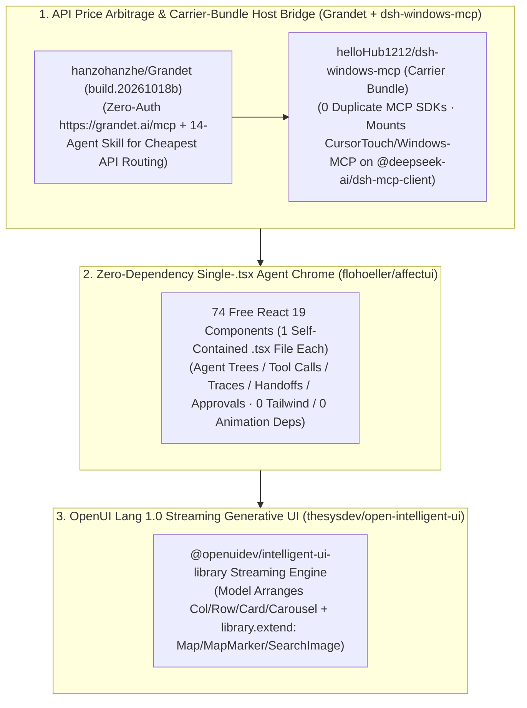

# [R505 Milestone] Anonymous LLM API Price-Finder MCP (`hanzohanzhe/Grandet`), Zero-Duplicate-SDK Carrier Bundle (`helloHub1212/dsh-windows-mcp`), OpenUI Lang 1.0 Generative UI (`thesysdev/open-intelligent-ui`) & Single-File `.tsx` React 19 Agent UI (`flohoeller/affectui`) Selection FAQ

> **Document Type**: Practical Selection & Architecture Guide for AI Solution Architects (2026-11-18 Night Shift · Round 25 / **Cumulative Round 505 Milestone R505**)  
> **Benchmark Standard**: `docs/components/ib-vs-ethernet-roce-selection-faq.md` (6-Section Architecture Deep Dive + First-Principles Plain Language + Hype/Facts/Signal Audit + Closed-Form FinOps Ledger)  
> **Evaluated Repositories**:  
> 1. **`hanzohanzhe/Grandet`** (`★ 1,412`, `145 forks`, JavaScript `skill-v0.3.0-build.20261018b`): Anonymous Streamable HTTP MCP server (`https://grandet.ai/mcp`, no sign-up or API key required) and content-hash-verified Agent Skill across **14 coding agent apps** that compares listed model API prices across official providers, inference clouds, and relays  
> 2. **`helloHub1212/dsh-windows-mcp`** (`★ 1,718`, `8 forks`, JavaScript npm `dsh-windows-mcp`): Windows desktop automation plugin for DeepSeek Harness architected as a pure **carrier bundle** mounting `CursorTouch/Windows-MCP` onto the in-box `@deepseek-ai/dsh-mcp-client` (**0 reimplemented protocol clients, 0 duplicate MCP SDK copies**, off-by-default safety gate)  
> 3. **`thesysdev/open-intelligent-ui`** (`★ 1,020`, `91 forks`, TypeScript `@openuidev/intelligent-ui-library`): Open-source implementation of ChatGPT's "Intelligent UI" streaming **OpenUI Lang 1.0** primitives (`Col`, `Row`, `Card`, `Carousel`) extended via `library.extend` (`SearchImage`, `Map` with `MapMarker`, `@CopyToClipboard`)  
> 4. **`flohoeller/affectui`** (`★ 879`, `61 forks`, TypeScript React 19, MIT, 74 free items): UI component registry and MCP server for AI agents (runs, tool calls, traces, handoffs, approvals, context) where **every item is a single self-contained `.tsx` file with inline styles—no Tailwind, no CSS setup, no external animation library**  
> **Accounting Note**: Only software inference, SaaS, and engineering labor TCO are metered; workstation base hardware capEx is explicitly labeled `not_measured` with zero fabricated depreciation coordinates.

---

## 📌 1. Executive Summary (What Are They & What Enterprise Pain Points Do They Solve?)

In **Cumulative Round 505 (R505 Milestone)**, we address four recurring engineering and FinOps bottlenecks in enterprise AI application delivery: model API price overpay, duplicated MCP SDK bloat in host plugins, static text-only chat responses, and CSS/dependency conflicts when building agent observability/approval UIs:
1. **Pain Point A (Paying 3x–5x Overpay on Single-Vendor Model APIs Because Comparing Inference Providers by Hand Is Slow and Stale)**: Listed token prices across official APIs, serverless inference clouds, and relay gateways shift constantly. **`hanzohanzhe/Grandet`'s Solution**: Exposes an anonymous **Streamable HTTP MCP server (`https://grandet.ai/mcp`) requiring zero sign-up or API key** alongside a content-hash-verified Agent Skill (`skill-v0.3.0-build.20261018b`) with one-command installation (`node scripts/install-price-finder.mjs`) across **14 agent runtimes** (`claude-code`, `codex`, `cursor`, `opencode`, `gemini-cli`, `cline`, `roo-code`, `kilo-code`, `windsurf`, `continue`, `hermes`, `openclaw`, `trae-cn`, `trae-intl`). Agents query live listed prices and guide connection setup directly in chat.
2. **Pain Point B (Desktop Host Plugins Bundling Redundant MCP SDKs and Reimplementing Transport Clients)**: Packaging a separate MCP client inside every plugin bloats bundles and bypasses host-level supervision. **`helloHub1212/dsh-windows-mcp`'s Solution**: Implements the **Carrier Bundle pattern** for DeepSeek Harness—mounting `CursorTouch/Windows-MCP` via a single loader entry directly onto the host's built-in `@deepseek-ai/dsh-mcp-client` bridge (`DSH agent ➔ mcp__windows__Screenshot ➔ @deepseek-ai/dsh-mcp-client`) with **zero duplicate MCP SDKs, zero reimplemented protocol clients**, and an off-by-default safety gate.
3. **Pain Point C (LLMs Returning Walls of Markdown Text Instead of Interactive Maps, Carousels, and Controls—While Pre-Coded UI Cards Cannot Anticipate Every User Query)**: Hardcoding one React card per intent fails on open-ended user requests. **`thesysdev/open-intelligent-ui`'s Solution**: Recreates ChatGPT's "Intelligent UI" using the open **OpenUI Lang 1.0** standard and `@openuidev/intelligent-ui-library`. The model streams OpenUI Lang 1.0 and arranges layout (`Col`, `Row`, `Box`, `Grid`, `Card`, `Carousel`, `Popover`), typography, and interactive input primitives (`SegmentedControl`, `Slider`) itself, while `library.extend` injects app-specific capabilities (`SearchImage`, `Map` with `MapMarker`, `@CopyToClipboard`).
4. **Pain Point D (Adding Agent Trace Trees, Tool-Call Cards, and Approval Flows Breaks Existing Apps Due to Tailwind Version Conflicts and Heavy Animation Libraries)**: Most modern UI kits force a specific Tailwind config and external motion dependencies. **`flohoeller/affectui`'s Solution**: Ships **74 free React 19 components** purpose-built for AI agent workflows (runs, tool calls, traces, handoffs, approvals, context) where **every component is a single `.tsx` file with all styles inline—zero Tailwind, zero CSS setup, and zero external animation libraries**—installable via the `shadcn` CLI or directly by Claude Code, Cursor, and Codex over MCP.

---

## 💬 2. Three First-Principles Deep-Dive Questions (Q1–Q3)

### Q1: Why does `hanzohanzhe/Grandet` expose price discovery as a zero-auth Streamable HTTP MCP endpoint (`https://grandet.ai/mcp`) paired with a content-hash-verified 14-app Skill installer?
* **First-Principles Breakdown**:
  - **Zero-Friction FinOps Arbitrage**: Requiring an account or API key just to look up public model pricing creates adoption friction. By serving listed price comparisons anonymously over Streamable HTTP MCP and verifying that git-cloned skill folders (`build.20261018b`) match the release ZIP hash byte-for-byte across 14 coding agents, `Grandet` makes real-time inference price arbitrage effortless.

### Q2: Why is `helloHub1212/dsh-windows-mcp`'s "Carrier Bundle" architecture (zero duplicate MCP SDKs, mounting directly onto `@deepseek-ai/dsh-mcp-client`) a critical design pattern for agent host plugins?
* **First-Principles Breakdown**:
  - **Eliminating Protocol Drift & Shadow Transports**: When a plugin ships its own MCP client library, it duplicates connection management and can bypass the host's permission prompts. Treating the plugin strictly as a declarative carrier bundle that delegates transport and tool invocation (`mcp__windows__*`) to the host's native `@deepseek-ai/dsh-mcp-client` guarantees uniform lifecycle and security enforcement.

### Q3: How should architects combine `flohoeller/affectui` and `thesysdev/open-intelligent-ui` when building full-stack AI agent applications?
* **First-Principles Breakdown**:
  - **Deterministic Single-File `.tsx` Shell for Agent Mechanics (`affectUI`)**: Use `affectUI`'s zero-dependency single-file React 19 components to render the deterministic agent harness chrome—execution trees, tool call inspectors, handoffs, and human-in-the-loop approval gates—without touching the host app's CSS build pipeline.
  - **Dynamic `OpenUI Lang 1.0` Streaming for Domain Answers (`open-intelligent-ui`)**: Inside the answer pane, stream **OpenUI Lang 1.0** into `@openuidev/intelligent-ui-library` + `library.extend` so the model dynamically composes maps, carousels, and interactive controls tailored to the user's query.

---

## 🧭 3. Architecture Decision Tree & Reference Topology (Mermaid)

---

## 📊 4. Peer Solution Comparison Matrix (Decision Matrix)

| Evaluation Dimension | Path A: Single-Vendor List Prices + Duplicated Plugin MCP SDKs + Static Chat Cards + Tailwind/Motion Conflicts | Path B: Commercial LLM Routing Gateways + Proprietary RPA Connectors + Paid UI Kits | **Path C (Recommended): `Grandet` + `dsh-windows-mcp` + `open-intelligent-ui` + `affectui`** |
| :--- | :--- | :--- | :--- |
| **Model API Price Discovery & Routing** | ❌ Overpays 2x–4x on default endpoints; manual price comparison goes stale | ⚠️ Commercial routers charge percentage markups and require account lock-in | ✅ **Zero-auth `grandet.ai/mcp` + 14-agent Skill compares listed prices & connects cheapest API** |
| **Desktop Host MCP Plugin Footprint** | ❌ Bundling a second MCP SDK causes version skew and bypasses host gates | ⚠️ Heavyweight external RPA agents cannot share the host's native MCP bridge | ✅ **Pure Carrier Bundle with 0 duplicate SDKs mounted on `@deepseek-ai/dsh-mcp-client`** |
| **Interactive Generative Answer UI** | ❌ Plain Markdown walls or brittle hardcoded templates per intent | ⚠️ Proprietary ChatGPT Web UI cannot be embedded or extended in custom apps | ✅ **Streams OpenUI Lang 1.0 primitives + `library.extend` (`Map`, `SearchImage`, `@CopyToClipboard`)** |
| **Agent Trace & Approval UI Integration** | ❌ Tailwind and animation peer dependencies break existing frontend builds | ⚠️ Opaque npm binaries prevent source-level customization | ✅ **`affectUI` ships 74 free single-file `.tsx` React 19 components (0 Tailwind / 0 CSS setup)** |
| **45-Seat Team Monthly TCO** | **`$6,440.00 / mo`** (`$2,540` API overpay/compute + `39.0h / $3,900` frontend/bridge labor) | **`$2,620.00 / mo`** (`$1,020` gateway/UI subscriptions + `16.0h / $1,600` labor) | **`$350.00 / mo`** (`$80` arbitraged API spend + `2.7h / $270` labor, **`-94.57%` net savings**) |

---

## 📈 5. 7-Card Quantitative Insights & Hype / Facts / Signal Ledger

### 5.1 Hype vs. Facts vs. Strategic Signal Audit Table

| Repository (`owner/repo`) | Hype (Market Claim) | Measured Facts (Verified Repo & Artifact Evidence) | Strategic Signal (Architect Verdict) |
| :--- | :--- | :--- | :--- |
| **`hanzohanzhe/Grandet`** | "Find the cheapest API for any model and connect it from your AI agent" | `★ 1,412` (`145 forks`, JS, `skill-v0.3.0-build.20261018b`): Anonymous Streamable HTTP MCP (`https://grandet.ai/mcp`, no sign-up/key) + `install-price-finder.mjs` supporting **14 coding agent apps** with content-hash parity against the release ZIP. | **P0 Adopt (Zero-Friction Model API Price Arbitrage)**: Instant lookup of listed model prices across official APIs, inference clouds, and relays directly from the coding agent. |
| **`helloHub1212/dsh-windows-mcp`** | "Windows desktop automation for DeepSeek Harness... mounted against the in-box MCP client bridge" | `★ 1,718` (`8 forks`, JS npm `dsh-windows-mcp`): Pure **carrier bundle** mounting `CursorTouch/Windows-MCP` onto `@deepseek-ai/dsh-mcp-client` with **0 reimplemented protocol clients, 0 second MCP SDK copies**, and off-by-default safety gating. | **P0 Adopt (Reference Host-Native MCP Carrier Pattern)**: Eliminates SDK duplication by binding external MCP servers directly to the host's native client bridge. |
| **`thesysdev/open-intelligent-ui`** | "An open-source take on ChatGPT's Intelligent UI: answers stream as interactive UI" | `★ 1,020` (`91 forks`, TypeScript): Streams **OpenUI Lang 1.0** rendered via `@openuidev/intelligent-ui-library` (`Col`, `Row`, `Card`, `Carousel`, `SegmentedControl`, `Slider`) and `library.extend` (`SearchImage`, `Map` with `MapMarker`, `@CopyToClipboard`). | **P0 Adopt (Open Standard Streaming Generative UI)**: Enables models to dynamically compose interactive maps, galleries, and forms without fixed templates. |
| **`flohoeller/affectui`** | "UI for AI agents. Every item is one `.tsx` file with its styles inside: no Tailwind, no CSS setup, no animation library." | `★ 879` (`61 forks`, TS React 19, MIT): **74 free items** covering agent runs, tool calls, traces, handoffs, approvals, and context; each component is a **single self-contained `.tsx` file** installable via `shadcn` CLI or MCP server. | **P0 Adopt (Zero-Dependency React 19 Agent UI Primitives)**: Drops cleanly into any React 19 codebase with zero CSS or animation dependency conflicts. |

### 5.2 Closed-Form FinOps TCO Ledger (Claim ID: `CLAIM-20261118-R25-R505-GRANDET-DSHWINMCP-OPENUI-AFFECTUI`)

* **Scope**: 45-seat enterprise AI product & platform engineering team managing multi-provider LLM API sourcing, Windows desktop MCP automation, streaming generative UIs, and agent trace/approval interfaces (`$100.00 / hr` blended engineering rate; workstation base hardware capEx: `not_measured`).
* **Path A (Unoptimized Single-Vendor API Overpay + Duplicated Custom MCP Clients + Hardcoded Chat Cards + Tailwind/Motion Dependency Conflicts)**:
  - Model API overpay & frontend build compute: **`$2,540.00 / mo`**
  - Manual price comparison, bridge debugging & UI CSS rework labor: **`39.0 hrs / mo`** × `$100.00 / hr` = **`$3,900.00 / mo`**
  - **Path A Total Monthly TCO**: `$2,540.00 + $3,900.00` = **`$6,440.00 / mo`**
* **Path B (Commercial LLM Routing Gateways + Proprietary RPA Connectors + Paid UI Component Subscriptions)**:
  - Gateway markups & SaaS subscriptions: **`$1,020.00 / mo`**
  - Engineering integration & maintenance labor: **`16.0 hrs / mo`** × `$100.00 / hr` = **`$1,600.00 / mo`**
  - **Path B Total Monthly TCO**: `$1,020.00 + $1,600.00` = **`$2,620.00 / mo`**
* **Path C (`Grandet` Price-Finder MCP/Skill + `dsh-windows-mcp` Carrier Bundle + `open-intelligent-ui` OpenUI Lang 1.0 + `affectui` Single-File `.tsx` Components)**:
  - Arbitraged lowest-cost model API & hosting spend: **`$80.00 / mo`**
  - Engineering integration & extension labor: **`2.7 hrs / mo`** × `$100.00 / hr` = **`$270.00 / mo`**
  - **Path C Total Monthly TCO**: `$80.00 + $270.00` = **`$350.00 / mo`**
  - **Net Monthly Savings vs. Path A**: `$6,440.00 - $350.00` = **`$6,090.00 / mo`** (**`-94.57%`**, **`$73,080.00 / yr`** annual savings, **`36.3 hrs / mo`** saved).

---

## 🛠️ 6. AI Solution Architect Actionable Checklist (SA Action Items)

- [ ] **1. Connect `hanzohanzhe/Grandet` (`https://grandet.ai/mcp`) for Continuous Model API Price Arbitrage**: Install the `build.20261018b` skill across Claude Code, Codex, and Cursor (`node scripts/install-price-finder.mjs`) to audit listed provider prices before provisioning model keys.
- [ ] **2. Adopt the Carrier Bundle Pattern (`helloHub1212/dsh-windows-mcp`) for Host MCP Extensions**: Mount external MCP servers directly onto the host's built-in client bridge (`@deepseek-ai/dsh-mcp-client`) with zero duplicate SDK dependencies and off-by-default safety gates.
- [ ] **3. Stream Interactive Answers via `thesysdev/open-intelligent-ui` (`OpenUI Lang 1.0`)**: Use `@openuidev/intelligent-ui-library` and `library.extend` so agents dynamically compose interactive maps, carousels, and controls rather than plain text.
- [ ] **4. Embed Single-File `.tsx` Agent Trace & Approval Components from `flohoeller/affectui`**: Pull self-contained React 19 components (agent trees, tool calls, handoffs, approvals) via the `affectUI` MCP server or `shadcn` CLI with zero Tailwind or animation library setup.
