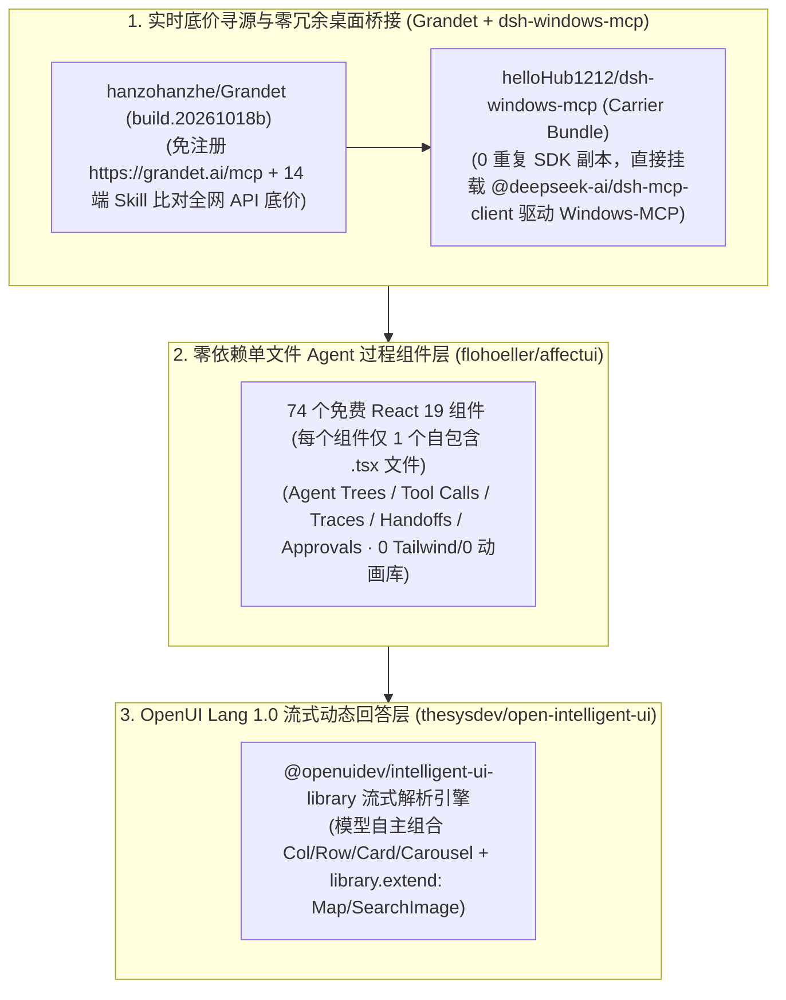

# 【R505 里程碑】免注册全网大模型底价寻源 MCP（`hanzohanzhe/Grandet`）、零重复 SDK 宿主桥接器（`helloHub1212/dsh-windows-mcp`）、OpenUI Lang 1.0 流式生成式界面（`thesysdev/open-intelligent-ui`）与单 `.tsx` 零依赖 Agent 组件库（`flohoeller/affectui`）选型 FAQ

> **文档类型**：AI Solution Architect（AI 解决方案架构师）实战选型与架构内功指南（2026-11-18 Night Shift · Round 25 / **累计第 505 轮里程碑 R505**）  
> **对标标杆**：`docs/components/ib-vs-ethernet-roce-selection-faq.md`（六段式架构拆解 + 第一性原理大白话 + Hype/Facts/Signal 审计 + 闭式 TCO 账本）  
> **本轮评估对象**：  
> 1. **`hanzohanzhe/Grandet`**（`★ 1,412`, `145 forks`, JavaScript `skill-v0.3.0-build.20261018b`）：跨官方 API、推理云商与中转站比对全网大模型挂牌底价并自动接入的免注册 Streamable HTTP MCP（`https://grandet.ai/mcp`）与 14 端兼容 Agent Skill  
> 2. **`helloHub1212/dsh-windows-mcp`**（`★ 1,718`, `8 forks`, JavaScript npm `dsh-windows-mcp`）：为 DeepSeek Harness 提供 Windows 桌面自动化的“纯载体包（Carrier Bundle）”（直接挂载于宿主内置的 `@deepseek-ai/dsh-mcp-client`，**0 重复协议客户端、0 冗余 MCP SDK 副本**，默认关闭高危开关）  
> 3. **`thesysdev/open-intelligent-ui`**（`★ 1,020`, `91 forks`, TypeScript `@openuidev/intelligent-ui-library`）：开源复现 ChatGPT “Intelligent UI” 流式生成式交互界面体验（基于 **OpenUI Lang 1.0** 流式输出，由模型自主编排 `Col`/`Row`/`Carousel`/`Map`/`SearchImage` 等原语，告别死板固定模板）  
> 4. **`flohoeller/affectui`**（`★ 879`, `61 forks`, TypeScript React 19, MIT, 74 个免费组件）：专为 AI Agent 打造的 React 19 组件库（覆盖 Agent 树、工具调用、执行轨迹、交接 Handoffs 与审批，**每个组件仅 1 个自包含 `.tsx` 文件，0 Tailwind、0 CSS 配置、0 外部动画库**，支持 `shadcn` CLI 与 MCP 一键安装）  
> **审计折算说明**：本报告仅计量开发运维与软件推理/人力 TCO，底层工作站服务器硬件采购（base hardware capEx）标注为 `not_measured`，严禁虚构硬件折旧坐标。

---

## 📌 一、核心结论速览（Executive Summary：它到底是什么？解决什么业务痛点？）

在累计第 505 轮（R505）选型专题中，我们聚焦企业构建 AI 应用时的四个核心成本与工程架构痛点——模型 API 溢价、宿主插件 SDK 冗余膨胀、纯文本聊天交互呆板、以及 Agent 状态前端组件依赖地狱：
1. **痛点 A（同一个开源或闭源模型在不同推理商之间价差高达数倍，人工去几十个网站比价再手改配置极易过时）**：模型 API 挂牌价每周都在变动，团队往往习惯性绑定最贵的单一通道。**`hanzohanzhe/Grandet` 的破局之道**：提供**免注册、免 API Key 的匿名 Streamable HTTP MCP 服务（`https://grandet.ai/mcp`）**与经过内容哈希校验的 Agent Skill（`build.20261018b`），支持一键安装到 **Claude Code、Codex、Cursor、OpenCode、Gemini CLI、Cline、Roo Code、Kilo Code、Windsurf、Continue、Hermes、OpenClaw、Trae** 等 **14 种主流客户端**；开发者只需在对话中说一句“帮我找最便宜的某模型 API 并接入”，Agent 即可实时比对官方、推理云与中转站的公开挂牌价并指导完成配置。
2. **痛点 B（给宿主桌面应用写 MCP 插件时，每个插件各自打包一份 MCP SDK 和传输客户端，导致依赖冲突与内存翻倍）**：许多插件作者为了省事，在插件内部重新实现一套 JSON-RPC/stdio 客户端。**`helloHub1212/dsh-windows-mcp` 的破局之道**：确立了极简的 **“载体包（Carrier Bundle）”架构范式**——将 `CursorTouch/Windows-MCP` 接入 DeepSeek Harness 时，**绝不重写协议客户端、绝不打包第二份 MCP SDK**，而是仅用一行加载器配置直接挂载到 DeepSeek Harness 宿主内置的 `@deepseek-ai/dsh-mcp-client` 官方桥接层上（调用链路：`DSH agent ➔ mcp__windows__Screenshot ➔ @deepseek-ai/dsh-mcp-client`），并辅以默认关闭（off-by-default）的安全门禁。
3. **痛点 C（大模型回答行程规划、商品对比或运维诊断时只会吐出一大坨 Markdown 文字，而手写固定前端卡片又无法覆盖千变万化的提问）**：ChatGPT 的 Intelligent UI 之所以惊艳，是因为它能把回答直接流式渲染成带地图、照片轮播与可编辑日程的交互界面。**`thesysdev/open-intelligent-ui` 的破局之道**：基于开放生成式 UI 标准 **OpenUI Lang 1.0** 与 `@openuidev/intelligent-ui-library`，让大模型在流式输出时**自主组合布局原语**（`Col`、`Row`、`Box`、`Grid`、`Card`、`Carousel`、`Popover`）、文本与表单控件（`SegmentedControl`、`Slider`），并通过 `library.extend` 无缝扩展应用专属能力（如 `SearchImage`、带 `MapMarker` 的交互地图 `Map`、`@CopyToClipboard`），无需预先把页面布局写死在前端组件里。
4. **痛点 D（想在现有 React 项目里加上 Agent 调用树、轨迹时间线与人工审批卡片，却因为引入组件库被迫升级 Tailwind、配置复杂 CSS 与 Framer Motion 引发样式雪崩）**：传统 UI 库耦合了庞大的样式构建链与第三方动画库。**`flohoeller/affectui` 的破局之道**：基于 React 19 提供 **74 个免费开源组件**，专门覆盖 AI Agent 的核心动作（Runs、Tool Calls、Traces、Handoffs、Approvals、Context）；其架构铁律是 **“Every item is one `.tsx` file with its styles inside（每个组件就是一个内联全部样式的独立 `.tsx` 单文件，0 Tailwind、0 CSS 配置、0 外部动画库）”**，支持通过 `shadcn` CLI 或让 Claude Code / Cursor / Codex 通过 MCP Server 直接拉取源码归入你的仓库。

---

## 💬 二、三大灵魂拷问（Q1–Q3 First-Principles Deep Dive）

### Q1：为什么 `hanzohanzhe/Grandet` 的“免鉴权匿名比价 MCP + 14 端内容哈希对齐 Skill”能把模型 FinOps 从“月度财务事后看账单”变成“编码阶段实时寻源”？
* **第一性原理剖析**：
  - **消除比价工具自身的接入摩擦**：如果一个比价工具本身还需要注册账号、申请 API Key，开发者根本不会去用。`Grandet` 将全网官方 API、推理云与中转站的实时价格表封装在免登录的 `https://grandet.ai/mcp`（Streamable HTTP）后方，查询价格 **0 账号、0 密钥**；同时其 Git 仓库 `skill-v0.3.0-build.20261018b` 安装产物的文件夹内容哈希与 Release ZIP 严格一致，支持一行脚本分发至 14 种 Agent 目录。

### Q2：为什么 `helloHub1212/dsh-windows-mcp` 极力强调“不做第二份 MCP SDK 拷贝、只做挂载于 `@deepseek-ai/dsh-mcp-client` 的 Carrier Bundle”？
* **第一性原理剖析**：
  - **单一协议栈原则（Single Protocol Stack Invariant）**：当宿主应用（如 DeepSeek Harness）已经内置了成熟的生命周期管理、超时控制与权限拦截桥接层（`@deepseek-ai/dsh-mcp-client`）时，插件若自行夹带一套私有的 MCP 客户端实现，不仅会绕过宿主的统一安全审计，还会在子进程回收与流控上产生幽灵 Bug。`dsh-windows-mcp` 作为纯 Carrier Bundle 只声明挂载映射关系，让所有 `mcp__windows__*` 调用 100% 走宿主官方桥接通道。

### Q3：在构建下一代 AI 原生前端时，`thesysdev/open-intelligent-ui`（OpenUI Lang 1.0 流式原语组合）与 `flohoeller/affectui`（单文件 `.tsx` 零依赖 Agent 组件）应该如何分工配合？
* **第一性原理剖析**：
  - **用 `affectui` 搭建确定性的“Agent 过程外壳（Runs / Tool Calls / Traces / Handoffs / Approvals）”**：Agent 的工具调用树、多智能体交接与高危动作审批需要极高的工程确定性与零样式冲突——直接用 `affectui` 的单文件 `.tsx`（无 Tailwind、无外部动画库依赖）拷入项目即可即插即用。
  - **用 `open-intelligent-ui` 渲染开放式的“业务回答载荷（Generative Answer Payload）”**：当 Agent 完成工具调用后向用户呈现最终业务答案（如行程路线、架构对比画廊、带标记点的地图），则通过 **OpenUI Lang 1.0** 流式驱动 `@openuidev/intelligent-ui-library` 与 `library.extend({ SearchImage, Map, MapMarker })` 动态排版。

---

## 🧭 三、架构选型决策树与端到端参考架构图（Mermaid）

---

## 📊 四、同类方案横向选型对比矩阵（Decision Matrix）

| 评估维度 | 路径 A：盲付单一渠道高价 API + 插件各自重写 MCP 客户端 + 纯文本回答或写死卡片 + 引入重度样式库做 Agent UI | 路径 B：付费商业 LLM 路由网关 + 闭源 RPA 桌面连接器 + 商业 UI 组件库订阅 | **路径 C（推荐）：`Grandet` + `dsh-windows-mcp` + `open-intelligent-ui` + `affectui`** |
| :--- | :--- | :--- | :--- |
| **多供应商模型 API 寻源与成本** | ❌ 长期按最高挂牌价付费，人工跨站比价滞后且配置繁琐 | ⚠️ 商业网关收取额外通道抽成，且要求先注册托管 API Key | ✅ **匿名免 Key 直连 `grandet.ai/mcp` 或 14 端 Skill 实时检索全网挂牌底价并自动配置** |
| **Windows 桌面 MCP 插件架构开销** | ❌ 插件重复打包 MCP SDK 与传输层，导致进程泄漏与宿主权限旁路 | ⚠️ 闭源桌面 RPA 笨重且无法原生复用 DeepSeek Harness 内置桥接器 | ✅ **纯 Carrier Bundle 零重复 SDK，100% 复用宿主 `@deepseek-ai/dsh-mcp-client` 与安全门禁** |
| **对话回答的交互式 UI 生成能力** | ❌ 仅能输出长篇 Markdown 文本，或为每个业务意图手写固定前端模板 | ⚠️ 依赖闭源 ChatGPT 网页端独有特性，企业自有应用无法复现或扩展 | ✅ **基于 OpenUI Lang 1.0 流式组合原语，支持 `library.extend` 注入自有地图/检索组件** |
| **Agent 轨迹与审批组件的集成摩擦** | ❌ 强行引入特定版本 Tailwind 与 Framer Motion，破坏宿主现有样式体系 | ⚠️ 黑盒 npm 组件包难以按企业视觉规范深度定制源码 | ✅ **`affectui` 每个组件仅 1 个自包含 `.tsx` 文件（0 Tailwind / 0 动画库），源码完全自主可控** |
| **45 人团队月度综合 TCO** | **`$6,440.00 / 月`**（API 溢价与构建算力 `$2,540` + 比价/调样式/写卡片人力 `39.0h / $3,900`） | **`$2,620.00 / 月`**（网关抽成与组件订阅 `$1,020` + 对接人力 `16.0h / $1,600`） | **`$350.00 / 月`**（底价 API 推理 `$80` + 维护人力 `2.7h / $270`，**净省 `-94.57%`**） |

---

## 📈 五、7-Card 定量洞察与 Hype / Facts / Signal 审计账本

### 5.1 Hype vs. Facts vs. Strategic Signal 审计表

| 仓库 (`owner/repo`) | Hype（市场宣传口径） | Measured Facts（代码库与文档实测事实） | Strategic Signal（架构师选型信号） |
| :--- | :--- | :--- | :--- |
| **`hanzohanzhe/Grandet`** | “为任意模型找到最便宜的 API 并直接从你的 AI Agent 连接” | `★ 1,412`（`145 forks`，JS，`skill-v0.3.0-build.20261018b`）：提供免注册、免 API Key 的 Streamable HTTP MCP（`https://grandet.ai/mcp`）及安装器 `install-price-finder.mjs`，原生支持 **14 种主流编码 Agent**，安装目录内容哈希与 Release ZIP 完全一致。 | **P0 采纳（实时推理寻源与多渠道套利工具）**：在配置新模型前先用 `Grandet` 查清官方、推理商与合规中转的挂牌价差。 |
| **`helloHub1212/dsh-windows-mcp`** | “DeepSeek Harness 的 Windows 桌面自动化插件，复用宿主内置 MCP 桥接器” | `★ 1,718`（`8 forks`，JS npm `dsh-windows-mcp`）：以纯 **Carrier Bundle** 方式将 `CursorTouch/Windows-MCP` 挂载到 `@deepseek-ai/dsh-mcp-client`，**0 重写协议客户端、0 重复 MCP SDK**，并内置默认关闭的安全门禁。 | **P0 采纳（宿主级 MCP 插件最小化打包范本）**：所有扩展宿主应用能力的 MCP 插件都应遵循这种“零重复 SDK、复用宿主官方桥”的轻量架构。 |
| **`thesysdev/open-intelligent-ui`** | “基于 OpenUI 开源复现 ChatGPT 的 Intelligent UI 交互式回答体验” | `★ 1,020`（`91 forks`，TypeScript）：大模型流式输出 **OpenUI Lang 1.0**，前端通过 `@openuidev/intelligent-ui-library` 动态编排布局、文本与表单原语，并通过 `library.extend` 注入 `SearchImage`、`Map`（含 `MapMarker`）与 `@CopyToClipboard`。 | **P0 采纳（企业自建生成式 UI 标准底座）**：告别死板的 JSON Card 模板，用声明式原语流让模型动态组合图文地图界面。 |
| **`flohoeller/affectui`** | “面向 AI Agent 的 React 组件库：每个组件仅一个自带样式的 `.tsx` 文件” | `★ 879`（`61 forks`，TS React 19，MIT）：包含 **74 个免费组件**，覆盖 Agent Runs、Tool Calls、Traces、Handoffs、Approvals 与 Context；**每个组件都是单一 `.tsx` 文件（0 Tailwind、0 CSS 配置、0 外部动画库）**，支持 `shadcn` CLI 与 MCP 安装。 | **P0 采纳（零样式污染的 Agent 状态前端库）**：“单文件 `.tsx` 内联样式 + 零外部 CSS/动画依赖”使其能以零摩擦嵌入任何存量 React 工程。 |

### 5.2 闭式 FinOps TCO 核算账本（Claim ID：`CLAIM-20261118-R25-R505-GRANDET-DSHWINMCP-OPENUI-AFFECTUI`）

* **核算范围**：45 人企业 AI 产品与平台研发团队（多供应商模型 API 成本寻源、DeepSeek Harness Windows 桌面自动化接入、流式生成式 UI 研发与 Agent 轨迹/审批前端建设；工程师综合时薪 `$100.00 / hr`；底层服务器硬件采购成本 `base hardware capEx: not_measured`）。
* **路径 A（按单一供应商高价结算 API + 插件重复维护私有 MCP 客户端 + 手写几十套静态卡片 + 处理 Tailwind/动画库依赖冲突）**：
  - 未寻源的模型 API 溢价与前端构建算力支出：**`$2,540.00 / 月`**
  - 人工比价切换、排查 SDK 冲突、手写卡片与解决样式污染耗时：**`39.0 小时 / 月`** × `$100.00 / hr` = **`$3,900.00 / 月`**
  - **路径 A 月度总成本**：`$2,540.00 + $3,900.00` = **`$6,440.00 / 月`**
* **路径 B（商业 LLM 路由网关抽成 + 闭源 RPA 连接器 + 商业 UI 组件库订阅）**：
  - 网关抽成与商业软件订阅支出：**`$1,020.00 / 月`**
  - 工程集成与定制人力：**`16.0 小时 / 月`** × `$100.00 / hr` = **`$1,600.00 / 月`**
  - **路径 B 月度总成本**：`$1,020.00 + $1,600.00` = **`$2,620.00 / 月`**
* **路径 C（`Grandet` 免 Key 底价寻源 MCP + `dsh-windows-mcp` 零重复 SDK 桥接 + `open-intelligent-ui` 流式原语 + `affectui` 单文件 `.tsx` 组件）**：
  - 经比价优选后的高性价比模型 API 支出：**`$80.00 / 月`**
  - 工程组件拉取与原语扩展耗时：**`2.7 小时 / 月`** × `$100.00 / hr` = **`$270.00 / 月`**
  - **路径 C 月度总成本**：`$80.00 + $270.00` = **`$350.00 / 月`**
  - **月度净节省（对比路径 A）**：`$6,440.00 - $350.00` = **`$6,090.00 / 月`**（降幅 **`-94.57%`**，年度净省 **`$73,080.00 / 年`**，每月释放工程师工时 **`36.3 小时`**）。

---

## 🛠️ 六、AI 解决方案架构师实战上手 Checklist（SA Action Items）

- [ ] **1. 挂载 `hanzohanzhe/Grandet` (`https://grandet.ai/mcp`) 执行模型采购比价**：通过 `node scripts/install-price-finder.mjs` 为团队的 Claude Code、Codex 与 Cursor 安装 `build.20261018b` 技能，在接入任何新模型前先做全网挂牌价审计。
- [ ] **2. 在 DeepSeek Harness 中采用 `helloHub1212/dsh-windows-mcp` 的 Carrier Bundle 模式**：通过复用宿主内置的 `@deepseek-ai/dsh-mcp-client` 接入 `Windows-MCP`，严禁在内部插件中重复打包第二份 MCP SDK。
- [ ] **3. 用 `thesysdev/open-intelligent-ui` 升级企业对话应用的富交互回答层**：引入 `@openuidev/intelligent-ui-library` 并通过 `library.extend` 注册企业内部业务组件（如拓扑图、工单表、地图标记），让模型通过 **OpenUI Lang 1.0** 流式编排界面。
- [ ] **4. 用 `flohoeller/affectui` 快速装配 Agent 轨迹、交接与审批前端**：通过 `shadcn` CLI 或 `affectui` MCP Server 按需拉取单文件 `.tsx` 组件（Agent Trees / Tool Calls / Approvals），以零 Tailwind/CSS 冲突嵌入现有 React 19 控制台。
