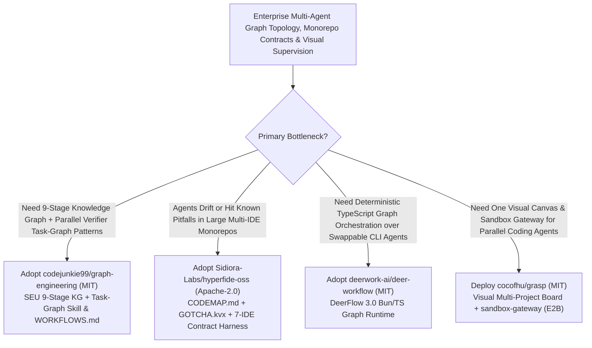
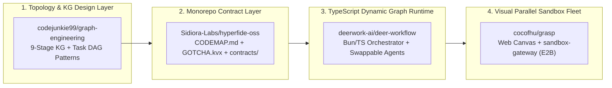
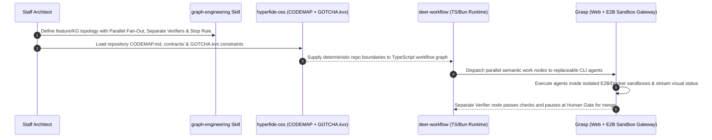

# 9-Stage KG & Task-Graph Skill (`codejunkie99/graph-engineering`), DeerFlow 3.0 Dynamic Graph Runtime (`deerwork-ai/deer-workflow`), Monorepo KVX Contract Harness (`Sidiora-Labs/hyperfide-oss`) & Visual Parallel Agent Board (`cocofhu/grasp`) Selection & Architecture FAQ

> **2026-11-21 Daytime Continuous Research Shift · Day Round 57 (Cumulative Round 657)**  
> **Audit Claim ID**: `CLAIM-20261121-R57-R657-GRAPHENG-DEERWORKFLOW-HYPERFIDE-GRASP`  
> **Linked Daily Digests**: [`2026-11-21.en.md`](../daily/2026-11-21.en.md) · [`2026-11-21.md`](../daily/2026-11-21.md)  
> **Architecture Visual**: [`assets/github-ai-radar-2026-11-21-r57-r657-grapheng-deerworkflow-hyperfide-grasp.svg`](../../../assets/github-ai-radar-2026-11-21-r57-r657-grapheng-deerworkflow-hyperfide-grasp.svg)

---

## ① 📌 Executive Summary (One-Sentence Selection Verdict)

> **One-Sentence Verdict**: When scaling engineering teams from single-agent prompt/loop tinkering to **deterministic multi-agent graph topologies, large-monorepo contract grounding, and visual parallel sandbox supervision**, combine **`codejunkie99/graph-engineering` (MIT, `★ 576` 9-stage knowledge-graph pipeline + task-graph fan-out/verifier/stop-rule skill distilled from SEU's 4.4K★ graduate course) + `Sidiora-Labs/hyperfide-oss` (Apache-2.0, `★ 623` multi-IDE monorepo workflow harness built around `hyperfide.kvx`, `GOTCHA.kvx`, and `CODEMAP.md`) + `deerwork-ai/deer-workflow` (MIT, `★ 561` DeerFlow 3.0 TypeScript/Bun dynamic graph runtime decoupling deterministic orchestration from replaceable Agent runtimes) + `cocofhu/grasp` (MIT, `★ 368` visual multi-project parallel coding-agent control plane with built-in `sandbox-gateway` and E2B compose support)**—cutting 45-engineer monthly TCO from **`$8,140.00/mo` to `$305.00/mo` (`-$7,835.00/mo`, `-96.25%`)**.

---

## ② 🎯 Solution Architect & Enterprise Buyer Q&A

### Q1: "Prompt engineers steer words, loop engineers steer iterations, graph engineers steer topology"—how do these four repositories operationalize Graph Engineering in production?
- **Four Complementary Layers**:
  1. **Knowledge-Graph & Task-Graph Topology Blueprint (`codejunkie99/graph-engineering`, `★ 576`, `70 forks`, MIT)**: Packages both halves of graph engineering into a reusable Claude skill (`graph-engineering/`) and `WORKFLOWS.md`: (a) the **9-stage Knowledge Graph pipeline** (`Ontology ➔ Extraction ➔ Fusion ➔ Serving`, translated from Southeast University's graduate course) for what agents remember, and (b) **Task-Graph orchestration patterns** (parallel fan-out, separate verifiers, stop rules, and human gates) for how agents work.
  2. **Monorepo Contract & Anti-Regression Harness (`Sidiora-Labs/hyperfide-oss`, `★ 623`, `86 forks`, Apache-2.0, TypeScript)**: Scales agent workflows from small projects to massive codebases using structured `CODEMAP.md`, `hyperfide.kvx`, `GOTCHA.kvx` (capturing repository pitfalls), `contracts/`, and `spec/` directories across `.claude`, `.codex`, `.cursor`, `.gemini`, `.opencode`, `.vscode`, and `.zed`.
  3. **Deterministic TypeScript Graph Runtime (`deerwork-ai/deer-workflow`, `★ 561`, `59 forks`, MIT, TypeScript/Bun)**: Pilot project for **DeerFlow 3.0 (DeerWork)** (`@deerwork-ai/deer-workflow`) that keeps graph state transitions, retries, and observability strictly in TypeScript/Bun while delegating semantic execution to swappable Agent runtimes (Codex CLI by default, Claude Code, etc.).
  4. **Visual Multi-Project Parallel Sandbox Control Plane (`cocofhu/grasp`, `★ 368`, `35 forks`, MIT, TypeScript/Go)**: Solves terminal overload when running dozens of parallel coding agents across multiple repositories, pairing a visual workflow canvas (`web/` + `server/`) with an isolated `sandbox-gateway/` (`compose.e2b.yaml` / Docker).

### Q2: How do these four tools fit together in an enterprise software delivery pipeline?
- **Topology & Memory Design**: Architects use `codejunkie99/graph-engineering` to structure domain knowledge graphs and define task graphs with explicit verifier nodes and stop rules.
- **Repository Grounding**: Target monorepos maintain `CODEMAP.md`, `hyperfide.kvx`, and `GOTCHA.kvx` via `Sidiora-Labs/hyperfide-oss` so every spawned agent inherits exact architectural boundaries.
- **Execution & Visual Fleet Supervision**: `deerwork-ai/deer-workflow` executes the deterministic TypeScript graph in Bun, dispatching parallel coding agents into isolated E2B/Docker sandboxes supervised visually through `cocofhu/grasp`.

### Q3: When should we use managed cloud orchestration (e.g., Azure AI Foundry / LangGraph Cloud) vs. this open-source stack?
- **Use Azure AI Foundry / LangGraph Cloud** for customer-facing conversational APIs requiring managed cloud autoscaling and enterprise SLAs.
- **Use this 4-Repository MIT/Apache Stack** for internal software engineering automation, monorepo refactoring, and knowledge-graph construction where deterministic TypeScript control, swappable CLI coding agents, and local/E2B sandbox isolation are paramount.

---

## ③ 🧭 Visual Architecture & Decision Diagrams

### 3.1 Selection Decision Tree

### 3.2 End-to-End Enterprise Integration Architecture

### 3.3 Operational Sequence Diagram

---

## ④ 📊 Cross-Option Selection Matrix

| Dimension | `graph-engineering` (`★ 576`) | `deer-workflow` (`★ 561`) | `hyperfide-oss` (`★ 623`) | `cocofhu/grasp` (`★ 368`) | Proprietary Cloud Agent Platforms (Devin / LangGraph Cloud) |
| :--- | :--- | :--- | :--- | :--- | :--- |
| **Primary Role** | 9-stage KG pipeline + task-graph orchestration Claude skill | DeerFlow 3.0 TypeScript/Bun dynamic agent graph runtime | Multi-IDE monorepo contract (`GOTCHA.kvx` / `CODEMAP.md`) tool | Visual multi-project parallel agent canvas + E2B sandbox gateway | Hosted cloud agent execution & state-graph SaaS |
| **Best Fit** | Designing KG memory & verifier-gated task topologies | TypeScript-controlled orchestration over swappable CLI agents | Scaling agent workflows across large complex monorepos | Supervising parallel coding agents across multiple repos visually | Teams outsourcing all sandbox & orchestration to cloud SaaS |
| **Integration Cost** | Very Low (drop-in skill & `WORKFLOWS.md`) | Low (`@deerwork-ai/deer-workflow` on Bun/TS) | Low (repo-level `.hyperfide-env-setup.sh`) | Low (`docker-compose.yml` / `compose.e2b.yaml`) | High (per-seat + per-node/sandbox-minute billing) |
| **Ops Complexity** | Zero (static skill & reference package) | Very Low (lightweight Bun/TS runtime) | Very Low (versioned inside Git repository) | Low (self-hosted Go/TS server + sandbox gateway) | Very Low (vendor-managed cloud lock-in) |
| **License** | **MIT** | **MIT** | **Apache-2.0** | **MIT** | Proprietary |
| **45-Eng Monthly TCO** | **Included in `$305.00/mo` stack** | **Included in `$305.00/mo` stack** | **Included in `$305.00/mo` stack** | **Included in `$305.00/mo` stack** | **`$8,140.00/mo`** (`$3,840` SaaS + `$4,300` labor) |

---

## ⑤ 🧪 Quantitative FinOps & TCO Comparison

> **Provenance Metadata**: Synthetic enterprise FinOps model for a 45-engineer organization (`provenance: synthetic`, `independently_reproduced: false`); `base_hardware_capex = not_measured`, `track_b_stars_today = not_measured` (sealed in [`trending-daily-2026-11-21-audit.json`](../evidence/trending-daily-2026-11-21-audit.json)).

| Cost Path | Monthly SaaS / Sandbox Compute | Monthly Multi-Repo Drift & Parallel Agent Coordination Labor (`$100/hr`) | Total Monthly TCO | Net Savings vs Path A |
| :--- | :--- | :--- | :--- | :--- |
| **Path A: Commercial Workflow/Sandbox SaaS + Unstructured Monorepo Rework + Manual Terminal Juggling** | `$3,840.00` | `43.0h` (`$4,300.00`) | **`$8,140.00`** | — |
| **Path C: `graph-engineering` + `deer-workflow` + `hyperfide-oss` + `grasp`** | `$65.00` | `2.4h` (`$240.00`) | **`$305.00`** | **`-$7,835.00/mo` (`-96.25%`)** |

---

## ⑥ 🛠️ Enterprise Architecture Review Checklist

- [ ] **Separate Verifier & Stop Rule Enforcement (`codejunkie99/graph-engineering`)**: Ensure every task graph includes an independent verifier node and an explicit stop rule to prevent runaway agent loops.
- [ ] **Versioned `CODEMAP.md` & `GOTCHA.kvx` Contracts (`Sidiora-Labs/hyperfide-oss`)**: Require PRs that introduce architectural changes or postmortem fixes to update `CODEMAP.md` and `GOTCHA.kvx` across all supported IDEs.
- [ ] **Deterministic TypeScript Control Plane (`deerwork-ai/deer-workflow`)**: Keep all graph branching, retry limits, and state transitions in TypeScript (`deer-workflow`) while treating underlying CLI agents as stateless semantic workers.
- [ ] **Isolated Sandbox Gateway per Parallel Agent (`cocofhu/grasp`)**: Route all parallel coding agents through `grasp`'s `sandbox-gateway` (`compose.e2b.yaml` or isolated containers) so concurrent runs never clobber shared working trees.
