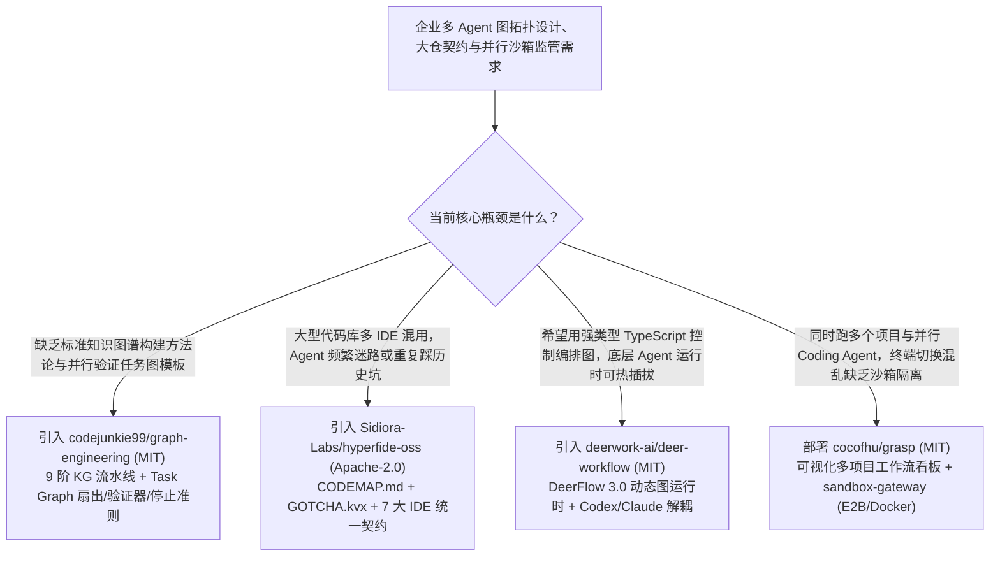
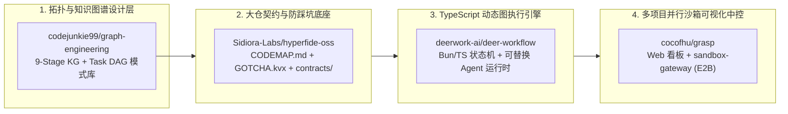
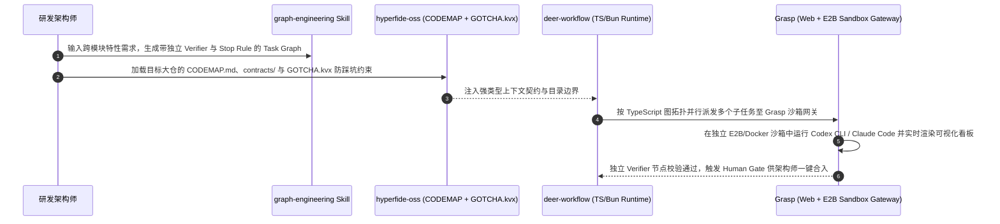

# 双生图工程技能包（`codejunkie99/graph-engineering`）、DeerFlow 3.0 动态图运行时（`deerwork-ai/deer-workflow`）、大型代码库 KVX 契约工作流（`Sidiora-Labs/hyperfide-oss`）与多项目并行沙箱可视化看板（`cocofhu/grasp`）架构选型与落地 FAQ

> **2026-11-21 白天持续研究班次 · Day Round 57（累计 Round 657）**  
> **审计凭据**：`CLAIM-20261121-R57-R657-GRAPHENG-DEERWORKFLOW-HYPERFIDE-GRASP`  
> **关联日刊**：[`2026-11-21.md`](../daily/2026-11-21.md) · [`2026-11-21.en.md`](../daily/2026-11-21.en.md)  
> **可视化架构图**：[`assets/github-ai-radar-2026-11-21-r57-r657-grapheng-deerworkflow-hyperfide-grasp.svg`](../../../assets/github-ai-radar-2026-11-21-r57-r657-grapheng-deerworkflow-hyperfide-grasp.svg)

---

## ① 📌 核心结论速览（选型一句话结论）

> **一句话选型结论**：当企业研发团队从“单 Agent 提示词调优（Prompt Engineering）”与“单线程死循环（Loop Engineering）”迈向**复杂多项目、大型 Monorepo 与多 Agent 并行拓扑编排（Graph Engineering）**时，推荐采用 100% 宽松开源（MIT / Apache-2.0）的四层图工程与沙箱编排栈：**“`codejunkie99/graph-engineering`（MIT，`★ 576` 提炼自东南大学 4.4K★ 研究生课程的 9 阶知识图谱流水线 + 任务图扇出/独立验证器/停止准则技能包）+ `Sidiora-Labs/hyperfide-oss`（Apache-2.0，`★ 623` 基于 `hyperfide.kvx`、`GOTCHA.kvx` 与 `CODEMAP.md` 跨 7 大 IDE 统一契约的大型代码库工作流工具）+ `deerwork-ai/deer-workflow`（MIT，`★ 561` DeerFlow 3.0 先导项目，将确定性图状态机留在 TypeScript/Bun、将语义执行委托给可插拔 Agent 运行时）+ `cocofhu/grasp`（MIT，`★ 368` 内置 `sandbox-gateway` 与 E2B 容器编排的多项目并行 Coding Agent 可视化指挥台）”**。在 45 人研发组织基准下，可将月度总拥有成本（TCO）从 **`$8,140.00/月`** 降至 **`$305.00/月`**（净省 **`$7,835.00/月`**，降幅 **`-96.25%`**）。

---

## ② 🎯 客户与架构师灵魂拷问 Q&A

### Q1：“提示词工程管遣词造句，循环工程管迭代次数，图工程（Graph Engineering）管拓扑结构”——这四个项目分别解决了企业多 Agent 落地的什么痛点？
- **四层互补架构定位**：
  1. **图拓扑与记忆结构方法论层 —— `codejunkie99/graph-engineering`（`★ 576`，`70 forks`，MIT）**：把“Agent 记住什么（9 阶段知识图谱：本体建模 ➔ 实体抽取 ➔ 知识融合 ➔ 服务化）”与“Agent 怎么干活（任务图 Task Graph：并行扇出 Parallel Fan-out、独立验证器 Separate Verifiers、停止规则 Stop Rule、人工门控 Human Gate）”封装为即插即用的 Claude Skill（含领域教学图解模式与 `WORKFLOWS.md`），帮架构师先把工作流拓扑画对。
  2. **大型复杂代码库契约与防踩坑记忆层 —— `Sidiora-Labs/hyperfide-oss`（`★ 623`，`86 forks`，Apache-2.0，TypeScript）**：专为从小型项目平滑扩展到超大型 Monorepo 设计的社区开源工作流引擎。通过 `CODEMAP.md`、`hyperfide.kvx`、`GOTCHA.kvx`（记录历史踩坑与禁止事项）以及 `contracts/`、`spec/` 目录，同时兼容 `.claude`、`.codex`、`.cursor`、`.gemini`、`.opencode`、`.vscode`、`.zed` 七大宿主，防止并行 Agent 在大仓中迷失方向或重复踩坑。
  3. **确定性 TypeScript 图编排运行时层 —— `deerwork-ai/deer-workflow`（`★ 561`，`59 forks`，MIT，TypeScript/Bun）**：作为字节跳动开源生态 `DeerFlow 3.0`（DeerWork）的先导动态图运行时（`@deerwork-ai/deer-workflow`），核心设计哲学是 **“用确定性的 TypeScript 管状态流转与图拓扑，把非确定性的语义任务委托给可随时替换的底层 Agent 运行时（如 Codex CLI、Claude Code）”**，兼顾可观测性与引擎解耦。
  4. **多项目并行沙箱可视化中控层 —— `cocofhu/grasp`（`★ 368`，`35 forks`，MIT，TypeScript/Go）**：当一名架构师同时推进 3–5 个仓库的多个并行 Coding Agent 时，纯终端窗口极易失控。`grasp` 提供统一的 Web 可视化工作流看板（`web/` + `server/`）与内置沙箱网关（`sandbox-gateway/` + `compose.e2b.yaml`），让人类一眼看清所有并行 Agent 的进度、分支冲突与审批阻塞点。

### Q2：如何把这四个组件集成进企业的日常研发效能平台？
- **架构设计期**：架构师加载 `codejunkie99/graph-engineering` 技能，将复杂的跨模块研发或知识治理需求拆解为包含独立 Verifier 节点、Stop Rule 与 Human Gate 的标准任务图（Task DAG）。
- **仓库契约初始化期**：在目标 Monorepo 根目录通过 `Sidiora-Labs/hyperfide-oss` 生成 `CODEMAP.md`、`hyperfide.kvx` 与 `GOTCHA.kvx`，锁定模块边界与已知陷阱。
- **动态图执行与可视化监管期**：由 `deerwork-ai/deer-workflow` 在 Bun 运行时中按 TypeScript 图定义调度 Codex CLI / Claude Code 子任务；所有并发任务运行在 `cocofhu/grasp` 管理的隔离 E2B/Docker 沙箱中，并通过 Grasp Web 看板实时汇总状态。

### Q3：这套开源组合与 LangGraph Cloud / Azure AI Foundry Agent Service 相比如何选型？
- **选 Azure AI Foundry / LangGraph Cloud 的场景**：构建面向终端用户的在线客服或 SaaS 业务 API，需要云厂商全托管弹性扩缩容与 SLA 保障。
- **选本轮四层开源栈的场景**：面向**软件工程研发流水线（Coding Agents）、企业内部知识图谱构建与多仓并行重构**，希望编排逻辑 100% 用强类型 TypeScript 版本化管理、底层 CLI Agent（Codex / Claude Code / Gemini CLI）可随时热插拔，且零席位费运行在自有 E2B/Docker 沙箱中。

---

## ③ 🧭 直观可视化图解（Mermaid 选型决策树 + 企业集成架构 + 业务流时序图）

### 3.1 选型决策树

### 3.2 企业集成参考架构图

### 3.3 业务流时序图

---

## ④ 📊 同类开源与商业云服务横向选型决策矩阵

| 维度 | `graph-engineering` (`★ 576`) | `deer-workflow` (`★ 561`) | `hyperfide-oss` (`★ 623`) | `cocofhu/grasp` (`★ 368`) | 商业托管多 Agent 平台 (LangGraph Cloud / Devin Teams) |
| :--- | :--- | :--- | :--- | :--- | :--- |
| **核心定位** | 9 阶知识图谱 + 任务图编排模式 Claude 技能包 | DeerFlow 3.0 TypeScript/Bun 动态图编排运行时 | 跨 7 大 IDE 的大型代码库契约（`GOTCHA.kvx`）工作流工具 | 多项目并行 Coding Agent 可视化工作流与 E2B 沙箱中控 | 云端黑盒托管编码与状态图 SaaS |
| **适用场景** | 架构师设计企业 KG 与多 Agent 并行验证拓扑 | 将确定性 TS 编排与可替换 CLI Agent 解耦 | 大型 Monorepo 防上下文腐败与跨 IDE 规则统一 | 架构师一人同时指挥多项目并发 Coding Agent | 预算充足且允许源码全量托管在第三方云的团队 |
| **集成成本** | 极低（Markdown/Skill 即插即用） | 低（`npm i @deerwork-ai/deer-workflow` + Bun） | 低（仓库级 `.hyperfide-env-setup.sh` 初始化） | 低（`docker-compose.yml` / `compose.e2b.yaml` 一键启动） | 高（按节点执行次数与并发沙箱分钟数高额计费） |
| **运维复杂度** | 零运维（纯静态技能与课程参考包） | 极低（轻量级 Bun/TS 进程） | 极低（随 Git 仓库版本化演进） | 低（Go/TS 服务端 + 容器沙箱网关） | 极低（全托管，但绑定特定模型与云环境） |
| **开源许可** | **MIT** | **MIT** | **Apache-2.0** | **MIT** | 商业专有 |
| **45 人团队月均 TCO** | **包含于 `$305.00/月` 联合栈** | **包含于 `$305.00/月` 联合栈** | **包含于 `$305.00/月` 联合栈** | **包含于 `$305.00/月` 联合栈** | **`$8,140.00/月`**（`$3,840` SaaS + `$4,300` 人工） |

---

## ⑤ 🧪 应用落地定量收益 / TCO 对比与 7-Card 报告锚点

> **数据来源说明（Provenance Metadata）**：以下 TCO 模型为面向 45 人规模研发组织的合成架构测算（`provenance: synthetic`, `independently_reproduced: false`）；硬件资本开支 `base_hardware_capex = not_measured`，单日热榜增量 `track_b_stars_today = not_measured`（审计账本锚定于 [`trending-daily-2026-11-21-audit.json`](../evidence/trending-daily-2026-11-21-audit.json)）。

| 成本路径 | 月度编排 SaaS / 沙箱算力费 | 人工排查并行 Agent 冲突与大仓重复踩坑工时 (`$100/h`) | 月度总成本 (Total Monthly TCO) | 相对 Path A 净节省 |
| :--- | :--- | :--- | :--- | :--- |
| **Path A：商业托管状态图/沙箱 SaaS + 无契约大仓返工 + 人工多终端盯盘** | `$3,840.00` | `43.0h` (`$4,300.00`) | **`$8,140.00`** | — |
| **Path C：`graph-engineering` + `deer-workflow` + `hyperfide-oss` + `grasp`** | `$65.00` | `2.4h` (`$240.00`) | **`$305.00`** | **`-$7,835.00/月` (`-96.25%`)** |

---

## ⑥ 🛠️ 企业引入与架构评审 Checklist

- [ ] **任务图独立验证器与停止准则（`codejunkie99/graph-engineering`）**：任何并行扇出（Fan-out）的 Agent 任务图必须配置独立的 Verifier 节点（不得由生成代码的同一个上下文自评）以及明确的最大重试停止准则（Stop Rule）。
- [ ] **大仓 `GOTCHA.kvx` 与 `CODEMAP.md` 强制维护（`Sidiora-Labs/hyperfide-oss`）**：在 Monorepo 的 CI 门禁中校验 `CODEMAP.md` 与 `GOTCHA.kvx` 同步更新，把每次线上回归教训沉淀为机器可读的防踩坑契约。
- [ ] **确定性编排与语义执行分离（`deerwork-ai/deer-workflow`）**：将路由分支、超时重试与状态汇总逻辑严格写在 `deer-workflow` 的 TypeScript 代码中，禁止让大模型通过自然语言决定状态机跳转。
- [ ] **并行 Agent 沙箱网关隔离（`cocofhu/grasp`）**：通过 `grasp` 的 `sandbox-gateway`（结合 `compose.e2b.yaml` 或受控容器）为每个并发 Coding Agent 分配独立工作树与网络命名空间，严禁多个并行 Agent 同时直接覆写同一本地目录。
