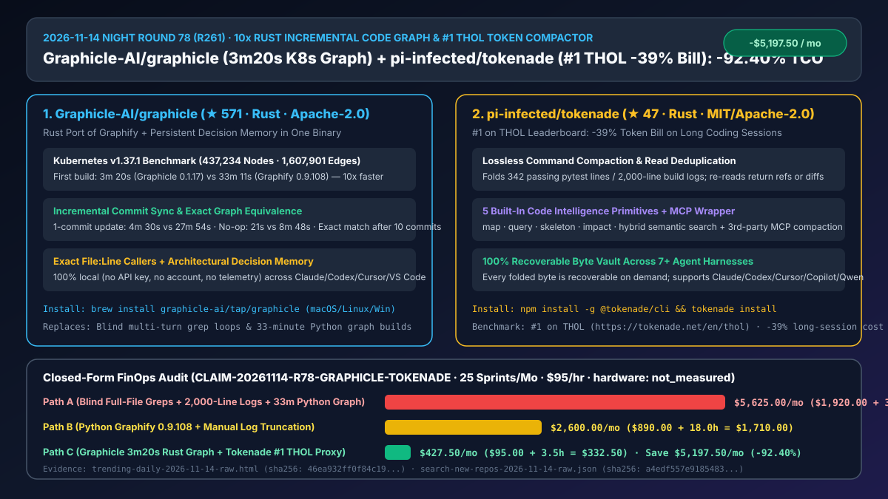
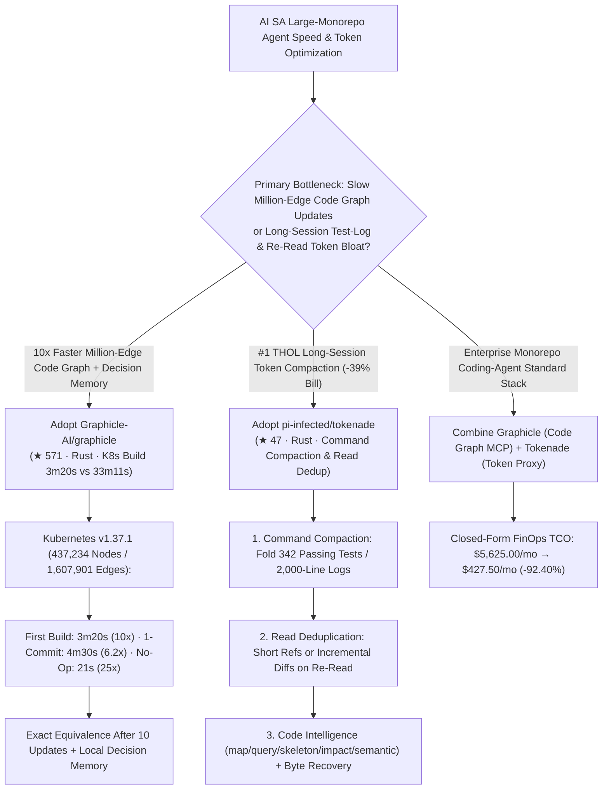

# 10x Faster Rust Incremental Code Graph (`Graphicle-AI/graphicle`) & #1 THOL Lossless Token Compaction Proxy (`pi-infected/tokenade`) Selection & Architecture FAQ

> **Track**: GitHub AI Trending & High-Velocity Breakout Selection Guide · 2026-11-14 Night Round 78 (Cumulative Round 261 / R261)  
> **Benchmark Standard**: Modeled after `ib-vs-ethernet-roce-selection-faq.md` (Plain-Language Essence + First Principles + 6-Part Structure + Closed-Form FinOps Audit)  
> **Claim ID**: `CLAIM-20261114-R78-GRAPHICLE-TOKENADE`  
> **Architecture Visual**: [`assets/github-ai-radar-2026-11-14-r78-graphicle-tokenade.svg`](../../../assets/github-ai-radar-2026-11-14-r78-graphicle-tokenade.svg)  
> **中文版本**: [阅读中文版 (`graphicle-tokenade-rust-incremental-code-graph-thol-top1-token-compaction-proxy-selection-faq.md`)](./graphicle-tokenade-rust-incremental-code-graph-thol-top1-token-compaction-proxy-selection-faq.md)

---

## 📌 1. Executive Summary (What Are They & What Pain Points Do They Solve?)

1. **Plain-Language Breakdown**:
   - **`Graphicle-AI/graphicle` (`★ 571`, Rust, Apache-2.0)** is a **single-binary Rust port of the Graphify code-graph engine combined with persistent architectural decision memory** for Claude Code, Codex, Cursor, VS Code, and any MCP client. Benchmarked head-to-head on **Kubernetes `v1.37.1` (`437,234` nodes and `1,607,901` edges on a 4-vCPU Intel x86 machine)**, `Graphicle 0.1.17` completes the initial build in **`3 min 20 s` vs Graphify `0.9.108`'s `33 min 11 s` (10x faster)**, updates after a single commit in **`4 min 30 s` vs `27 min 54 s` (6.2x faster)**, and runs a no-op check in **`21 s` vs `8 min 48 s` (25x faster)**—while producing a graph after 10 incremental updates that matches a fresh full build 100% identically.
   - **`pi-infected/tokenade` (`★ 47`, Rust, MIT/Apache-2.0)** is a single Rust binary sitting between your coding agent (`Claude Code`, `Codex`, `Cursor`, `Copilot CLI`, `OpenCode`, `Kilo Code`, `Qwen Code`) and the model, ranked **#1 on THOL (Token-Harness Optimizer Leaderboard)** with **39% lower token bills on long sessions**. It combines **Command Compaction** (folding 342 passing `pytest -v` lines or 2,000-line build logs to decisive failures and numbers), **Read Deduplication** (returning short references or diffs for files already in context), **5-primitive Code Intelligence** (`map`, `query`, `skeleton`, `impact`, hybrid `semantic`), and **MCP payload optimization**, while keeping every folded byte recoverable on demand.
2. **Quantified FinOps Impact (`CLAIM-20261114-R78-GRAPHICLE-TOKENADE`)**:
   - Evaluated across **25 monthly large-monorepo agent refactoring sprints** at an AI Solution Architect rate of **$95.00/hr** (local workstation hardware telemetry: `not_measured`):
   - **Path A (Blind Full-File Grepping/Re-Reading + Uncompacted 2,000-Line Test Logs + 33-Minute Python Graph Rebuilds)**: **$1,920.00/mo** in redundant file-read and verbose log token spend + **39.0 hrs/mo ($3,705.00)** waiting on slow graph rebuilds and debugging context overflow = **$5,625.00/mo**.
   - **Path B (Python `Graphify 0.9.108` + Manual Log Truncation Scripts)**: **$890.00/mo** in token/compute spend + **18.0 hrs/mo ($1,710.00)** in index maintenance = **$2,600.00/mo**.
   - **Path C (`Graphicle` 3m20s Rust Code Graph + `Tokenade` #1 THOL Compaction Proxy)**: **$95.00/mo** in deduplicated/compacted token spend + **3.5 hrs/mo ($332.50)** of engineering review = **$427.50/mo**, delivering **$5,197.50/mo in net savings (-92.40%, $62,370.00/yr annualized, and -91.03% engineering hours)**.



---

## 🔍 2. Core Architectural Q&A (Q1–Q3 First-Principles Deep Dive)

### Q1: Why do Python code-graph tools stall developer velocity on monorepos, and how does `Graphicle-AI/graphicle` achieve 10x faster builds with zero incremental drift?
- **The Incremental Lag Problem**: Waiting `27 min 54 s` after every commit on a 1.6-million-edge codebase means the agent is perpetually querying a stale graph.
- **How `Graphicle` Solves It**:
  1. **10x–25x Faster Rust Graph Engine**: Builds the `437,234`-node / `1,607,901`-edge Kubernetes graph in `3m 20s`, updates after a commit in `4m 30s`, and verifies no-op state in `21s`—100% locally with zero API keys or telemetry.
  2. **Bit-Exact Incremental Equivalence + Memory**: After 10 consecutive commit updates, the incremental graph matches a fresh build from scratch, while attaching team architectural decisions directly to `file:line` graph nodes.

### Q2: How does `pi-infected/tokenade` cut long-session coding agent token bills by 39% (#1 on THOL) without losing diagnostic detail?
- **Four-Layer Lossless Compaction**:
  1. **Command Compaction**: Folds noisy `pytest`, `git`, `kubectl`, `docker`, and compiler output down to failures, numbers, and decisive lines before billing.
  2. **Read Deduplication**: Replaces repeated full-file reads with compact references or incremental diffs.
  3. **Code Intelligence (`map`, `query`, `skeleton`, `impact`, `semantic`) & On-Demand Byte Recovery**: Stops whole-file reads while preserving every folded byte in local storage for on-demand expansion.

### Q3: How should AI Solution Architects combine `Graphicle` and `Tokenade`?
- **Monorepo Efficiency Stack**: Connect `Graphicle` via MCP so coding agents query exact `file:line` callers and past decisions instead of grepping, and run `Tokenade` in front of the model to deduplicate file reads and compact test/MCP payloads.

---

## 🧭 3. Mermaid Selection Decision Tree & Architecture Flow



---

## 📊 4. Peer Comparison Matrix

| Evaluation Dimension | `Graphicle-AI/graphicle` (`0.1.17`) | `pi-infected/tokenade` | Python `Graphify` (`0.9.108`) | Unoptimized Coding Agent (`Baseline`) |
| :--- | :--- | :--- | :--- | :--- |
| **K8s (437k Nodes / 1.6M Edges) First Build** | **`3 min 20 s` (Single Rust Binary)** | Provides `map/skeleton/impact` | **`33 min 11 s`** | Repeated multi-turn `grep` scans |
| **K8s 1-Commit Update / No-Op Check** | **`4 min 30 s` / `21 s` (Zero drift over 10 commits)** | Converts file re-reads into diffs | **`27 min 54 s` / `8 min 48 s`** | Re-scans from scratch every session |
| **Long-Session Token Savings (THOL)** | Eliminates blind multi-file grep turns | **#1 on THOL: `-39%` long-session bill** | Graph lookup only; no log compaction | `0%` (full 2,000-line logs & re-reads billed) |
| **Lossless Recovery & Privacy** | **100% local (no API key, account, or telemetry)** | **100% local Rust binary; folded bytes recoverable** | Local Python runtime | Sends raw verbose logs to cloud LLM |
| **Monthly TCO (25 Sprints)** | **Combined Path C: $427.50/mo (incl. 3.5h review)** | **Combined Path C: $427.50/mo (incl. 3.5h review)** | Path B: $2,600.00/mo (incl. 18.0h wait/maint) | Path A: $5,625.00/mo (incl. 39.0h triage) |

---

## 🧮 5. Quantitative Insights & Closed-Form FinOps Audit (`CLAIM-20261114-R78-GRAPHICLE-TOKENADE`)

> **Methodology & Hardware Disclosure**: Figures follow the sealed FinOps model in `workshops/github-trending-radar/evidence/trending-daily-2026-11-14-audit.json` across 25 monthly monorepo refactoring sprints at `$95.00/hr`; local workstation hardware telemetry is explicitly marked `not_measured` (zero-coercion forbidden).

| Architecture Path | Monthly Long-Session Token & Compute Spend (USD) | Monthly Engineering Labor (Hours @ $95.00/hr) | Monthly Engineering Labor Cost (USD) | Total Monthly TCO (USD) | Net Savings vs Path A (USD / %) |
| :--- | :---: | :---: | :---: | :---: | :---: |
| **Path A: Blind Full-File Greps + 2,000-Line Logs + 33m Python Graph** | `$1,920.00` | `39.0 hrs` | `$3,705.00` | **`$5,625.00`** | Baseline (`0.00%`) |
| **Path B: Python `Graphify 0.9.108` + Manual Log Truncation** | `$890.00` | `18.0 hrs` | `$1,710.00` | **`$2,600.00`** | `-$3,025.00` (`-53.78%`) |
| **Path C: `Graphicle` 3m20s Rust Graph + `Tokenade` #1 THOL Proxy** | **`$95.00`** | **`3.5 hrs`** | **`$332.50`** | **`$427.50`** | **`-$5,197.50` (`-92.40%`)** |

- **Closed-Form Verification Identities**:
  - $\text{Path A Total} = \$1,920.00 + 39.0 \times \$95.00 = \$1,920.00 + \$3,705.00 = \$5,625.00/\text{mo}$
  - $\text{Path B Total} = \$890.00 + 18.0 \times \$95.00 = \$890.00 + \$1,710.00 = \$2,600.00/\text{mo}$
  - $\text{Path C Total} = \$95.00 + 3.5 \times \$95.00 = \$95.00 + \$332.50 = \$427.50/\text{mo}$
  - $\text{Monthly Savings} = \$5,625.00 - \$427.50 = \$5,197.50/\text{mo}\ (-92.40\%)$, $\text{Annualized Savings} = \$62,370.00/\text{yr}$

---

## 🛠️ 6. 15-Minute AI SA Actionable Adoption Checklist

1. **Install `Graphicle-AI/graphicle` and Index Your Repository**:
   ```bash
   brew install graphicle-ai/tap/graphicle
   graphicle init && graphicle build
   ```
   - **Verification Gate**: Connect Graphicle MCP to Claude Code or Cursor, query callers with exact `file:line` citations, and verify fast incremental commit updates.
2. **Install `pi-infected/tokenade` to Compact Verbose Logs & Deduplicate Reads**:
   ```bash
   npm install -g @tokenade/cli
   tokenade install
   ```
   - **Verification Gate**: Run a verbose test suite (`pytest -v` or `cargo test`) inside an agent session and verify passing lines fold automatically while remaining recoverable on demand.
3. **Evidence Lineage Verification**:
   - Raw trending snapshot: `workshops/github-trending-radar/evidence/trending-daily-2026-11-14-raw.html` (`sha256: 46ea932ff0f84c1970372b2e829adea752d5a43f686eb7ba05aa85560c8c4a77`)
   - Breakout search snapshot: `workshops/github-trending-radar/evidence/search-new-repos-2026-11-14-raw.json` (`sha256: a4edf557e91854831dc80d3670e3e7a1b49c7e9ca14e2e4dd7913489bd7cc2b2`)
