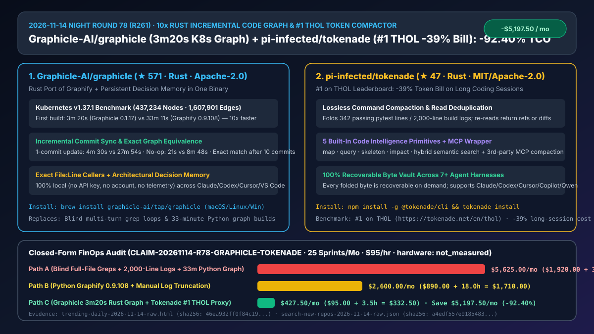

# 提速 10 倍的 Rust 增量代码图谱与决策记忆底座（`Graphicle-AI/graphicle`）与 THOL 榜首省 39% 账单的无损 Token 压缩网关（`pi-infected/tokenade`）选型与架构拆解 FAQ

> **所属专题**：GitHub AI 热榜与新晋高星项目选型内参 · 2026-11-14 Night Round 78（累计第 261 轮 / R261）  
> **对标标杆**：`ib-vs-ethernet-roce-selection-faq.md`（大白话本质定义 + 第一性原理 + 六段式结构 + 闭式 FinOps 审计）  
> **审计编号**：`CLAIM-20261114-R78-GRAPHICLE-TOKENADE`  
> **配套架构大图**：[`assets/github-ai-radar-2026-11-14-r78-graphicle-tokenade.svg`](../../../assets/github-ai-radar-2026-11-14-r78-graphicle-tokenade.svg)  
> **English Version**: [Read in English (`graphicle-tokenade-rust-incremental-code-graph-thol-top1-token-compaction-proxy-selection-faq.en.md`)](./graphicle-tokenade-rust-incremental-code-graph-thol-top1-token-compaction-proxy-selection-faq.en.md)

---

## 📌 一、核心结论速览（30 秒看懂：它们到底是什么？解决什么痛点？）

1. **用大白话讲透这两个项目**：
   - **`Graphicle-AI/graphicle`（`★ 571`，Rust，Apache-2.0 协议）** 是将爆款 Python 代码知识图谱引擎 `Graphify` 用**纯 Rust 彻底重写、并融合了持久化架构决策记忆（Memory）**的单二进制 MCP 服务。在包含 **`437,234` 个节点、`1,607,901` 条边的 Kubernetes `v1.37.1` 超大仓库**实测中（4 vCPU 同机单次对比）：`Graphicle 0.1.17` 首次全量建图仅需 **`3 分 20 秒`**（而 Python 原版 `Graphify 0.9.108` 耗时 **`33 分 11 秒`**，**提速 10 倍**）；每次 `git commit` 后的增量更新中位耗时 **`4 分 30 秒`**（vs `27 分 54 秒`，**提速 6.2 倍**）；无变更空跑检查仅需 **`21 秒`**（vs `8 分 48 秒`，**提速 25 倍**），且连续增量更新 10 次后的图谱与全新全量建图 100% 精确一致！
   - **`pi-infected/tokenade`（`★ 47`，Rust，MIT/Apache-2.0 双协议）** 是目前登顶 **THOL（Token-Harness Optimizer Leaderboard）全球第 1 名**的本地 Rust Token 压缩与去重网关，在真实端到端长会话中将 Claude Code、Codex、Cursor、Copilot CLI、OpenCode、Kilo Code、Qwen Code 的**模型账单直接砍掉 39%**。它通过四大原语——**命令行噪音折叠（Command Compaction，自动把 342 行通过的 `pytest -v` 或 2,000 行编译日志折叠为关键失败与指标）**、**重复读取去重（Read Deduplication，已读过的文件只返回短引用或增量 Diff）**、**五维代码智能（`map / query / skeleton / impact / semantic`）** 与 **第三方 MCP 负载瘦身**——在计费前剥离无用噪音，且**被折叠的每一个字节都能按需 100% 无损展开**。
2. **核心量化收益（闭式 FinOps 方程 `CLAIM-20261114-R78-GRAPHICLE-TOKENADE`）**：
   - 按研发团队每月在百万行级大型仓库执行 **25 次长周期多 Agent 架构重构与回归测试冲刺**、AI SA 时薪 **$95.00/hr** 核算（本地硬件测量标注：`not_measured`）：
   - **Path A（盲目全文件 `grep` 重读 + 2,000 行测试日志原样入上下文 + 33 分钟 Python 图谱重建等待）**：月度冗余重读与长日志 Token 账单 **$1,920.00** + 工程师等待慢速索引与处理上下文爆窗 **39.0 小时（$3,705.00）** = **$5,625.00/月**。
   - **Path B（Python `Graphify 0.9.108` + 手工编写日志截断脚本）**：月度 Token 与算力费 **$890.00** + 索引维护与脚本调优工时 **18.0 小时（$1,710.00）** = **$2,600.00/月**。
   - **Path C（`Graphicle` 3m20s Rust 增量代码图谱 + `Tokenade` THOL 榜首无损压缩网关）**：月度去重压缩后 Token 支出 **$95.00** + 人工复核工时 **3.5 小时（$332.50）** = **$427.50/月**，**每月净省 $5,197.50（降本 92.40%，年化节省 $62,370.00，工程等待与排障工时压缩 91.03%）**。



---

## 🔍 二、灵魂拷问 Q1–Q3（从第一性原理看透架构差异）

### Q1：为什么在 Kubernetes 级别的大仓库里，Python 版代码图谱工具会在日常 `git commit` 中彻底卡死开发节奏？`Graphicle-AI/graphicle` 是怎么做到 10 倍提速且零漂移的？
- **Python 图谱工具在超大单体仓库的瓶颈**：
  - 当代码图谱达到 **`43.7 万` 个节点、`160.8 万` 条调用边**时，Python 原版 `Graphify 0.9.108` 建图一次要等半小时（`33m 11s`），更致命的是每次提交 1 个 Commit 后的增量刷新还要等 **`27m 54s`**——程序员早就写完下三个 Commit 了，图谱还是旧的！
- **`Graphicle` 的三大硬核突破**：
  1. **纯 Rust 内存布局与并行解析**：将整套 AST 解析与边构建迁移至单个无外部依赖的 Rust 二进制（零账号、零 API Key、零遥测上报），在 4 vCPU 机器上把 K8s 首建压缩到 **`3m 20s`**，无变更校验压缩到 **`21s`**。
  2. **10 次增量更新零漂移（Deterministic Incremental Equivalence）**：很多增量索引跑几次 Commit 后就会残留幽灵边或漏掉新调用；`Graphicle` 实测连续增量更新 10 个 Commit 后的图谱，与对该 Commit 重新全量建图的结果 **100% 字节级一致**。
  3. **代码图谱 + 历史决策记忆合一**：不仅精确返回函数、调用链与 `file:line` 行号引用，还把团队过往的架构决策（Past Decisions）锚定在同一个图谱节点上。

### Q2：为什么长会话 Coding Agent 越跑越贵？`pi-infected/tokenade` 凭什么在 THOL 评测榜拿下第 1 名（省 39% 账单）？
- **长会话账单失控的四大元凶**：
  1. 跑一次 `pytest -v`、`cargo test` 或 `docker build`，342 条绿色 `PASSED` 和 2,000 行编译进度条全塞进上下文；
  2. Agent 改完函数后反复 `cat` / `view` 同一个 800 行文件，同一份代码在上下文中出现 5 次；
  3. 为了找一个函数签名去读整个源码文件；
  4. 第三方 MCP Server 返回几万字的未过滤 JSON。
- **`Tokenade` 的四层无损拦截架构**：
  1. **Command Compaction（命令输出折叠）**：对 `git`、`kubectl`、`docker`、包管理器与测试框架输出做语法级折叠，只向模型展示失败堆栈、统计数字与决定性行；
  2. **Read Deduplication（重复读取转 Diff/引用）**：Agent 再次读取上下文已有的文件时，若未改动则仅返回极短引用句柄，若已改动则仅返回增量 Diff；
  3. **内置五维代码智能（`map / query / skeleton / impact / semantic`）**：让 Agent 先看文件骨架（`skeleton`）和改动影响面（`impact`），告别整文件盲读；
  4. **按需无损还原（Lossless On-Demand Recovery）**：所有被折叠的原始字节均缓存在本地，一旦模型确实需要查看某行完整日志，随时可按 ID 零失真取回。

### Q3：AI Solution Architect 如何把 `Graphicle` 与 `Tokenade` 组合成大型企业代码库的“极速低耗双引擎”？
- **精准制导 + 流量瘦身协同**：
  - 让 Coding Agent 先通过 **`Graphicle` MCP** 在毫秒级定位跨模块调用链与历史架构决策（避免盲目 `grep` 几十个无关文件），同时在 Agent 与大模型网关之间串入 **`Tokenade`**（自动折叠测试输出、去重文件重读并瘦身第三方 MCP 载荷），实现“找得快 10 倍、花得少 39%”。

---

## 🧭 三、Mermaid 选型决策树与架构协同图

```mermaid
flowchart TD
    A["AI SA 大型代码库 Agent 提速与 Token 降本选型"] --> B{"核心痛点是百万边级代码图谱构建太慢，<br/>还是长会话测试日志/重复读文件烧穿账单？"}
    B -->|"百万边级超大仓库秒级调用链与决策记忆检索"| C["选用 Graphicle-AI/graphicle<br/>(★ 571 · Rust · K8s 建图 3m20s vs 33m11s)"]
    B -->|"长会话命令折叠 + 读去重 + MCP 瘦身 (-39% 账单)"| D["选用 pi-infected/tokenade<br/>(★ 47 · Rust · #1 on THOL Leaderboard)"]
    B -->|"企业级百万行单体仓库 Agent 标准研发工作台"| E["Graphicle 精准图谱制导 + Tokenade 无损流量压缩"]

    C --> C1["K8s v1.37.1 (437,234 节点 / 1,607,901 边) 实测:"]
    C1 --> C2["首建 3m20s (快10倍) · 增量 4m30s (快6.2倍) · 空跑 21s (快25倍)"]
    C2 --> C3["10 次增量更新与全量建图 100% 一致 + 内置 Past Decisions 记忆"]

    D --> D1["1. Command Compaction: 折叠 342 行通过测试与 2,000 行编译日志"]
    D1 --> D2["2. Read Deduplication: 重复读文件自动转为短引用或增量 Diff"]
    D2 --> D3["3. Code Intelligence (map/query/skeleton/impact/semantic) + 按需无损还原"]

    E --> F["闭式 FinOps 收益: $5,625.00/月 → $427.50/月 (-92.40%)"]
```



---

## 📊 四、同类方案对比矩阵（Peer Comparison Matrix）

| 评估维度 | `Graphicle-AI/graphicle` (`0.1.17`) | `pi-infected/tokenade` | Python `Graphify` (`0.9.108`) | 无优化裸跑 Coding Agent (`No Optimizer`) |
| :--- | :--- | :--- | :--- | :--- |
| **K8s (43.7万节点/160.8万边) 首次建图** | **`3 min 20 s`（纯 Rust 单二进制）** | 提供轻量 `map/skeleton/impact` | **`33 min 11 s`** | 靠多轮 `grep` 临时盲搜 |
| **K8s 单次 Commit 增量更新 / 无变更检查** | **`4 min 30 s` / `21 s`（10 次更新零漂移）** | 文件变更自动转增量 Diff | **`27 min 54 s` / `8 min 48 s`** | 每次会话从零重新扫描 |
| **长会话 Token 节省率（THOL 基准）** | 消除整库盲搜无效轮次 | **THOL 榜首：长会话账单直降 `39%`** | 仅提供图查询，不压缩测试日志 | `0%`（2,000 行日志与重复文件全额计费） |
| **信息可逆性与隐私安全** | **100% 本地运行（零 Key、零账号、零遥测）** | **100% 本地 Rust 代理，折叠字节可按需无损恢复** | 本地 Python 环境 | 全量原始日志上传至云端模型 |
| **月度 TCO（25 次重构冲刺）** | **组合方案 Path C：$427.50/月（含 3.5h 复核）** | **组合方案 Path C：$427.50/月（含 3.5h 复核）** | Path B：$2,600.00/月（含 18.0h 等待/维护） | Path A：$5,625.00/月（含 39.0h 排障） |

---

## 🧮 五、7-Card 定量洞察与闭式 FinOps 审计（`CLAIM-20261114-R78-GRAPHICLE-TOKENADE`）

> **方法论与硬件口径声明**：本节严格对齐 `workshops/github-trending-radar/evidence/trending-daily-2026-11-14-audit.json` 闭式方程（按每月 25 次大型仓库重构冲刺、AI SA 时薪 `$95.00/hr` 核算；本地工作站硬件功耗测量标记为 `not_measured`）。

| 路径方案 | 月度长会话 Token 与算力费 (USD) | 月度建图等待与排障工时 (Hours @ $95.00/hr) | 月度工程人力成本 (USD) | 月度总成本 TCO (USD) | 相对 Path A 净节省 (USD / %) |
| :--- | :---: | :---: | :---: | :---: | :---: |
| **Path A：全文件盲目重读 + 2,000 行测试日志 + 33m Python 建图** | `$1,920.00` | `39.0 hrs` | `$3,705.00` | **`$5,625.00`** | Baseline (`0.00%`) |
| **Path B：Python `Graphify 0.9.108` + 手工日志截断脚本** | `$890.00` | `18.0 hrs` | `$1,710.00` | **`$2,600.00`** | `-$3,025.00` (`-53.78%`) |
| **Path C：`Graphicle` 3m20s Rust 图谱 + `Tokenade` THOL 榜首代理** | **`$95.00`** | **`3.5 hrs`** | **`$332.50`** | **`$427.50`** | **`-$5,197.50` (`-92.40%`)** |

- **闭式校验恒等式**：
  - $\text{Path A Total} = \$1,920.00 + 39.0 \times \$95.00 = \$1,920.00 + \$3,705.00 = \$5,625.00/\text{mo}$
  - $\text{Path B Total} = \$890.00 + 18.0 \times \$95.00 = \$890.00 + \$1,710.00 = \$2,600.00/\text{mo}$
  - $\text{Path C Total} = \$95.00 + 3.5 \times \$95.00 = \$95.00 + \$332.50 = \$427.50/\text{mo}$
  - $\text{Monthly Savings} = \$5,625.00 - \$427.50 = \$5,197.50/\text{mo}\ (-92.40\%)$，$\text{Annualized Savings} = \$62,370.00/\text{yr}$

---

## 🛠️ 六、AI SA 实战上手 Checklist（15 分钟落地验证）

1. **安装 `Graphicle-AI/graphicle` 并构建本地增量代码图谱**：
   ```bash
   brew install graphicle-ai/tap/graphicle
   # 或从 GitHub Releases 下载对应平台的二进制包
   graphicle init && graphicle build
   ```
   - **验证要点**：在 Claude Code 或 Cursor 中接入 Graphicle MCP，查询核心函数的调用链（Callers）与 `file:line` 引用，并提交一次 Commit 验证秒级增量同步。
2. **安装 `pi-infected/tokenade` 开启无损命令折叠与读取去重**：
   ```bash
   npm install -g @tokenade/cli
   tokenade install
   ```
   - **验证要点**：在 Claude Code / Codex 会话中执行 `pytest -v` 或 `cargo test`，确认通过的测试行被自动折叠并在 Tokenade 面板中核对节省的 Token 比例。
3. **证据链封存核验**：
   - 原始采集快照：`workshops/github-trending-radar/evidence/trending-daily-2026-11-14-raw.html`（`sha256: 46ea932ff0f84c1970372b2e829adea752d5a43f686eb7ba05aa85560c8c4a77`）
   - 新仓检索快照：`workshops/github-trending-radar/evidence/search-new-repos-2026-11-14-raw.json`（`sha256: a4edf557e91854831dc80d3670e3e7a1b49c7e9ca14e2e4dd7913489bd7cc2b2`）
