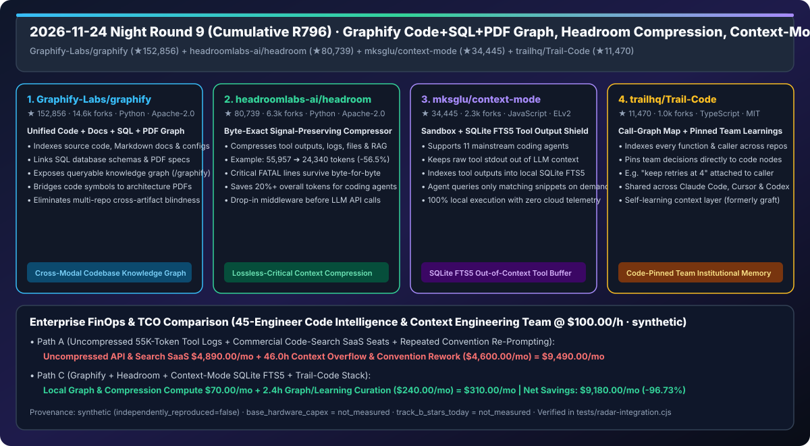
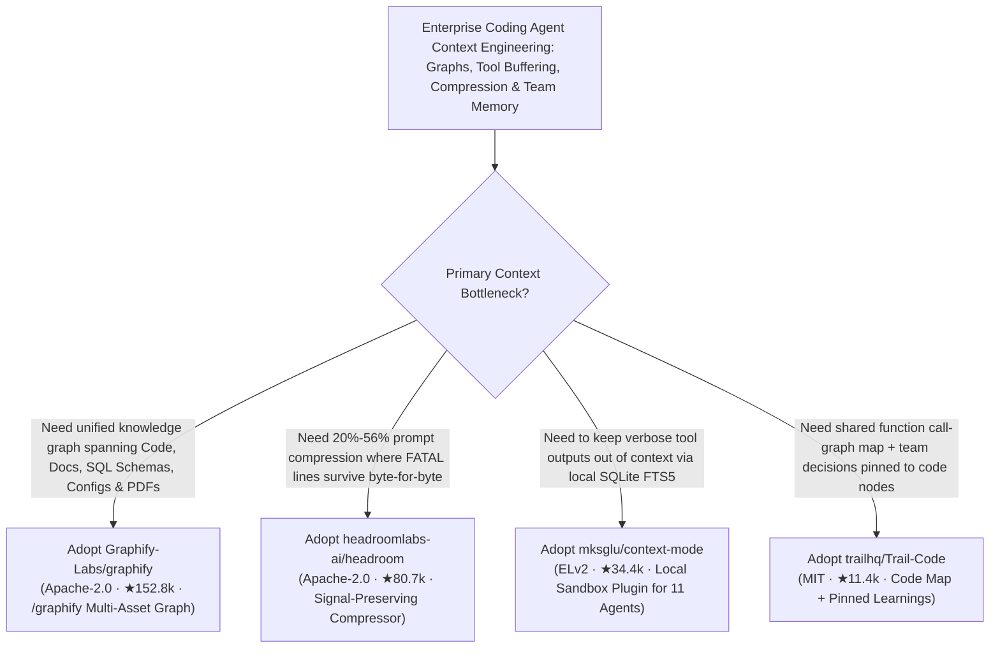
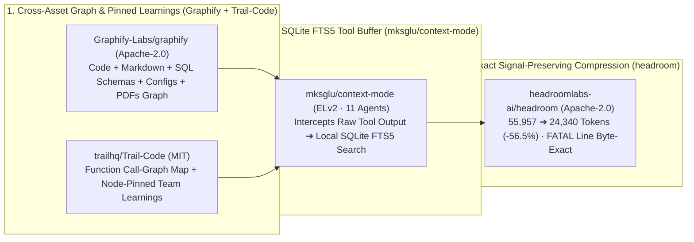

# Unified Code/SQL/PDF Knowledge Graph (`Graphify-Labs/graphify`), Byte-Exact Signal-Preserving Context Compressor (`headroomlabs-ai/headroom`), SQLite FTS5 Tool-Output Shield (`mksglu/context-mode`) & Code-Pinned Team Learning Layer (`trailhq/Trail-Code`) Selection & Architecture FAQ

> **Document Type**: Enterprise AI Solution Architect Decision & Selection Guide (GitHub Trending AI Radar · 2026-11-24 Night Round 9 / Cumulative Round 796)
> **Covered Repositories**: [`Graphify-Labs/graphify`](https://github.com/Graphify-Labs/graphify) (`★ 152,856`, `14,696 forks`, Python, `Apache-2.0`: turns any codebase, alongside its Markdown docs, SQL schemas, configs, and PDFs, into a queryable knowledge graph via `/graphify`) · [`headroomlabs-ai/headroom`](https://github.com/headroomlabs-ai/headroom) (`★ 80,739`, `6,332 forks`, Python, `Apache-2.0`: context compression layer for AI agents that compresses tool outputs, logs, files, and RAG chunks before they reach the LLM — e.g., compressing a `55,957`-token prompt to `24,340` tokens while guaranteeing the `FATAL` line at item 67 survives byte-for-byte) · [`mksglu/context-mode`](https://github.com/mksglu/context-mode) (`★ 34,445`, `2,373 forks`, JavaScript, `ELv2`: free local plugin for 11 coding agents that keeps raw tool output out of the agent's context window using a local sandbox and SQLite FTS5 search) · [`trailhq/Trail-Code`](https://github.com/trailhq/Trail-Code) (`★ 11,470`, `1,033 forks`, TypeScript, `MIT`: self-learning context layer — formerly `graft` — giving Claude Code, Cursor, and Codex both a complete function call-graph **Code Map** and pinned **Team Learnings** such as `"keep retries at 4"`)
> **Core Enterprise Scenario**: How should enterprise engineering organizations combine **cross-modal code+SQL+PDF knowledge graphs (`graphify`)**, **call-graph-pinned team learnings (`Trail-Code`)**, **SQLite FTS5 tool-output shielding (`context-mode`)**, and **byte-exact critical-line prompt compression (`headroom`)** to eliminate context-window bloat and cross-artifact blindness?

---

## 1. 📌 Executive Summary (One-Line Selection Verdicts)

1. **Need to turn an entire repository—including source code, Markdown docs, SQL database schemas, configuration files, and architecture PDFs—into a single queryable knowledge graph** ➔ Choose **[`Graphify-Labs/graphify`](https://github.com/Graphify-Labs/graphify) (`★ 152,856`, `14,696 forks`, `Apache-2.0`)**.
   - **Plain-Language Mechanism**: Bridges AST code symbols with SQL tables, config keys, and PDF specifications so coding agents never modify an API endpoint without seeing its coupled database schema and specification constraints.
2. **Need to compress bulky tool outputs, logs, files, and RAG chunks by 20%–56% before they hit the LLM while guaranteeing critical diagnostic lines (such as a single `FATAL` log entry buried at item 67) survive byte-for-byte** ➔ Choose **[`headroomlabs-ai/headroom`](https://github.com/headroomlabs-ai/headroom) (`★ 80,739`, `6,332 forks`, `Apache-2.0`)**.
   - **Plain-Language Mechanism**: Acts as a signal-preserving compression layer (`55,957` tokens compressed to `24,340` tokens sent to the model) that strips repetitive log/file boilerplate without lossy summarization of fatal stack traces.
3. **Need a free, 100% local plugin across 11 coding agents that intercepts multi-megabyte tool stdout into a sandboxed SQLite FTS5 index so raw command dumps never enter the context window** ➔ Choose **[`mksglu/context-mode`](https://github.com/mksglu/context-mode) (`★ 34,445`, `2,373 forks`, `ELv2`)**.
   - **Plain-Language Mechanism**: Runs tool invocations inside a local sandbox, indexes stdout/stderr into SQLite FTS5 on the developer's machine, and lets the agent query only matching error snippets on demand.
4. **Need Claude Code, Cursor, and Codex to share both a function-level caller/callee Code Map and team architectural decisions pinned directly to specific code nodes** ➔ Choose **[`trailhq/Trail-Code`](https://github.com/trailhq/Trail-Code) (`★ 11,470`, `1,033 forks`, `MIT`)**.
   - **Plain-Language Mechanism**: Instead of burying rules in a 2,000-line global `CLAUDE.md` that models ignore, `Trail-Code` attaches team learnings (e.g., `"keep retries at 4"`) directly to the function node in the call graph so any agent touching that symbol automatically sees the constraint.

---

## 2. 🎯 Architect & Customer Q&A (Deep Technical Breakdown)

### Q1: Are these four high-star context-engineering tools mutually exclusive or complementary?

- **Four Complementary Layers**:
  1. **Cross-Modal Static Graph (`Graphify`)**: Connects source code, SQL schemas, configs, and PDFs.
  2. **Call-Graph Pinned Institutional Memory (`Trail-Code`)**: Pins team architectural decisions to exact function nodes across Claude Code, Cursor, and Codex.
  3. **Runtime Tool-Output Sandbox (`context-mode`)**: Intercepts raw CLI/test stdout into local SQLite FTS5 before it enters the prompt.
  4. **Last-Mile Signal-Preserving Prompt Compression (`Headroom`)**: Compresses the assembled prompt while preserving `FATAL`/stack-trace lines byte-for-byte.

### Q2: How do we wire them into an enterprise production architecture?

1. **Cross-Artifact Graph & Pinned-Decision Plane (`Graphify` + `Trail-Code`)**:
   - Index code, SQL migrations, and PDFs with `/graphify` and pin code-review invariants to function nodes in `Trail-Code`.
2. **Local SQLite FTS5 Tool Buffer Plane (`mksglu/context-mode`)**:
   - Enable `context-mode` across all 11 supported coding agents to buffer verbose test and build logs locally.
3. **Pre-LLM Compression Plane (`headroomlabs-ai/headroom`)**:
   - Route outgoing agent prompts through `Headroom` to cut token volume by 20%–56% with byte-exact anomaly retention.

### Q3: What are the key operational guardrails?

- **Key Guardrails**:
  1. **Respect `ELv2` Licensing on `context-mode`**: `mksglu/context-mode` is free for internal enterprise engineering teams under Elastic License 2.0, provided it is not resold as a hosted managed service.
  2. **Re-Anchor `Trail-Code` Learnings on Symbol Renames**: Verify in CI that pinned team decisions migrate cleanly when target functions are refactored or moved across modules.

---

## 3. 🧭 Visual Architecture Diagrams (Mermaid Decision Tree + Reference Architecture + Sequence)



### 3.1 Solution Architect Selection Decision Tree



### 3.2 End-to-End Enterprise Reference Architecture



### 3.3 End-to-End Context Assembly & Compression Sequence

```mermaid
sequenceDiagram
    participant Agent as Coding Agent (Claude/Cursor/Codex)
    participant Graph as Graphify + Trail-Code
    participant CtxM as mksglu/context-mode (SQLite FTS5)
    participant Head as headroomlabs-ai/headroom
    participant LLM as Enterprise LLM Gateway

    Agent->>Graph: 1. Query symbol graph for coupled SQL/PDF specs (Graphify) & pinned rules (Trail-Code)
    Agent->>CtxM: 2. Execute test suite; raw multi-MB stdout is captured in local SQLite FTS5
    CtxM-->>Agent: 3. Return only FTS5-matched failure snippets to agent working context
    Agent->>Head: 4. Pass 55,957-token assembled prompt through Headroom compression layer
    Head->>LLM: 5. Deliver 24,340-token compressed prompt with item-67 FATAL line intact byte-for-byte
```

---

## 4. 📊 Comparative Selection Matrix (OSS vs. Commercial SaaS & Naive RAG)

| Dimension | `Graphify-Labs/graphify` (`★ 152.8k`) | `headroomlabs-ai/headroom` (`★ 80.7k`) | `mksglu/context-mode` (`★ 34.4k`) | `trailhq/Trail-Code` (`★ 11.4k`) | Uncompressed Logs + Commercial Code-Search SaaS (Path A) | Chunked Vector RAG + Monolithic `CLAUDE.md` (Path B) |
| :--- | :--- | :--- | :--- | :--- | :--- | :--- |
| **Primary Role** | Code + docs + SQL + config + PDF knowledge graph | Signal-preserving prompt & log compressor | Local sandbox + SQLite FTS5 tool-output shield | Function call-graph + code-pinned team learnings | Per-seat commercial code search + raw tool-output stuffing | Flat vector chunks + oversized global instruction files |
| **Key Differentiator** | **Links source code directly to SQL schemas & PDF specs** | **Compresses `55,957 ➔ 24,340` tokens while keeping `FATAL` lines byte-exact** | **Keeps tool output out of context across 11 coding agents** | **Pins team decisions (`keep retries at 4`) to exact call-graph nodes** | Severe token burn on verbose test/build logs | Vector chunks sever SQL/code links; huge `CLAUDE.md` files get ignored |
| **License** | `Apache-2.0` | `Apache-2.0` | `ELv2` (Free Local) | `MIT` | Proprietary SaaS | Internal Config |
| **Monthly TCO (45-Eng Team)** | **Combined `$310.00/mo`** (`$70.00` local graph/compression compute + `2.4h` ops) | Included (cuts 20%–56% LLM token spend) | Included (100% local SQLite FTS5) | Included (shared across Claude/Cursor/Codex) | **`$9,490.00/mo`** (`$4,890.00` raw token/SaaS spend + `46.0h` overflow & convention rework) | `~$3,280.00/mo` (high SQL/code drift & repeated rule-violation rework) |

---

## 5. 🧪 Quantitative Enterprise ROI / TCO Model & 7-Card Report

> **📊 Provenance & Closed-Form Declaration**:
> - **provenance**: `synthetic` (45-engineer enterprise codebase intelligence and context-engineering team workload at `$100.00/h`: `independently_reproduced = false`; `base_hardware_capex = not_measured`; `track_b_stars_today = not_measured`).
> - **Closed-Form Equations**:
>   - **Path A (Uncompressed 55K-Token Tool Prompts + Commercial Code-Search SaaS Seats + Repeated Convention & SQL/PDF Drift Rework)**: Monthly uncompressed token & commercial search SaaS spend **`$4,890.00`** + context-overflow debugging, missed SQL/PDF coupling fixes & repeated convention review labor **`46.0h × $100.00/h = $4,600.00`** = **`$9,490.00/mo`**.
>   - **Path C (Self-Hosted `Graphify-Labs/graphify` + `headroomlabs-ai/headroom` + `mksglu/context-mode` + `trailhq/Trail-Code` Stack)**: Local graph indexing & compression compute **`$70.00`** + graph sync & pinned-learning curation **`2.4h × $100.00/h = $240.00`** = **`$310.00/mo`**.
>   - **Net Savings vs. Path A**: **`-$9,180.00/mo`** (**`96.73%`** cost reduction).

| Option | API / Search SaaS / Compute Spend | Context Debugging & Drift Rework Labor (`$100/h`) | Monthly Total TCO | Net Savings vs. Path A | Key Architectural Outcome |
| :--- | :---: | :---: | :---: | :---: | :--- |
| **Path A: Uncompressed Logs + Commercial Search SaaS + Manual Review** | `$4,890.00` | `46.0h` (`$4,600.00`) | **`$9,490.00`** | Baseline | Tool dumps flood context windows; team conventions get overwritten |
| **Path B: Flat Vector RAG + Monolithic `CLAUDE.md` File** | `$1,480.00` | `18.0h` (`$1,800.00`) | **`$3,280.00`** | `-$6,210.00` (`-65.44%`) | Loses SQL/PDF structural edges; global rules suffer attention decay |
| **Path C: `Graphify` + `Headroom` + `context-mode` + `Trail-Code`** | **`$70.00`** | **`2.4h` (`$240.00`)** | **`$310.00`** | **`-$9,180.00` (`-96.73%`)** | **Code+SQL+PDF graph + FTS5 shield + byte-exact `FATAL` compression + pinned rules** |

- 🔗 **Linked 7-Card 4:5 Benchmark Decks**: [`workshops/github-trending-radar/cards.en.html`](../cards.en.html) · [`cards.html`](../cards.html)

---

## 6. 🛠️ Enterprise Adoption & Architecture Review Checklist

- [ ] **Cross-Modal `/graphify` Ingestion**: Include SQL schema migrations, YAML configs, and architecture PDFs alongside source code in `Graphify-Labs/graphify` indexing jobs.
- [ ] **Byte-Exact Critical-Line Verification in `Headroom`**: Validate that `headroomlabs-ai/headroom` preserves `FATAL`, `PANIC`, and assertion failure lines byte-for-byte while compressing surrounding log noise.
- [ ] **Enable `context-mode` Across All 11 Coding Agents**: Roll out `mksglu/context-mode` on developer machines so verbose test/build outputs are indexed in local SQLite FTS5 rather than injected into prompts.
- [ ] **Pin Postmortem Rules in `Trail-Code`**: After every production incident or architecture review, pin the resulting invariant directly to the target function node in `trailhq/Trail-Code`.
